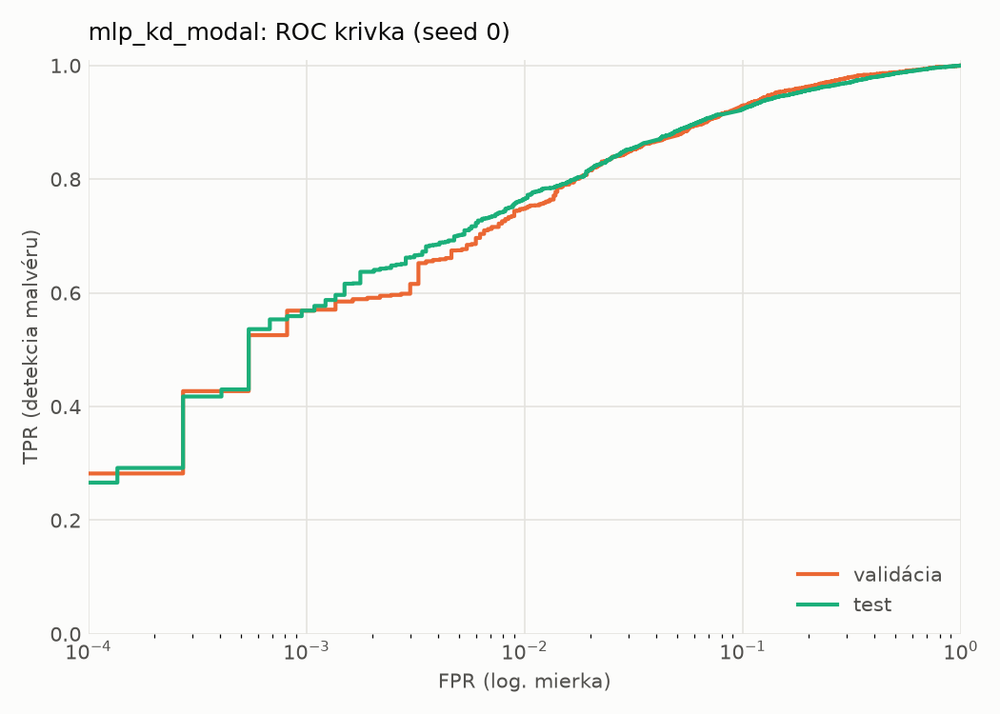
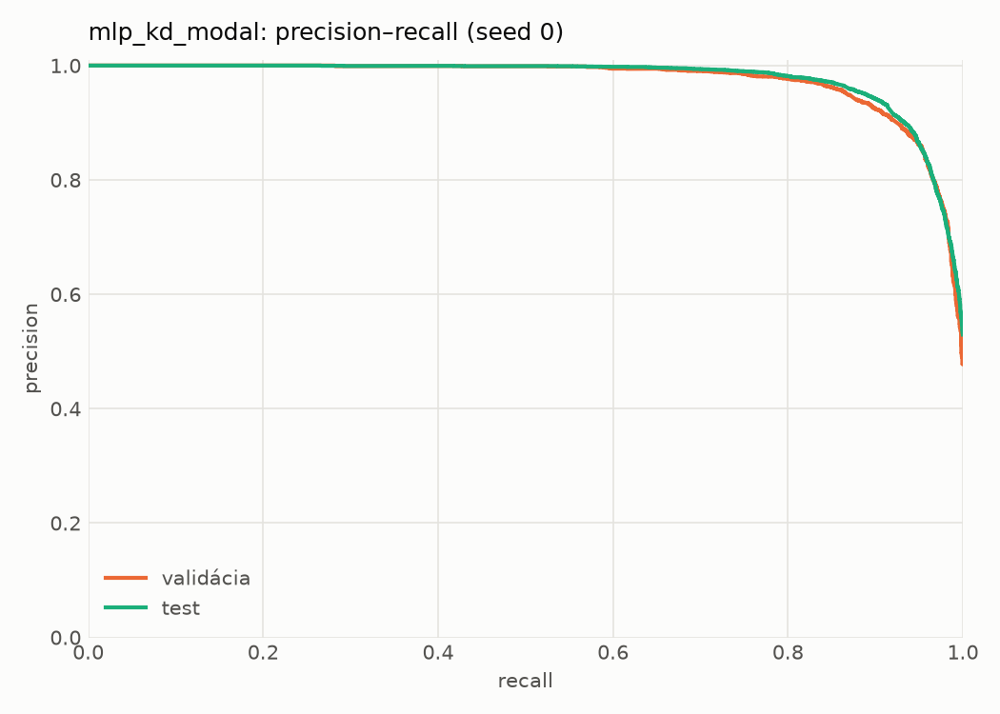
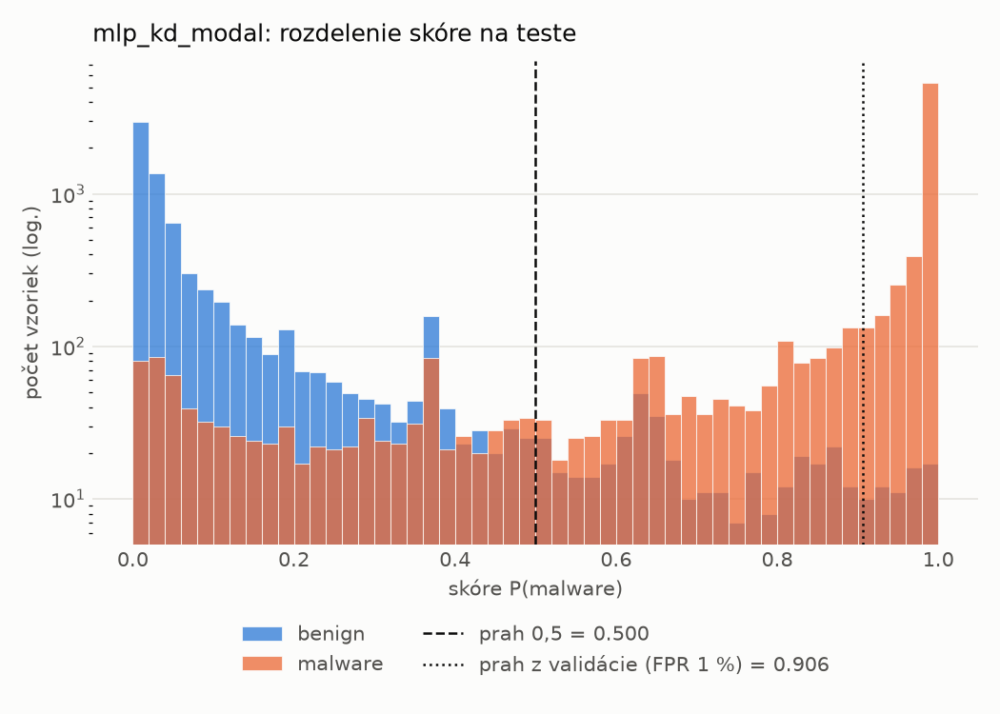
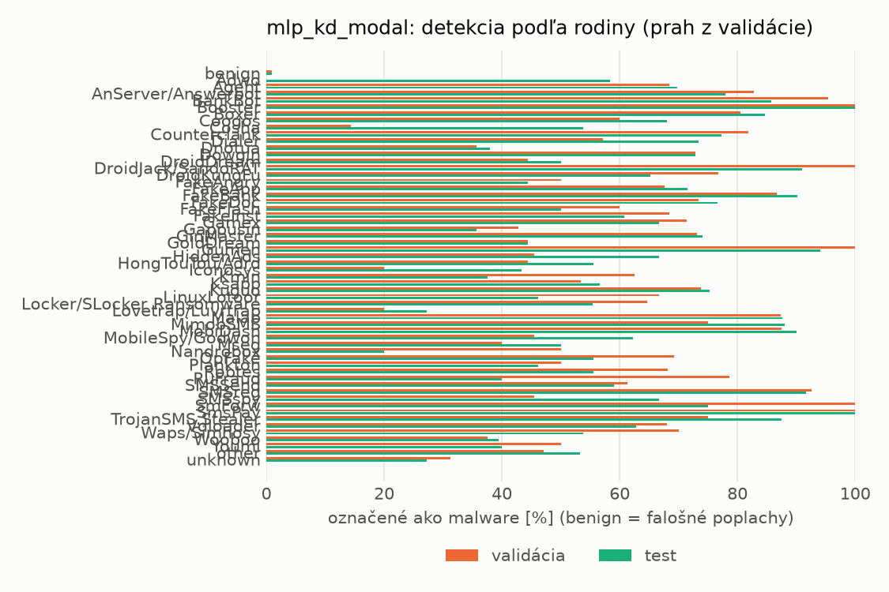
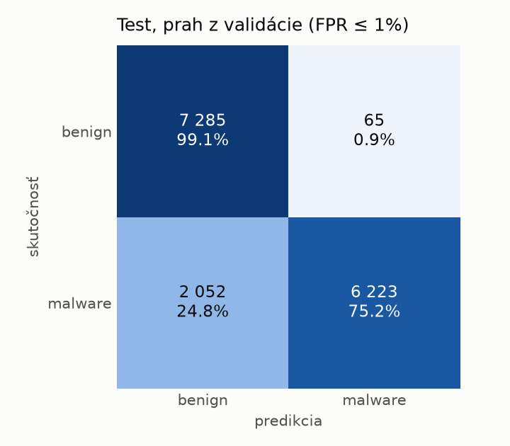
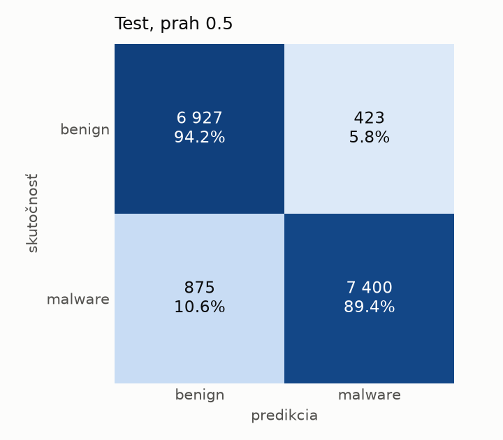
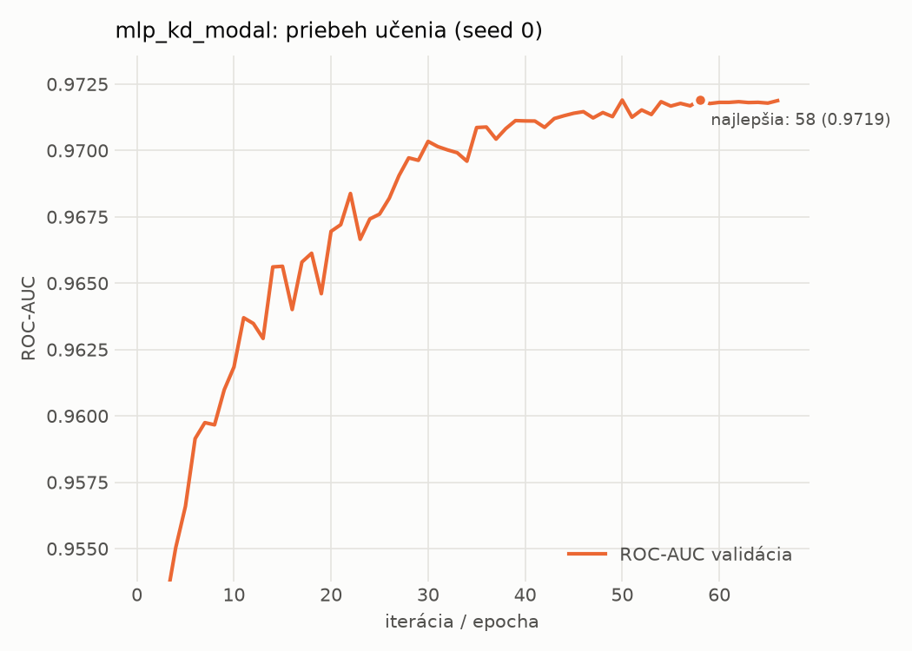

# dynamic/mlp_kd_modal – beh `20261122-214555`

> Automaticky generované (`src/training/run_tabular.py`). Konfigurácia: `config.yaml`, protokol: `protocol.yaml`.

- **Model:** `mlp` – študent – malé MLP učené destiláciou z učiteľa rovnakej modality (variant A)
- **Ladenie:** bez ladenia – hyperparametre prevzaté z `runs_v4/real_full/full/students_dynamic/mlp_kd_modal/20261122-210858`
- **Finálne modely:** seedy [0, 1, 2]; hodnoty sú priemer ± smerodajná odchýlka cez seedy
- **Najlepšie hyperparametre:** `{"hidden_layers": 1, "max_epochs": 100, "patience": 8, "hidden_width": 64, "dropout": 0.014842517384265013, "lr": 0.0018389280483922955, "weight_decay": 7.464279126466132e-05, "batch_size": 512, "kd_alpha": 0.45301900884301544, "kd_temperature": 1.2914074151312493}`

## Detekčná kvalita (bez prahu)
| metrika | train (podvzorka) | validácia | test |
|---|---|---|---|
| ROC-AUC | 0.9750 ± 0.0004 | 0.9720 ± 0.0005 | 0.9700 ± 0.0004 |
| PR-AUC | 0.9765 ± 0.0005 | 0.9744 ± 0.0003 | 0.9775 ± 0.0001 |
| TPR pri FPR 1 % | 0.7749 ± 0.0093 | 0.7487 ± 0.0038 | 0.7616 ± 0.0038 |
| TPR pri FPR 0,1 % | 0.5221 ± 0.0306 | 0.5514 ± 0.0324 | 0.5907 ± 0.0189 |
| log loss | 0.1934 ± 0.0024 | 0.2094 ± 0.0017 | 0.2189 ± 0.0011 |
| Brier skóre | 0.0559 ± 0.0009 | 0.0608 ± 0.0007 | 0.0630 ± 0.0005 |

Rozdiel ROC-AUC train − validácia: **0.0031** (veľký rozdiel = preučenie).

## Pri prahu z validácie (FPR ≤ 1% na validácii)
| metrika | train (podvzorka) | validácia | test |
|---|---|---|---|
| accuracy | 0.8783 ± 0.0011 | 0.8748 ± 0.0018 | 0.8659 ± 0.0012 |
| balanced accuracy | 0.8706 ± 0.0012 | 0.8694 ± 0.0019 | 0.8729 ± 0.0011 |
| precision | 0.9899 ± 0.0020 | 0.9859 ± 0.0001 | 0.9892 ± 0.0004 |
| recall (TPR) | 0.7479 ± 0.0027 | 0.7487 ± 0.0038 | 0.7550 ± 0.0026 |
| FPR | 0.0067 ± 0.0014 | 0.0098 ± 0.0000 | 0.0093 ± 0.0004 |
| F1 | 0.8521 ± 0.0016 | 0.8511 ± 0.0025 | 0.8564 ± 0.0015 |
| MCC | 0.7734 ± 0.0020 | 0.7676 ± 0.0031 | 0.7585 ± 0.0018 |

## Pri pevnom prahu 0.5
| metrika | train (podvzorka) | validácia | test |
|---|---|---|---|
| accuracy | 0.9263 ± 0.0021 | 0.9165 ± 0.0007 | 0.9170 ± 0.0009 |
| balanced accuracy | 0.9248 ± 0.0023 | 0.9158 ± 0.0008 | 0.9185 ± 0.0008 |
| precision | 0.9380 ± 0.0017 | 0.9237 ± 0.0022 | 0.9466 ± 0.0011 |
| recall (TPR) | 0.9023 ± 0.0059 | 0.8995 ± 0.0040 | 0.8937 ± 0.0028 |
| FPR | 0.0526 ± 0.0018 | 0.0679 ± 0.0024 | 0.0567 ± 0.0014 |
| F1 | 0.9198 ± 0.0026 | 0.9114 ± 0.0010 | 0.9194 ± 0.0010 |
| MCC | 0.8522 ± 0.0040 | 0.8327 ± 0.0013 | 0.8355 ± 0.0016 |

## Výpočtové nároky (seed 0, testovacia množina)
| meranie | hodnota |
|---|---|
| tréning finálneho modelu | 10.6 s (priemer cez seedy) |
| ladenie spolu | 0 s |
| počet parametrov / uzlov | 8 641 |
| veľkosť modelu na disku | 0.04 MB |
| transformácia vstupu – latencia (1 vlákno) | 0.015 ms |
| transformácia vstupu – priepustnosť | 731 172 vzoriek/s |
| CPU latencia modelu (batch 1, 1 vlákno) | 0.157 ms (p95 0.167) |
| CPU priepustnosť (24 vlákien) | 6 001 767 vzoriek/s |
| GPU latencia (batch 1) | 0.282 ms (p95 0.338) |
| GPU priepustnosť | 2 358 170 vzoriek/s |
| GPU špičková pamäť | 59 MB |

## Grafy
| | |
|---|---|
|  |  |
|  |  |
|  |  |
|  |  |

## Súbory
`metrics.json` (všetky metriky po seedoch vrátane rodín), `timing.json`, `hpo_trials.csv`,
`predictions/<časť>_seed<N>.parquet` (sha256, family, label, score), `model/seed_<N>/`, `log.txt`.
