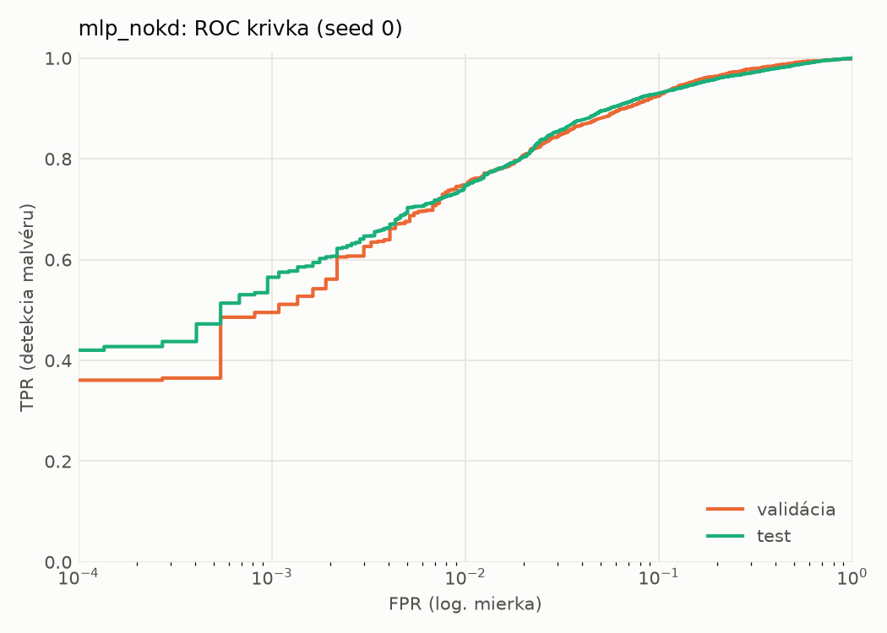
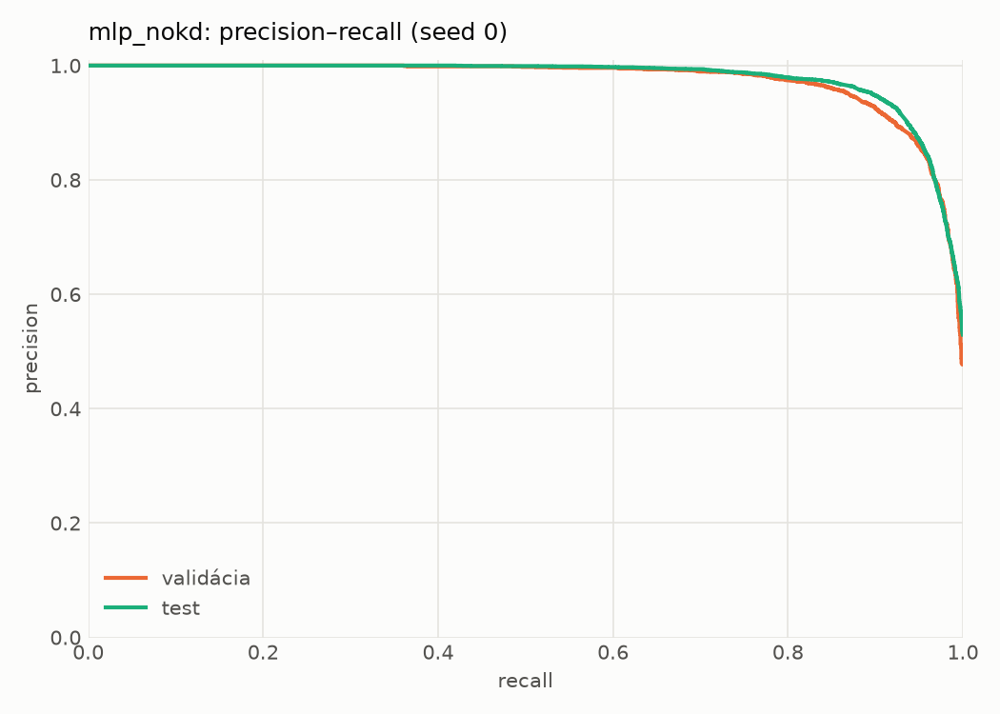
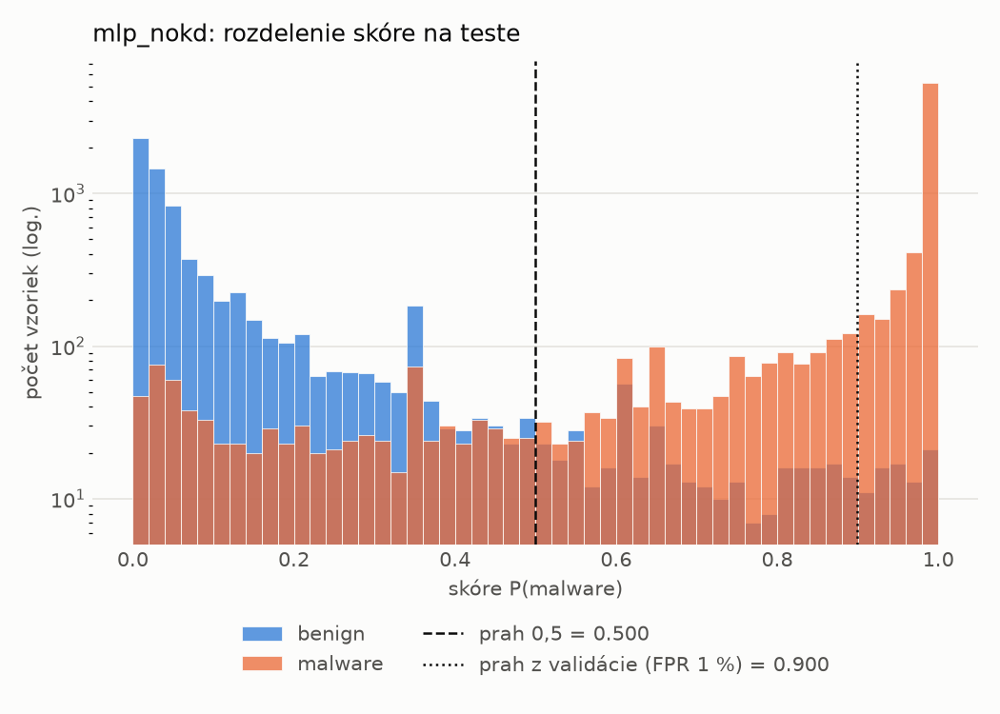
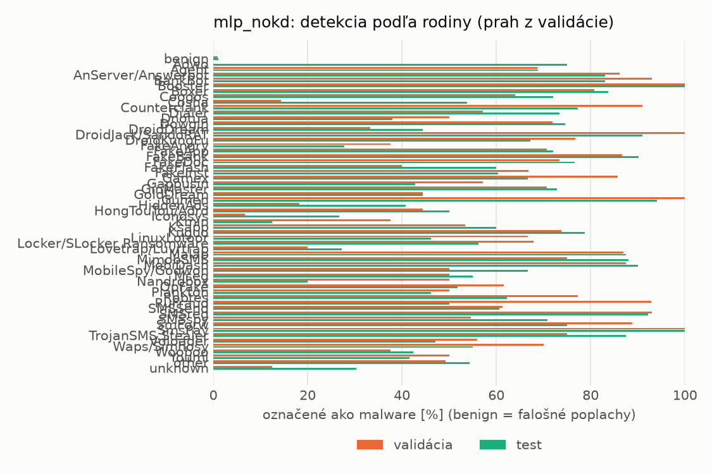
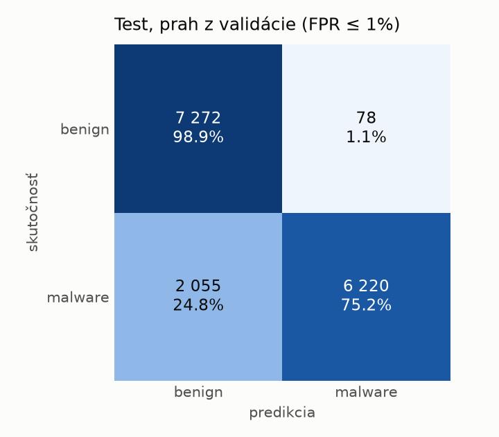
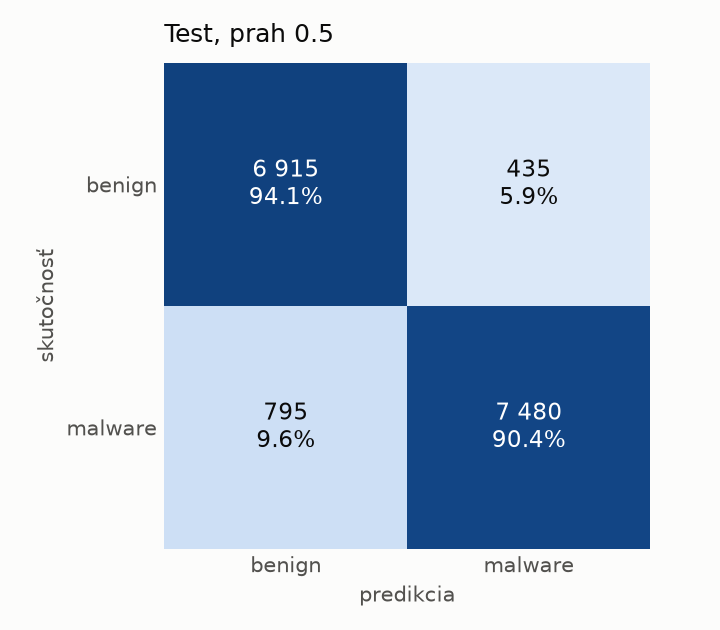
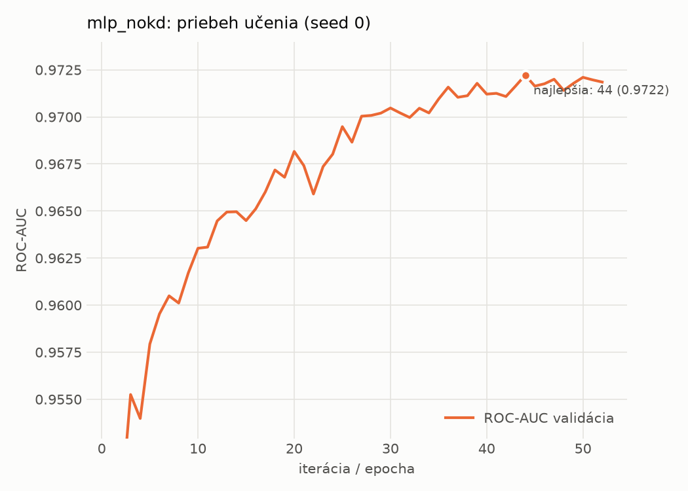

# dynamic/mlp_nokd – beh `20261122-214508`

> Automaticky generované (`src/training/run_tabular.py`). Konfigurácia: `config.yaml`, protokol: `protocol.yaml`.

- **Model:** `mlp` – kontrola – rovnaké malé MLP bez destilácie (iba skutočné označenia)
- **Ladenie:** bez ladenia – hyperparametre prevzaté z `runs_v4/real_full/full/students_dynamic/mlp_nokd/20261122-205917`
- **Finálne modely:** seedy [0, 1, 2]; hodnoty sú priemer ± smerodajná odchýlka cez seedy
- **Najlepšie hyperparametre:** `{"hidden_layers": 1, "max_epochs": 100, "patience": 8, "hidden_width": 64, "dropout": 0.014622282919838341, "lr": 0.0013105433289036465, "weight_decay": 1.7870054646247664e-05, "batch_size": 256}`

## Detekčná kvalita (bez prahu)
| metrika | train (podvzorka) | validácia | test |
|---|---|---|---|
| ROC-AUC | 0.9782 ± 0.0015 | 0.9722 ± 0.0004 | 0.9712 ± 0.0009 |
| PR-AUC | 0.9797 ± 0.0014 | 0.9746 ± 0.0004 | 0.9785 ± 0.0006 |
| TPR pri FPR 1 % | 0.7986 ± 0.0168 | 0.7520 ± 0.0056 | 0.7503 ± 0.0065 |
| TPR pri FPR 0,1 % | 0.5706 ± 0.0470 | 0.4951 ± 0.0183 | 0.5711 ± 0.0055 |
| log loss | 0.1812 ± 0.0067 | 0.2092 ± 0.0012 | 0.2123 ± 0.0032 |
| Brier skóre | 0.0522 ± 0.0017 | 0.0604 ± 0.0004 | 0.0608 ± 0.0013 |

Rozdiel ROC-AUC train − validácia: **0.0060** (veľký rozdiel = preučenie).

## Pri prahu z validácie (FPR ≤ 1% na validácii)
| metrika | train (podvzorka) | validácia | test |
|---|---|---|---|
| accuracy | 0.8808 ± 0.0019 | 0.8765 ± 0.0028 | 0.8655 ± 0.0018 |
| balanced accuracy | 0.8732 ± 0.0021 | 0.8712 ± 0.0029 | 0.8724 ± 0.0017 |
| precision | 0.9914 ± 0.0015 | 0.9861 ± 0.0003 | 0.9876 ± 0.0009 |
| recall (TPR) | 0.7522 ± 0.0049 | 0.7520 ± 0.0056 | 0.7555 ± 0.0034 |
| FPR | 0.0058 ± 0.0010 | 0.0097 ± 0.0002 | 0.0107 ± 0.0008 |
| F1 | 0.8554 ± 0.0028 | 0.8533 ± 0.0037 | 0.8561 ± 0.0021 |
| MCC | 0.7782 ± 0.0031 | 0.7705 ± 0.0048 | 0.7573 ± 0.0029 |

## Pri pevnom prahu 0.5
| metrika | train (podvzorka) | validácia | test |
|---|---|---|---|
| accuracy | 0.9309 ± 0.0025 | 0.9172 ± 0.0012 | 0.9209 ± 0.0023 |
| balanced accuracy | 0.9298 ± 0.0028 | 0.9166 ± 0.0013 | 0.9222 ± 0.0020 |
| precision | 0.9378 ± 0.0029 | 0.9212 ± 0.0037 | 0.9468 ± 0.0025 |
| recall (TPR) | 0.9131 ± 0.0080 | 0.9040 ± 0.0060 | 0.9013 ± 0.0070 |
| FPR | 0.0534 ± 0.0031 | 0.0707 ± 0.0040 | 0.0570 ± 0.0032 |
| F1 | 0.9253 ± 0.0031 | 0.9125 ± 0.0016 | 0.9235 ± 0.0026 |
| MCC | 0.8613 ± 0.0049 | 0.8341 ± 0.0023 | 0.8429 ± 0.0041 |

## Výpočtové nároky (seed 0, testovacia množina)
| meranie | hodnota |
|---|---|
| tréning finálneho modelu | 15.2 s (priemer cez seedy) |
| ladenie spolu | 0 s |
| počet parametrov / uzlov | 8 641 |
| veľkosť modelu na disku | 0.04 MB |
| transformácia vstupu – latencia (1 vlákno) | 0.015 ms |
| transformácia vstupu – priepustnosť | 728 255 vzoriek/s |
| CPU latencia modelu (batch 1, 1 vlákno) | 0.157 ms (p95 0.166) |
| CPU priepustnosť (24 vlákien) | 7 904 189 vzoriek/s |
| GPU latencia (batch 1) | 0.448 ms (p95 0.476) |
| GPU priepustnosť | 2 629 984 vzoriek/s |
| GPU špičková pamäť | 89 MB |

## Grafy
| | |
|---|---|
|  |  |
|  |  |
|  |  |
|  |  |

## Súbory
`metrics.json` (všetky metriky po seedoch vrátane rodín), `timing.json`, `hpo_trials.csv`,
`predictions/<časť>_seed<N>.parquet` (sha256, family, label, score), `model/seed_<N>/`, `log.txt`.
