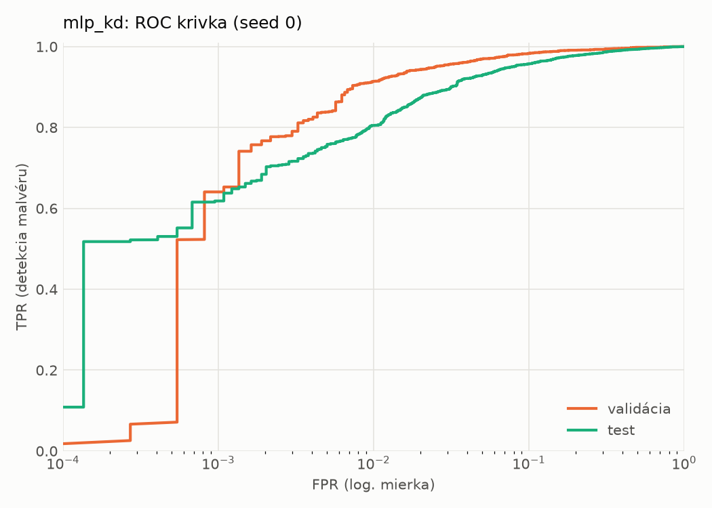
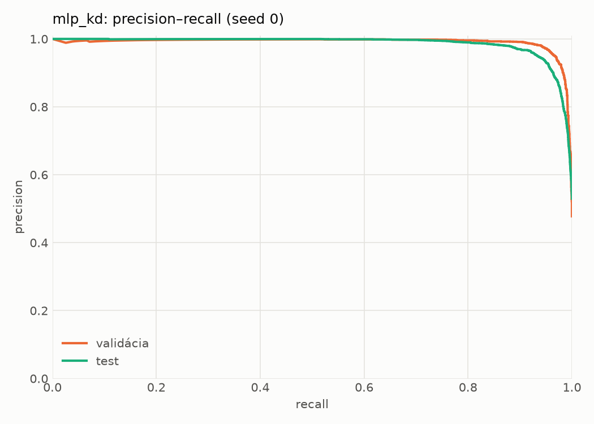
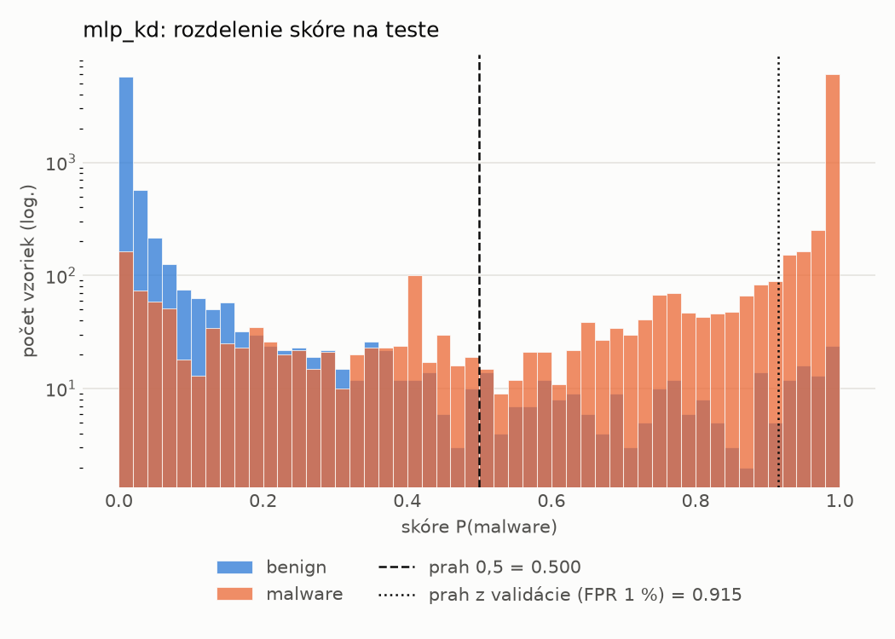
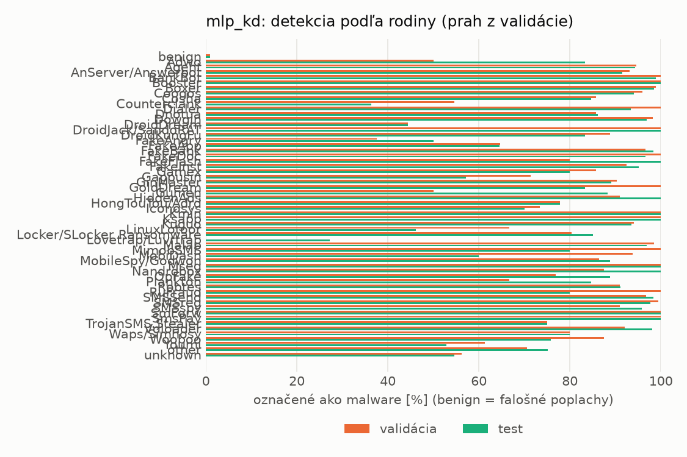
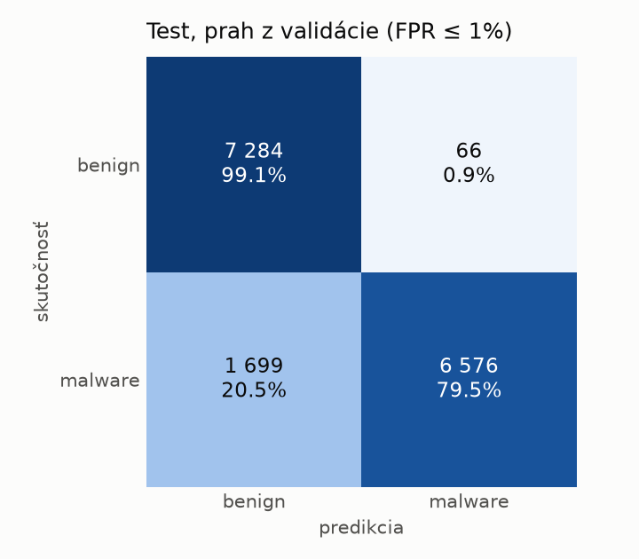
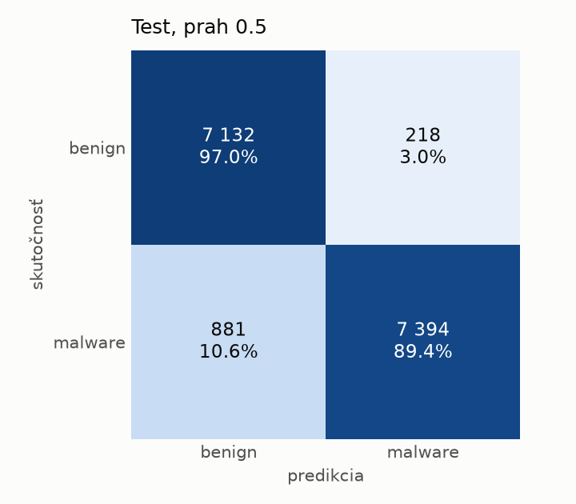
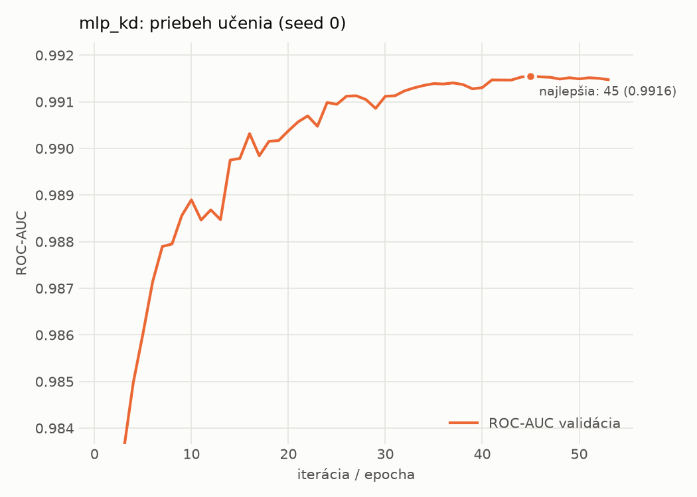

# static/mlp_kd – beh `20261122-214307`

> Automaticky generované (`src/training/run_tabular.py`). Konfigurácia: `config.yaml`, protokol: `protocol.yaml`.

- **Model:** `mlp` – študent – malé MLP učené destiláciou z hybridného učiteľa
- **Ladenie:** bez ladenia – hyperparametre prevzaté z `runs_v4/real_full/full/students_static/mlp_kd/20261122-203423`
- **Finálne modely:** seedy [0, 1, 2]; hodnoty sú priemer ± smerodajná odchýlka cez seedy
- **Najlepšie hyperparametre:** `{"hidden_layers": 1, "max_epochs": 100, "patience": 8, "hidden_width": 64, "dropout": 0.018096880153353218, "lr": 0.002445898909575082, "weight_decay": 6.315937377471515e-05, "batch_size": 1024, "kd_alpha": 0.6461462865023861, "kd_temperature": 1.5048732616232385}`

## Detekčná kvalita (bez prahu)
| metrika | train (podvzorka) | validácia | test |
|---|---|---|---|
| ROC-AUC | 0.9960 ± 0.0002 | 0.9914 ± 0.0002 | 0.9825 ± 0.0012 |
| PR-AUC | 0.9962 ± 0.0002 | 0.9907 ± 0.0001 | 0.9864 ± 0.0008 |
| TPR pri FPR 1 % | 0.9549 ± 0.0041 | 0.9139 ± 0.0042 | 0.8020 ± 0.0033 |
| TPR pri FPR 0,1 % | 0.8513 ± 0.0175 | 0.6933 ± 0.0524 | 0.5989 ± 0.0168 |
| log loss | 0.0724 ± 0.0018 | 0.1138 ± 0.0014 | 0.2023 ± 0.0075 |
| Brier skóre | 0.0195 ± 0.0004 | 0.0290 ± 0.0004 | 0.0527 ± 0.0005 |

Rozdiel ROC-AUC train − validácia: **0.0046** (veľký rozdiel = preučenie).

## Pri prahu z validácie (FPR ≤ 1% na validácii)
| metrika | train (podvzorka) | validácia | test |
|---|---|---|---|
| accuracy | 0.9612 ± 0.0015 | 0.9538 ± 0.0020 | 0.8865 ± 0.0011 |
| balanced accuracy | 0.9588 ± 0.0015 | 0.9521 ± 0.0021 | 0.8924 ± 0.0010 |
| precision | 0.9958 ± 0.0007 | 0.9884 ± 0.0001 | 0.9903 ± 0.0002 |
| recall (TPR) | 0.9211 ± 0.0025 | 0.9139 ± 0.0042 | 0.7935 ± 0.0020 |
| FPR | 0.0035 ± 0.0005 | 0.0098 ± 0.0000 | 0.0088 ± 0.0002 |
| F1 | 0.9570 ± 0.0017 | 0.9497 ± 0.0023 | 0.8811 ± 0.0012 |
| MCC | 0.9241 ± 0.0029 | 0.9094 ± 0.0038 | 0.7925 ± 0.0018 |

## Pri pevnom prahu 0.5
| metrika | train (podvzorka) | validácia | test |
|---|---|---|---|
| accuracy | 0.9744 ± 0.0008 | 0.9627 ± 0.0007 | 0.9321 ± 0.0024 |
| balanced accuracy | 0.9738 ± 0.0007 | 0.9626 ± 0.0007 | 0.9344 ± 0.0023 |
| precision | 0.9810 ± 0.0026 | 0.9627 ± 0.0023 | 0.9738 ± 0.0028 |
| recall (TPR) | 0.9640 ± 0.0012 | 0.9592 ± 0.0015 | 0.8958 ± 0.0046 |
| FPR | 0.0165 ± 0.0023 | 0.0340 ± 0.0022 | 0.0271 ± 0.0030 |
| F1 | 0.9724 ± 0.0008 | 0.9609 ± 0.0007 | 0.9332 ± 0.0025 |
| MCC | 0.9486 ± 0.0015 | 0.9253 ± 0.0014 | 0.8675 ± 0.0046 |

## Výpočtové nároky (seed 0, testovacia množina)
| meranie | hodnota |
|---|---|
| tréning finálneho modelu | 4.9 s (priemer cez seedy) |
| ladenie spolu | 0 s |
| počet parametrov / uzlov | 10 753 |
| veľkosť modelu na disku | 0.05 MB |
| transformácia vstupu – latencia (1 vlákno) | 0.014 ms |
| transformácia vstupu – priepustnosť | 825 305 vzoriek/s |
| CPU latencia modelu (batch 1, 1 vlákno) | 0.089 ms (p95 0.164) |
| CPU priepustnosť (24 vlákien) | 2 381 497 vzoriek/s |
| GPU latencia (batch 1) | 0.286 ms (p95 0.319) |
| GPU priepustnosť | 1 285 500 vzoriek/s |
| GPU špičková pamäť | 69 MB |

## Grafy
| | |
|---|---|
|  |  |
|  |  |
|  |  |
|  |  |

## Súbory
`metrics.json` (všetky metriky po seedoch vrátane rodín), `timing.json`, `hpo_trials.csv`,
`predictions/<časť>_seed<N>.parquet` (sha256, family, label, score), `model/seed_<N>/`, `log.txt`.
