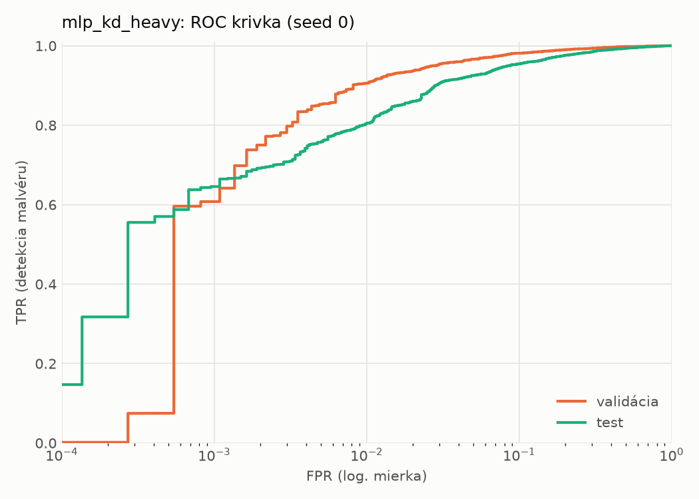
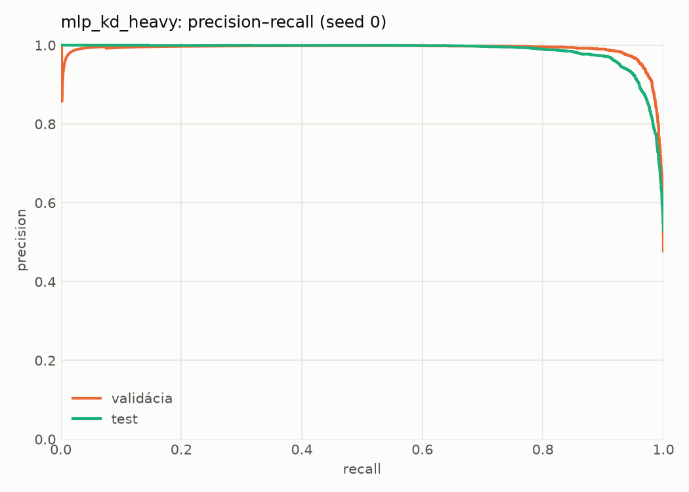
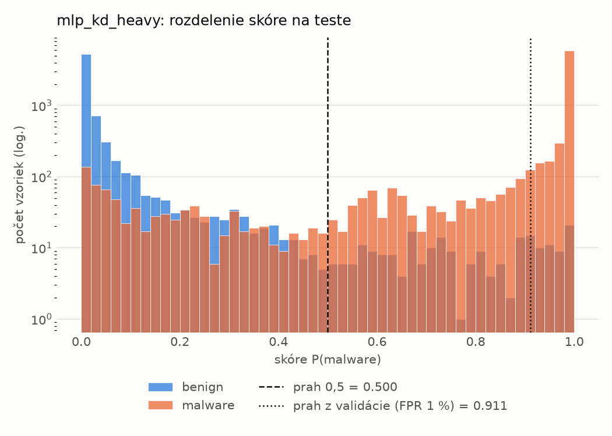
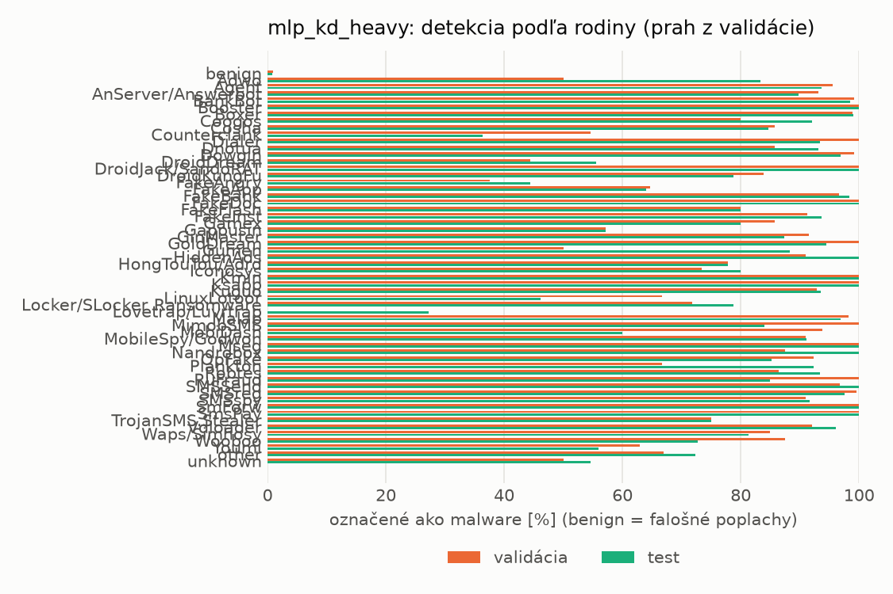
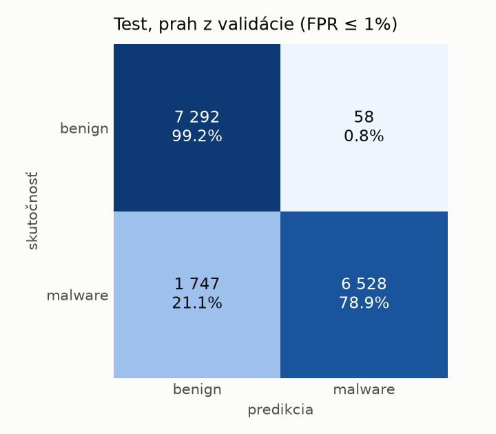
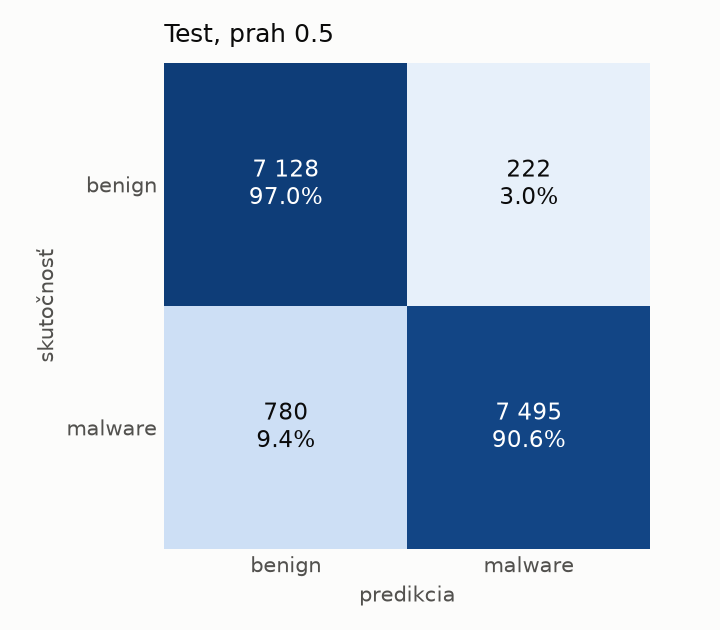
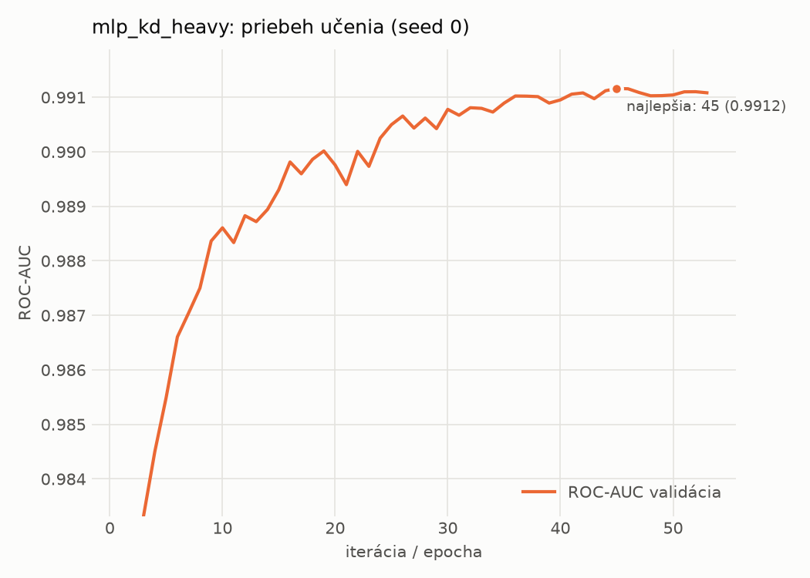

# static/mlp_kd_heavy – beh `20261122-214413`

> Automaticky generované (`src/training/run_tabular.py`). Konfigurácia: `config.yaml`, protokol: `protocol.yaml`.

- **Model:** `mlp` – študent – malé MLP učené destiláciou z mlp_large hybridu (V4)
- **Ladenie:** bez ladenia – hyperparametre prevzaté z `runs_v4/real_full/full/students_static/mlp_kd_heavy/20261122-204855`
- **Finálne modely:** seedy [0, 1, 2]; hodnoty sú priemer ± smerodajná odchýlka cez seedy
- **Najlepšie hyperparametre:** `{"hidden_layers": 1, "max_epochs": 100, "patience": 8, "hidden_width": 64, "dropout": 0.04239795529418809, "lr": 0.0021920597062990285, "weight_decay": 0.0001469802566586536, "batch_size": 1024, "kd_alpha": 0.8931311185241001, "kd_temperature": 5.447798930063548}`

## Detekčná kvalita (bez prahu)
| metrika | train (podvzorka) | validácia | test |
|---|---|---|---|
| ROC-AUC | 0.9955 ± 0.0002 | 0.9909 ± 0.0003 | 0.9811 ± 0.0009 |
| PR-AUC | 0.9957 ± 0.0001 | 0.9890 ± 0.0009 | 0.9853 ± 0.0007 |
| TPR pri FPR 1 % | 0.9479 ± 0.0020 | 0.9046 ± 0.0044 | 0.8014 ± 0.0083 |
| TPR pri FPR 0,1 % | 0.8366 ± 0.0012 | 0.6185 ± 0.0919 | 0.6381 ± 0.0100 |
| log loss | 0.0767 ± 0.0013 | 0.1155 ± 0.0011 | 0.1955 ± 0.0072 |
| Brier skóre | 0.0208 ± 0.0004 | 0.0309 ± 0.0002 | 0.0540 ± 0.0019 |

Rozdiel ROC-AUC train − validácia: **0.0047** (veľký rozdiel = preučenie).

## Pri prahu z validácie (FPR ≤ 1% na validácii)
| metrika | train (podvzorka) | validácia | test |
|---|---|---|---|
| accuracy | 0.9556 ± 0.0015 | 0.9494 ± 0.0020 | 0.8813 ± 0.0028 |
| balanced accuracy | 0.9529 ± 0.0017 | 0.9475 ± 0.0021 | 0.8875 ± 0.0026 |
| precision | 0.9945 ± 0.0012 | 0.9884 ± 0.0001 | 0.9909 ± 0.0009 |
| recall (TPR) | 0.9103 ± 0.0040 | 0.9046 ± 0.0044 | 0.7830 ± 0.0052 |
| FPR | 0.0045 ± 0.0010 | 0.0097 ± 0.0002 | 0.0081 ± 0.0008 |
| F1 | 0.9505 ± 0.0018 | 0.9447 ± 0.0024 | 0.8748 ± 0.0033 |
| MCC | 0.9133 ± 0.0028 | 0.9012 ± 0.0038 | 0.7841 ± 0.0046 |

## Pri pevnom prahu 0.5
| metrika | train (podvzorka) | validácia | test |
|---|---|---|---|
| accuracy | 0.9739 ± 0.0005 | 0.9603 ± 0.0005 | 0.9327 ± 0.0028 |
| balanced accuracy | 0.9735 ± 0.0005 | 0.9603 ± 0.0006 | 0.9347 ± 0.0027 |
| precision | 0.9780 ± 0.0011 | 0.9573 ± 0.0005 | 0.9705 ± 0.0008 |
| recall (TPR) | 0.9661 ± 0.0001 | 0.9597 ± 0.0010 | 0.9003 ± 0.0048 |
| FPR | 0.0192 ± 0.0009 | 0.0392 ± 0.0005 | 0.0308 ± 0.0008 |
| F1 | 0.9720 ± 0.0005 | 0.9585 ± 0.0006 | 0.9340 ± 0.0029 |
| MCC | 0.9477 ± 0.0010 | 0.9205 ± 0.0011 | 0.8680 ± 0.0054 |

## Výpočtové nároky (seed 0, testovacia množina)
| meranie | hodnota |
|---|---|
| tréning finálneho modelu | 4.8 s (priemer cez seedy) |
| ladenie spolu | 0 s |
| počet parametrov / uzlov | 10 753 |
| veľkosť modelu na disku | 0.05 MB |
| transformácia vstupu – latencia (1 vlákno) | 0.014 ms |
| transformácia vstupu – priepustnosť | 621 280 vzoriek/s |
| CPU latencia modelu (batch 1, 1 vlákno) | 0.157 ms (p95 0.167) |
| CPU priepustnosť (24 vlákien) | 2 683 555 vzoriek/s |
| GPU latencia (batch 1) | 0.291 ms (p95 0.308) |
| GPU priepustnosť | 2 215 715 vzoriek/s |
| GPU špičková pamäť | 106 MB |

## Grafy
| | |
|---|---|
|  |  |
|  |  |
|  |  |
|  |  |

## Súbory
`metrics.json` (všetky metriky po seedoch vrátane rodín), `timing.json`, `hpo_trials.csv`,
`predictions/<časť>_seed<N>.parquet` (sha256, family, label, score), `model/seed_<N>/`, `log.txt`.
