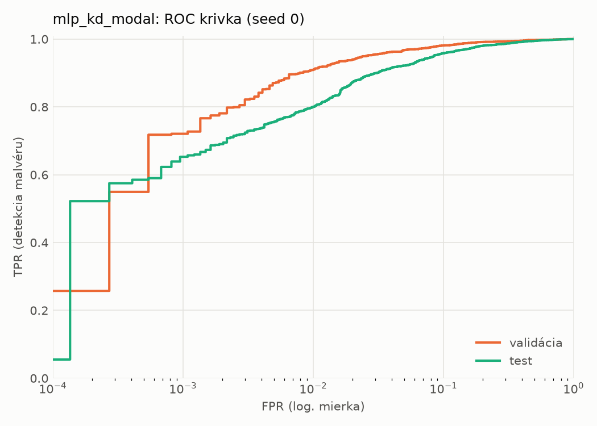
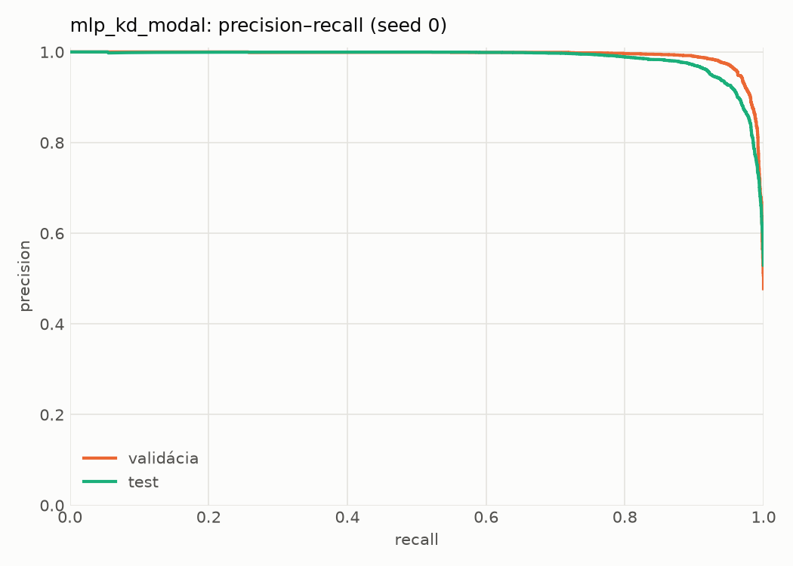
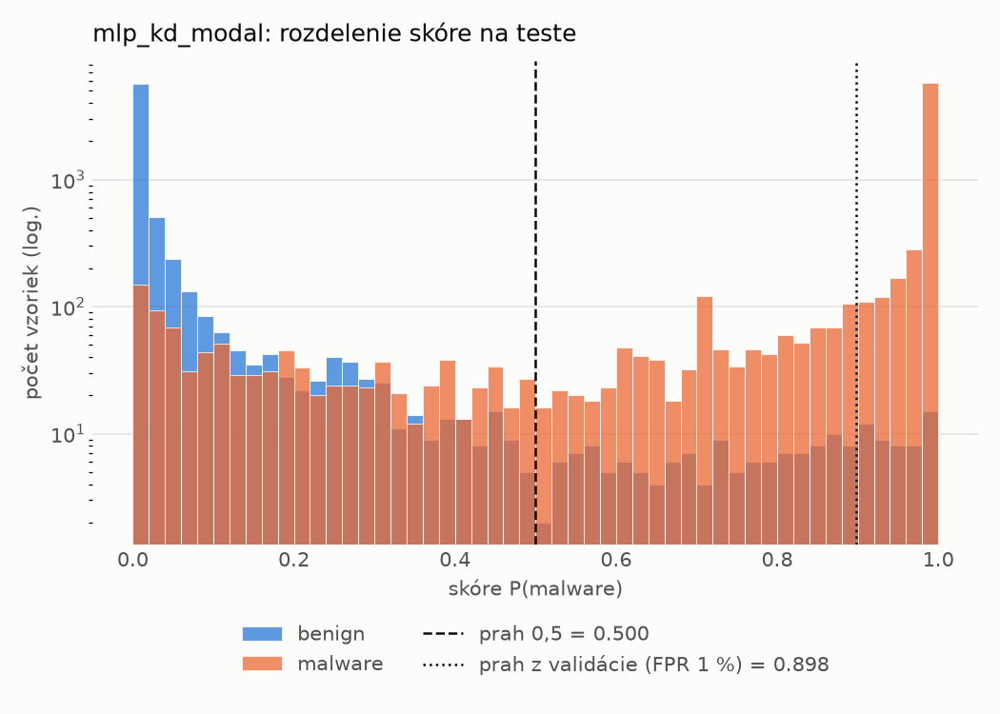
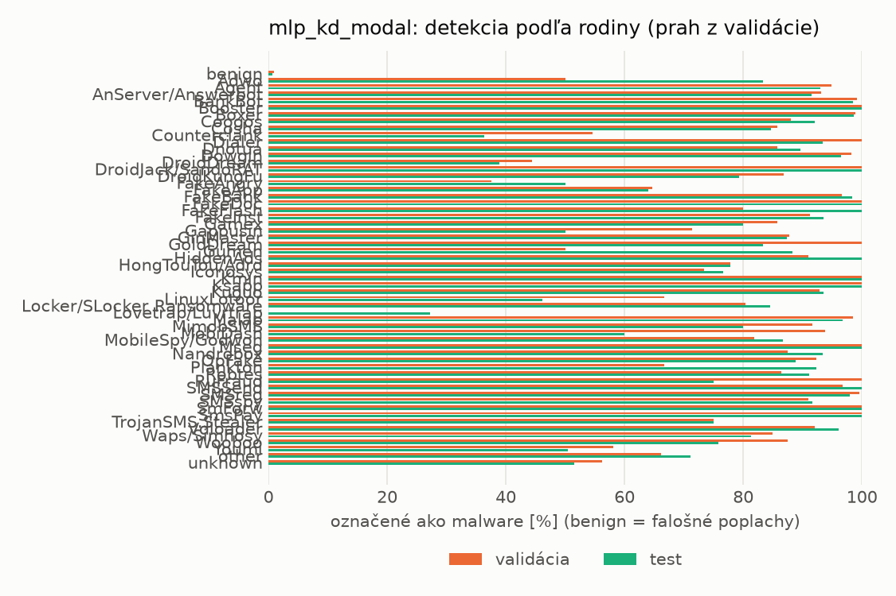
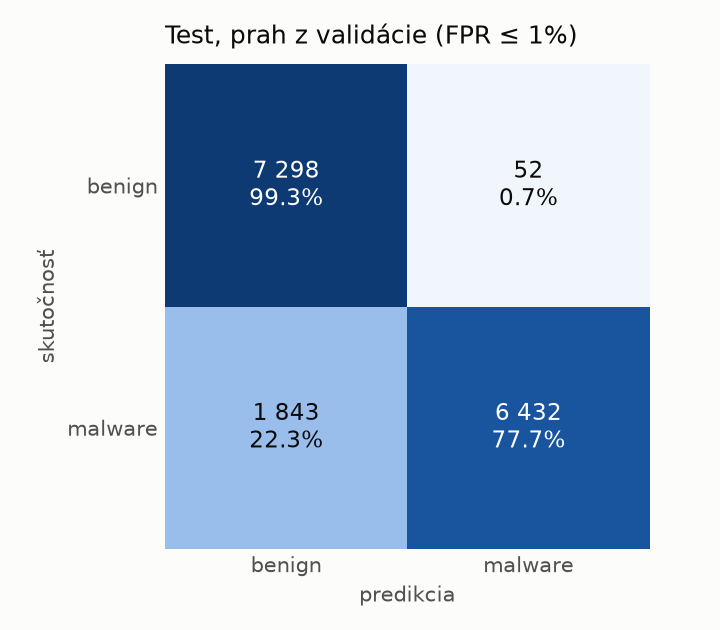
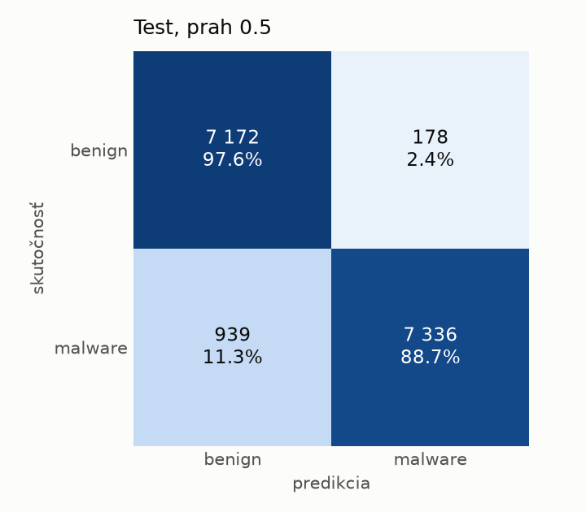
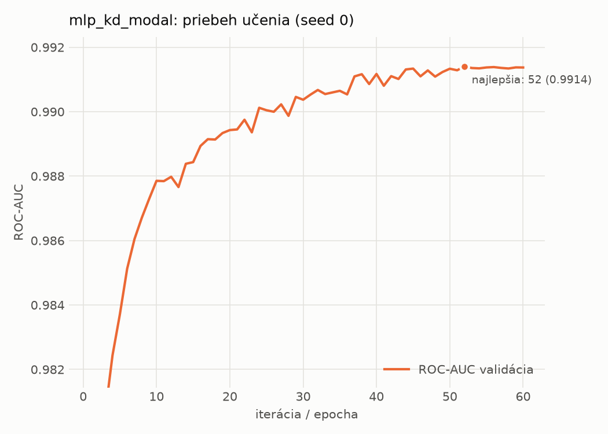

# static/mlp_kd_modal – beh `20261122-214356`

> Automaticky generované (`src/training/run_tabular.py`). Konfigurácia: `config.yaml`, protokol: `protocol.yaml`.

- **Model:** `mlp` – študent – malé MLP učené destiláciou z učiteľa rovnakej modality (variant A)
- **Ladenie:** bez ladenia – hyperparametre prevzaté z `runs_v4/real_full/full/students_static/mlp_kd_modal/20261122-204432`
- **Finálne modely:** seedy [0, 1, 2]; hodnoty sú priemer ± smerodajná odchýlka cez seedy
- **Najlepšie hyperparametre:** `{"hidden_layers": 1, "max_epochs": 100, "patience": 8, "hidden_width": 64, "dropout": 0.005196375734621726, "lr": 0.0014172842807441423, "weight_decay": 1.1835949733056038e-05, "batch_size": 1024, "kd_alpha": 0.5211229932470658, "kd_temperature": 1.6263320735090332}`

## Detekčná kvalita (bez prahu)
| metrika | train (podvzorka) | validácia | test |
|---|---|---|---|
| ROC-AUC | 0.9952 ± 0.0003 | 0.9909 ± 0.0005 | 0.9820 ± 0.0007 |
| PR-AUC | 0.9955 ± 0.0002 | 0.9914 ± 0.0007 | 0.9859 ± 0.0006 |
| TPR pri FPR 1 % | 0.9460 ± 0.0021 | 0.9133 ± 0.0040 | 0.7933 ± 0.0064 |
| TPR pri FPR 0,1 % | 0.8290 ± 0.0148 | 0.7352 ± 0.0151 | 0.6326 ± 0.0181 |
| log loss | 0.0797 ± 0.0018 | 0.1133 ± 0.0024 | 0.2018 ± 0.0002 |
| Brier skóre | 0.0216 ± 0.0005 | 0.0301 ± 0.0004 | 0.0556 ± 0.0003 |

Rozdiel ROC-AUC train − validácia: **0.0044** (veľký rozdiel = preučenie).

## Pri prahu z validácie (FPR ≤ 1% na validácii)
| metrika | train (podvzorka) | validácia | test |
|---|---|---|---|
| accuracy | 0.9583 ± 0.0018 | 0.9535 ± 0.0019 | 0.8820 ± 0.0031 |
| balanced accuracy | 0.9558 ± 0.0020 | 0.9518 ± 0.0020 | 0.8881 ± 0.0028 |
| precision | 0.9939 ± 0.0015 | 0.9884 ± 0.0000 | 0.9899 ± 0.0018 |
| recall (TPR) | 0.9166 ± 0.0052 | 0.9133 ± 0.0040 | 0.7853 ± 0.0071 |
| FPR | 0.0050 ± 0.0013 | 0.0098 ± 0.0000 | 0.0090 ± 0.0017 |
| F1 | 0.9537 ± 0.0021 | 0.9494 ± 0.0022 | 0.8758 ± 0.0038 |
| MCC | 0.9184 ± 0.0032 | 0.9089 ± 0.0036 | 0.7850 ± 0.0045 |

## Pri pevnom prahu 0.5
| metrika | train (podvzorka) | validácia | test |
|---|---|---|---|
| accuracy | 0.9723 ± 0.0004 | 0.9619 ± 0.0004 | 0.9290 ± 0.0015 |
| balanced accuracy | 0.9717 ± 0.0003 | 0.9617 ± 0.0004 | 0.9314 ± 0.0013 |
| precision | 0.9779 ± 0.0017 | 0.9623 ± 0.0014 | 0.9742 ± 0.0019 |
| recall (TPR) | 0.9626 ± 0.0009 | 0.9579 ± 0.0015 | 0.8894 ± 0.0041 |
| FPR | 0.0192 ± 0.0015 | 0.0344 ± 0.0014 | 0.0265 ± 0.0021 |
| F1 | 0.9702 ± 0.0004 | 0.9601 ± 0.0004 | 0.9299 ± 0.0016 |
| MCC | 0.9444 ± 0.0009 | 0.9237 ± 0.0008 | 0.8619 ± 0.0026 |

## Výpočtové nároky (seed 0, testovacia množina)
| meranie | hodnota |
|---|---|
| tréning finálneho modelu | 5.0 s (priemer cez seedy) |
| ladenie spolu | 0 s |
| počet parametrov / uzlov | 10 753 |
| veľkosť modelu na disku | 0.05 MB |
| transformácia vstupu – latencia (1 vlákno) | 0.015 ms |
| transformácia vstupu – priepustnosť | 612 083 vzoriek/s |
| CPU latencia modelu (batch 1, 1 vlákno) | 0.157 ms (p95 0.167) |
| CPU priepustnosť (24 vlákien) | 3 408 521 vzoriek/s |
| GPU latencia (batch 1) | 0.271 ms (p95 0.304) |
| GPU priepustnosť | 1 360 399 vzoriek/s |
| GPU špičková pamäť | 69 MB |

## Grafy
| | |
|---|---|
|  |  |
|  |  |
|  |  |
|  |  |

## Súbory
`metrics.json` (všetky metriky po seedoch vrátane rodín), `timing.json`, `hpo_trials.csv`,
`predictions/<časť>_seed<N>.parquet` (sha256, family, label, score), `model/seed_<N>/`, `log.txt`.
