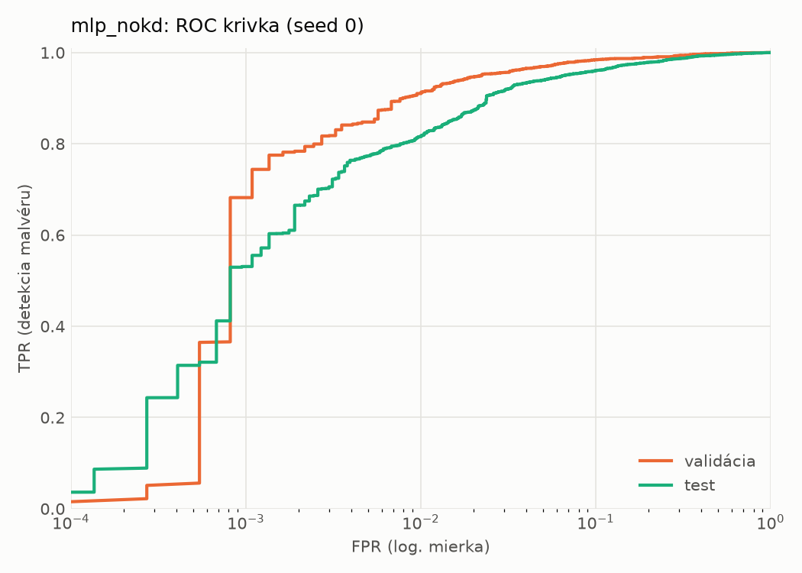
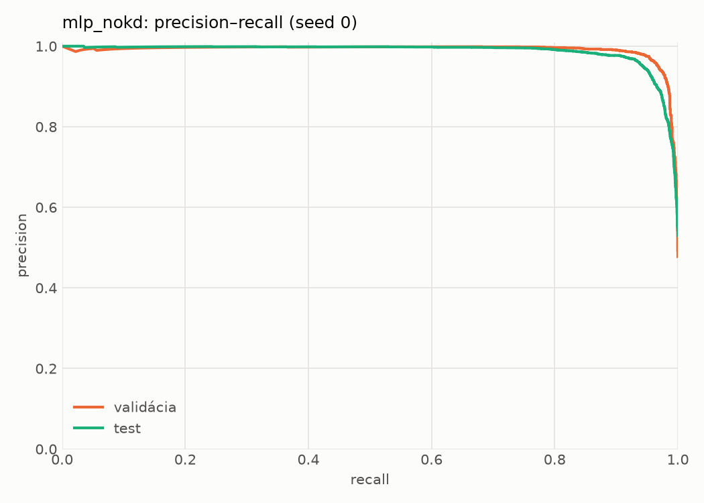
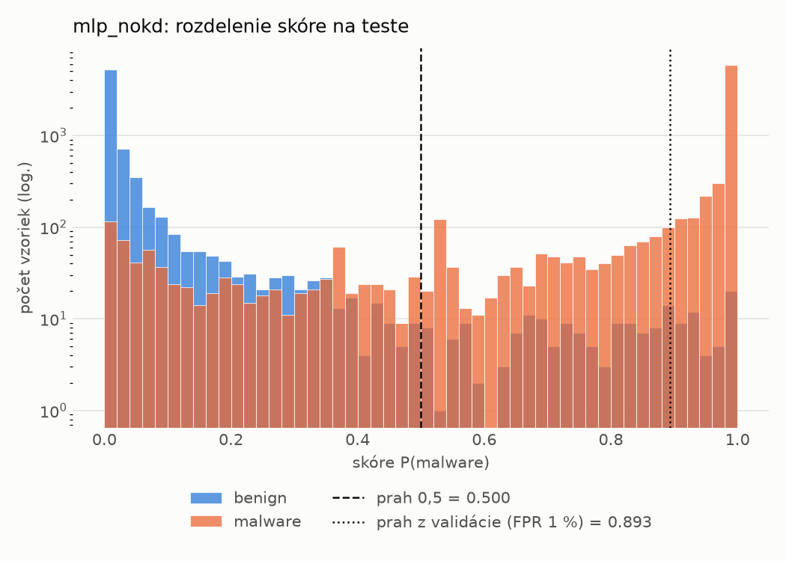
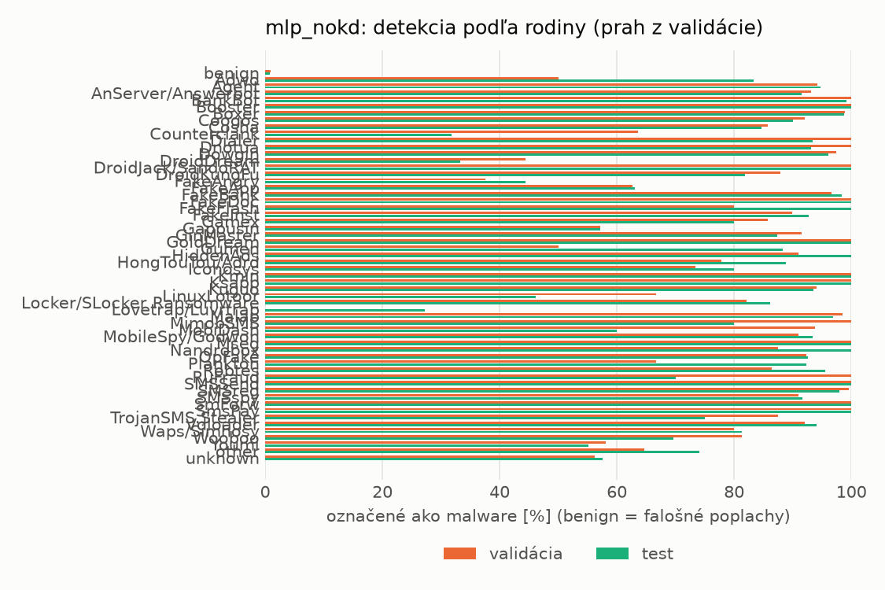
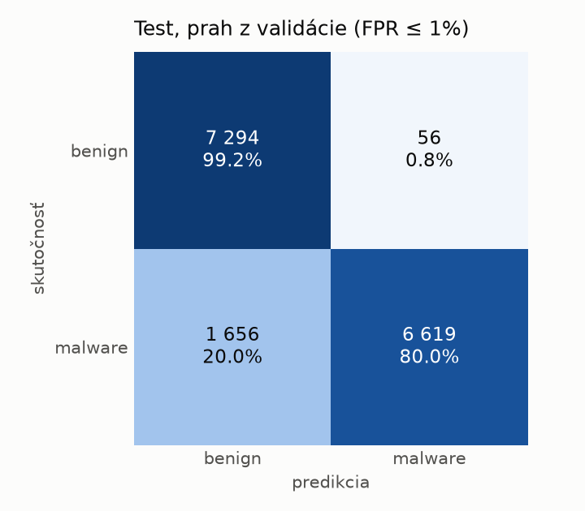
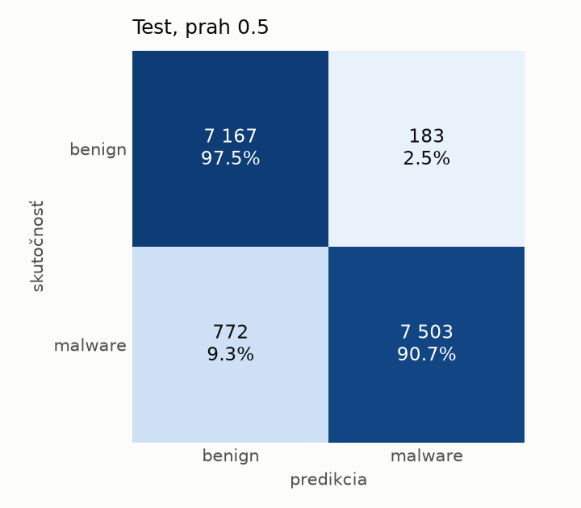
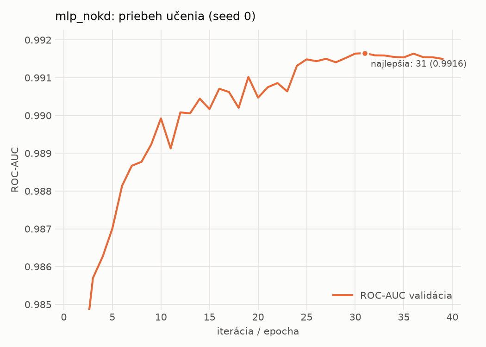

# static/mlp_nokd – beh `20261122-214324`

> Automaticky generované (`src/training/run_tabular.py`). Konfigurácia: `config.yaml`, protokol: `protocol.yaml`.

- **Model:** `mlp` – kontrola – rovnaké malé MLP bez destilácie (iba skutočné označenia)
- **Ladenie:** bez ladenia – hyperparametre prevzaté z `runs_v4/real_full/full/students_static/mlp_nokd/20261122-203844`
- **Finálne modely:** seedy [0, 1, 2]; hodnoty sú priemer ± smerodajná odchýlka cez seedy
- **Najlepšie hyperparametre:** `{"hidden_layers": 1, "max_epochs": 100, "patience": 8, "hidden_width": 64, "dropout": 0.011630579234704915, "lr": 0.0010706598847019353, "weight_decay": 3.845140400781195e-05, "batch_size": 256}`

## Detekčná kvalita (bez prahu)
| metrika | train (podvzorka) | validácia | test |
|---|---|---|---|
| ROC-AUC | 0.9967 ± 0.0002 | 0.9913 ± 0.0004 | 0.9823 ± 0.0010 |
| PR-AUC | 0.9968 ± 0.0002 | 0.9907 ± 0.0000 | 0.9859 ± 0.0007 |
| TPR pri FPR 1 % | 0.9602 ± 0.0015 | 0.9111 ± 0.0085 | 0.8068 ± 0.0078 |
| TPR pri FPR 0,1 % | 0.8714 ± 0.0054 | 0.5538 ± 0.1141 | 0.5293 ± 0.0412 |
| log loss | 0.0671 ± 0.0020 | 0.1093 ± 0.0016 | 0.1901 ± 0.0099 |
| Brier skóre | 0.0180 ± 0.0005 | 0.0283 ± 0.0003 | 0.0523 ± 0.0035 |

Rozdiel ROC-AUC train − validácia: **0.0054** (veľký rozdiel = preučenie).

## Pri prahu z validácie (FPR ≤ 1% na validácii)
| metrika | train (podvzorka) | validácia | test |
|---|---|---|---|
| accuracy | 0.9603 ± 0.0043 | 0.9524 ± 0.0041 | 0.8871 ± 0.0041 |
| balanced accuracy | 0.9579 ± 0.0046 | 0.9507 ± 0.0042 | 0.8929 ± 0.0038 |
| precision | 0.9968 ± 0.0009 | 0.9885 ± 0.0002 | 0.9911 ± 0.0013 |
| recall (TPR) | 0.9183 ± 0.0100 | 0.9111 ± 0.0085 | 0.7939 ± 0.0083 |
| FPR | 0.0026 ± 0.0008 | 0.0097 ± 0.0002 | 0.0080 ± 0.0012 |
| F1 | 0.9559 ± 0.0050 | 0.9482 ± 0.0046 | 0.8816 ± 0.0049 |
| MCC | 0.9226 ± 0.0080 | 0.9070 ± 0.0077 | 0.7937 ± 0.0066 |

## Pri pevnom prahu 0.5
| metrika | train (podvzorka) | validácia | test |
|---|---|---|---|
| accuracy | 0.9769 ± 0.0006 | 0.9640 ± 0.0008 | 0.9332 ± 0.0057 |
| balanced accuracy | 0.9763 ± 0.0007 | 0.9638 ± 0.0008 | 0.9356 ± 0.0054 |
| precision | 0.9839 ± 0.0004 | 0.9646 ± 0.0020 | 0.9759 ± 0.0002 |
| recall (TPR) | 0.9666 ± 0.0010 | 0.9598 ± 0.0015 | 0.8960 ± 0.0108 |
| FPR | 0.0139 ± 0.0003 | 0.0322 ± 0.0019 | 0.0249 ± 0.0001 |
| F1 | 0.9752 ± 0.0007 | 0.9622 ± 0.0008 | 0.9342 ± 0.0060 |
| MCC | 0.9538 ± 0.0013 | 0.9279 ± 0.0016 | 0.8700 ± 0.0105 |

## Výpočtové nároky (seed 0, testovacia množina)
| meranie | hodnota |
|---|---|
| tréning finálneho modelu | 10.0 s (priemer cez seedy) |
| ladenie spolu | 0 s |
| počet parametrov / uzlov | 10 753 |
| veľkosť modelu na disku | 0.05 MB |
| transformácia vstupu – latencia (1 vlákno) | 0.015 ms |
| transformácia vstupu – priepustnosť | 614 753 vzoriek/s |
| CPU latencia modelu (batch 1, 1 vlákno) | 0.157 ms (p95 0.167) |
| CPU priepustnosť (24 vlákien) | 3 074 819 vzoriek/s |
| GPU latencia (batch 1) | 0.314 ms (p95 0.337) |
| GPU priepustnosť | 1 365 738 vzoriek/s |
| GPU špičková pamäť | 106 MB |

## Grafy
| | |
|---|---|
|  |  |
|  |  |
|  |  |
|  |  |

## Súbory
`metrics.json` (všetky metriky po seedoch vrátane rodín), `timing.json`, `hpo_trials.csv`,
`predictions/<časť>_seed<N>.parquet` (sha256, family, label, score), `model/seed_<N>/`, `log.txt`.
