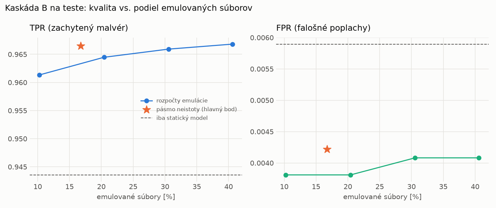

# Kaskáda B `b_baselines` – beh `20261122-230820`

> Generované `src/cascade/evaluate_b.py` (2026-11-22T23:08:20+01:00). Seedy: [0, 1, 2]; hodnoty = priemer ± sm. odchýlka.
> Všetky prahy a pásmo neistoty sú z validácie; test sa na nič nenastavuje. Postup: `docs/09_plan_v2.md`.

| rola | beh |
|---|---|
| static | `runs_v4/real_full/lofo/BankBot/static/lightgbm/20261122-224851` |
| dynamic | `runs_v4/real_full/lofo/BankBot/dynamic/lightgbm/20261122-225203` |
| hybrid | `runs_v4/real_full/lofo/BankBot/hybrid/lightgbm/20261122-225455` |

Druhý stupeň: **dynamic**. Pásmo neistoty statického modelu: FPR ≤ 0.1% nad `hi`,
najviac 1% malvéru validácie pod `lo` (seed 0: lo = 0.0222, hi = 0.9983, seed 1: lo = 0.0192, hi = 0.9984, seed 2: lo = 0.0282, hi = 0.9948).

## Test
| prístup | accuracy | balanced_accuracy | precision | recall_tpr | fpr | f1 | mcc |
|---|---|---|---|---|---|---|---|
| kaskáda B | 0.9803 ± 0.0004 | 0.9811 ± 0.0003 | 0.9961 ± 0.0001 | 0.9665 ± 0.0007 | 0.0042 ± 0.0001 | 0.9811 ± 0.0003 | 0.9609 ± 0.0007 |
| statický | 0.9673 ± 0.0006 | 0.9688 ± 0.0005 | 0.9945 ± 0.0002 | 0.9436 ± 0.0012 | 0.0059 ± 0.0002 | 0.9684 ± 0.0006 | 0.9360 ± 0.0011 |
| dynamický | 0.9233 ± 0.0011 | 0.9271 ± 0.0011 | 0.9904 ± 0.0001 | 0.8636 ± 0.0022 | 0.0094 ± 0.0001 | 0.9227 ± 0.0012 | 0.8552 ± 0.0020 |
| hybrid (každá vzorka) | 0.9824 ± 0.0001 | 0.9830 ± 0.0001 | 0.9929 ± 0.0003 | 0.9739 ± 0.0003 | 0.0079 ± 0.0004 | 0.9833 ± 0.0001 | 0.9650 ± 0.0002 |

- **emulované súbory: 16.75%** (ostatné rozhodne iba statický model); na hybrid ide 4.11% súborov
- chyby pri istom rozhodnutí statického modelu (seed 0): 75
- validácia: emulované 16.45%, na hybrid 4.06%

## Validácia
| prístup | accuracy | balanced_accuracy | precision | recall_tpr | fpr | f1 | mcc |
|---|---|---|---|---|---|---|---|
| kaskáda B | 0.9804 ± 0.0001 | 0.9810 ± 0.0001 | 0.9950 ± 0.0001 | 0.9674 ± 0.0003 | 0.0054 ± 0.0002 | 0.9810 ± 0.0001 | 0.9613 ± 0.0001 |
| statický | 0.9671 ± 0.0005 | 0.9681 ± 0.0004 | 0.9908 ± 0.0002 | 0.9457 ± 0.0007 | 0.0096 ± 0.0002 | 0.9677 ± 0.0005 | 0.9352 ± 0.0009 |
| dynamický | 0.9269 ± 0.0006 | 0.9295 ± 0.0006 | 0.9899 ± 0.0002 | 0.8687 ± 0.0010 | 0.0097 ± 0.0002 | 0.9254 ± 0.0006 | 0.8613 ± 0.0011 |
| hybrid (každá vzorka) | 0.9813 ± 0.0001 | 0.9816 ± 0.0001 | 0.9909 ± 0.0001 | 0.9730 ± 0.0003 | 0.0097 ± 0.0002 | 0.9819 ± 0.0001 | 0.9627 ± 0.0003 |

## Januárové vzorky vynechanej rodiny (iba malvér → TPR)
| prístup | TPR |
|---|---|
| kaskáda B | 0.9958 ± 0.0006 |
| statický | 0.9855 ± 0.0010 |
| dynamický | 0.7736 ± 0.0777 |
| hybrid (každá vzorka) | 0.9958 ± 0.0006 |

Podiel emulovaných: 13.49%

## Krivka rozpočtu emulácie (test, priemer cez seedy)
| budget_val | emulation_rate | hybrid_rate | recall_tpr | fpr | f1 |
|---|---|---|---|---|---|
| 0.1000 | 0.1026 | 0.0333 | 0.9613 | 0.0038 | 0.9786 |
| 0.2000 | 0.2042 | 0.0508 | 0.9645 | 0.0038 | 0.9802 |
| 0.3000 | 0.3056 | 0.0614 | 0.9659 | 0.0041 | 0.9809 |
| 0.4000 | 0.4059 | 0.0713 | 0.9668 | 0.0041 | 0.9813 |

## Výpočtové nároky
Čas dynamickej analýzy (beh v emulátore alebo na zariadení) dataset neuvádza, preto sa neodhaduje. Úspora kaskády B = podiel súborov s dynamickou analýzou: **16.75%** (ostatné prístupy 100 %).

_Chýba benchmark niektorého komponentu (v zero-day behoch sa nemeria)._

