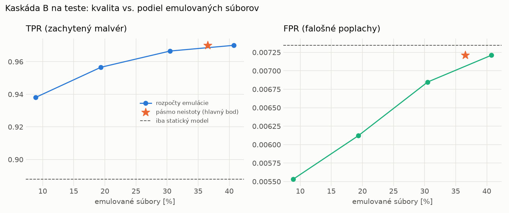

# Kaskáda B `b_direct` – beh `20261122-230816`

> Generované `src/cascade/evaluate_b.py` (2026-11-22T23:08:16+01:00). Seedy: [0, 1, 2]; hodnoty = priemer ± sm. odchýlka.
> Všetky prahy a pásmo neistoty sú z validácie; test sa na nič nenastavuje. Postup: `docs/09_plan_v2.md`.

| rola | beh |
|---|---|
| static | `runs_v4/real_full/lofo/BankBot/students_static/mlp_kd/20261122-230257` |
| hybrid | `runs_v4/real_full/lofo/BankBot/hybrid/lightgbm/20261122-225455` |

Druhý stupeň: **hybrid**. Pásmo neistoty statického modelu: FPR ≤ 0.1% nad `hi`,
najviac 1% malvéru validácie pod `lo` (seed 0: lo = 0.0220, hi = 0.9999, seed 1: lo = 0.0284, hi = 0.9999, seed 2: lo = 0.0238, hi = 0.9996).

## Test
| prístup | accuracy | balanced_accuracy | precision | recall_tpr | fpr | f1 | mcc |
|---|---|---|---|---|---|---|---|
| kaskáda B | 0.9808 ± 0.0003 | 0.9814 ± 0.0003 | 0.9934 ± 0.0003 | 0.9701 ± 0.0009 | 0.0072 ± 0.0004 | 0.9816 ± 0.0003 | 0.9618 ± 0.0006 |
| statický | 0.9372 ± 0.0030 | 0.9403 ± 0.0029 | 0.9927 ± 0.0006 | 0.8880 ± 0.0059 | 0.0073 ± 0.0006 | 0.9374 ± 0.0032 | 0.8803 ± 0.0054 |
| hybrid (každá vzorka) | 0.9824 ± 0.0001 | 0.9830 ± 0.0001 | 0.9929 ± 0.0003 | 0.9739 ± 0.0003 | 0.0079 ± 0.0004 | 0.9833 ± 0.0001 | 0.9650 ± 0.0002 |

- **emulované súbory: 36.55%** (ostatné rozhodne iba statický model); na hybrid ide 36.55% súborov
- chyby pri istom rozhodnutí statického modelu (seed 0): 95
- validácia: emulované 36.07%, na hybrid 36.07%

## Validácia
| prístup | accuracy | balanced_accuracy | precision | recall_tpr | fpr | f1 | mcc |
|---|---|---|---|---|---|---|---|
| kaskáda B | 0.9804 ± 0.0002 | 0.9808 ± 0.0002 | 0.9916 ± 0.0003 | 0.9707 ± 0.0001 | 0.0090 ± 0.0003 | 0.9810 ± 0.0002 | 0.9610 ± 0.0004 |
| statický | 0.9351 ± 0.0028 | 0.9374 ± 0.0027 | 0.9900 ± 0.0001 | 0.8846 ± 0.0054 | 0.0098 ± 0.0000 | 0.9343 ± 0.0031 | 0.8760 ± 0.0051 |
| hybrid (každá vzorka) | 0.9813 ± 0.0001 | 0.9816 ± 0.0001 | 0.9909 ± 0.0001 | 0.9730 ± 0.0003 | 0.0097 ± 0.0002 | 0.9819 ± 0.0001 | 0.9627 ± 0.0003 |

## Januárové vzorky vynechanej rodiny (iba malvér → TPR)
| prístup | TPR |
|---|---|
| kaskáda B | 0.9929 ± 0.0006 |
| statický | 0.9798 ± 0.0051 |
| hybrid (každá vzorka) | 0.9958 ± 0.0006 |

Podiel emulovaných: 65.25%

## Krivka rozpočtu emulácie (test, priemer cez seedy)
| budget_val | emulation_rate | hybrid_rate | recall_tpr | fpr | f1 |
|---|---|---|---|---|---|
| 0.1000 | 0.0890 | 0.0890 | 0.9381 | 0.0055 | 0.9656 |
| 0.2000 | 0.1937 | 0.1937 | 0.9566 | 0.0061 | 0.9751 |
| 0.3000 | 0.3049 | 0.3049 | 0.9665 | 0.0068 | 0.9799 |
| 0.4000 | 0.4075 | 0.4075 | 0.9700 | 0.0072 | 0.9816 |

## Výpočtové nároky
Čas dynamickej analýzy (beh v emulátore alebo na zariadení) dataset neuvádza, preto sa neodhaduje. Úspora kaskády B = podiel súborov s dynamickou analýzou: **36.55%** (ostatné prístupy 100 %).

_Chýba benchmark niektorého komponentu (v zero-day behoch sa nemeria)._

