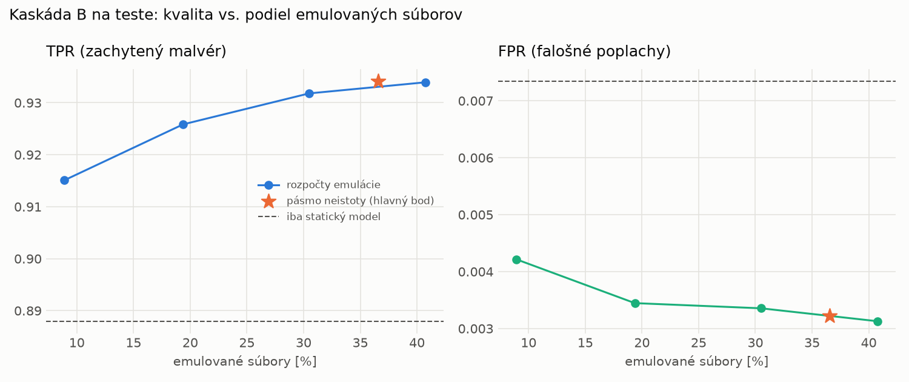

# Kaskáda B `b_heavy` – beh `20261122-230818`

> Generované `src/cascade/evaluate_b.py` (2026-11-22T23:08:18+01:00). Seedy: [0, 1, 2]; hodnoty = priemer ± sm. odchýlka.
> Všetky prahy a pásmo neistoty sú z validácie; test sa na nič nenastavuje. Postup: `docs/09_plan_v2.md`.

| rola | beh |
|---|---|
| static | `runs_v4/real_full/lofo/BankBot/students_static/mlp_kd/20261122-230257` |
| dynamic | `runs_v4/real_full/lofo/BankBot/students_dynamic/mlp_kd/20261122-230432` |
| hybrid | `runs_v4/real_full/lofo/BankBot/hybrid/mlp_large/20261122-225644` |

Druhý stupeň: **dynamic**. Pásmo neistoty statického modelu: FPR ≤ 0.1% nad `hi`,
najviac 1% malvéru validácie pod `lo` (seed 0: lo = 0.0220, hi = 0.9999, seed 1: lo = 0.0284, hi = 0.9999, seed 2: lo = 0.0238, hi = 0.9996).

## Test
| prístup | accuracy | balanced_accuracy | precision | recall_tpr | fpr | f1 | mcc |
|---|---|---|---|---|---|---|---|
| kaskáda B | 0.9636 ± 0.0021 | 0.9655 ± 0.0019 | 0.9969 ± 0.0006 | 0.9342 ± 0.0045 | 0.0032 ± 0.0006 | 0.9645 ± 0.0021 | 0.9294 ± 0.0038 |
| statický | 0.9372 ± 0.0030 | 0.9403 ± 0.0029 | 0.9927 ± 0.0006 | 0.8880 ± 0.0059 | 0.0073 ± 0.0006 | 0.9374 ± 0.0032 | 0.8803 ± 0.0054 |
| dynamický | 0.8602 ± 0.0013 | 0.8675 ± 0.0012 | 0.9889 ± 0.0011 | 0.7444 ± 0.0033 | 0.0094 ± 0.0010 | 0.8494 ± 0.0018 | 0.7493 ± 0.0017 |
| hybrid (každá vzorka) | 0.9745 ± 0.0008 | 0.9755 ± 0.0008 | 0.9930 ± 0.0004 | 0.9585 ± 0.0018 | 0.0076 ± 0.0004 | 0.9755 ± 0.0008 | 0.9495 ± 0.0016 |

- **emulované súbory: 36.55%** (ostatné rozhodne iba statický model); na hybrid ide 9.44% súborov
- chyby pri istom rozhodnutí statického modelu (seed 0): 95
- validácia: emulované 36.07%, na hybrid 9.69%

## Validácia
| prístup | accuracy | balanced_accuracy | precision | recall_tpr | fpr | f1 | mcc |
|---|---|---|---|---|---|---|---|
| kaskáda B | 0.9623 ± 0.0014 | 0.9636 ± 0.0014 | 0.9943 ± 0.0001 | 0.9331 ± 0.0029 | 0.0058 ± 0.0002 | 0.9627 ± 0.0015 | 0.9266 ± 0.0027 |
| statický | 0.9351 ± 0.0028 | 0.9374 ± 0.0027 | 0.9900 ± 0.0001 | 0.8846 ± 0.0054 | 0.0098 ± 0.0000 | 0.9343 ± 0.0031 | 0.8760 ± 0.0051 |
| dynamický | 0.8643 ± 0.0034 | 0.8695 ± 0.0033 | 0.9882 ± 0.0001 | 0.7489 ± 0.0066 | 0.0098 ± 0.0000 | 0.8520 ± 0.0043 | 0.7551 ± 0.0056 |
| hybrid (každá vzorka) | 0.9745 ± 0.0007 | 0.9751 ± 0.0006 | 0.9909 ± 0.0001 | 0.9599 ± 0.0012 | 0.0096 ± 0.0002 | 0.9751 ± 0.0007 | 0.9494 ± 0.0013 |

## Januárové vzorky vynechanej rodiny (iba malvér → TPR)
| prístup | TPR |
|---|---|
| kaskáda B | 0.9875 ± 0.0017 |
| statický | 0.9798 ± 0.0051 |
| dynamický | 0.7319 ± 0.0737 |
| hybrid (každá vzorka) | 0.9859 ± 0.0062 |

Podiel emulovaných: 65.25%

## Krivka rozpočtu emulácie (test, priemer cez seedy)
| budget_val | emulation_rate | hybrid_rate | recall_tpr | fpr | f1 |
|---|---|---|---|---|---|
| 0.1000 | 0.0890 | 0.0394 | 0.9151 | 0.0042 | 0.9538 |
| 0.2000 | 0.1937 | 0.0709 | 0.9258 | 0.0034 | 0.9600 |
| 0.3000 | 0.3049 | 0.0896 | 0.9318 | 0.0034 | 0.9632 |
| 0.4000 | 0.4075 | 0.1022 | 0.9339 | 0.0031 | 0.9645 |

## Výpočtové nároky
Čas dynamickej analýzy (beh v emulátore alebo na zariadení) dataset neuvádza, preto sa neodhaduje. Úspora kaskády B = podiel súborov s dynamickou analýzou: **36.55%** (ostatné prístupy 100 %).

_Chýba benchmark niektorého komponentu (v zero-day behoch sa nemeria)._

