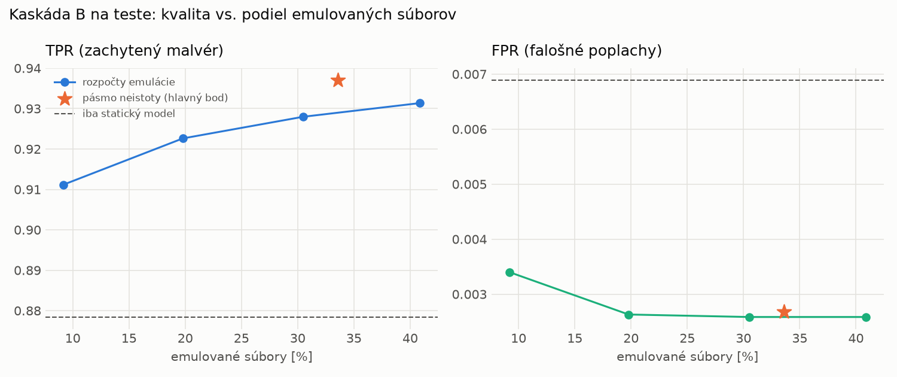

# Kaskáda B `b_heavyteacher` – beh `20261122-230824`

> Generované `src/cascade/evaluate_b.py` (2026-11-22T23:08:24+01:00). Seedy: [0, 1, 2]; hodnoty = priemer ± sm. odchýlka.
> Všetky prahy a pásmo neistoty sú z validácie; test sa na nič nenastavuje. Postup: `docs/09_plan_v2.md`.

| rola | beh |
|---|---|
| static | `runs_v4/real_full/lofo/BankBot/students_static/mlp_kd_heavy/20261122-230409` |
| dynamic | `runs_v4/real_full/lofo/BankBot/students_dynamic/mlp_kd_heavy/20261122-230654` |
| hybrid | `runs_v4/real_full/lofo/BankBot/hybrid/lightgbm/20261122-225455` |

Druhý stupeň: **dynamic**. Pásmo neistoty statického modelu: FPR ≤ 0.1% nad `hi`,
najviac 1% malvéru validácie pod `lo` (seed 0: lo = 0.0373, hi = 0.9986, seed 1: lo = 0.0394, hi = 0.9991, seed 2: lo = 0.0347, hi = 0.9987).

## Test
| prístup | accuracy | balanced_accuracy | precision | recall_tpr | fpr | f1 | mcc |
|---|---|---|---|---|---|---|---|
| kaskáda B | 0.9654 ± 0.0013 | 0.9672 ± 0.0012 | 0.9975 ± 0.0002 | 0.9371 ± 0.0025 | 0.0027 ± 0.0002 | 0.9663 ± 0.0013 | 0.9328 ± 0.0024 |
| statický | 0.9324 ± 0.0009 | 0.9358 ± 0.0008 | 0.9931 ± 0.0014 | 0.8784 ± 0.0027 | 0.0069 ± 0.0014 | 0.9322 ± 0.0010 | 0.8717 ± 0.0015 |
| dynamický | 0.8593 ± 0.0064 | 0.8667 ± 0.0060 | 0.9887 ± 0.0013 | 0.7429 ± 0.0132 | 0.0096 ± 0.0012 | 0.8483 ± 0.0082 | 0.7478 ± 0.0098 |
| hybrid (každá vzorka) | 0.9824 ± 0.0001 | 0.9830 ± 0.0001 | 0.9929 ± 0.0003 | 0.9739 ± 0.0003 | 0.0079 ± 0.0004 | 0.9833 ± 0.0001 | 0.9650 ± 0.0002 |

- **emulované súbory: 33.59%** (ostatné rozhodne iba statický model); na hybrid ide 9.21% súborov
- chyby pri istom rozhodnutí statického modelu (seed 0): 76
- validácia: emulované 33.48%, na hybrid 9.11%

## Validácia
| prístup | accuracy | balanced_accuracy | precision | recall_tpr | fpr | f1 | mcc |
|---|---|---|---|---|---|---|---|
| kaskáda B | 0.9644 ± 0.0008 | 0.9657 ± 0.0008 | 0.9952 ± 0.0000 | 0.9363 ± 0.0015 | 0.0049 ± 0.0000 | 0.9649 ± 0.0008 | 0.9307 ± 0.0015 |
| statický | 0.9312 ± 0.0022 | 0.9336 ± 0.0021 | 0.9899 ± 0.0000 | 0.8771 ± 0.0043 | 0.0098 ± 0.0000 | 0.9301 ± 0.0024 | 0.8689 ± 0.0040 |
| dynamický | 0.8654 ± 0.0069 | 0.8706 ± 0.0066 | 0.9882 ± 0.0002 | 0.7510 ± 0.0131 | 0.0098 ± 0.0000 | 0.8534 ± 0.0086 | 0.7569 ± 0.0112 |
| hybrid (každá vzorka) | 0.9813 ± 0.0001 | 0.9816 ± 0.0001 | 0.9909 ± 0.0001 | 0.9730 ± 0.0003 | 0.0097 ± 0.0002 | 0.9819 ± 0.0001 | 0.9627 ± 0.0003 |

## Januárové vzorky vynechanej rodiny (iba malvér → TPR)
| prístup | TPR |
|---|---|
| kaskáda B | 0.9884 ± 0.0076 |
| statický | 0.9753 ± 0.0189 |
| dynamický | 0.6744 ± 0.0142 |
| hybrid (každá vzorka) | 0.9958 ± 0.0006 |

Podiel emulovaných: 16.57%

## Krivka rozpočtu emulácie (test, priemer cez seedy)
| budget_val | emulation_rate | hybrid_rate | recall_tpr | fpr | f1 |
|---|---|---|---|---|---|
| 0.1000 | 0.0917 | 0.0410 | 0.9112 | 0.0034 | 0.9520 |
| 0.2000 | 0.1978 | 0.0749 | 0.9226 | 0.0026 | 0.9586 |
| 0.3000 | 0.3049 | 0.0969 | 0.9280 | 0.0026 | 0.9615 |
| 0.4000 | 0.4086 | 0.1069 | 0.9314 | 0.0026 | 0.9633 |

## Výpočtové nároky
Čas dynamickej analýzy (beh v emulátore alebo na zariadení) dataset neuvádza, preto sa neodhaduje. Úspora kaskády B = podiel súborov s dynamickou analýzou: **33.59%** (ostatné prístupy 100 %).

_Chýba benchmark niektorého komponentu (v zero-day behoch sa nemeria)._

