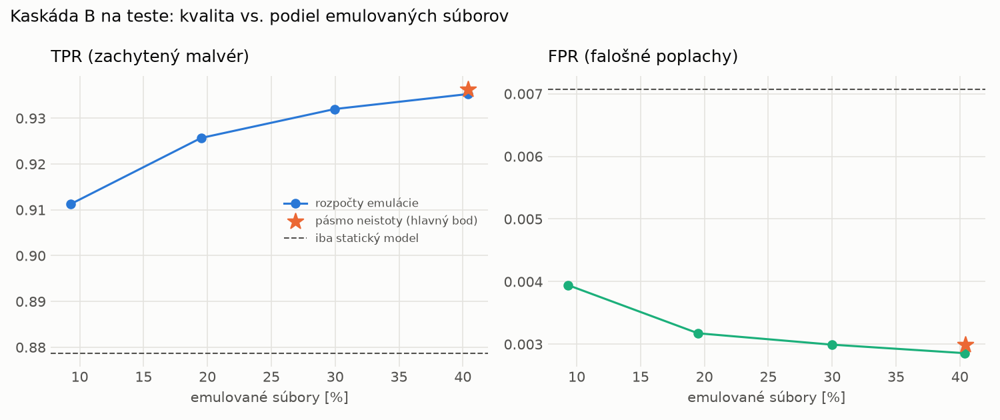

# Kaskáda B `b_nokd` – beh `20261122-230822`

> Generované `src/cascade/evaluate_b.py` (2026-11-22T23:08:22+01:00). Seedy: [0, 1, 2]; hodnoty = priemer ± sm. odchýlka.
> Všetky prahy a pásmo neistoty sú z validácie; test sa na nič nenastavuje. Postup: `docs/09_plan_v2.md`.

| rola | beh |
|---|---|
| static | `runs_v4/real_full/lofo/BankBot/students_static/mlp_nokd/20261122-230316` |
| dynamic | `runs_v4/real_full/lofo/BankBot/students_dynamic/mlp_nokd/20261122-230517` |
| hybrid | `runs_v4/real_full/lofo/BankBot/hybrid/lightgbm/20261122-225455` |

Druhý stupeň: **dynamic**. Pásmo neistoty statického modelu: FPR ≤ 0.1% nad `hi`,
najviac 1% malvéru validácie pod `lo` (seed 0: lo = 0.0338, hi = 0.9998, seed 1: lo = 0.0354, hi = 0.9993, seed 2: lo = 0.0356, hi = 0.9995).

## Test
| prístup | accuracy | balanced_accuracy | precision | recall_tpr | fpr | f1 | mcc |
|---|---|---|---|---|---|---|---|
| kaskáda B | 0.9649 ± 0.0006 | 0.9667 ± 0.0006 | 0.9972 ± 0.0003 | 0.9364 ± 0.0012 | 0.0030 ± 0.0004 | 0.9658 ± 0.0006 | 0.9317 ± 0.0012 |
| statický | 0.9324 ± 0.0028 | 0.9358 ± 0.0025 | 0.9929 ± 0.0012 | 0.8787 ± 0.0063 | 0.0071 ± 0.0013 | 0.9323 ± 0.0030 | 0.8718 ± 0.0046 |
| dynamický | 0.8531 ± 0.0064 | 0.8609 ± 0.0060 | 0.9909 ± 0.0003 | 0.7294 ± 0.0124 | 0.0075 ± 0.0003 | 0.8402 ± 0.0081 | 0.7388 ± 0.0101 |
| hybrid (každá vzorka) | 0.9824 ± 0.0001 | 0.9830 ± 0.0001 | 0.9929 ± 0.0003 | 0.9739 ± 0.0003 | 0.0079 ± 0.0004 | 0.9833 ± 0.0001 | 0.9650 ± 0.0002 |

- **emulované súbory: 40.41%** (ostatné rozhodne iba statický model); na hybrid ide 10.27% súborov
- chyby pri istom rozhodnutí statického modelu (seed 0): 82
- validácia: emulované 40.22%, na hybrid 9.99%

## Validácia
| prístup | accuracy | balanced_accuracy | precision | recall_tpr | fpr | f1 | mcc |
|---|---|---|---|---|---|---|---|
| kaskáda B | 0.9633 ± 0.0007 | 0.9646 ± 0.0007 | 0.9951 ± 0.0004 | 0.9342 ± 0.0015 | 0.0050 ± 0.0004 | 0.9637 ± 0.0007 | 0.9286 ± 0.0013 |
| statický | 0.9304 ± 0.0047 | 0.9329 ± 0.0045 | 0.9899 ± 0.0001 | 0.8756 ± 0.0090 | 0.0098 ± 0.0000 | 0.9292 ± 0.0051 | 0.8676 ± 0.0084 |
| dynamický | 0.8593 ± 0.0065 | 0.8648 ± 0.0062 | 0.9880 ± 0.0002 | 0.7394 ± 0.0124 | 0.0098 ± 0.0000 | 0.8458 ± 0.0082 | 0.7471 ± 0.0105 |
| hybrid (každá vzorka) | 0.9813 ± 0.0001 | 0.9816 ± 0.0001 | 0.9909 ± 0.0001 | 0.9730 ± 0.0003 | 0.0097 ± 0.0002 | 0.9819 ± 0.0001 | 0.9627 ± 0.0003 |

## Januárové vzorky vynechanej rodiny (iba malvér → TPR)
| prístup | TPR |
|---|---|
| kaskáda B | 0.9875 ± 0.0017 |
| statický | 0.9823 ± 0.0048 |
| dynamický | 0.6487 ± 0.0409 |
| hybrid (každá vzorka) | 0.9958 ± 0.0006 |

Podiel emulovaných: 43.90%

## Krivka rozpočtu emulácie (test, priemer cez seedy)
| budget_val | emulation_rate | hybrid_rate | recall_tpr | fpr | f1 |
|---|---|---|---|---|---|
| 0.1000 | 0.0930 | 0.0419 | 0.9113 | 0.0039 | 0.9518 |
| 0.2000 | 0.1950 | 0.0753 | 0.9257 | 0.0032 | 0.9600 |
| 0.3000 | 0.2997 | 0.0911 | 0.9320 | 0.0030 | 0.9635 |
| 0.4000 | 0.4038 | 0.1060 | 0.9353 | 0.0029 | 0.9653 |

## Výpočtové nároky
Čas dynamickej analýzy (beh v emulátore alebo na zariadení) dataset neuvádza, preto sa neodhaduje. Úspora kaskády B = podiel súborov s dynamickou analýzou: **40.41%** (ostatné prístupy 100 %).

_Chýba benchmark niektorého komponentu (v zero-day behoch sa nemeria)._

