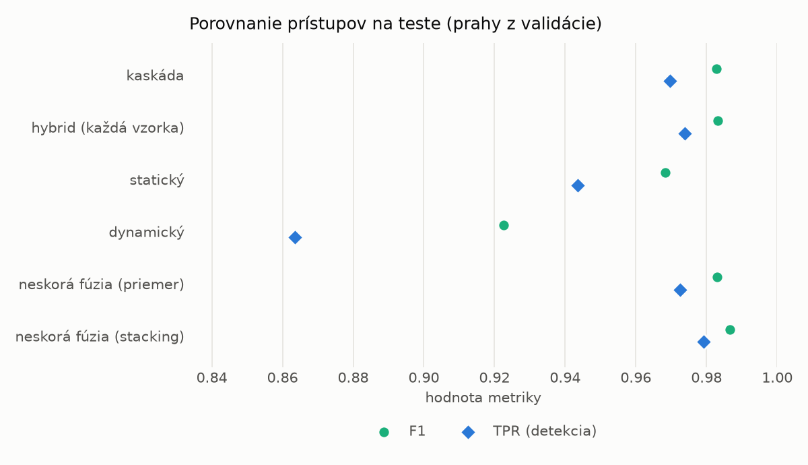
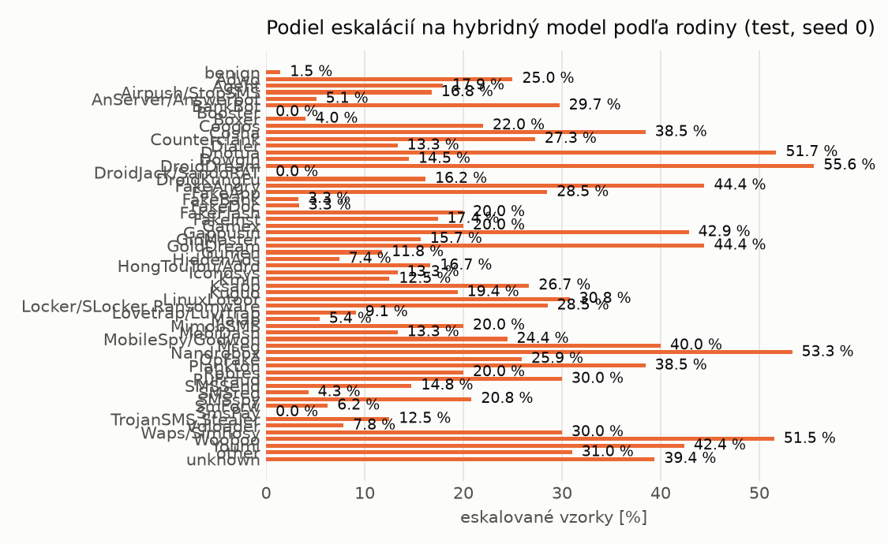

# Kaskáda `baselines` – beh `20261122-230810`

> Generované `src/cascade/evaluate.py` (2026-11-22T23:08:10+01:00). Seedy: [0, 1, 2]; hodnoty = priemer ± sm. odchýlka.
> Všetky prahy sú určené na validácii (FPR ≤ 1 %); test sa na nič nenastavuje.

| rola | beh |
|---|---|
| static | `runs_v4/real_full/lofo/BankBot/static/lightgbm/20261122-224851` |
| dynamic | `runs_v4/real_full/lofo/BankBot/dynamic/lightgbm/20261122-225203` |
| hybrid | `runs_v4/real_full/lofo/BankBot/hybrid/lightgbm/20261122-225455` |

## Test
| prístup | accuracy | balanced_accuracy | precision | recall_tpr | fpr | f1 | mcc |
|---|---|---|---|---|---|---|---|
| kaskáda | 0.9820 ± 0.0001 | 0.9827 ± 0.0001 | 0.9962 ± 0.0002 | 0.9696 ± 0.0001 | 0.0041 ± 0.0002 | 0.9827 ± 0.0001 | 0.9642 ± 0.0002 |
| hybrid (každá vzorka) | 0.9824 ± 0.0001 | 0.9830 ± 0.0001 | 0.9929 ± 0.0003 | 0.9739 ± 0.0003 | 0.0079 ± 0.0004 | 0.9833 ± 0.0001 | 0.9650 ± 0.0002 |
| statický | 0.9673 ± 0.0006 | 0.9688 ± 0.0005 | 0.9945 ± 0.0002 | 0.9436 ± 0.0012 | 0.0059 ± 0.0002 | 0.9684 ± 0.0006 | 0.9360 ± 0.0011 |
| dynamický | 0.9233 ± 0.0011 | 0.9271 ± 0.0011 | 0.9904 ± 0.0001 | 0.8636 ± 0.0022 | 0.0094 ± 0.0001 | 0.9227 ± 0.0012 | 0.8552 ± 0.0020 |
| neskorá fúzia (priemer) | 0.9822 ± 0.0010 | 0.9828 ± 0.0009 | 0.9937 ± 0.0004 | 0.9725 ± 0.0023 | 0.0069 ± 0.0005 | 0.9830 ± 0.0010 | 0.9645 ± 0.0019 |
| neskorá fúzia (stacking) | 0.9860 ± 0.0004 | 0.9864 ± 0.0004 | 0.9944 ± 0.0003 | 0.9791 ± 0.0005 | 0.0062 ± 0.0003 | 0.9867 ± 0.0004 | 0.9721 ± 0.0008 |

## Validácia
| prístup | accuracy | balanced_accuracy | precision | recall_tpr | fpr | f1 | mcc |
|---|---|---|---|---|---|---|---|
| kaskáda | 0.9819 ± 0.0002 | 0.9824 ± 0.0002 | 0.9950 ± 0.0001 | 0.9702 ± 0.0003 | 0.0054 ± 0.0002 | 0.9824 ± 0.0002 | 0.9640 ± 0.0004 |
| hybrid (každá vzorka) | 0.9813 ± 0.0001 | 0.9816 ± 0.0001 | 0.9909 ± 0.0001 | 0.9730 ± 0.0003 | 0.0097 ± 0.0002 | 0.9819 ± 0.0001 | 0.9627 ± 0.0003 |
| statický | 0.9671 ± 0.0005 | 0.9681 ± 0.0004 | 0.9908 ± 0.0002 | 0.9457 ± 0.0007 | 0.0096 ± 0.0002 | 0.9677 ± 0.0005 | 0.9352 ± 0.0009 |
| dynamický | 0.9269 ± 0.0006 | 0.9295 ± 0.0006 | 0.9899 ± 0.0002 | 0.8687 ± 0.0010 | 0.0097 ± 0.0002 | 0.9254 ± 0.0006 | 0.8613 ± 0.0011 |
| neskorá fúzia (priemer) | 0.9801 ± 0.0012 | 0.9805 ± 0.0011 | 0.9908 ± 0.0000 | 0.9708 ± 0.0023 | 0.0098 ± 0.0000 | 0.9807 ± 0.0012 | 0.9604 ± 0.0023 |
| neskorá fúzia (stacking) | 0.9843 ± 0.0003 | 0.9845 ± 0.0002 | 0.9910 ± 0.0001 | 0.9787 ± 0.0006 | 0.0097 ± 0.0002 | 0.9848 ± 0.0003 | 0.9685 ± 0.0005 |

## Správanie kaskády (test, seed 0)
- podiel eskalácií na hybrid: **9.10%** (1422 vzoriek)
- chyby pri zhode študentov (kaskáda ich nemôže opraviť): **152**
  (1.070% zo zhôd; FP 2, FN 150)
- úspešnosť na eskalovaných vzorkách: hybrid 0.9092827004219409, statický 0.7475386779184248,
  dynamický 0.25246132208157523  → prínos hybridu pri nezhode

## Výpočtové nároky (odhad z benchmarkov komponentov)
_Chýba benchmark niektorého komponentu (`python -m src.evaluation.benchmark`)._

