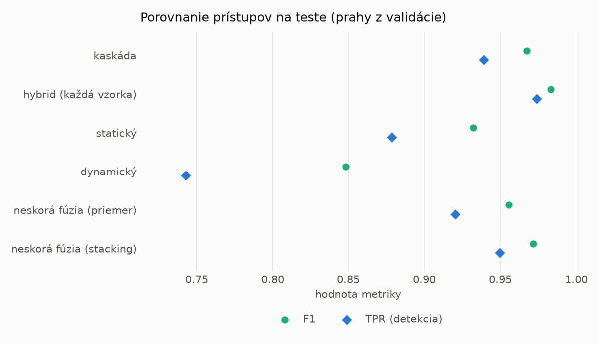
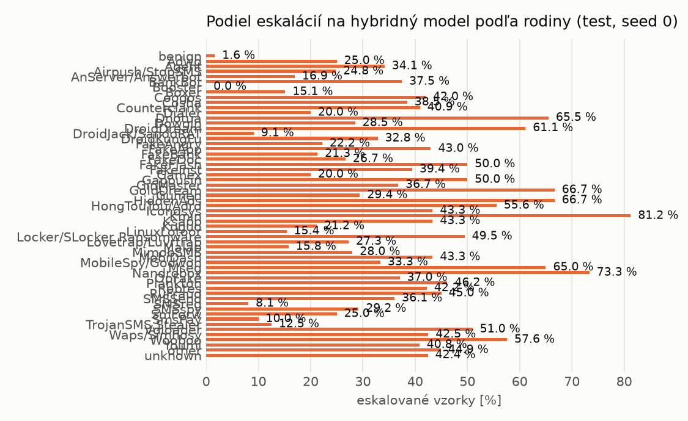

# Kaskáda `heavyteacher` – beh `20261122-230812`

> Generované `src/cascade/evaluate.py` (2026-11-22T23:08:13+01:00). Seedy: [0, 1, 2]; hodnoty = priemer ± sm. odchýlka.
> Všetky prahy sú určené na validácii (FPR ≤ 1 %); test sa na nič nenastavuje.

| rola | beh |
|---|---|
| static | `runs_v4/real_full/lofo/BankBot/students_static/mlp_kd_heavy/20261122-230409` |
| dynamic | `runs_v4/real_full/lofo/BankBot/students_dynamic/mlp_kd_heavy/20261122-230654` |
| hybrid | `runs_v4/real_full/lofo/BankBot/hybrid/lightgbm/20261122-225455` |

## Test
| prístup | accuracy | balanced_accuracy | precision | recall_tpr | fpr | f1 | mcc |
|---|---|---|---|---|---|---|---|
| kaskáda | 0.9665 ± 0.0012 | 0.9682 ± 0.0012 | 0.9973 ± 0.0003 | 0.9392 ± 0.0024 | 0.0029 ± 0.0003 | 0.9674 ± 0.0012 | 0.9347 ± 0.0023 |
| hybrid (každá vzorka) | 0.9824 ± 0.0001 | 0.9830 ± 0.0001 | 0.9929 ± 0.0003 | 0.9739 ± 0.0003 | 0.0079 ± 0.0004 | 0.9833 ± 0.0001 | 0.9650 ± 0.0002 |
| statický | 0.9324 ± 0.0009 | 0.9358 ± 0.0008 | 0.9931 ± 0.0014 | 0.8784 ± 0.0027 | 0.0069 ± 0.0014 | 0.9322 ± 0.0010 | 0.8717 ± 0.0015 |
| dynamický | 0.8593 ± 0.0064 | 0.8667 ± 0.0060 | 0.9887 ± 0.0013 | 0.7429 ± 0.0132 | 0.0096 ± 0.0012 | 0.8483 ± 0.0082 | 0.7478 ± 0.0098 |
| neskorá fúzia (priemer) | 0.9547 ± 0.0045 | 0.9569 ± 0.0042 | 0.9939 ± 0.0015 | 0.9202 ± 0.0098 | 0.0064 ± 0.0016 | 0.9556 ± 0.0047 | 0.9124 ± 0.0082 |
| neskorá fúzia (stacking) | 0.9706 ± 0.0011 | 0.9719 ± 0.0011 | 0.9944 ± 0.0008 | 0.9498 ± 0.0018 | 0.0060 ± 0.0008 | 0.9716 ± 0.0011 | 0.9422 ± 0.0021 |

## Validácia
| prístup | accuracy | balanced_accuracy | precision | recall_tpr | fpr | f1 | mcc |
|---|---|---|---|---|---|---|---|
| kaskáda | 0.9656 ± 0.0009 | 0.9668 ± 0.0009 | 0.9954 ± 0.0003 | 0.9384 ± 0.0017 | 0.0047 ± 0.0003 | 0.9661 ± 0.0009 | 0.9329 ± 0.0017 |
| hybrid (každá vzorka) | 0.9813 ± 0.0001 | 0.9816 ± 0.0001 | 0.9909 ± 0.0001 | 0.9730 ± 0.0003 | 0.0097 ± 0.0002 | 0.9819 ± 0.0001 | 0.9627 ± 0.0003 |
| statický | 0.9312 ± 0.0022 | 0.9336 ± 0.0021 | 0.9899 ± 0.0000 | 0.8771 ± 0.0043 | 0.0098 ± 0.0000 | 0.9301 ± 0.0024 | 0.8689 ± 0.0040 |
| dynamický | 0.8654 ± 0.0069 | 0.8706 ± 0.0066 | 0.9882 ± 0.0002 | 0.7510 ± 0.0131 | 0.0098 ± 0.0000 | 0.8534 ± 0.0086 | 0.7569 ± 0.0112 |
| neskorá fúzia (priemer) | 0.9512 ± 0.0072 | 0.9529 ± 0.0069 | 0.9904 ± 0.0003 | 0.9155 ± 0.0136 | 0.0097 ± 0.0002 | 0.9514 ± 0.0075 | 0.9055 ± 0.0133 |
| neskorá fúzia (stacking) | 0.9678 ± 0.0014 | 0.9687 ± 0.0013 | 0.9906 ± 0.0000 | 0.9472 ± 0.0026 | 0.0098 ± 0.0000 | 0.9684 ± 0.0014 | 0.9365 ± 0.0026 |

## Správanie kaskády (test, seed 0)
- podiel eskalácií na hybrid: **15.50%** (2422 vzoriek)
- chyby pri zhode študentov (kaskáda ich nemôže opraviť): **471**
  (3.567% zo zhôd; FP 1, FN 470)
- úspešnosť na eskalovaných vzorkách: hybrid 0.9727497935590421, statický 0.7605284888521883,
  dynamický 0.23947151114781173  → prínos hybridu pri nezhode

## Výpočtové nároky (odhad z benchmarkov komponentov)
_Chýba benchmark niektorého komponentu (`python -m src.evaluation.benchmark`)._

