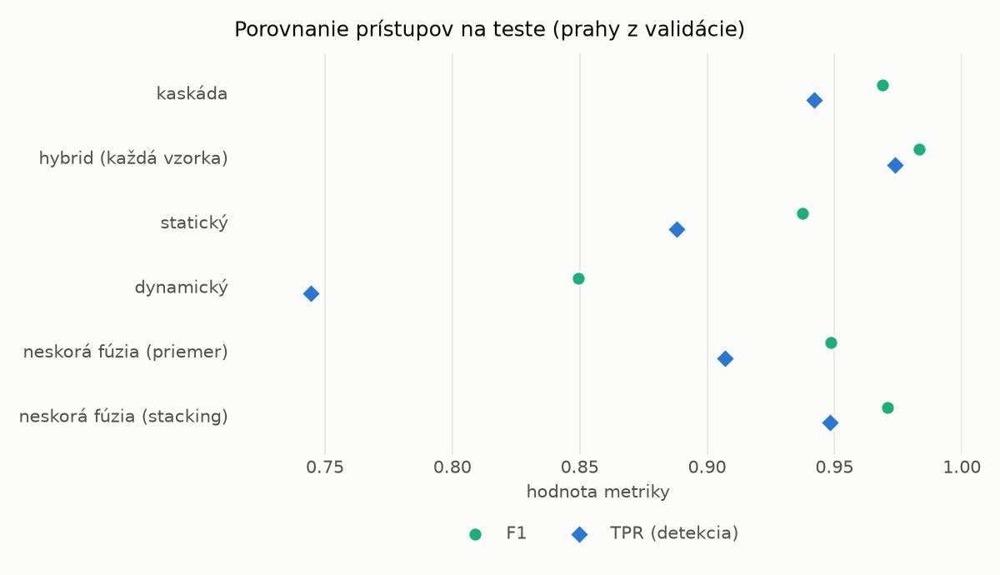
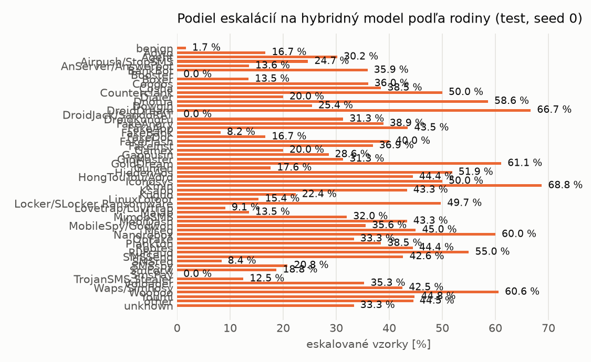

# Kaskáda `main` – beh `20261122-230801`

> Generované `src/cascade/evaluate.py` (2026-11-22T23:08:01+01:00). Seedy: [0, 1, 2]; hodnoty = priemer ± sm. odchýlka.
> Všetky prahy sú určené na validácii (FPR ≤ 1 %); test sa na nič nenastavuje.

| rola | beh |
|---|---|
| static | `runs_v4/real_full/lofo/BankBot/students_static/mlp_kd/20261122-230257` |
| dynamic | `runs_v4/real_full/lofo/BankBot/students_dynamic/mlp_kd/20261122-230432` |
| hybrid | `runs_v4/real_full/lofo/BankBot/hybrid/lightgbm/20261122-225455` |

## Test
| prístup | accuracy | balanced_accuracy | precision | recall_tpr | fpr | f1 | mcc |
|---|---|---|---|---|---|---|---|
| kaskáda | 0.9679 ± 0.0012 | 0.9695 ± 0.0011 | 0.9971 ± 0.0002 | 0.9421 ± 0.0022 | 0.0031 ± 0.0002 | 0.9688 ± 0.0012 | 0.9374 ± 0.0023 |
| hybrid (každá vzorka) | 0.9824 ± 0.0001 | 0.9830 ± 0.0001 | 0.9929 ± 0.0003 | 0.9739 ± 0.0003 | 0.0079 ± 0.0004 | 0.9833 ± 0.0001 | 0.9650 ± 0.0002 |
| statický | 0.9372 ± 0.0030 | 0.9403 ± 0.0029 | 0.9927 ± 0.0006 | 0.8880 ± 0.0059 | 0.0073 ± 0.0006 | 0.9374 ± 0.0032 | 0.8803 ± 0.0054 |
| dynamický | 0.8602 ± 0.0013 | 0.8675 ± 0.0012 | 0.9889 ± 0.0011 | 0.7444 ± 0.0033 | 0.0094 ± 0.0010 | 0.8494 ± 0.0018 | 0.7493 ± 0.0017 |
| neskorá fúzia (priemer) | 0.9479 ± 0.0024 | 0.9505 ± 0.0023 | 0.9943 ± 0.0005 | 0.9069 ± 0.0045 | 0.0059 ± 0.0005 | 0.9486 ± 0.0025 | 0.8999 ± 0.0045 |
| neskorá fúzia (stacking) | 0.9699 ± 0.0011 | 0.9712 ± 0.0010 | 0.9946 ± 0.0004 | 0.9482 ± 0.0019 | 0.0058 ± 0.0005 | 0.9709 ± 0.0011 | 0.9408 ± 0.0021 |

## Validácia
| prístup | accuracy | balanced_accuracy | precision | recall_tpr | fpr | f1 | mcc |
|---|---|---|---|---|---|---|---|
| kaskáda | 0.9671 ± 0.0009 | 0.9683 ± 0.0009 | 0.9956 ± 0.0001 | 0.9411 ± 0.0019 | 0.0045 ± 0.0002 | 0.9676 ± 0.0009 | 0.9358 ± 0.0017 |
| hybrid (každá vzorka) | 0.9813 ± 0.0001 | 0.9816 ± 0.0001 | 0.9909 ± 0.0001 | 0.9730 ± 0.0003 | 0.0097 ± 0.0002 | 0.9819 ± 0.0001 | 0.9627 ± 0.0003 |
| statický | 0.9351 ± 0.0028 | 0.9374 ± 0.0027 | 0.9900 ± 0.0001 | 0.8846 ± 0.0054 | 0.0098 ± 0.0000 | 0.9343 ± 0.0031 | 0.8760 ± 0.0051 |
| dynamický | 0.8643 ± 0.0034 | 0.8695 ± 0.0033 | 0.9882 ± 0.0001 | 0.7489 ± 0.0066 | 0.0098 ± 0.0000 | 0.8520 ± 0.0043 | 0.7551 ± 0.0056 |
| neskorá fúzia (priemer) | 0.9445 ± 0.0029 | 0.9464 ± 0.0028 | 0.9902 ± 0.0001 | 0.9027 ± 0.0056 | 0.0098 ± 0.0000 | 0.9444 ± 0.0031 | 0.8931 ± 0.0054 |
| neskorá fúzia (stacking) | 0.9679 ± 0.0014 | 0.9688 ± 0.0013 | 0.9907 ± 0.0001 | 0.9474 ± 0.0028 | 0.0097 ± 0.0002 | 0.9686 ± 0.0014 | 0.9368 ± 0.0026 |

## Správanie kaskády (test, seed 0)
- podiel eskalácií na hybrid: **14.73%** (2302 vzoriek)
- chyby pri zhode študentov (kaskáda ich nemôže opraviť): **446**
  (3.348% zo zhôd; FP 3, FN 443)
- úspešnosť na eskalovaných vzorkách: hybrid 0.9669852302345786, statický 0.7450043440486533,
  dynamický 0.25499565595134666  → prínos hybridu pri nezhode

## Výpočtové nároky (odhad z benchmarkov komponentov)
_Chýba benchmark niektorého komponentu (`python -m src.evaluation.benchmark`)._

