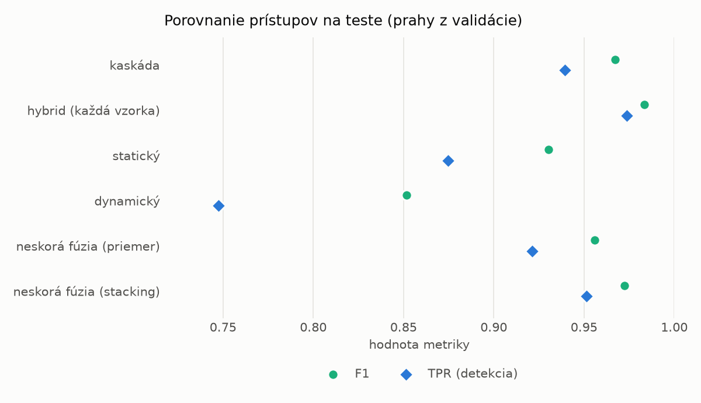
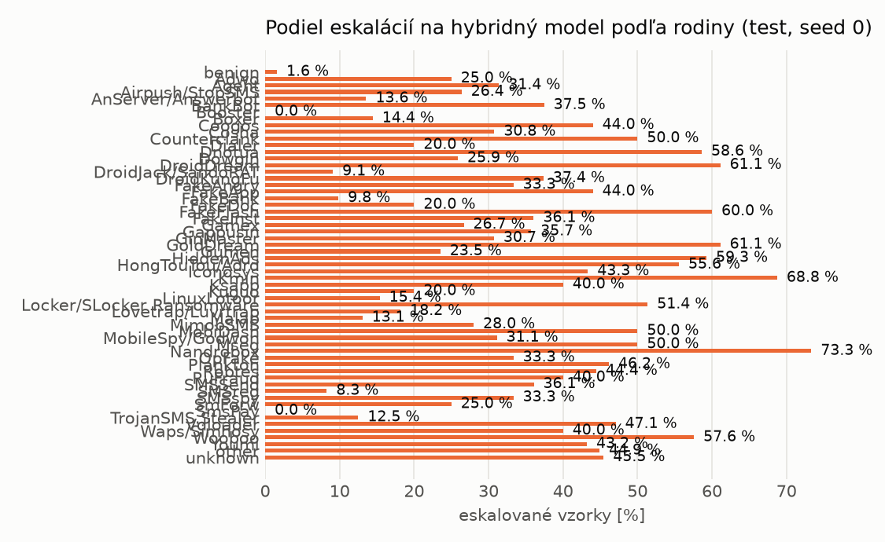

# Kaskáda `modal` – beh `20261122-230805`

> Generované `src/cascade/evaluate.py` (2026-11-22T23:08:06+01:00). Seedy: [0, 1, 2]; hodnoty = priemer ± sm. odchýlka.
> Všetky prahy sú určené na validácii (FPR ≤ 1 %); test sa na nič nenastavuje.

| rola | beh |
|---|---|
| static | `runs_v4/real_full/lofo/BankBot/students_static/mlp_kd_modal/20261122-230351` |
| dynamic | `runs_v4/real_full/lofo/BankBot/students_dynamic/mlp_kd_modal/20261122-230614` |
| hybrid | `runs_v4/real_full/lofo/BankBot/hybrid/lightgbm/20261122-225455` |

## Test
| prístup | accuracy | balanced_accuracy | precision | recall_tpr | fpr | f1 | mcc |
|---|---|---|---|---|---|---|---|
| kaskáda | 0.9664 ± 0.0015 | 0.9681 ± 0.0014 | 0.9971 ± 0.0005 | 0.9393 ± 0.0026 | 0.0031 ± 0.0005 | 0.9673 ± 0.0015 | 0.9345 ± 0.0028 |
| hybrid (každá vzorka) | 0.9824 ± 0.0001 | 0.9830 ± 0.0001 | 0.9929 ± 0.0003 | 0.9739 ± 0.0003 | 0.0079 ± 0.0004 | 0.9833 ± 0.0001 | 0.9650 ± 0.0002 |
| statický | 0.9306 ± 0.0038 | 0.9341 ± 0.0036 | 0.9935 ± 0.0009 | 0.8747 ± 0.0068 | 0.0065 ± 0.0009 | 0.9303 ± 0.0041 | 0.8687 ± 0.0069 |
| dynamický | 0.8620 ± 0.0011 | 0.8692 ± 0.0011 | 0.9894 ± 0.0004 | 0.7474 ± 0.0023 | 0.0090 ± 0.0003 | 0.8515 ± 0.0014 | 0.7523 ± 0.0017 |
| neskorá fúzia (priemer) | 0.9552 ± 0.0039 | 0.9573 ± 0.0037 | 0.9935 ± 0.0009 | 0.9213 ± 0.0080 | 0.0068 ± 0.0010 | 0.9561 ± 0.0040 | 0.9131 ± 0.0072 |
| neskorá fúzia (stacking) | 0.9714 ± 0.0008 | 0.9727 ± 0.0008 | 0.9944 ± 0.0011 | 0.9514 ± 0.0005 | 0.0061 ± 0.0012 | 0.9724 ± 0.0007 | 0.9438 ± 0.0016 |

## Validácia
| prístup | accuracy | balanced_accuracy | precision | recall_tpr | fpr | f1 | mcc |
|---|---|---|---|---|---|---|---|
| kaskáda | 0.9647 ± 0.0009 | 0.9660 ± 0.0009 | 0.9959 ± 0.0006 | 0.9362 ± 0.0014 | 0.0042 ± 0.0006 | 0.9652 ± 0.0009 | 0.9314 ± 0.0017 |
| hybrid (každá vzorka) | 0.9813 ± 0.0001 | 0.9816 ± 0.0001 | 0.9909 ± 0.0001 | 0.9730 ± 0.0003 | 0.0097 ± 0.0002 | 0.9819 ± 0.0001 | 0.9627 ± 0.0003 |
| statický | 0.9293 ± 0.0032 | 0.9318 ± 0.0030 | 0.9898 ± 0.0001 | 0.8735 ± 0.0061 | 0.0098 ± 0.0000 | 0.9280 ± 0.0035 | 0.8656 ± 0.0057 |
| dynamický | 0.8657 ± 0.0015 | 0.8709 ± 0.0014 | 0.9882 ± 0.0000 | 0.7515 ± 0.0028 | 0.0098 ± 0.0000 | 0.8538 ± 0.0018 | 0.7573 ± 0.0024 |
| neskorá fúzia (priemer) | 0.9523 ± 0.0045 | 0.9539 ± 0.0043 | 0.9904 ± 0.0002 | 0.9175 ± 0.0084 | 0.0097 ± 0.0002 | 0.9525 ± 0.0046 | 0.9074 ± 0.0083 |
| neskorá fúzia (stacking) | 0.9685 ± 0.0005 | 0.9694 ± 0.0004 | 0.9906 ± 0.0000 | 0.9485 ± 0.0009 | 0.0098 ± 0.0000 | 0.9691 ± 0.0005 | 0.9379 ± 0.0009 |

## Správanie kaskády (test, seed 0)
- podiel eskalácií na hybrid: **15.13%** (2364 vzoriek)
- chyby pri zhode študentov (kaskáda ich nemôže opraviť): **479**
  (3.612% zo zhôd; FP 2, FN 477)
- úspešnosť na eskalovaných vzorkách: hybrid 0.9703891708967851, statický 0.7174280879864636,
  dynamický 0.2825719120135364  → prínos hybridu pri nezhode

## Výpočtové nároky (odhad z benchmarkov komponentov)
_Chýba benchmark niektorého komponentu (`python -m src.evaluation.benchmark`)._

