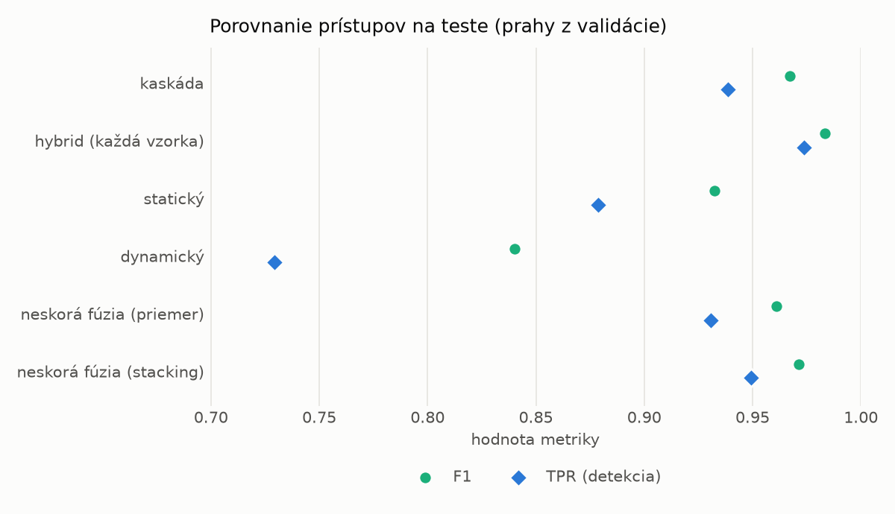
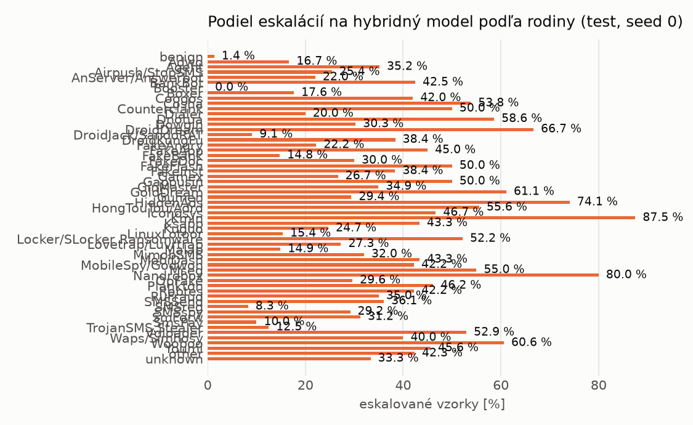

# Kaskáda `nokd` – beh `20261122-230803`

> Generované `src/cascade/evaluate.py` (2026-11-22T23:08:03+01:00). Seedy: [0, 1, 2]; hodnoty = priemer ± sm. odchýlka.
> Všetky prahy sú určené na validácii (FPR ≤ 1 %); test sa na nič nenastavuje.

| rola | beh |
|---|---|
| static | `runs_v4/real_full/lofo/BankBot/students_static/mlp_nokd/20261122-230316` |
| dynamic | `runs_v4/real_full/lofo/BankBot/students_dynamic/mlp_nokd/20261122-230517` |
| hybrid | `runs_v4/real_full/lofo/BankBot/hybrid/lightgbm/20261122-225455` |

## Test
| prístup | accuracy | balanced_accuracy | precision | recall_tpr | fpr | f1 | mcc |
|---|---|---|---|---|---|---|---|
| kaskáda | 0.9661 ± 0.0005 | 0.9678 ± 0.0005 | 0.9971 ± 0.0005 | 0.9388 ± 0.0007 | 0.0031 ± 0.0005 | 0.9671 ± 0.0005 | 0.9341 ± 0.0010 |
| hybrid (každá vzorka) | 0.9824 ± 0.0001 | 0.9830 ± 0.0001 | 0.9929 ± 0.0003 | 0.9739 ± 0.0003 | 0.0079 ± 0.0004 | 0.9833 ± 0.0001 | 0.9650 ± 0.0002 |
| statický | 0.9324 ± 0.0028 | 0.9358 ± 0.0025 | 0.9929 ± 0.0012 | 0.8787 ± 0.0063 | 0.0071 ± 0.0013 | 0.9323 ± 0.0030 | 0.8718 ± 0.0046 |
| dynamický | 0.8531 ± 0.0064 | 0.8609 ± 0.0060 | 0.9909 ± 0.0003 | 0.7294 ± 0.0124 | 0.0075 ± 0.0003 | 0.8402 ± 0.0081 | 0.7388 ± 0.0101 |
| neskorá fúzia (priemer) | 0.9601 ± 0.0055 | 0.9619 ± 0.0052 | 0.9936 ± 0.0009 | 0.9306 ± 0.0111 | 0.0068 ± 0.0010 | 0.9610 ± 0.0056 | 0.9223 ± 0.0103 |
| neskorá fúzia (stacking) | 0.9703 ± 0.0008 | 0.9716 ± 0.0008 | 0.9945 ± 0.0004 | 0.9492 ± 0.0018 | 0.0059 ± 0.0004 | 0.9713 ± 0.0008 | 0.9417 ± 0.0016 |

## Validácia
| prístup | accuracy | balanced_accuracy | precision | recall_tpr | fpr | f1 | mcc |
|---|---|---|---|---|---|---|---|
| kaskáda | 0.9646 ± 0.0008 | 0.9659 ± 0.0008 | 0.9952 ± 0.0003 | 0.9367 ± 0.0018 | 0.0049 ± 0.0003 | 0.9651 ± 0.0009 | 0.9311 ± 0.0016 |
| hybrid (každá vzorka) | 0.9813 ± 0.0001 | 0.9816 ± 0.0001 | 0.9909 ± 0.0001 | 0.9730 ± 0.0003 | 0.0097 ± 0.0002 | 0.9819 ± 0.0001 | 0.9627 ± 0.0003 |
| statický | 0.9304 ± 0.0047 | 0.9329 ± 0.0045 | 0.9899 ± 0.0001 | 0.8756 ± 0.0090 | 0.0098 ± 0.0000 | 0.9292 ± 0.0051 | 0.8676 ± 0.0084 |
| dynamický | 0.8593 ± 0.0065 | 0.8648 ± 0.0062 | 0.9880 ± 0.0002 | 0.7394 ± 0.0124 | 0.0098 ± 0.0000 | 0.8458 ± 0.0082 | 0.7471 ± 0.0105 |
| neskorá fúzia (priemer) | 0.9598 ± 0.0053 | 0.9611 ± 0.0051 | 0.9905 ± 0.0001 | 0.9319 ± 0.0101 | 0.0098 ± 0.0000 | 0.9603 ± 0.0054 | 0.9214 ± 0.0100 |
| neskorá fúzia (stacking) | 0.9684 ± 0.0005 | 0.9693 ± 0.0005 | 0.9907 ± 0.0001 | 0.9484 ± 0.0011 | 0.0097 ± 0.0002 | 0.9691 ± 0.0005 | 0.9378 ± 0.0010 |

## Správanie kaskády (test, seed 0)
- podiel eskalácií na hybrid: **15.82%** (2472 vzoriek)
- chyby pri zhode študentov (kaskáda ich nemôže opraviť): **467**
  (3.551% zo zhôd; FP 3, FN 464)
- úspešnosť na eskalovaných vzorkách: hybrid 0.973705501618123, statický 0.761326860841424,
  dynamický 0.23867313915857605  → prínos hybridu pri nezhode

## Výpočtové nároky (odhad z benchmarkov komponentov)
_Chýba benchmark niektorého komponentu (`python -m src.evaluation.benchmark`)._

