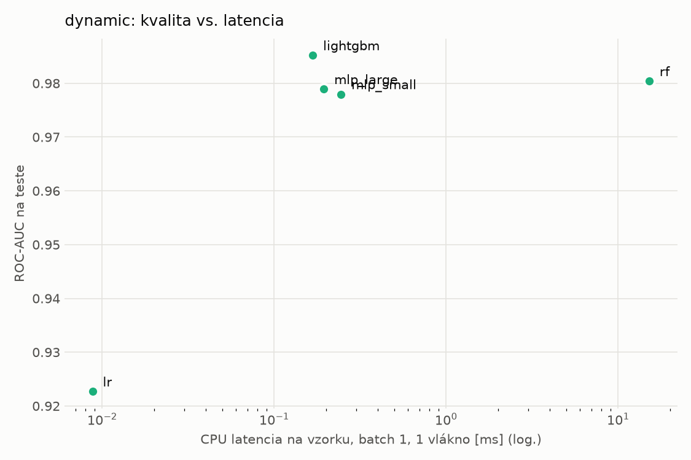
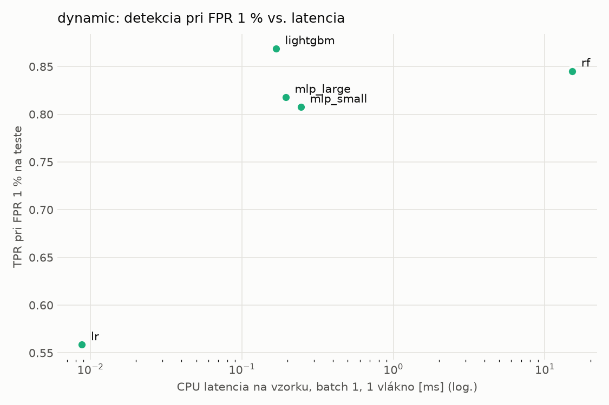
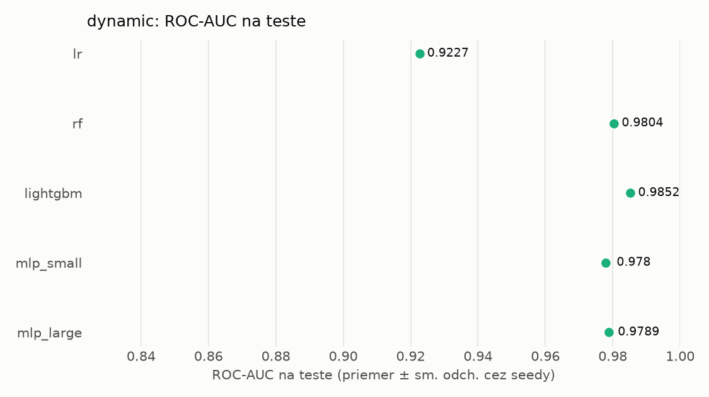
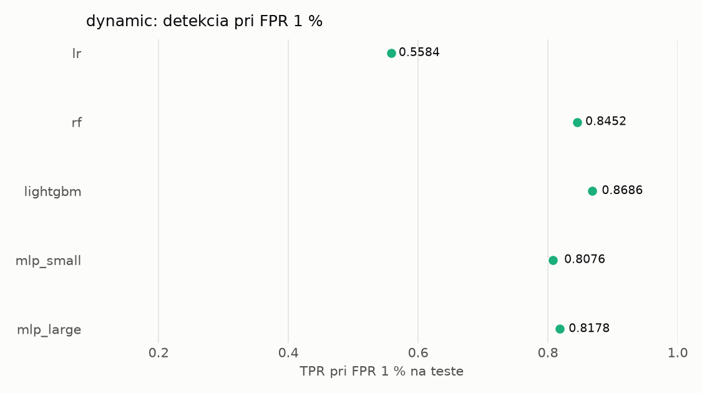

# Porovnanie modelov – dynamic

> Generované `src/evaluation/compare.py` (2026-11-22T22:54:41+01:00); použitý je posledný beh každého modelu.
> Metriky sú priemer cez seedy. \* = pri prahu určenom na validácii (FPR ≤ 1 %).
> CPU ms/vz. = medián latencie jednej vzorky na 1 vlákne vrátane transformácie vstupu (meranie hneď po tréningu,
> orientačné). Oficiálne merania spotreby sú v časti „Spotreba zdrojov pri inferencii“.

## Detekčná kvalita a orientačné časy
| model | ROC-AUC val | ROC-AUC test | TPR@FPR 1 % test | TPR@FPR 0,1 % test | F1 test* | FPR test* | gap train−val | CPU ms/vz. | CPU vz./s | GPU ms/vz. | parametre | MB | tréning s | ladenie min |
|---|---|---|---|---|---|---|---|---|---|---|---|---|---|---|
| [lr](../../dynamic/lr/20261122-225140/README.md) | 0.9198 | 0.9227 ± 0.0000 | 0.5584 | 0.4633 | 0.7179 | 0.0114 | -0.0007 | 0.009 | 4 370 385 | – | 132 | 0.01 | 0.4 | 0.0 |
| [rf](../../dynamic/rf/20261122-225142/README.md) | 0.9788 | 0.9804 ± 0.0000 | 0.8452 | 0.7387 | 0.9076 | 0.0083 | 0.0204 | 15.182 | 106 898 | – | 4 525 144 | 362.43 | 3.2 | 0.0 |
| [lightgbm](../../dynamic/lightgbm/20261122-225203/README.md) | 0.9837 | 0.9852 ± 0.0001 | 0.8686 | 0.7680 | 0.9227 | 0.0094 | 0.0155 | 0.168 | 76 865 | – | 449 397 | 24.69 | 16.9 | 0.0 |
| [mlp_small](../../dynamic/mlp_small/20261122-225308/README.md) | 0.9759 | 0.9780 ± 0.0009 | 0.8076 | 0.6446 | 0.8792 | 0.0081 | 0.0111 | 0.245 | 2 325 876 | 0.640 | 67 585 | 0.28 | 23.0 | 0.0 |
| [mlp_large](../../dynamic/mlp_large/20261122-225419/README.md) | 0.9775 | 0.9789 ± 0.0003 | 0.8178 | 0.6397 | 0.8871 | 0.0079 | 0.0132 | 0.195 | 630 755 | 0.435 | 596 481 | 2.41 | 6.4 | 0.0 |

## Nízka prevalencia malvéru (test, prah z validácie)
| model | TPR | FPR | precision @ 1 % | falošné na 1 skutočný poplach @ 1 % | precision @ 0.1 % | falošné na 1 skutočný poplach @ 0.1 % |
|---|---|---|---|---|---|---|
| lr | 0.5657 | 0.0114 | 0.333 | 2.00 | 0.047 | 20.18 |
| rf | 0.8370 | 0.0083 | 0.505 | 0.98 | 0.092 | 9.91 |
| lightgbm | 0.8636 | 0.0094 | 0.480 | 1.08 | 0.084 | 10.91 |
| mlp_small | 0.7900 | 0.0081 | 0.497 | 1.01 | 0.089 | 10.21 |
| mlp_large | 0.8027 | 0.0079 | 0.505 | 0.98 | 0.092 | 9.88 |

Prepočet: TPR a FPR nezávisia od podielu malvéru, preto sa dajú preniesť na nízku prevalenciu (v reálnej prevádzke je malvéru ~1 % alebo menej; v teste 54 %). „Falošné na 1 skutočný poplach“ = koľko neškodných súborov je označených na každý zachytený malvér.

## Spotreba zdrojov pri inferencii (benchmark, testovacia množina)
_Benchmark zatiaľ nebol spustený (`python -m src.evaluation.benchmark --approach dynamic`)._

## Grafy

