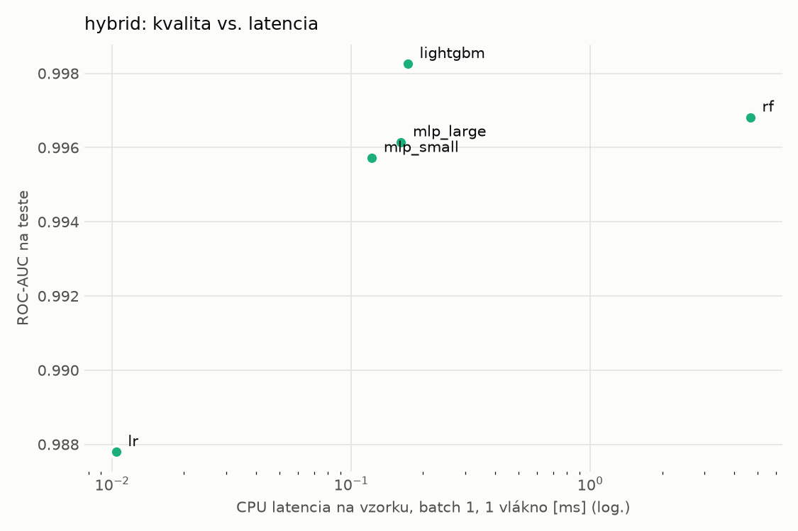
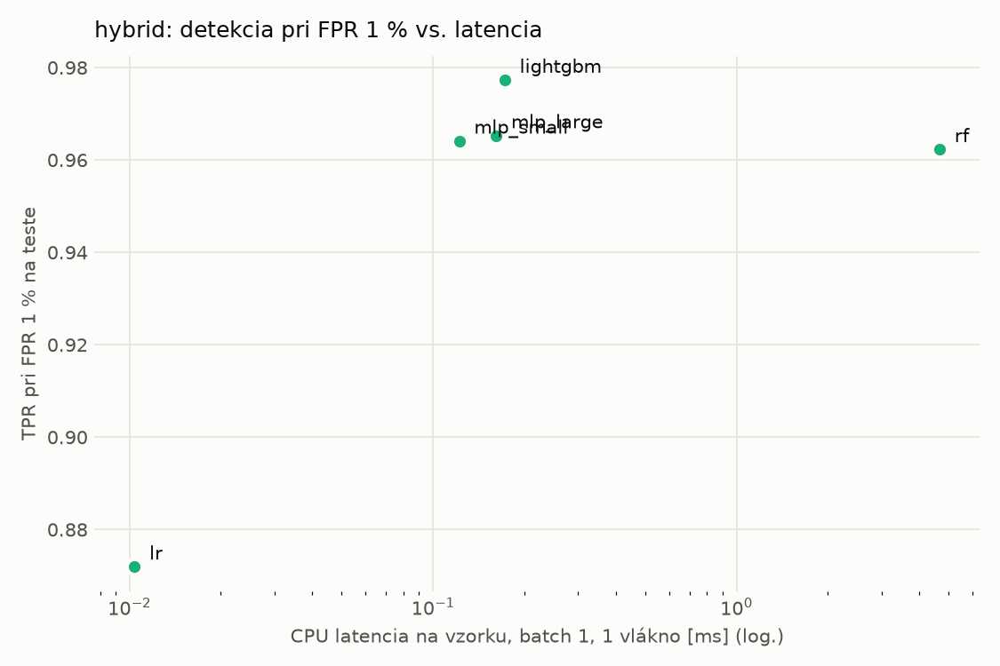
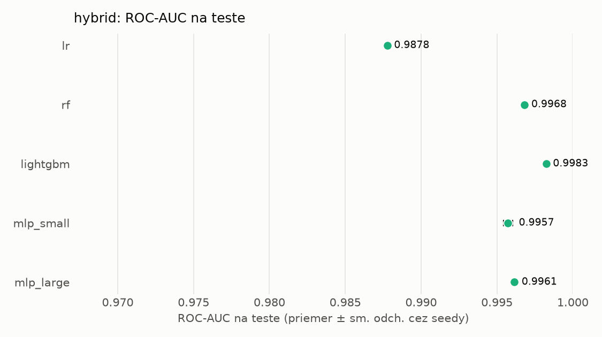
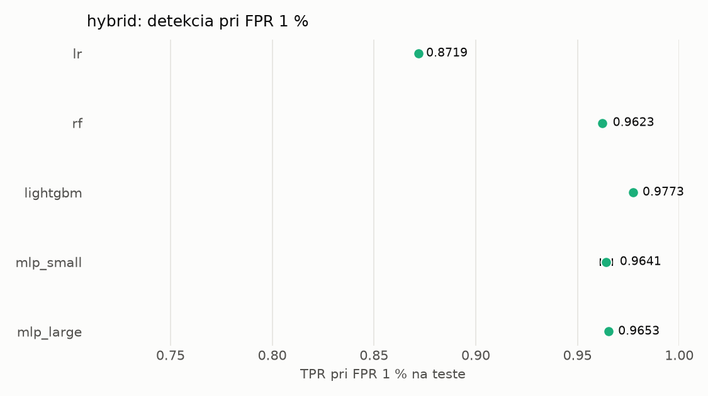

# Porovnanie modelov – hybrid

> Generované `src/evaluation/compare.py` (2026-11-22T22:57:30+01:00); použitý je posledný beh každého modelu.
> Metriky sú priemer cez seedy. \* = pri prahu určenom na validácii (FPR ≤ 1 %).
> CPU ms/vz. = medián latencie jednej vzorky na 1 vlákne vrátane transformácie vstupu (meranie hneď po tréningu,
> orientačné). Oficiálne merania spotreby sú v časti „Spotreba zdrojov pri inferencii“.

## Detekčná kvalita a orientačné časy
| model | ROC-AUC val | ROC-AUC test | TPR@FPR 1 % test | TPR@FPR 0,1 % test | F1 test* | FPR test* | gap train−val | CPU ms/vz. | CPU vz./s | GPU ms/vz. | parametre | MB | tréning s | ladenie min |
|---|---|---|---|---|---|---|---|---|---|---|---|---|---|---|
| [lr](../../hybrid/lr/20261122-225444/README.md) | 0.9866 | 0.9878 ± 0.0000 | 0.8719 | 0.6047 | 0.9238 | 0.0093 | 0.0013 | 0.010 | 2 157 345 | – | 295 | 0.01 | 0.4 | 0.0 |
| [rf](../../hybrid/rf/20261122-225447/README.md) | 0.9962 | 0.9968 ± 0.0000 | 0.9623 | 0.9131 | 0.9735 | 0.0064 | 0.0038 | 4.672 | 194 818 | – | 788 390 | 63.35 | 1.4 | 0.0 |
| [lightgbm](../../hybrid/lightgbm/20261122-225455/README.md) | 0.9975 | 0.9983 ± 0.0000 | 0.9773 | 0.9315 | 0.9833 | 0.0079 | 0.0025 | 0.173 | 76 914 | – | 484 995 | 27.08 | 21.8 | 0.0 |
| [mlp_small](../../hybrid/mlp_small/20261122-225616/README.md) | 0.9950 | 0.9957 ± 0.0003 | 0.9641 | 0.8625 | 0.9743 | 0.0072 | 0.0036 | 0.122 | 967 301 | 0.657 | 109 313 | 0.45 | 8.6 | 0.0 |
| [mlp_large](../../hybrid/mlp_large/20261122-225644/README.md) | 0.9953 | 0.9961 ± 0.0001 | 0.9653 | 0.8790 | 0.9755 | 0.0076 | 0.0037 | 0.162 | 538 602 | 0.532 | 317 185 | 1.29 | 14.2 | 0.0 |

## Nízka prevalencia malvéru (test, prah z validácie)
| model | TPR | FPR | precision @ 1 % | falošné na 1 skutočný poplach @ 1 % | precision @ 0.1 % | falošné na 1 skutočný poplach @ 0.1 % |
|---|---|---|---|---|---|---|
| lr | 0.8655 | 0.0093 | 0.486 | 1.06 | 0.086 | 10.68 |
| rf | 0.9537 | 0.0064 | 0.601 | 0.66 | 0.130 | 6.70 |
| lightgbm | 0.9739 | 0.0079 | 0.555 | 0.80 | 0.110 | 8.09 |
| mlp_small | 0.9560 | 0.0072 | 0.572 | 0.75 | 0.117 | 7.54 |
| mlp_large | 0.9585 | 0.0076 | 0.561 | 0.78 | 0.112 | 7.89 |

Prepočet: TPR a FPR nezávisia od podielu malvéru, preto sa dajú preniesť na nízku prevalenciu (v reálnej prevádzke je malvéru ~1 % alebo menej; v teste 54 %). „Falošné na 1 skutočný poplach“ = koľko neškodných súborov je označených na každý zachytený malvér.

## Spotreba zdrojov pri inferencii (benchmark, testovacia množina)
_Benchmark zatiaľ nebol spustený (`python -m src.evaluation.benchmark --approach hybrid`)._

## Grafy

