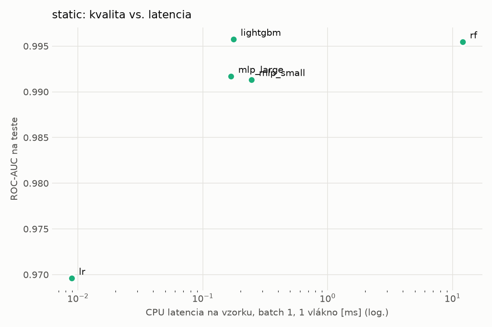
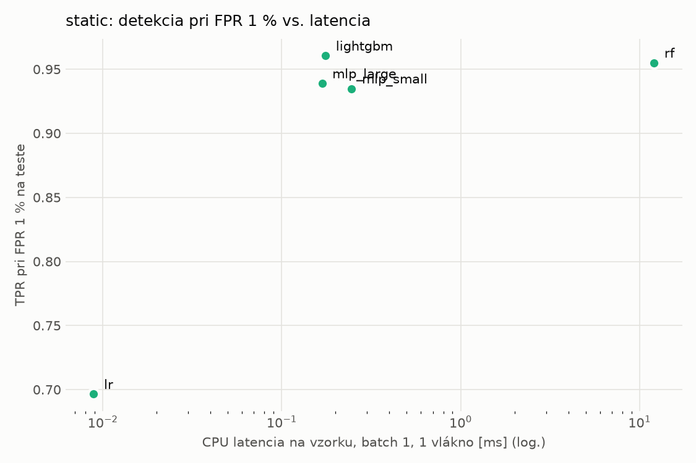
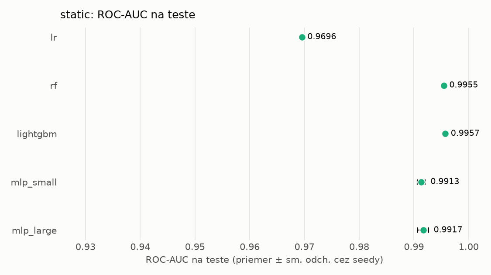
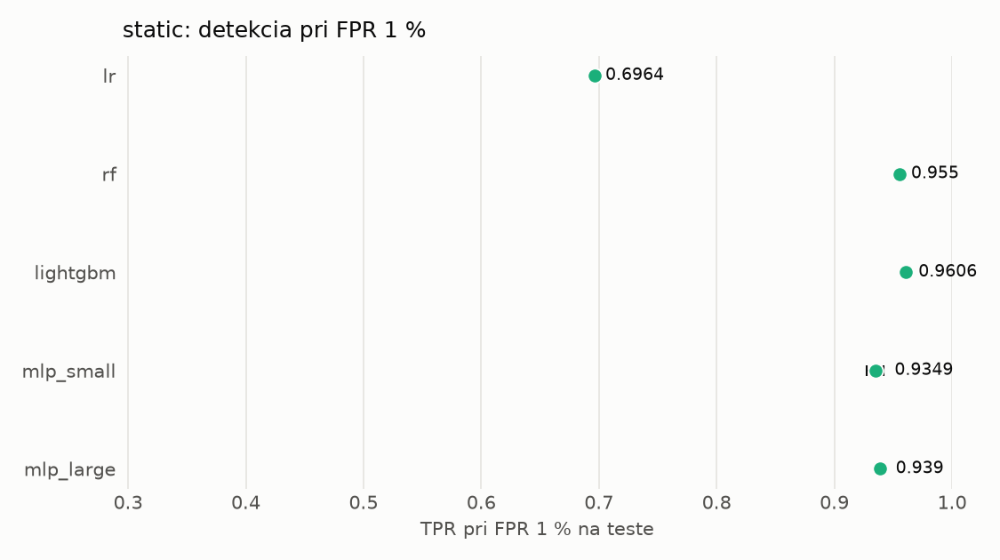

# Porovnanie modelov – static

> Generované `src/evaluation/compare.py` (2026-11-22T22:51:37+01:00); použitý je posledný beh každého modelu.
> Metriky sú priemer cez seedy. \* = pri prahu určenom na validácii (FPR ≤ 1 %).
> CPU ms/vz. = medián latencie jednej vzorky na 1 vlákne vrátane transformácie vstupu (meranie hneď po tréningu,
> orientačné). Oficiálne merania spotreby sú v časti „Spotreba zdrojov pri inferencii“.

## Detekčná kvalita a orientačné časy
| model | ROC-AUC val | ROC-AUC test | TPR@FPR 1 % test | TPR@FPR 0,1 % test | F1 test* | FPR test* | gap train−val | CPU ms/vz. | CPU vz./s | GPU ms/vz. | parametre | MB | tréning s | ladenie min |
|---|---|---|---|---|---|---|---|---|---|---|---|---|---|---|
| [lr](../../static/lr/20261122-224833/README.md) | 0.9678 | 0.9696 ± 0.0000 | 0.6964 | 0.2398 | 0.7754 | 0.0079 | 0.0036 | 0.009 | 3 822 256 | – | 164 | 0.01 | 0.2 | 0.0 |
| [rf](../../static/rf/20261122-224837/README.md) | 0.9943 | 0.9955 ± 0.0001 | 0.9550 | 0.8697 | 0.9670 | 0.0060 | 0.0057 | 12.050 | 150 733 | – | 2 635 900 | 211.25 | 1.9 | 0.0 |
| [lightgbm](../../static/lightgbm/20261122-224851/README.md) | 0.9947 | 0.9957 ± 0.0000 | 0.9606 | 0.8428 | 0.9684 | 0.0059 | 0.0053 | 0.176 | 82 304 | – | 618 919 | 34.38 | 12.6 | 0.0 |
| [mlp_small](../../static/mlp_small/20261122-224947/README.md) | 0.9914 | 0.9913 ± 0.0007 | 0.9349 | 0.7028 | 0.9462 | 0.0060 | 0.0067 | 0.246 | 1 538 393 | 0.647 | 75 777 | 0.32 | 15.1 | 0.0 |
| [mlp_large](../../static/mlp_large/20261122-225035/README.md) | 0.9917 | 0.9917 ± 0.0010 | 0.9390 | 0.7056 | 0.9498 | 0.0063 | 0.0063 | 0.168 | 895 872 | 0.439 | 250 113 | 1.02 | 19.8 | 0.0 |

## Nízka prevalencia malvéru (test, prah z validácie)
| model | TPR | FPR | precision @ 1 % | falošné na 1 skutočný poplach @ 1 % | precision @ 0.1 % | falošné na 1 skutočný poplach @ 0.1 % |
|---|---|---|---|---|---|---|
| lr | 0.6376 | 0.0079 | 0.449 | 1.23 | 0.075 | 12.36 |
| rf | 0.9411 | 0.0060 | 0.614 | 0.63 | 0.136 | 6.35 |
| lightgbm | 0.9436 | 0.0059 | 0.618 | 0.62 | 0.138 | 6.24 |
| mlp_small | 0.9028 | 0.0060 | 0.602 | 0.66 | 0.130 | 6.67 |
| mlp_large | 0.9094 | 0.0063 | 0.593 | 0.69 | 0.126 | 6.92 |

Prepočet: TPR a FPR nezávisia od podielu malvéru, preto sa dajú preniesť na nízku prevalenciu (v reálnej prevádzke je malvéru ~1 % alebo menej; v teste 54 %). „Falošné na 1 skutočný poplach“ = koľko neškodných súborov je označených na každý zachytený malvér.

## Spotreba zdrojov pri inferencii (benchmark, testovacia množina)
_Benchmark zatiaľ nebol spustený (`python -m src.evaluation.benchmark --approach static`)._

## Grafy

