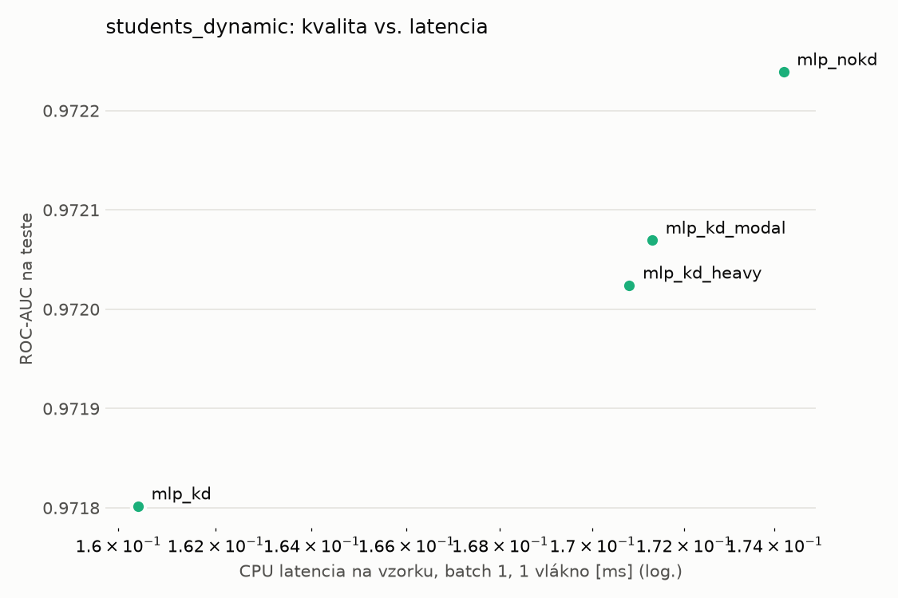
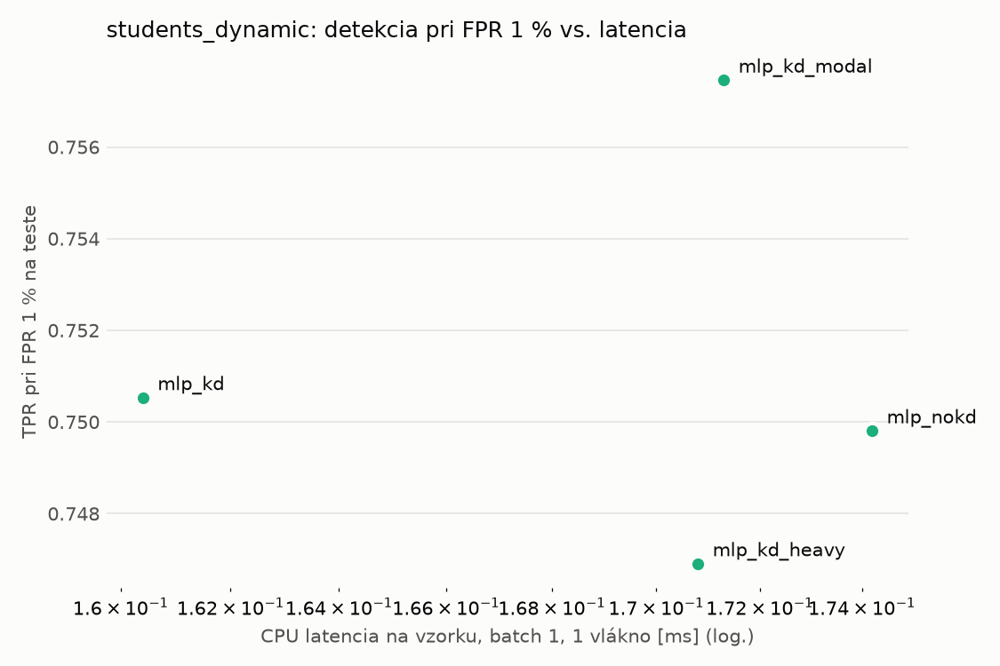
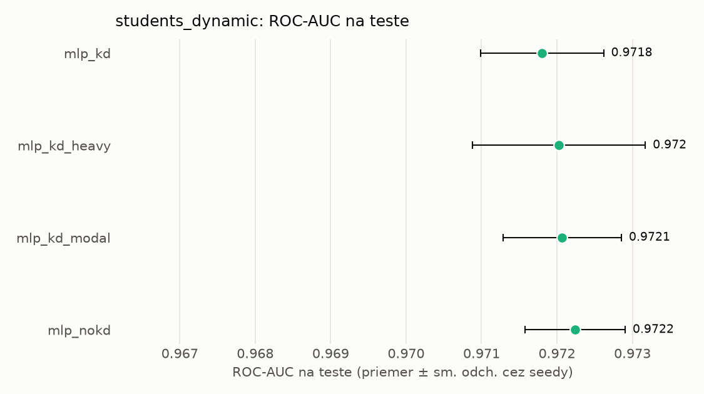
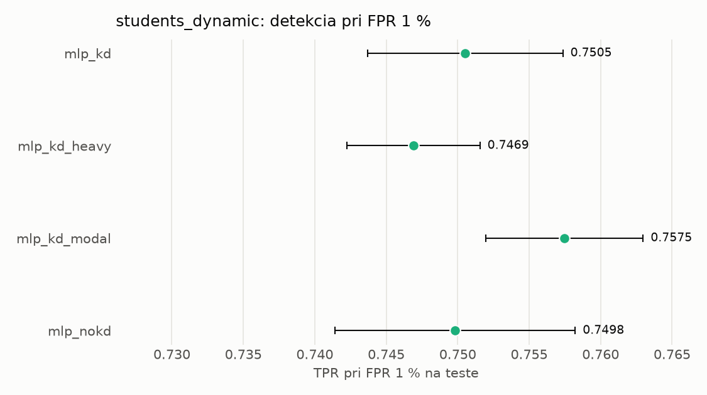

# Porovnanie modelov – students_dynamic

> Generované `src/evaluation/compare.py` (2026-11-22T23:07:58+01:00); použitý je posledný beh každého modelu.
> Metriky sú priemer cez seedy. \* = pri prahu určenom na validácii (FPR ≤ 1 %).
> CPU ms/vz. = medián latencie jednej vzorky na 1 vlákne vrátane transformácie vstupu (meranie hneď po tréningu,
> orientačné). Oficiálne merania spotreby sú v časti „Spotreba zdrojov pri inferencii“.

## Detekčná kvalita a orientačné časy
| model | ROC-AUC val | ROC-AUC test | TPR@FPR 1 % test | TPR@FPR 0,1 % test | F1 test* | FPR test* | gap train−val | CPU ms/vz. | CPU vz./s | GPU ms/vz. | parametre | MB | tréning s | ladenie min |
|---|---|---|---|---|---|---|---|---|---|---|---|---|---|---|
| [mlp_kd](../../students_dynamic/mlp_kd/20261122-230432/README.md) | 0.9692 | 0.9718 ± 0.0008 | 0.7505 | 0.5608 | 0.8494 | 0.0094 | 0.0060 | 0.160 | 7 309 258 | 0.275 | 8 641 | 0.04 | 14.4 | 0.0 |
| [mlp_kd_heavy](../../students_dynamic/mlp_kd_heavy/20261122-230654/README.md) | 0.9694 | 0.9720 ± 0.0011 | 0.7469 | 0.5376 | 0.8483 | 0.0096 | 0.0077 | 0.171 | 4 339 313 | 0.456 | 8 641 | 0.04 | 20.5 | 0.0 |
| [mlp_kd_modal](../../students_dynamic/mlp_kd_modal/20261122-230614/README.md) | 0.9703 | 0.9721 ± 0.0008 | 0.7575 | 0.5607 | 0.8515 | 0.0090 | 0.0052 | 0.171 | 8 102 152 | 0.451 | 8 641 | 0.04 | 12.7 | 0.0 |
| [mlp_nokd](../../students_dynamic/mlp_nokd/20261122-230517/README.md) | 0.9696 | 0.9722 ± 0.0007 | 0.7498 | 0.5628 | 0.8402 | 0.0075 | 0.0090 | 0.174 | 9 393 411 | 0.452 | 8 641 | 0.04 | 18.3 | 0.0 |

## Nízka prevalencia malvéru (test, prah z validácie)
| model | TPR | FPR | precision @ 1 % | falošné na 1 skutočný poplach @ 1 % | precision @ 0.1 % | falošné na 1 skutočný poplach @ 0.1 % |
|---|---|---|---|---|---|---|
| mlp_kd | 0.7444 | 0.0094 | 0.445 | 1.25 | 0.074 | 12.60 |
| mlp_kd_heavy | 0.7429 | 0.0096 | 0.440 | 1.28 | 0.072 | 12.87 |
| mlp_kd_modal | 0.7474 | 0.0090 | 0.455 | 1.20 | 0.077 | 12.06 |
| mlp_nokd | 0.7294 | 0.0075 | 0.495 | 1.02 | 0.088 | 10.31 |

Prepočet: TPR a FPR nezávisia od podielu malvéru, preto sa dajú preniesť na nízku prevalenciu (v reálnej prevádzke je malvéru ~1 % alebo menej; v teste 54 %). „Falošné na 1 skutočný poplach“ = koľko neškodných súborov je označených na každý zachytený malvér.

## Spotreba zdrojov pri inferencii (benchmark, testovacia množina)
_Benchmark zatiaľ nebol spustený (`python -m src.evaluation.benchmark --approach students_dynamic`)._

## Grafy

