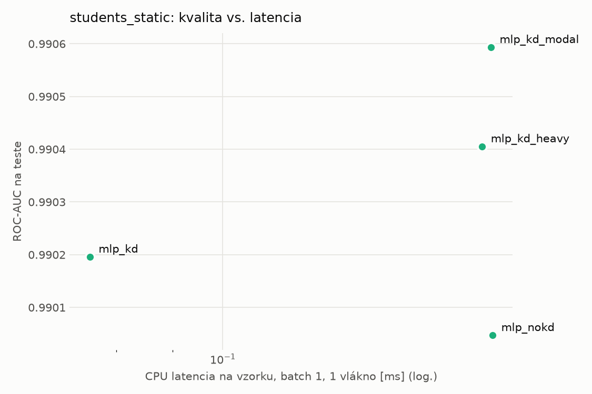
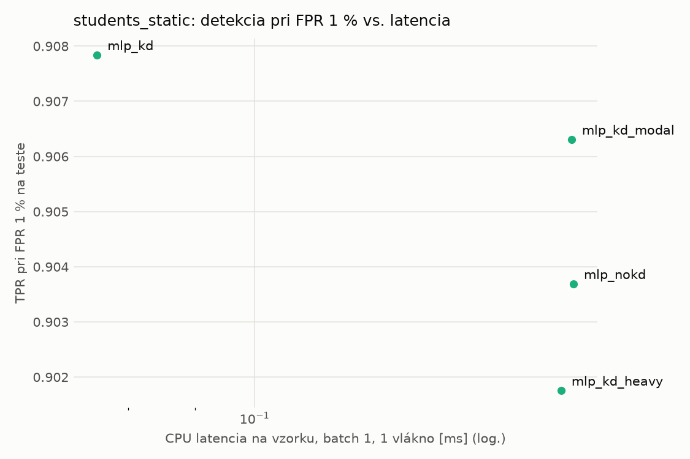
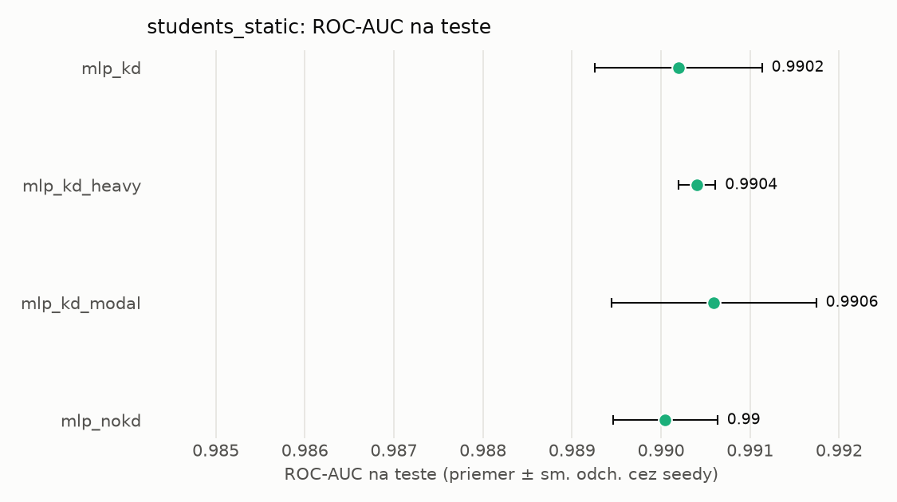
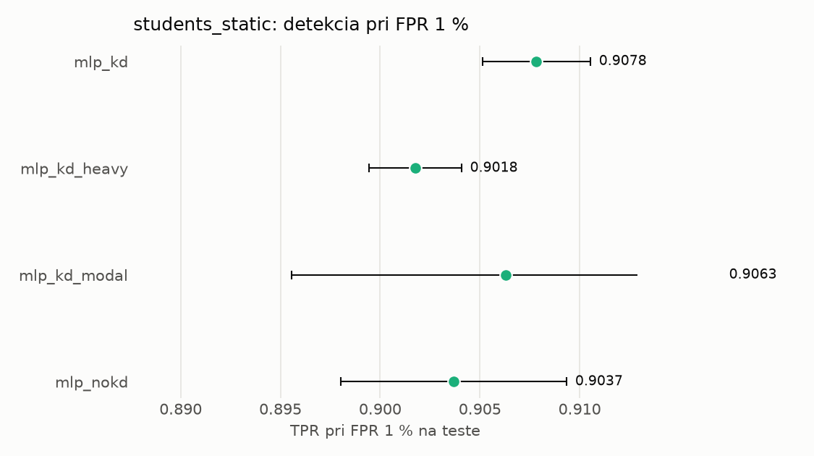

# Porovnanie modelov – students_static

> Generované `src/evaluation/compare.py` (2026-11-22T23:04:29+01:00); použitý je posledný beh každého modelu.
> Metriky sú priemer cez seedy. \* = pri prahu určenom na validácii (FPR ≤ 1 %).
> CPU ms/vz. = medián latencie jednej vzorky na 1 vlákne vrátane transformácie vstupu (meranie hneď po tréningu,
> orientačné). Oficiálne merania spotreby sú v časti „Spotreba zdrojov pri inferencii“.

## Detekčná kvalita a orientačné časy
| model | ROC-AUC val | ROC-AUC test | TPR@FPR 1 % test | TPR@FPR 0,1 % test | F1 test* | FPR test* | gap train−val | CPU ms/vz. | CPU vz./s | GPU ms/vz. | parametre | MB | tréning s | ladenie min |
|---|---|---|---|---|---|---|---|---|---|---|---|---|---|---|
| [mlp_kd](../../students_static/mlp_kd/20261122-230257/README.md) | 0.9896 | 0.9902 ± 0.0009 | 0.9078 | 0.6774 | 0.9374 | 0.0073 | 0.0045 | 0.076 | 2 695 964 | 0.452 | 10 689 | 0.05 | 5.8 | 0.0 |
| [mlp_kd_heavy](../../students_static/mlp_kd_heavy/20261122-230409/README.md) | 0.9888 | 0.9904 ± 0.0002 | 0.9018 | 0.7368 | 0.9322 | 0.0069 | 0.0048 | 0.172 | 2 705 440 | 0.452 | 10 689 | 0.05 | 5.9 | 0.0 |
| [mlp_kd_modal](../../students_static/mlp_kd_modal/20261122-230351/README.md) | 0.9896 | 0.9906 ± 0.0011 | 0.9063 | 0.7160 | 0.9303 | 0.0065 | 0.0037 | 0.175 | 2 046 041 | 0.276 | 10 689 | 0.05 | 5.4 | 0.0 |
| [mlp_nokd](../../students_static/mlp_nokd/20261122-230316/README.md) | 0.9890 | 0.9900 ± 0.0006 | 0.9037 | 0.6257 | 0.9323 | 0.0071 | 0.0057 | 0.176 | 1 939 307 | 0.292 | 10 689 | 0.05 | 10.9 | 0.0 |

## Nízka prevalencia malvéru (test, prah z validácie)
| model | TPR | FPR | precision @ 1 % | falošné na 1 skutočný poplach @ 1 % | precision @ 0.1 % | falošné na 1 skutočný poplach @ 0.1 % |
|---|---|---|---|---|---|---|
| mlp_kd | 0.8880 | 0.0073 | 0.550 | 0.82 | 0.108 | 8.27 |
| mlp_kd_heavy | 0.8784 | 0.0069 | 0.563 | 0.78 | 0.113 | 7.84 |
| mlp_kd_modal | 0.8747 | 0.0065 | 0.577 | 0.73 | 0.119 | 7.41 |
| mlp_nokd | 0.8787 | 0.0071 | 0.556 | 0.80 | 0.111 | 8.04 |

Prepočet: TPR a FPR nezávisia od podielu malvéru, preto sa dajú preniesť na nízku prevalenciu (v reálnej prevádzke je malvéru ~1 % alebo menej; v teste 54 %). „Falošné na 1 skutočný poplach“ = koľko neškodných súborov je označených na každý zachytený malvér.

## Spotreba zdrojov pri inferencii (benchmark, testovacia množina)
_Benchmark zatiaľ nebol spustený (`python -m src.evaluation.benchmark --approach students_static`)._

## Grafy

