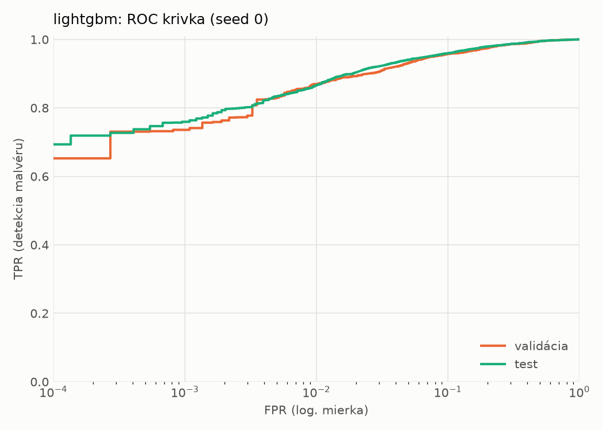
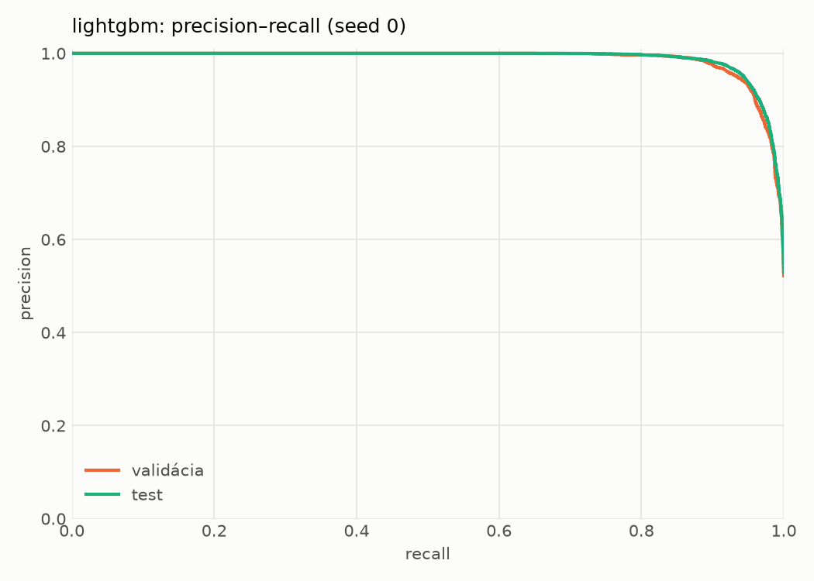
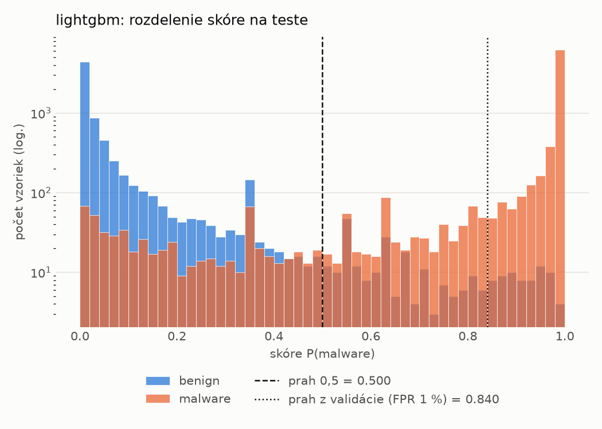
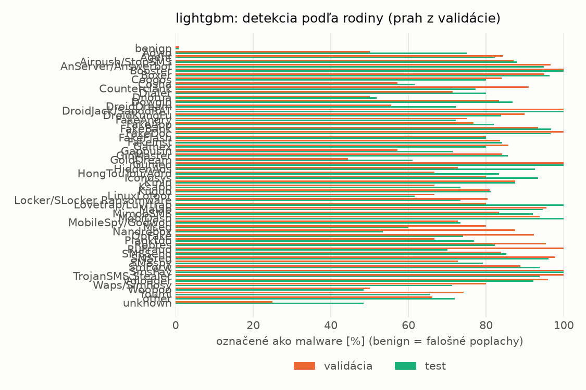
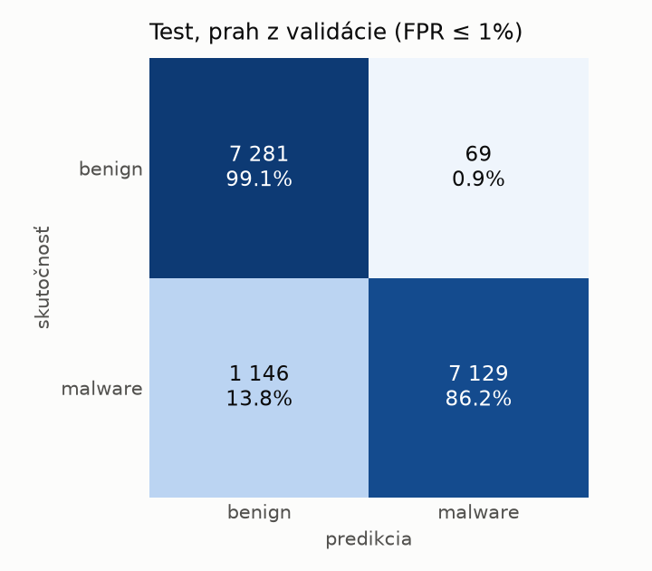
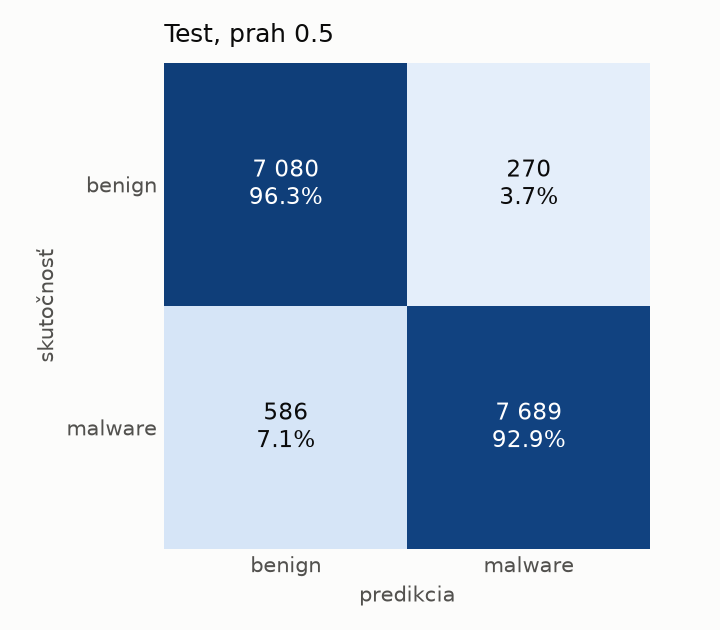
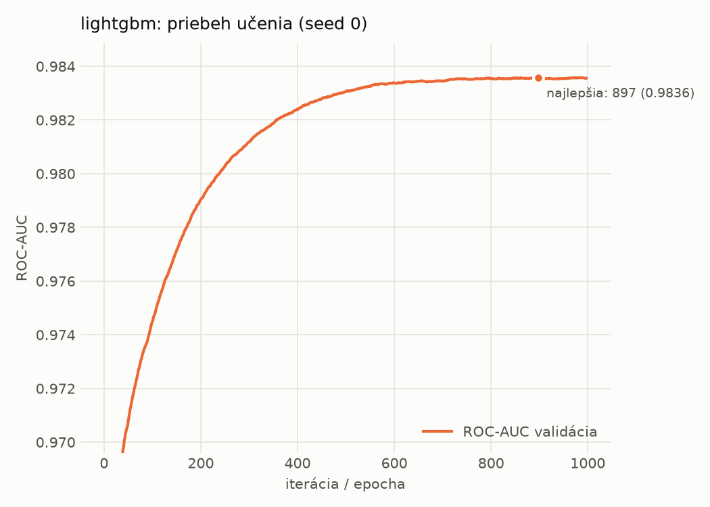

# dynamic/lightgbm – beh `20261122-225203`

> Automaticky generované (`src/training/run_tabular.py`). Konfigurácia: `config.yaml`, protokol: `protocol.yaml`.

- **Model:** `lightgbm` – LightGBM, gradient boosting stromov s early stopping na validácii (pôvodné hodnoty príznakov)
- **Ladenie:** bez ladenia – hyperparametre prevzaté z `runs_v4/real_full/full/dynamic/lightgbm/20261122-191914`
- **Finálne modely:** seedy [0, 1, 2]; hodnoty sú priemer ± smerodajná odchýlka cez seedy
- **Najlepšie hyperparametre:** `{"num_boost_round": 5000, "early_stopping_rounds": 100, "learning_rate": 0.017901592505193763, "num_leaves": 251, "min_child_samples": 52, "feature_fraction": 0.9358255991772038, "bagging_fraction": 0.8815171244905227, "lambda_l1": 0.02987319702672823, "lambda_l2": 0.017348460156736675}`

## Detekčná kvalita (bez prahu)
| metrika | train (podvzorka) | validácia | test |
|---|---|---|---|
| ROC-AUC | 0.9992 ± 0.0000 | 0.9837 ± 0.0001 | 0.9852 ± 0.0001 |
| PR-AUC | 0.9992 ± 0.0000 | 0.9875 ± 0.0001 | 0.9890 ± 0.0000 |
| TPR pri FPR 1 % | 0.9722 ± 0.0005 | 0.8687 ± 0.0010 | 0.8686 ± 0.0028 |
| TPR pri FPR 0,1 % | 0.9627 ± 0.0016 | 0.7316 ± 0.0055 | 0.7680 ± 0.0080 |
| log loss | 0.0461 ± 0.0015 | 0.1563 ± 0.0007 | 0.1482 ± 0.0005 |
| Brier skóre | 0.0113 ± 0.0004 | 0.0449 ± 0.0000 | 0.0423 ± 0.0002 |

Rozdiel ROC-AUC train − validácia: **0.0155** (veľký rozdiel = preučenie).

## Pri prahu z validácie (FPR ≤ 1% na validácii)
| metrika | train (podvzorka) | validácia | test |
|---|---|---|---|
| accuracy | 0.9707 ± 0.0008 | 0.9269 ± 0.0006 | 0.9233 ± 0.0011 |
| balanced accuracy | 0.9716 ± 0.0008 | 0.9295 ± 0.0006 | 0.9271 ± 0.0011 |
| precision | 0.9996 ± 0.0000 | 0.9899 ± 0.0002 | 0.9904 ± 0.0001 |
| recall (TPR) | 0.9437 ± 0.0016 | 0.8687 ± 0.0010 | 0.8636 ± 0.0022 |
| FPR | 0.0004 ± 0.0000 | 0.0097 ± 0.0002 | 0.0094 ± 0.0001 |
| F1 | 0.9708 ± 0.0008 | 0.9254 ± 0.0006 | 0.9227 ± 0.0012 |
| MCC | 0.9430 ± 0.0015 | 0.8613 ± 0.0011 | 0.8552 ± 0.0020 |

## Pri pevnom prahu 0.5
| metrika | train (podvzorka) | validácia | test |
|---|---|---|---|
| accuracy | 0.9848 ± 0.0003 | 0.9388 ± 0.0003 | 0.9452 ± 0.0000 |
| balanced accuracy | 0.9849 ± 0.0003 | 0.9395 ± 0.0004 | 0.9462 ± 0.0001 |
| precision | 0.9895 ± 0.0000 | 0.9574 ± 0.0005 | 0.9657 ± 0.0005 |
| recall (TPR) | 0.9810 ± 0.0006 | 0.9239 ± 0.0002 | 0.9295 ± 0.0005 |
| FPR | 0.0112 ± 0.0000 | 0.0449 ± 0.0005 | 0.0372 ± 0.0006 |
| F1 | 0.9852 ± 0.0003 | 0.9404 ± 0.0003 | 0.9472 ± 0.0000 |
| MCC | 0.9695 ± 0.0006 | 0.8782 ± 0.0007 | 0.8909 ± 0.0001 |

## Výpočtové nároky (seed 0, testovacia množina)
| meranie | hodnota |
|---|---|
| tréning finálneho modelu | 16.9 s (priemer cez seedy) |
| ladenie spolu | 0 s |
| počet parametrov / uzlov | 449 397 |
| veľkosť modelu na disku | 24.69 MB |
| CPU latencia modelu (batch 1, 1 vlákno) | 0.168 ms (p95 0.195) |
| CPU priepustnosť (24 vlákien) | 76 865 vzoriek/s |

## Grafy
| | |
|---|---|
|  |  |
|  |  |
|  |  |
|  |  |

## Súbory
`metrics.json` (všetky metriky po seedoch vrátane rodín), `timing.json`, `hpo_trials.csv`,
`predictions/<časť>_seed<N>.parquet` (sha256, family, label, score), `model/seed_<N>/`, `log.txt`.
