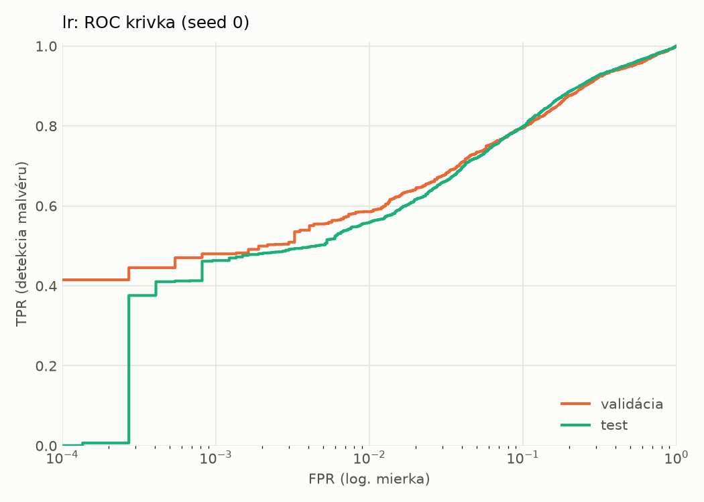
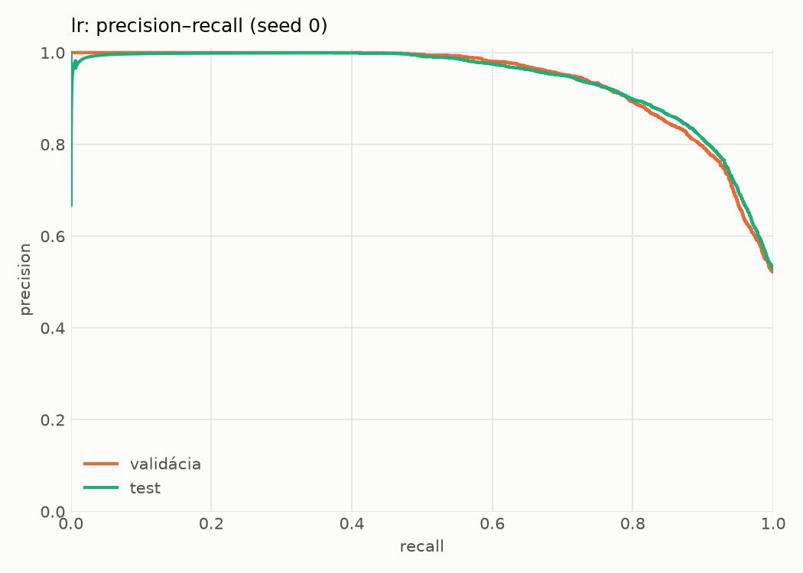
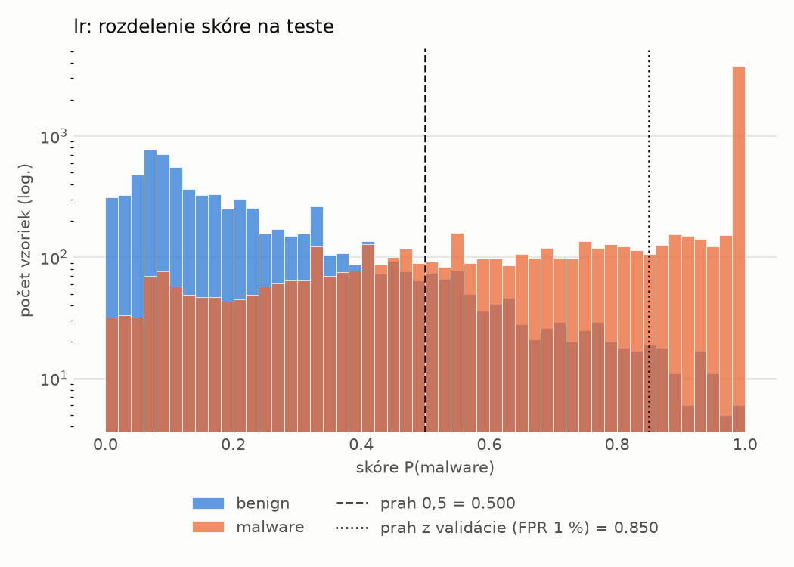
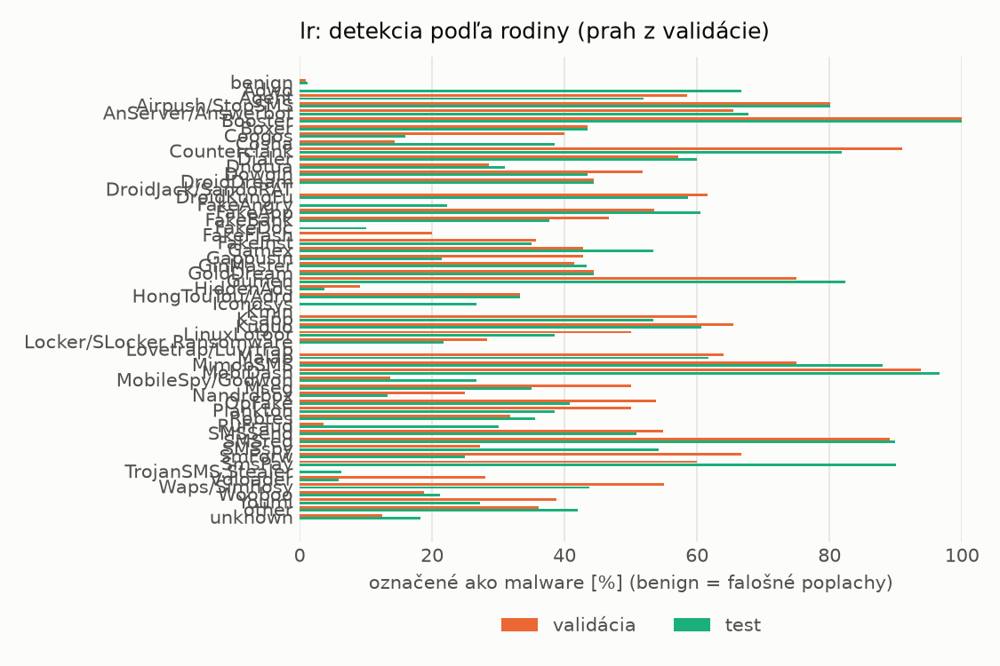
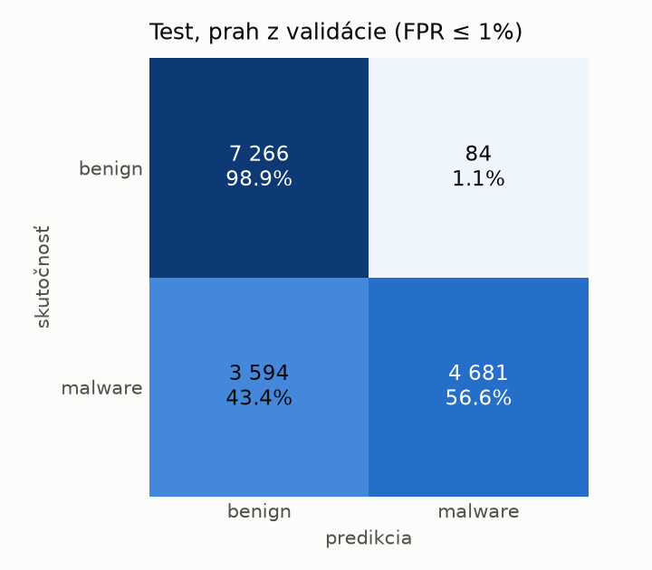
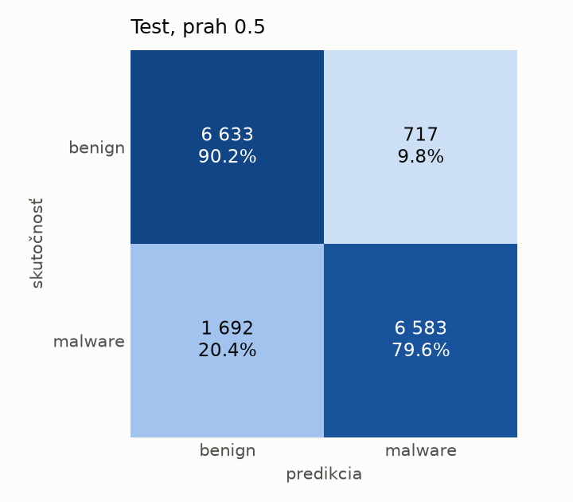

# dynamic/lr – beh `20261122-225140`

> Automaticky generované (`src/training/run_tabular.py`). Konfigurácia: `config.yaml`, protokol: `protocol.yaml`.

- **Model:** `logreg` – logistická regresia s L2 regularizáciou (vstup signed log1p + štandardizácia)
- **Ladenie:** bez ladenia – hyperparametre prevzaté z `runs_v4/real_full/full/dynamic/lr/20261122-191725`
- **Finálne modely:** seedy [0, 1, 2]; hodnoty sú priemer ± smerodajná odchýlka cez seedy
- **Najlepšie hyperparametre:** `{"max_iter": 2000, "C": 3.784688828069828}`

## Detekčná kvalita (bez prahu)
| metrika | train (podvzorka) | validácia | test |
|---|---|---|---|
| ROC-AUC | 0.9191 ± 0.0000 | 0.9198 ± 0.0000 | 0.9227 ± 0.0000 |
| PR-AUC | 0.9372 ± 0.0000 | 0.9406 ± 0.0000 | 0.9416 ± 0.0000 |
| TPR pri FPR 1 % | 0.5585 ± 0.0000 | 0.5855 ± 0.0000 | 0.5584 ± 0.0000 |
| TPR pri FPR 0,1 % | 0.4295 ± 0.0000 | 0.4800 ± 0.0000 | 0.4633 ± 0.0000 |
| log loss | 0.3524 ± 0.0000 | 0.3489 ± 0.0000 | 0.3509 ± 0.0000 |
| Brier skóre | 0.1103 ± 0.0000 | 0.1092 ± 0.0000 | 0.1094 ± 0.0000 |

Rozdiel ROC-AUC train − validácia: **-0.0007** (veľký rozdiel = preučenie).

## Pri prahu z validácie (FPR ≤ 1% na validácii)
| metrika | train (podvzorka) | validácia | test |
|---|---|---|---|
| accuracy | 0.7820 ± 0.0000 | 0.7793 ± 0.0000 | 0.7646 ± 0.0000 |
| balanced accuracy | 0.7888 ± 0.0000 | 0.7881 ± 0.0000 | 0.7771 ± 0.0000 |
| precision | 0.9758 ± 0.0000 | 0.9857 ± 0.0000 | 0.9824 ± 0.0000 |
| recall (TPR) | 0.5933 ± 0.0000 | 0.5855 ± 0.0000 | 0.5657 ± 0.0000 |
| FPR | 0.0157 ± 0.0000 | 0.0093 ± 0.0000 | 0.0114 ± 0.0000 |
| F1 | 0.7379 ± 0.0000 | 0.7347 ± 0.0000 | 0.7179 ± 0.0000 |
| MCC | 0.6215 ± 0.0000 | 0.6225 ± 0.0000 | 0.6009 ± 0.0000 |

## Pri pevnom prahu 0.5
| metrika | train (podvzorka) | validácia | test |
|---|---|---|---|
| accuracy | 0.8478 ± 0.0000 | 0.8455 ± 0.0000 | 0.8458 ± 0.0000 |
| balanced accuracy | 0.8494 ± 0.0000 | 0.8477 ± 0.0000 | 0.8490 ± 0.0000 |
| precision | 0.8915 ± 0.0000 | 0.8935 ± 0.0000 | 0.9018 ± 0.0000 |
| recall (TPR) | 0.8036 ± 0.0000 | 0.7993 ± 0.0000 | 0.7955 ± 0.0000 |
| FPR | 0.1048 ± 0.0000 | 0.1039 ± 0.0000 | 0.0976 ± 0.0000 |
| F1 | 0.8453 ± 0.0000 | 0.8438 ± 0.0000 | 0.8453 ± 0.0000 |
| MCC | 0.6999 ± 0.0000 | 0.6962 ± 0.0000 | 0.6983 ± 0.0000 |

## Výpočtové nároky (seed 0, testovacia množina)
| meranie | hodnota |
|---|---|
| tréning finálneho modelu | 0.4 s (priemer cez seedy) |
| ladenie spolu | 0 s |
| počet parametrov / uzlov | 132 |
| veľkosť modelu na disku | 0.01 MB |
| transformácia vstupu – latencia (1 vlákno) | 0.005 ms |
| transformácia vstupu – priepustnosť | 1 337 871 vzoriek/s |
| CPU latencia modelu (batch 1, 1 vlákno) | 0.004 ms (p95 0.004) |
| CPU priepustnosť (24 vlákien) | 4 370 385 vzoriek/s |

## Grafy
| | |
|---|---|
|  |  |
|  |  |
|  |  |
|  |  |

## Súbory
`metrics.json` (všetky metriky po seedoch vrátane rodín), `timing.json`, `hpo_trials.csv`,
`predictions/<časť>_seed<N>.parquet` (sha256, family, label, score), `model/seed_<N>/`, `log.txt`.
