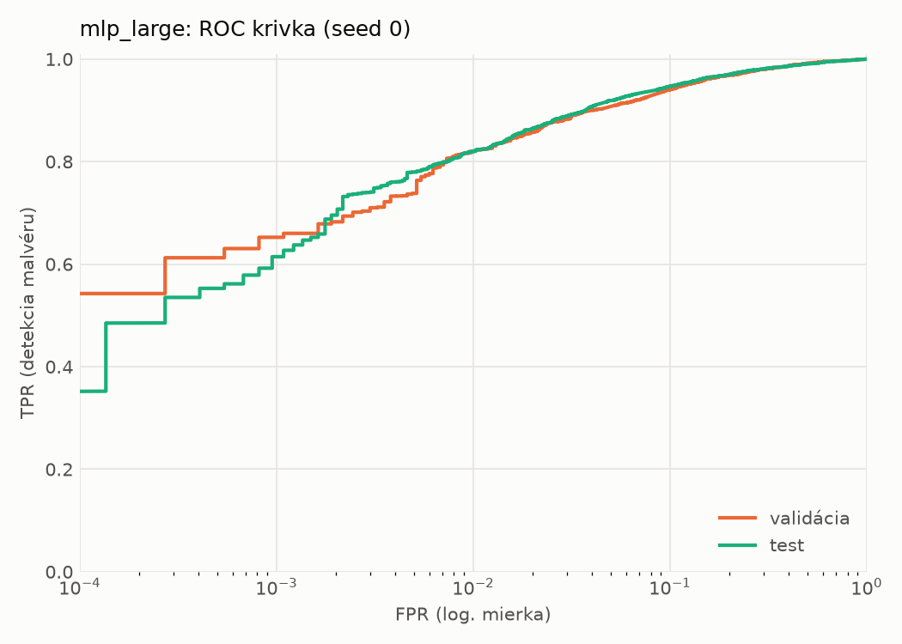
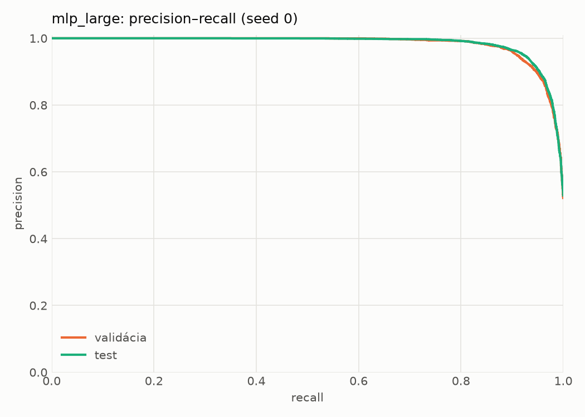
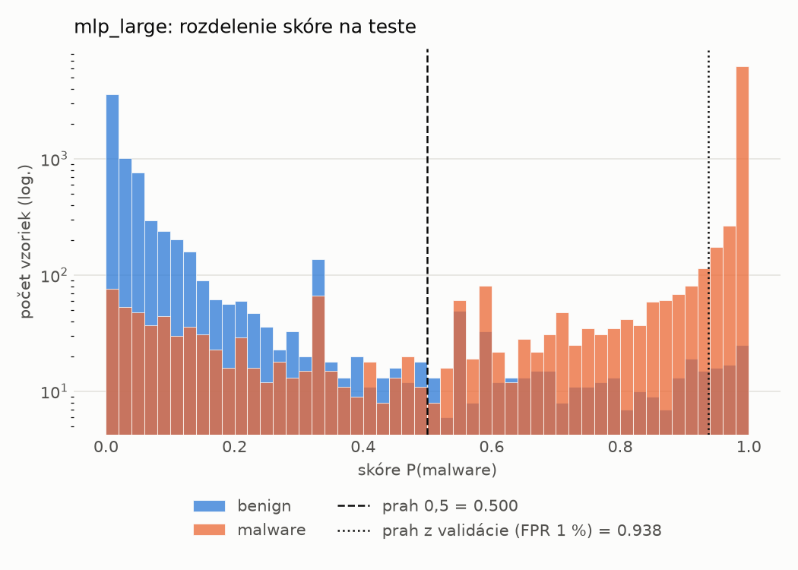
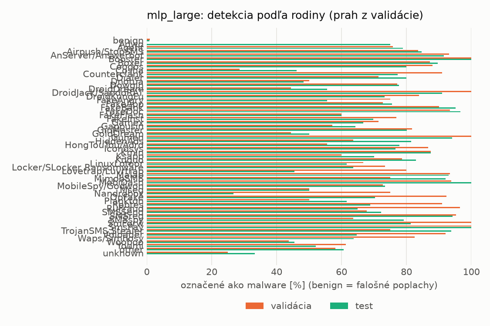
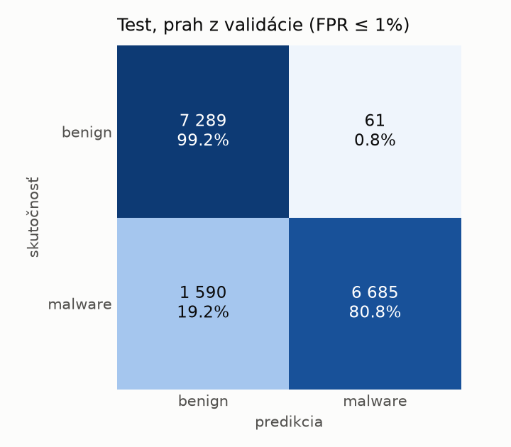
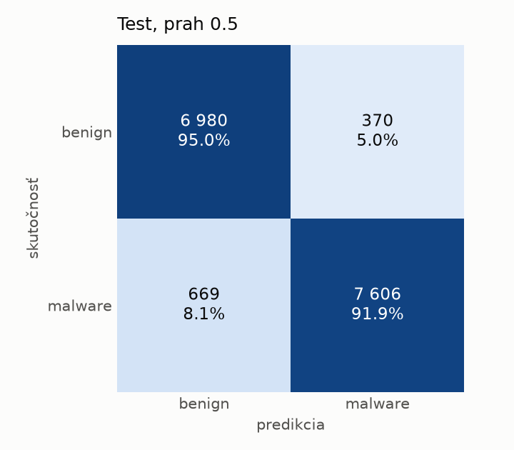
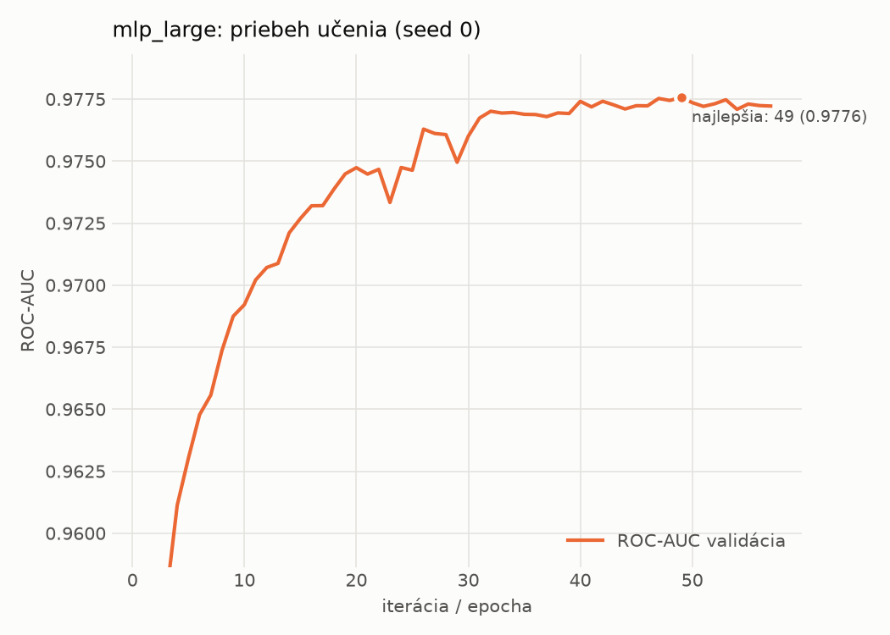

# dynamic/mlp_large – beh `20261122-225419`

> Automaticky generované (`src/training/run_tabular.py`). Konfigurácia: `config.yaml`, protokol: `protocol.yaml`.

- **Model:** `mlp` – veľká neurónová sieť (3–5 skrytých vrstiev, 512–2048 neurónov), kandidát na učiteľa
- **Ladenie:** bez ladenia – hyperparametre prevzaté z `runs_v4/real_full/full/dynamic/mlp_large/20261122-194320`
- **Finálne modely:** seedy [0, 1, 2]; hodnoty sú priemer ± smerodajná odchýlka cez seedy
- **Najlepšie hyperparametre:** `{"max_epochs": 100, "patience": 8, "hidden_layers": 3, "hidden_width": 512, "width_decay": 1.0, "dropout": 0.16077310300541978, "lr": 0.0005048635567863703, "weight_decay": 0.004783411439856203, "batch_size": 1024}`

## Detekčná kvalita (bez prahu)
| metrika | train (podvzorka) | validácia | test |
|---|---|---|---|
| ROC-AUC | 0.9907 ± 0.0006 | 0.9775 ± 0.0001 | 0.9789 ± 0.0003 |
| PR-AUC | 0.9927 ± 0.0004 | 0.9827 ± 0.0002 | 0.9843 ± 0.0002 |
| TPR pri FPR 1 % | 0.9120 ± 0.0030 | 0.8165 ± 0.0052 | 0.8178 ± 0.0027 |
| TPR pri FPR 0,1 % | 0.8556 ± 0.0049 | 0.6411 ± 0.0228 | 0.6397 ± 0.0234 |
| log loss | 0.1145 ± 0.0027 | 0.1938 ± 0.0013 | 0.1838 ± 0.0014 |
| Brier skóre | 0.0329 ± 0.0008 | 0.0552 ± 0.0006 | 0.0513 ± 0.0003 |

Rozdiel ROC-AUC train − validácia: **0.0132** (veľký rozdiel = preučenie).

## Pri prahu z validácie (FPR ≤ 1% na validácii)
| metrika | train (podvzorka) | validácia | test |
|---|---|---|---|
| accuracy | 0.9142 ± 0.0035 | 0.8995 ± 0.0027 | 0.8918 ± 0.0031 |
| balanced accuracy | 0.9170 ± 0.0033 | 0.9033 ± 0.0026 | 0.8974 ± 0.0029 |
| precision | 0.9993 ± 0.0002 | 0.9891 ± 0.0001 | 0.9913 ± 0.0004 |
| recall (TPR) | 0.8347 ± 0.0067 | 0.8165 ± 0.0052 | 0.8027 ± 0.0062 |
| FPR | 0.0006 ± 0.0002 | 0.0098 ± 0.0000 | 0.0079 ± 0.0004 |
| F1 | 0.9096 ± 0.0040 | 0.8945 ± 0.0032 | 0.8871 ± 0.0036 |
| MCC | 0.8414 ± 0.0059 | 0.8138 ± 0.0046 | 0.8016 ± 0.0050 |

## Pri pevnom prahu 0.5
| metrika | train (podvzorka) | validácia | test |
|---|---|---|---|
| accuracy | 0.9573 ± 0.0010 | 0.9266 ± 0.0012 | 0.9332 ± 0.0004 |
| balanced accuracy | 0.9579 ± 0.0010 | 0.9271 ± 0.0013 | 0.9340 ± 0.0004 |
| precision | 0.9739 ± 0.0021 | 0.9437 ± 0.0024 | 0.9525 ± 0.0013 |
| recall (TPR) | 0.9428 ± 0.0004 | 0.9138 ± 0.0006 | 0.9197 ± 0.0017 |
| FPR | 0.0271 ± 0.0022 | 0.0595 ± 0.0028 | 0.0516 ± 0.0015 |
| F1 | 0.9581 ± 0.0009 | 0.9285 ± 0.0011 | 0.9358 ± 0.0005 |
| MCC | 0.9152 ± 0.0021 | 0.8535 ± 0.0025 | 0.8668 ± 0.0009 |

## Výpočtové nároky (seed 0, testovacia množina)
| meranie | hodnota |
|---|---|
| tréning finálneho modelu | 6.4 s (priemer cez seedy) |
| ladenie spolu | 0 s |
| počet parametrov / uzlov | 596 481 |
| veľkosť modelu na disku | 2.41 MB |
| transformácia vstupu – latencia (1 vlákno) | 0.015 ms |
| transformácia vstupu – priepustnosť | 737 763 vzoriek/s |
| CPU latencia modelu (batch 1, 1 vlákno) | 0.180 ms (p95 0.357) |
| CPU priepustnosť (24 vlákien) | 630 755 vzoriek/s |
| GPU latencia (batch 1) | 0.435 ms (p95 0.937) |
| GPU priepustnosť | 2 347 929 vzoriek/s |
| GPU špičková pamäť | 128 MB |

## Grafy
| | |
|---|---|
|  |  |
|  |  |
|  |  |
|  |  |

## Súbory
`metrics.json` (všetky metriky po seedoch vrátane rodín), `timing.json`, `hpo_trials.csv`,
`predictions/<časť>_seed<N>.parquet` (sha256, family, label, score), `model/seed_<N>/`, `log.txt`.
