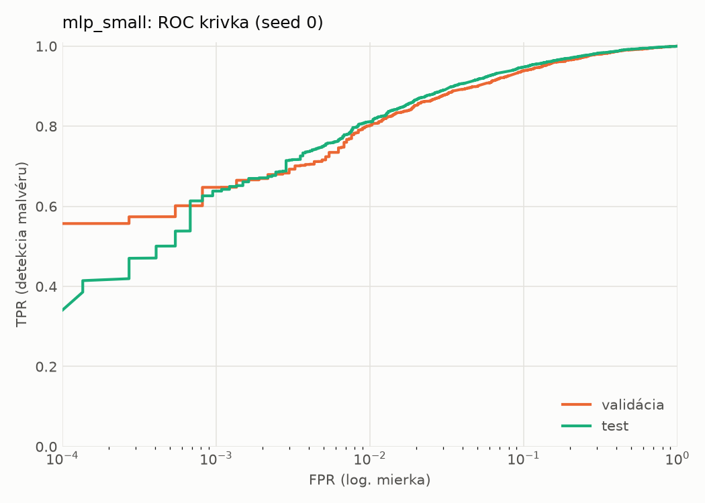
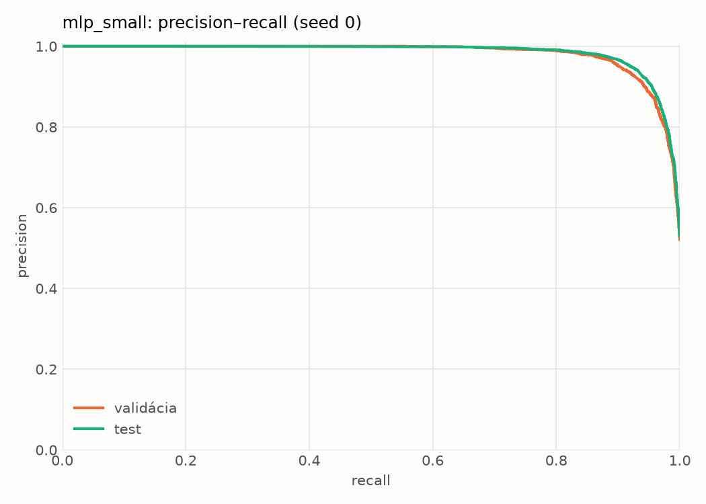
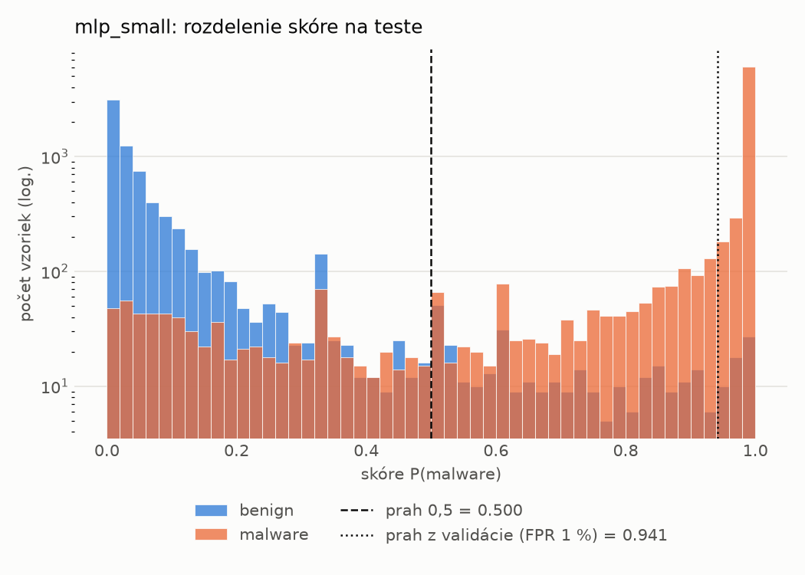
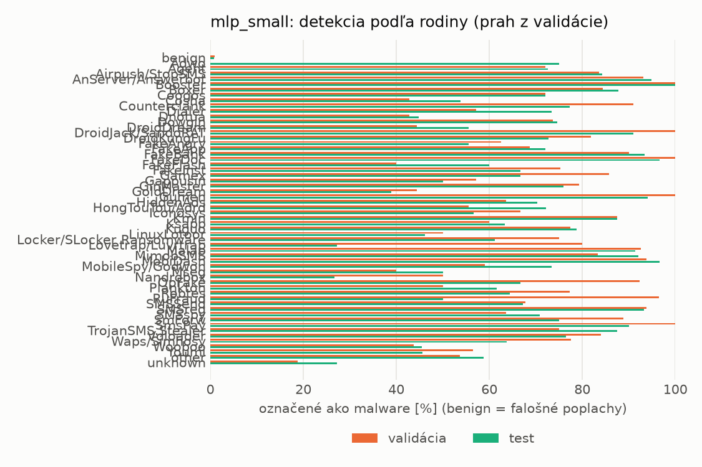
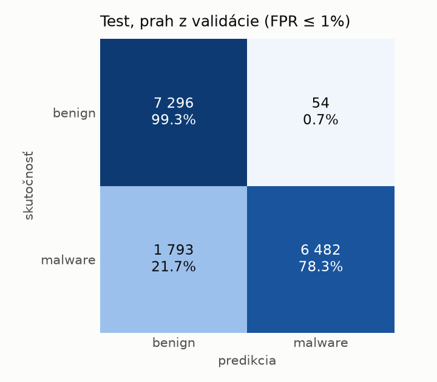
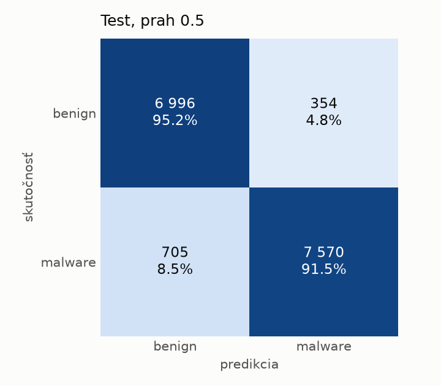
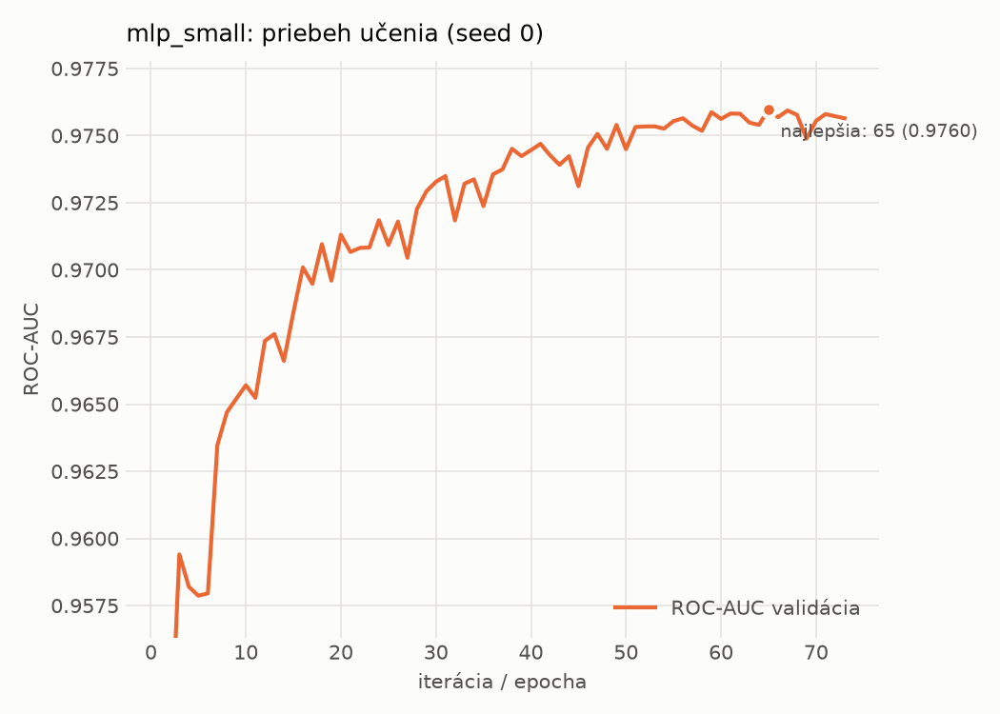

# dynamic/mlp_small – beh `20261122-225308`

> Automaticky generované (`src/training/run_tabular.py`). Konfigurácia: `config.yaml`, protokol: `protocol.yaml`.

- **Model:** `mlp` – malá neurónová sieť (1–2 skryté vrstvy), kandidát na ľahkého študenta
- **Ladenie:** bez ladenia – hyperparametre prevzaté z `runs_v4/real_full/full/dynamic/mlp_small/20261122-193213`
- **Finálne modely:** seedy [0, 1, 2]; hodnoty sú priemer ± smerodajná odchýlka cez seedy
- **Najlepšie hyperparametre:** `{"width_decay": 0.5, "max_epochs": 100, "patience": 8, "hidden_layers": 2, "hidden_width": 256, "dropout": 0.2449160262890371, "lr": 0.002872548733508973, "weight_decay": 4.509331245708397e-06, "batch_size": 256}`

## Detekčná kvalita (bez prahu)
| metrika | train (podvzorka) | validácia | test |
|---|---|---|---|
| ROC-AUC | 0.9869 ± 0.0028 | 0.9759 ± 0.0005 | 0.9780 ± 0.0009 |
| PR-AUC | 0.9899 ± 0.0020 | 0.9815 ± 0.0005 | 0.9835 ± 0.0007 |
| TPR pri FPR 1 % | 0.8853 ± 0.0191 | 0.8067 ± 0.0060 | 0.8076 ± 0.0059 |
| TPR pri FPR 0,1 % | 0.7923 ± 0.0410 | 0.6365 ± 0.0108 | 0.6446 ± 0.0114 |
| log loss | 0.1355 ± 0.0139 | 0.1968 ± 0.0012 | 0.1869 ± 0.0025 |
| Brier skóre | 0.0390 ± 0.0040 | 0.0568 ± 0.0012 | 0.0529 ± 0.0015 |

Rozdiel ROC-AUC train − validácia: **0.0111** (veľký rozdiel = preučenie).

## Pri prahu z validácie (FPR ≤ 1% na validácii)
| metrika | train (podvzorka) | validácia | test |
|---|---|---|---|
| accuracy | 0.9053 ± 0.0028 | 0.8945 ± 0.0031 | 0.8850 ± 0.0031 |
| balanced accuracy | 0.9084 ± 0.0027 | 0.8985 ± 0.0030 | 0.8910 ± 0.0029 |
| precision | 0.9983 ± 0.0013 | 0.9891 ± 0.0002 | 0.9910 ± 0.0006 |
| recall (TPR) | 0.8183 ± 0.0054 | 0.8067 ± 0.0060 | 0.7900 ± 0.0064 |
| FPR | 0.0015 ± 0.0011 | 0.0097 ± 0.0002 | 0.0081 ± 0.0006 |
| F1 | 0.8994 ± 0.0033 | 0.8886 ± 0.0037 | 0.8792 ± 0.0037 |
| MCC | 0.8259 ± 0.0048 | 0.8052 ± 0.0053 | 0.7902 ± 0.0049 |

## Pri pevnom prahu 0.5
| metrika | train (podvzorka) | validácia | test |
|---|---|---|---|
| accuracy | 0.9485 ± 0.0048 | 0.9234 ± 0.0017 | 0.9309 ± 0.0012 |
| balanced accuracy | 0.9493 ± 0.0047 | 0.9243 ± 0.0017 | 0.9323 ± 0.0009 |
| precision | 0.9716 ± 0.0038 | 0.9475 ± 0.0050 | 0.9585 ± 0.0029 |
| recall (TPR) | 0.9276 ± 0.0082 | 0.9032 ± 0.0052 | 0.9089 ± 0.0052 |
| FPR | 0.0291 ± 0.0039 | 0.0547 ± 0.0058 | 0.0444 ± 0.0035 |
| F1 | 0.9491 ± 0.0049 | 0.9248 ± 0.0017 | 0.9330 ± 0.0014 |
| MCC | 0.8981 ± 0.0094 | 0.8478 ± 0.0034 | 0.8630 ± 0.0019 |

## Výpočtové nároky (seed 0, testovacia množina)
| meranie | hodnota |
|---|---|
| tréning finálneho modelu | 23.0 s (priemer cez seedy) |
| ladenie spolu | 0 s |
| počet parametrov / uzlov | 67 585 |
| veľkosť modelu na disku | 0.28 MB |
| transformácia vstupu – latencia (1 vlákno) | 0.015 ms |
| transformácia vstupu – priepustnosť | 727 719 vzoriek/s |
| CPU latencia modelu (batch 1, 1 vlákno) | 0.231 ms (p95 0.243) |
| CPU priepustnosť (24 vlákien) | 2 325 876 vzoriek/s |
| GPU latencia (batch 1) | 0.640 ms (p95 0.668) |
| GPU priepustnosť | 2 061 210 vzoriek/s |
| GPU špičková pamäť | 75 MB |

## Grafy
| | |
|---|---|
|  |  |
|  |  |
|  |  |
|  |  |

## Súbory
`metrics.json` (všetky metriky po seedoch vrátane rodín), `timing.json`, `hpo_trials.csv`,
`predictions/<časť>_seed<N>.parquet` (sha256, family, label, score), `model/seed_<N>/`, `log.txt`.
