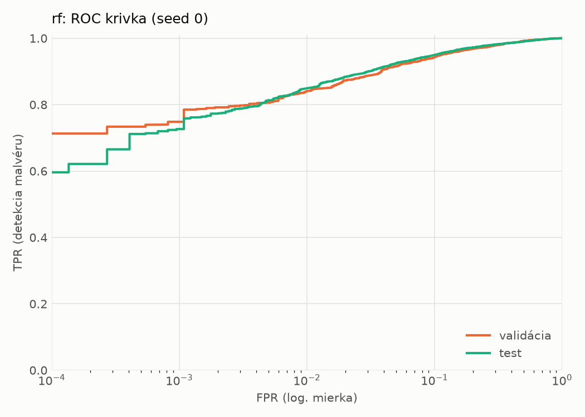
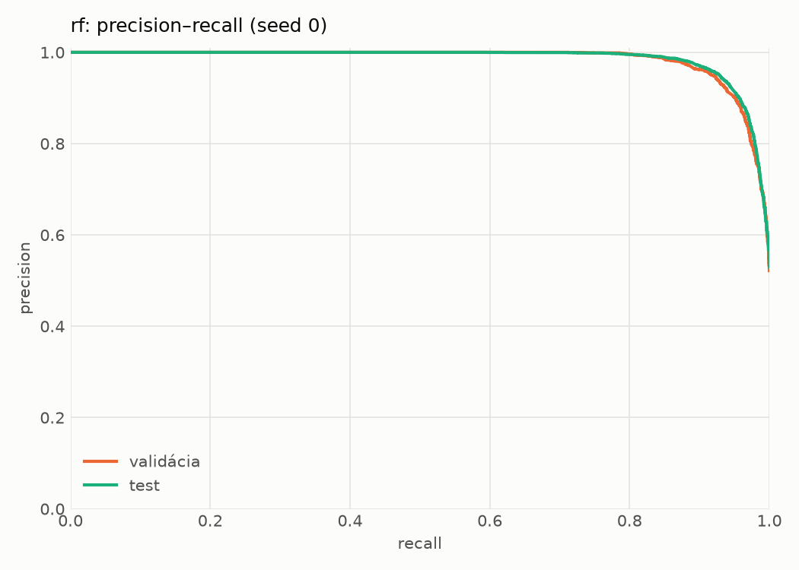
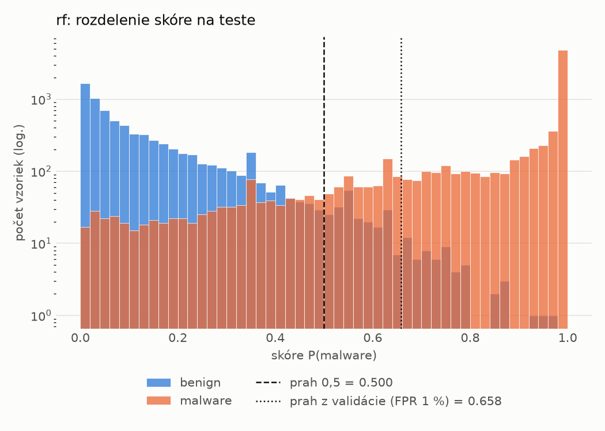
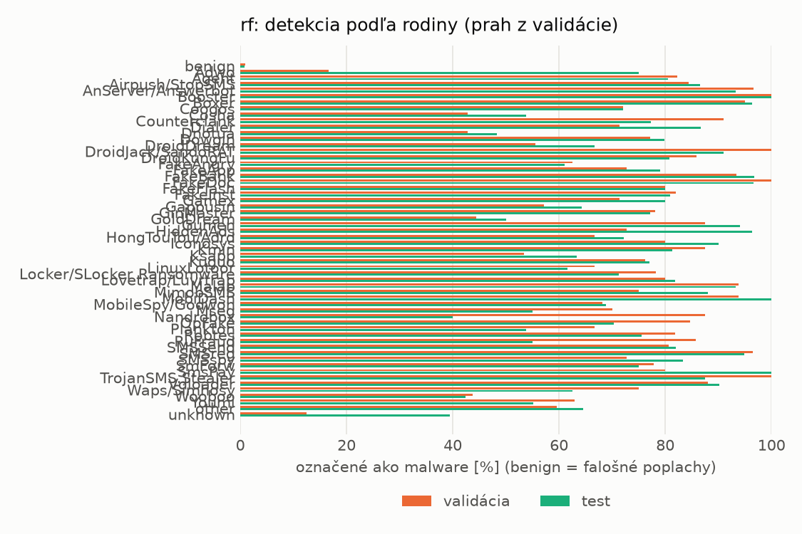
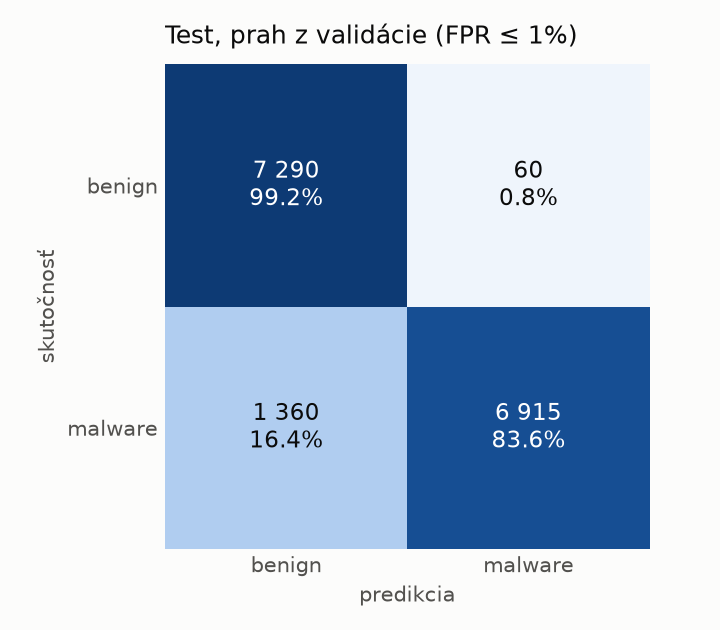
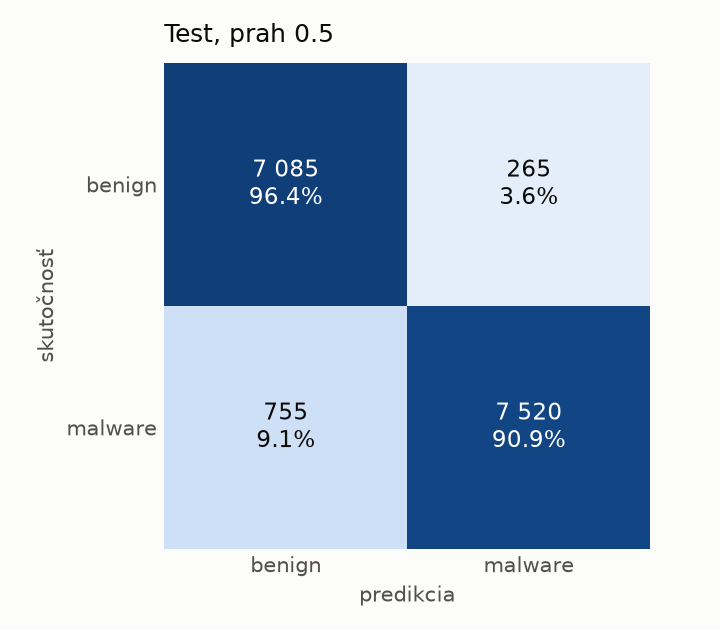

# dynamic/rf – beh `20261122-225142`

> Automaticky generované (`src/training/run_tabular.py`). Konfigurácia: `config.yaml`, protokol: `protocol.yaml`.

- **Model:** `random_forest` – Random Forest (pôvodné hodnoty príznakov)
- **Ladenie:** bez ladenia – hyperparametre prevzaté z `runs_v4/real_full/full/dynamic/rf/20261122-191738`
- **Finálne modely:** seedy [0, 1, 2]; hodnoty sú priemer ± smerodajná odchýlka cez seedy
- **Najlepšie hyperparametre:** `{"n_estimators": 500, "max_depth": 32, "min_samples_leaf": 1, "max_features": "sqrt"}`

## Detekčná kvalita (bez prahu)
| metrika | train (podvzorka) | validácia | test |
|---|---|---|---|
| ROC-AUC | 0.9992 ± 0.0000 | 0.9788 ± 0.0001 | 0.9804 ± 0.0000 |
| PR-AUC | 0.9993 ± 0.0000 | 0.9842 ± 0.0000 | 0.9858 ± 0.0000 |
| TPR pri FPR 1 % | 0.9844 ± 0.0012 | 0.8411 ± 0.0023 | 0.8452 ± 0.0010 |
| TPR pri FPR 0,1 % | 0.9600 ± 0.0010 | 0.7436 ± 0.0062 | 0.7387 ± 0.0111 |
| log loss | 0.0694 ± 0.0001 | 0.1884 ± 0.0005 | 0.1878 ± 0.0003 |
| Brier skóre | 0.0142 ± 0.0000 | 0.0547 ± 0.0001 | 0.0538 ± 0.0001 |

Rozdiel ROC-AUC train − validácia: **0.0204** (veľký rozdiel = preučenie).

## Pri prahu z validácie (FPR ≤ 1% na validácii)
| metrika | train (podvzorka) | validácia | test |
|---|---|---|---|
| accuracy | 0.9772 ± 0.0008 | 0.9124 ± 0.0013 | 0.9098 ± 0.0009 |
| balanced accuracy | 0.9780 ± 0.0007 | 0.9157 ± 0.0012 | 0.9144 ± 0.0008 |
| precision | 0.9998 ± 0.0000 | 0.9895 ± 0.0002 | 0.9913 ± 0.0006 |
| recall (TPR) | 0.9562 ± 0.0015 | 0.8411 ± 0.0023 | 0.8370 ± 0.0022 |
| FPR | 0.0002 ± 0.0000 | 0.0097 ± 0.0002 | 0.0083 ± 0.0006 |
| F1 | 0.9775 ± 0.0008 | 0.9093 ± 0.0014 | 0.9076 ± 0.0010 |
| MCC | 0.9555 ± 0.0014 | 0.8359 ± 0.0022 | 0.8319 ± 0.0014 |

## Pri pevnom prahu 0.5
| metrika | train (podvzorka) | validácia | test |
|---|---|---|---|
| accuracy | 0.9870 ± 0.0002 | 0.9316 ± 0.0003 | 0.9345 ± 0.0003 |
| balanced accuracy | 0.9871 ± 0.0002 | 0.9328 ± 0.0003 | 0.9362 ± 0.0003 |
| precision | 0.9907 ± 0.0002 | 0.9608 ± 0.0001 | 0.9662 ± 0.0002 |
| recall (TPR) | 0.9842 ± 0.0002 | 0.9059 ± 0.0006 | 0.9082 ± 0.0008 |
| FPR | 0.0099 ± 0.0002 | 0.0404 ± 0.0002 | 0.0358 ± 0.0003 |
| F1 | 0.9874 ± 0.0001 | 0.9325 ± 0.0003 | 0.9363 ± 0.0003 |
| MCC | 0.9741 ± 0.0003 | 0.8648 ± 0.0005 | 0.8709 ± 0.0005 |

## Výpočtové nároky (seed 0, testovacia množina)
| meranie | hodnota |
|---|---|
| tréning finálneho modelu | 3.2 s (priemer cez seedy) |
| ladenie spolu | 0 s |
| počet parametrov / uzlov | 4 525 144 |
| veľkosť modelu na disku | 362.43 MB |
| CPU latencia modelu (batch 1, 1 vlákno) | 15.182 ms (p95 15.642) |
| CPU priepustnosť (24 vlákien) | 106 898 vzoriek/s |

## Grafy
| | |
|---|---|
|  |  |
|  |  |
|  |  |
|  |  |

## Súbory
`metrics.json` (všetky metriky po seedoch vrátane rodín), `timing.json`, `hpo_trials.csv`,
`predictions/<časť>_seed<N>.parquet` (sha256, family, label, score), `model/seed_<N>/`, `log.txt`.
