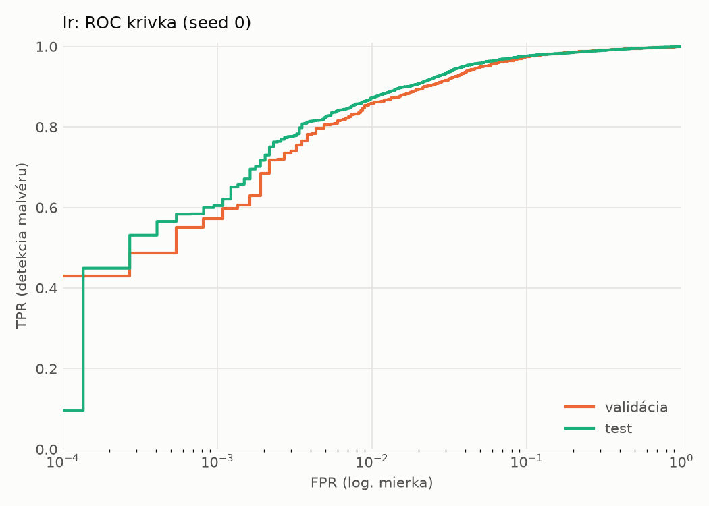
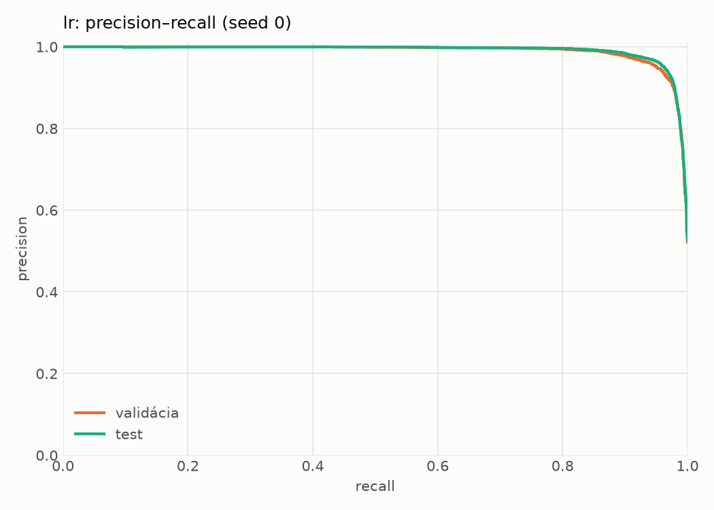
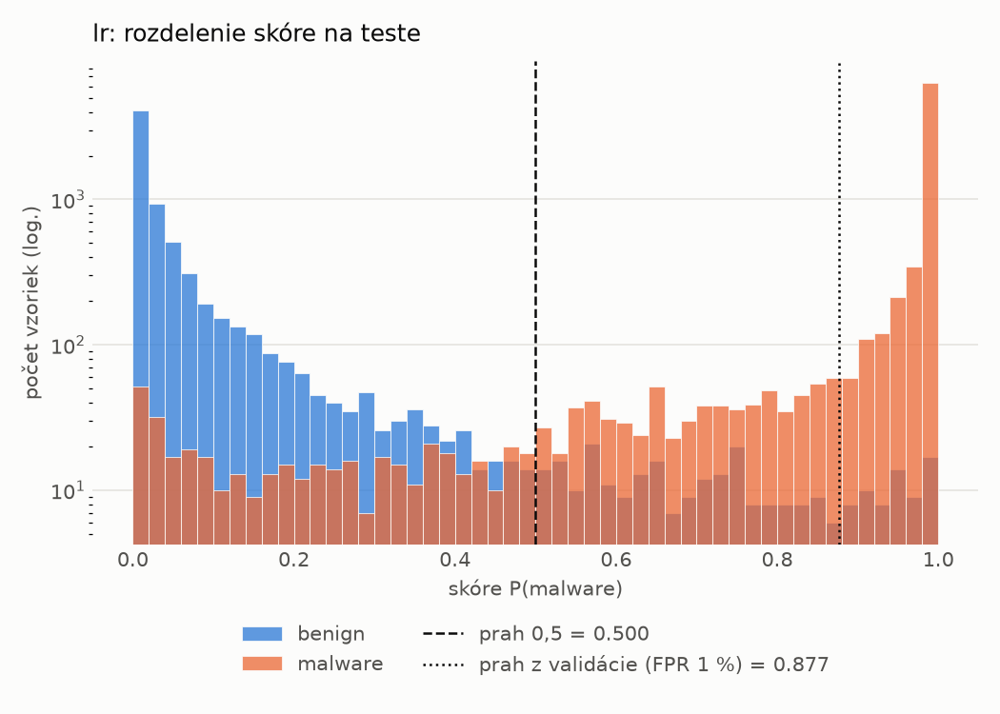
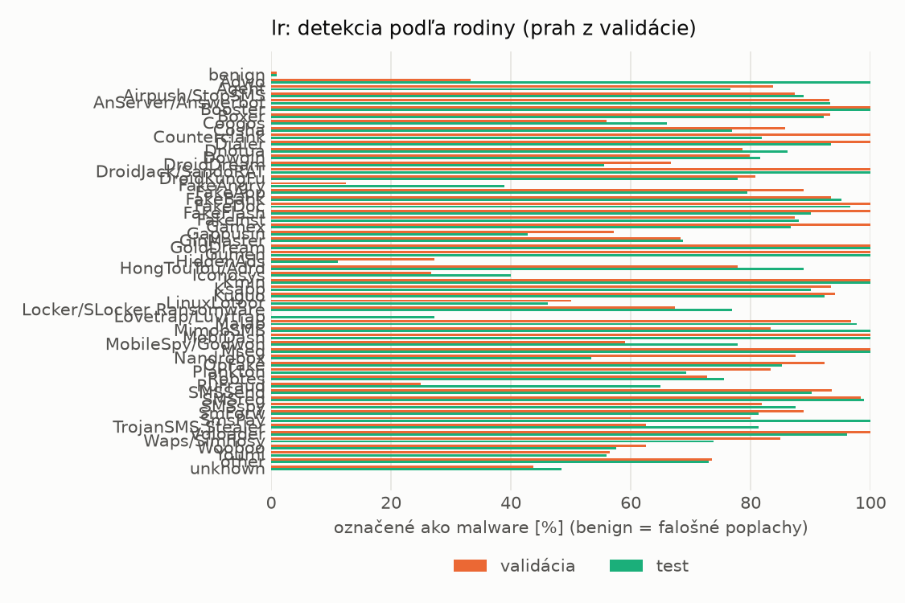
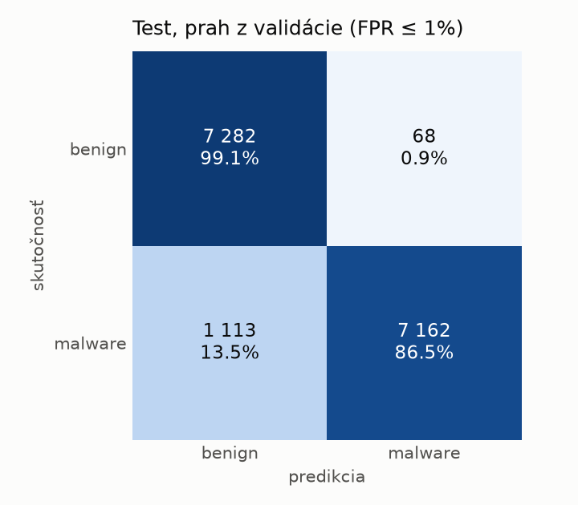
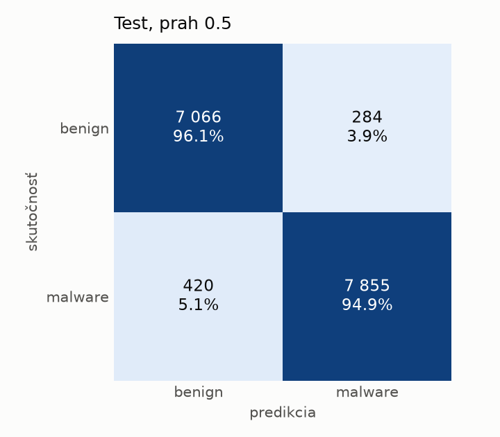

# hybrid/lr – beh `20261122-225444`

> Automaticky generované (`src/training/run_tabular.py`). Konfigurácia: `config.yaml`, protokol: `protocol.yaml`.

- **Model:** `logreg` – logistická regresia s L2 regularizáciou (vstup signed log1p + štandardizácia)
- **Ladenie:** bez ladenia – hyperparametre prevzaté z `runs_v4/real_full/full/hybrid/lr/20261122-195001`
- **Finálne modely:** seedy [0, 1, 2]; hodnoty sú priemer ± smerodajná odchýlka cez seedy
- **Najlepšie hyperparametre:** `{"max_iter": 2000, "C": 0.30240503427727145}`

## Detekčná kvalita (bez prahu)
| metrika | train (podvzorka) | validácia | test |
|---|---|---|---|
| ROC-AUC | 0.9879 ± 0.0000 | 0.9866 ± 0.0000 | 0.9878 ± 0.0000 |
| PR-AUC | 0.9904 ± 0.0000 | 0.9894 ± 0.0000 | 0.9906 ± 0.0000 |
| TPR pri FPR 1 % | 0.8658 ± 0.0000 | 0.8591 ± 0.0000 | 0.8719 ± 0.0000 |
| TPR pri FPR 0,1 % | 0.5681 ± 0.0000 | 0.5726 ± 0.0000 | 0.6047 ± 0.0000 |
| log loss | 0.1332 ± 0.0000 | 0.1428 ± 0.0000 | 0.1322 ± 0.0000 |
| Brier skóre | 0.0364 ± 0.0000 | 0.0394 ± 0.0000 | 0.0358 ± 0.0000 |

Rozdiel ROC-AUC train − validácia: **0.0013** (veľký rozdiel = preučenie).

## Pri prahu z validácie (FPR ≤ 1% na validácii)
| metrika | train (podvzorka) | validácia | test |
|---|---|---|---|
| accuracy | 0.9243 ± 0.0000 | 0.9218 ± 0.0000 | 0.9244 ± 0.0000 |
| balanced accuracy | 0.9265 ± 0.0000 | 0.9247 ± 0.0000 | 0.9281 ± 0.0000 |
| precision | 0.9898 ± 0.0000 | 0.9897 ± 0.0000 | 0.9906 ± 0.0000 |
| recall (TPR) | 0.8626 ± 0.0000 | 0.8591 ± 0.0000 | 0.8655 ± 0.0000 |
| FPR | 0.0095 ± 0.0000 | 0.0098 ± 0.0000 | 0.0093 ± 0.0000 |
| F1 | 0.9218 ± 0.0000 | 0.9198 ± 0.0000 | 0.9238 ± 0.0000 |
| MCC | 0.8567 ± 0.0000 | 0.8523 ± 0.0000 | 0.8571 ± 0.0000 |

## Pri pevnom prahu 0.5
| metrika | train (podvzorka) | validácia | test |
|---|---|---|---|
| accuracy | 0.9533 ± 0.0000 | 0.9482 ± 0.0000 | 0.9549 ± 0.0000 |
| balanced accuracy | 0.9535 ± 0.0000 | 0.9487 ± 0.0000 | 0.9553 ± 0.0000 |
| precision | 0.9625 ± 0.0000 | 0.9614 ± 0.0000 | 0.9651 ± 0.0000 |
| recall (TPR) | 0.9466 ± 0.0000 | 0.9384 ± 0.0000 | 0.9492 ± 0.0000 |
| FPR | 0.0396 ± 0.0000 | 0.0411 ± 0.0000 | 0.0386 ± 0.0000 |
| F1 | 0.9545 ± 0.0000 | 0.9498 ± 0.0000 | 0.9571 ± 0.0000 |
| MCC | 0.9067 ± 0.0000 | 0.8966 ± 0.0000 | 0.9098 ± 0.0000 |

## Výpočtové nároky (seed 0, testovacia množina)
| meranie | hodnota |
|---|---|
| tréning finálneho modelu | 0.4 s (priemer cez seedy) |
| ladenie spolu | 0 s |
| počet parametrov / uzlov | 295 |
| veľkosť modelu na disku | 0.01 MB |
| transformácia vstupu – latencia (1 vlákno) | 0.006 ms |
| transformácia vstupu – priepustnosť | 511 137 vzoriek/s |
| CPU latencia modelu (batch 1, 1 vlákno) | 0.004 ms (p95 0.004) |
| CPU priepustnosť (24 vlákien) | 2 157 345 vzoriek/s |

## Grafy
| | |
|---|---|
|  |  |
|  |  |
|  |  |
|  |  |

## Súbory
`metrics.json` (všetky metriky po seedoch vrátane rodín), `timing.json`, `hpo_trials.csv`,
`predictions/<časť>_seed<N>.parquet` (sha256, family, label, score), `model/seed_<N>/`, `log.txt`.
