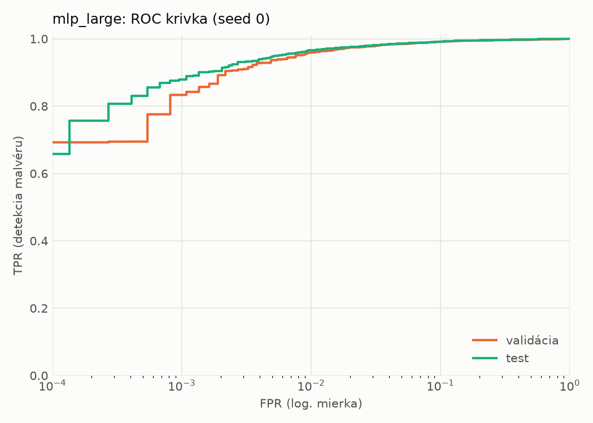
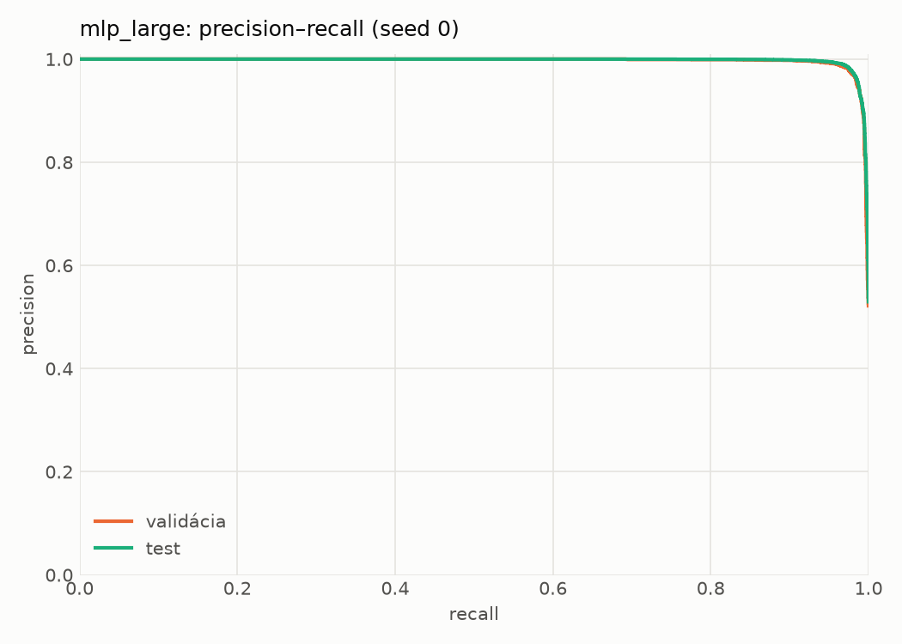
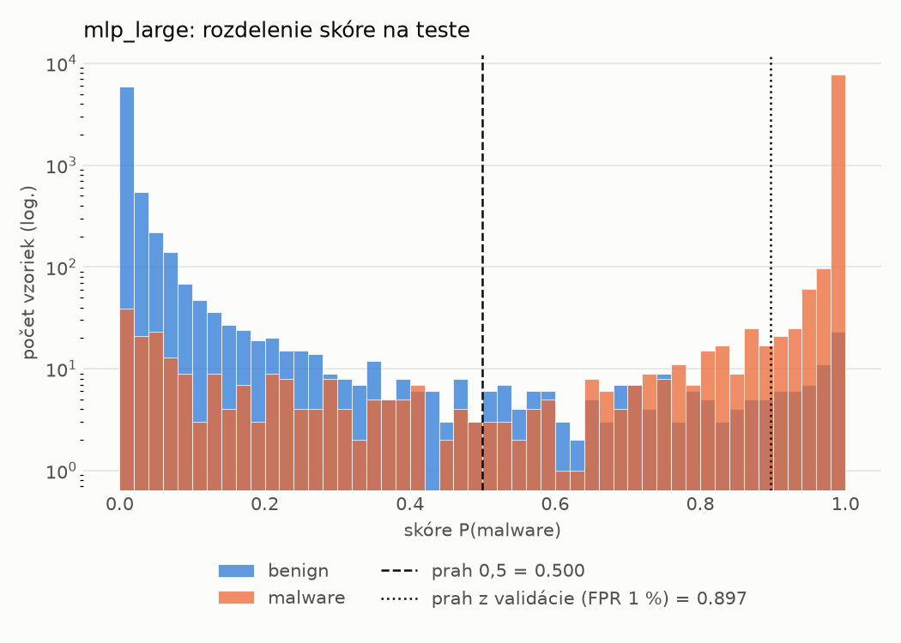
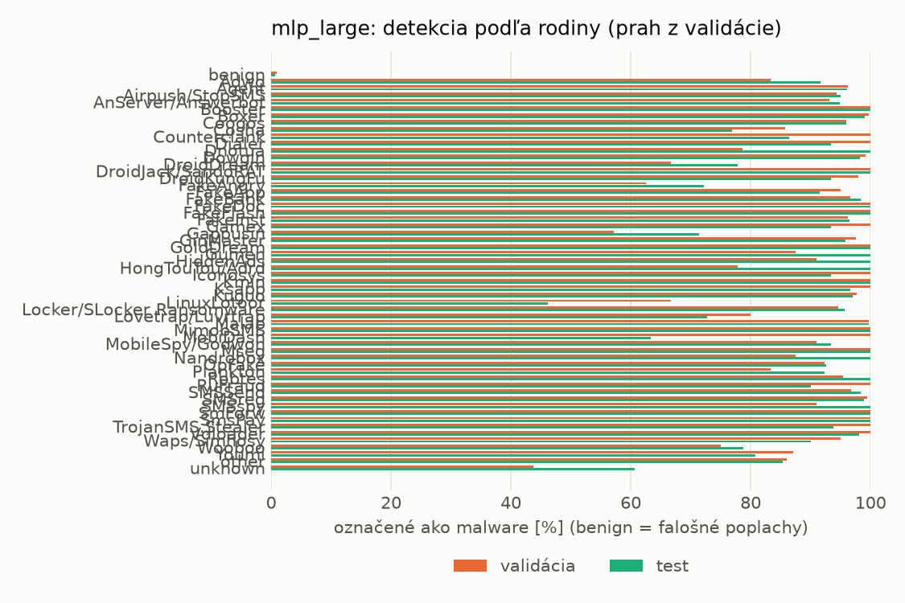
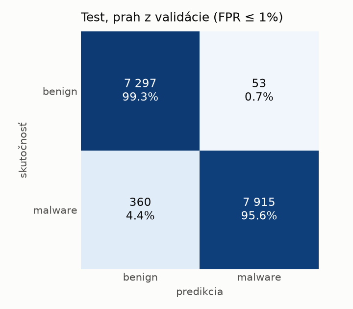
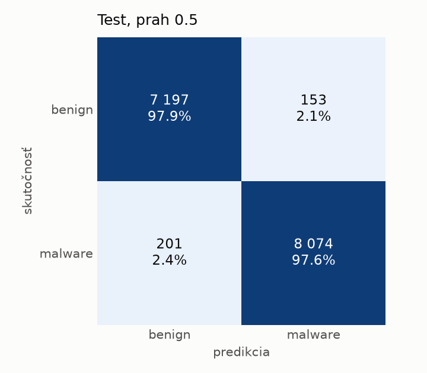
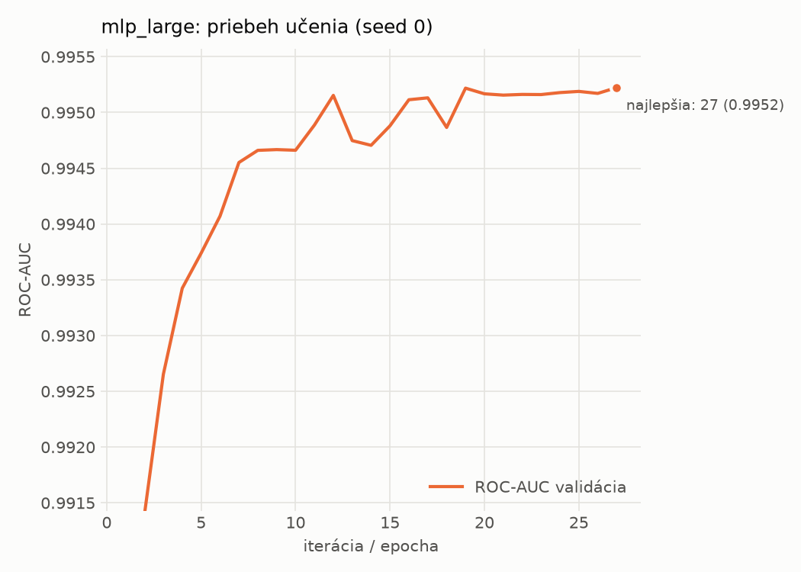

# hybrid/mlp_large – beh `20261122-225644`

> Automaticky generované (`src/training/run_tabular.py`). Konfigurácia: `config.yaml`, protokol: `protocol.yaml`.

- **Model:** `mlp` – veľká neurónová sieť (3–5 skrytých vrstiev, 512–2048 neurónov), kandidát na učiteľa
- **Ladenie:** bez ladenia – hyperparametre prevzaté z `runs_v4/real_full/full/hybrid/mlp_large/20261122-201300`
- **Finálne modely:** seedy [0, 1, 2]; hodnoty sú priemer ± smerodajná odchýlka cez seedy
- **Najlepšie hyperparametre:** `{"max_epochs": 100, "patience": 8, "hidden_layers": 3, "hidden_width": 512, "width_decay": 0.5, "dropout": 0.18171623767667733, "lr": 0.00010022812541545209, "weight_decay": 7.819097276436122e-06, "batch_size": 256}`

## Detekčná kvalita (bez prahu)
| metrika | train (podvzorka) | validácia | test |
|---|---|---|---|
| ROC-AUC | 0.9990 ± 0.0002 | 0.9953 ± 0.0001 | 0.9961 ± 0.0001 |
| PR-AUC | 0.9992 ± 0.0001 | 0.9965 ± 0.0001 | 0.9971 ± 0.0001 |
| TPR pri FPR 1 % | 0.9880 ± 0.0013 | 0.9599 ± 0.0012 | 0.9653 ± 0.0010 |
| TPR pri FPR 0,1 % | 0.9782 ± 0.0039 | 0.8243 ± 0.0095 | 0.8790 ± 0.0077 |
| log loss | 0.0314 ± 0.0024 | 0.0771 ± 0.0004 | 0.0704 ± 0.0011 |
| Brier skóre | 0.0080 ± 0.0007 | 0.0191 ± 0.0004 | 0.0180 ± 0.0001 |

Rozdiel ROC-AUC train − validácia: **0.0037** (veľký rozdiel = preučenie).

## Pri prahu z validácie (FPR ≤ 1% na validácii)
| metrika | train (podvzorka) | validácia | test |
|---|---|---|---|
| accuracy | 0.9855 ± 0.0007 | 0.9745 ± 0.0007 | 0.9745 ± 0.0008 |
| balanced accuracy | 0.9860 ± 0.0006 | 0.9751 ± 0.0006 | 0.9755 ± 0.0008 |
| precision | 0.9997 ± 0.0001 | 0.9909 ± 0.0001 | 0.9930 ± 0.0004 |
| recall (TPR) | 0.9723 ± 0.0012 | 0.9599 ± 0.0012 | 0.9585 ± 0.0018 |
| FPR | 0.0003 ± 0.0001 | 0.0096 ± 0.0002 | 0.0076 ± 0.0004 |
| F1 | 0.9858 ± 0.0007 | 0.9751 ± 0.0007 | 0.9755 ± 0.0008 |
| MCC | 0.9714 ± 0.0013 | 0.9494 ± 0.0013 | 0.9495 ± 0.0016 |

## Pri pevnom prahu 0.5
| metrika | train (podvzorka) | validácia | test |
|---|---|---|---|
| accuracy | 0.9899 ± 0.0012 | 0.9757 ± 0.0005 | 0.9775 ± 0.0001 |
| balanced accuracy | 0.9901 ± 0.0012 | 0.9757 ± 0.0006 | 0.9776 ± 0.0001 |
| precision | 0.9947 ± 0.0017 | 0.9766 ± 0.0017 | 0.9818 ± 0.0013 |
| recall (TPR) | 0.9858 ± 0.0009 | 0.9768 ± 0.0011 | 0.9755 ± 0.0014 |
| FPR | 0.0056 ± 0.0018 | 0.0255 ± 0.0019 | 0.0204 ± 0.0015 |
| F1 | 0.9902 ± 0.0011 | 0.9767 ± 0.0005 | 0.9786 ± 0.0001 |
| MCC | 0.9799 ± 0.0023 | 0.9513 ± 0.0011 | 0.9548 ± 0.0002 |

## Výpočtové nároky (seed 0, testovacia množina)
| meranie | hodnota |
|---|---|
| tréning finálneho modelu | 14.2 s (priemer cez seedy) |
| ladenie spolu | 0 s |
| počet parametrov / uzlov | 317 185 |
| veľkosť modelu na disku | 1.29 MB |
| transformácia vstupu – latencia (1 vlákno) | 0.017 ms |
| transformácia vstupu – priepustnosť | 284 683 vzoriek/s |
| CPU latencia modelu (batch 1, 1 vlákno) | 0.144 ms (p95 0.321) |
| CPU priepustnosť (24 vlákien) | 538 602 vzoriek/s |
| GPU latencia (batch 1) | 0.532 ms (p95 0.566) |
| GPU priepustnosť | 1 025 808 vzoriek/s |
| GPU špičková pamäť | 217 MB |

## Grafy
| | |
|---|---|
|  |  |
|  |  |
|  |  |
|  |  |

## Súbory
`metrics.json` (všetky metriky po seedoch vrátane rodín), `timing.json`, `hpo_trials.csv`,
`predictions/<časť>_seed<N>.parquet` (sha256, family, label, score), `model/seed_<N>/`, `log.txt`.
