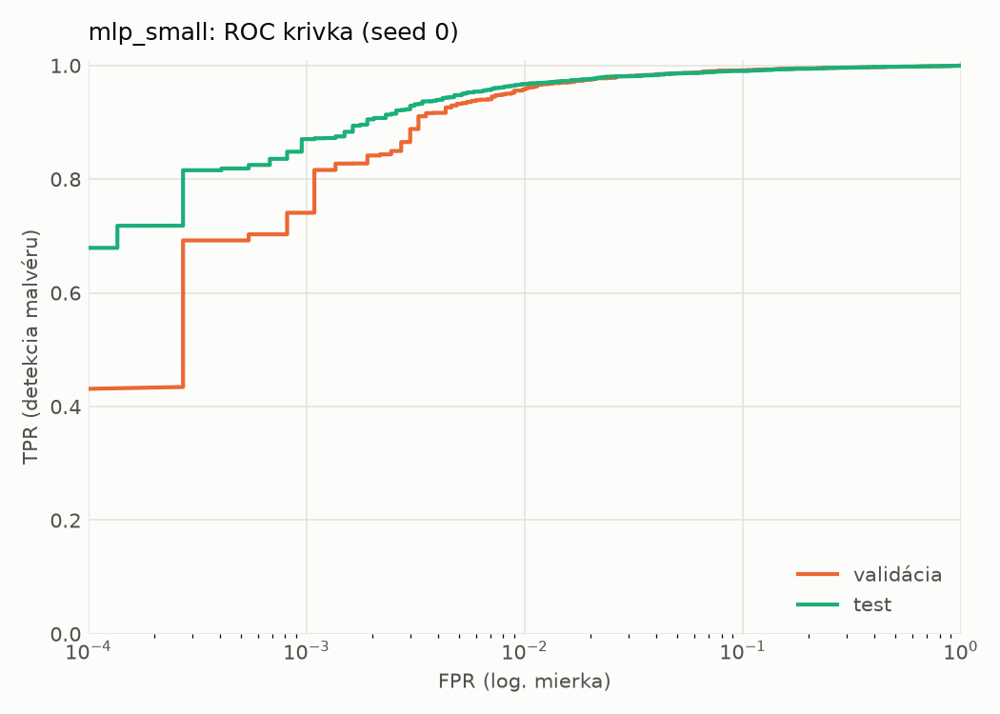
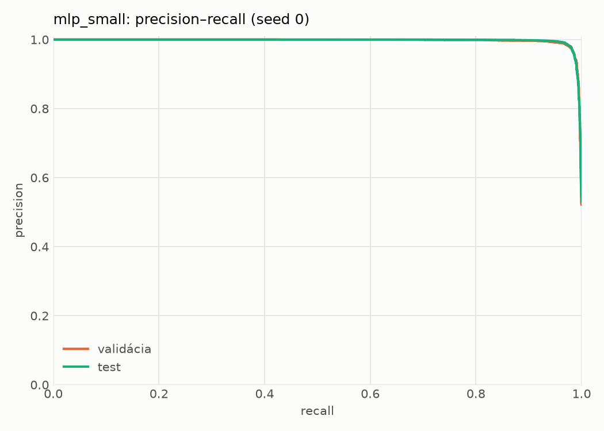
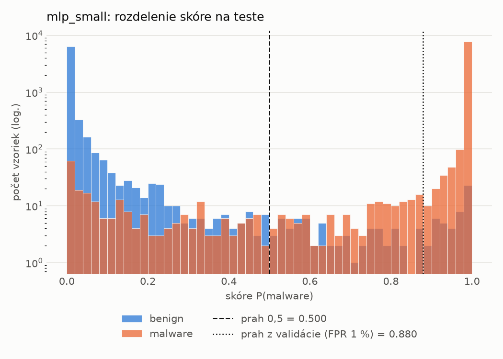
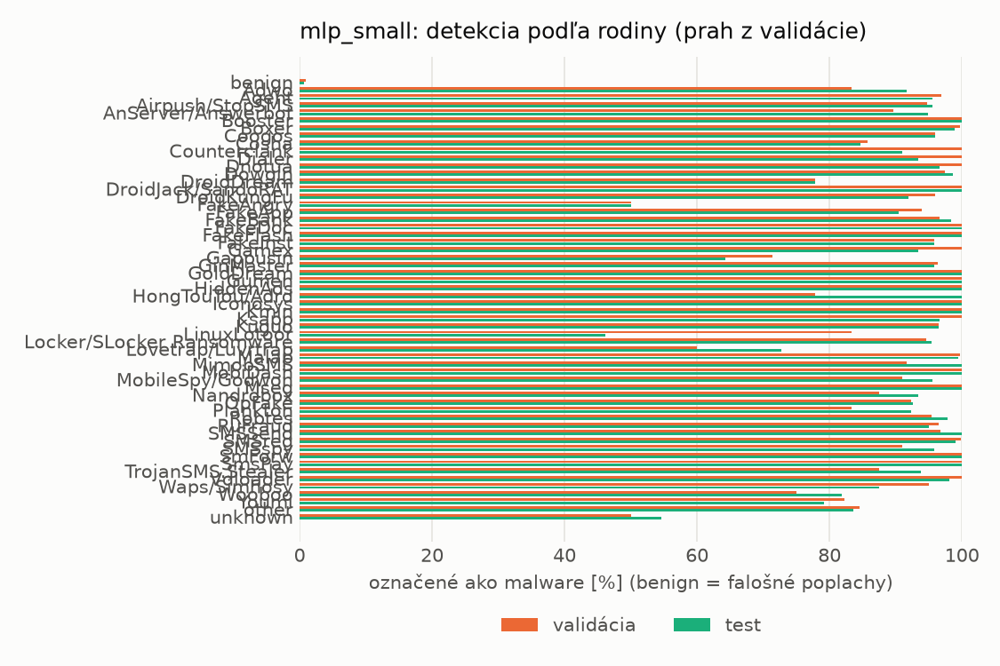
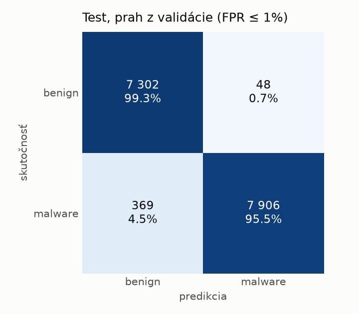
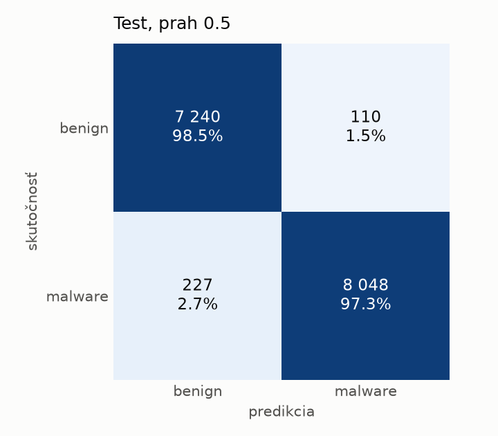
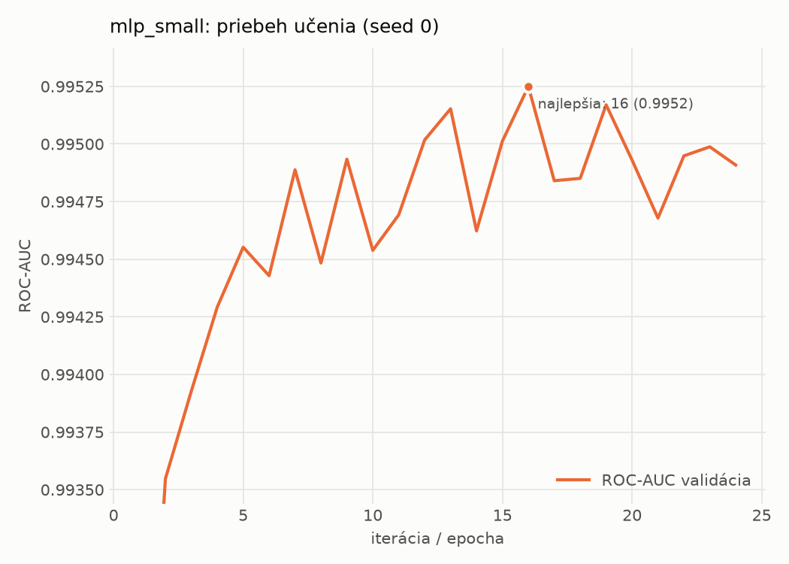

# hybrid/mlp_small – beh `20261122-225616`

> Automaticky generované (`src/training/run_tabular.py`). Konfigurácia: `config.yaml`, protokol: `protocol.yaml`.

- **Model:** `mlp` – malá neurónová sieť (1–2 skryté vrstvy), kandidát na ľahkého študenta
- **Ladenie:** bez ladenia – hyperparametre prevzaté z `runs_v4/real_full/full/hybrid/mlp_small/20261122-200826`
- **Finálne modely:** seedy [0, 1, 2]; hodnoty sú priemer ± smerodajná odchýlka cez seedy
- **Najlepšie hyperparametre:** `{"width_decay": 0.5, "max_epochs": 100, "patience": 8, "hidden_layers": 2, "hidden_width": 256, "dropout": 0.19625503285105284, "lr": 0.0008594281758471675, "weight_decay": 0.001025897876119634, "batch_size": 256}`

## Detekčná kvalita (bez prahu)
| metrika | train (podvzorka) | validácia | test |
|---|---|---|---|
| ROC-AUC | 0.9986 ± 0.0004 | 0.9950 ± 0.0002 | 0.9957 ± 0.0003 |
| PR-AUC | 0.9989 ± 0.0003 | 0.9963 ± 0.0002 | 0.9969 ± 0.0002 |
| TPR pri FPR 1 % | 0.9851 ± 0.0028 | 0.9568 ± 0.0045 | 0.9641 ± 0.0030 |
| TPR pri FPR 0,1 % | 0.9686 ± 0.0101 | 0.7860 ± 0.0403 | 0.8625 ± 0.0172 |
| log loss | 0.0382 ± 0.0064 | 0.0812 ± 0.0010 | 0.0734 ± 0.0013 |
| Brier skóre | 0.0100 ± 0.0017 | 0.0190 ± 0.0010 | 0.0182 ± 0.0007 |

Rozdiel ROC-AUC train − validácia: **0.0036** (veľký rozdiel = preučenie).

## Pri prahu z validácie (FPR ≤ 1% na validácii)
| metrika | train (podvzorka) | validácia | test |
|---|---|---|---|
| accuracy | 0.9817 ± 0.0028 | 0.9728 ± 0.0023 | 0.9733 ± 0.0012 |
| balanced accuracy | 0.9823 ± 0.0027 | 0.9735 ± 0.0022 | 0.9744 ± 0.0011 |
| precision | 0.9994 ± 0.0004 | 0.9907 ± 0.0000 | 0.9933 ± 0.0009 |
| recall (TPR) | 0.9652 ± 0.0051 | 0.9568 ± 0.0045 | 0.9560 ± 0.0029 |
| FPR | 0.0006 ± 0.0004 | 0.0098 ± 0.0000 | 0.0072 ± 0.0010 |
| F1 | 0.9820 ± 0.0028 | 0.9734 ± 0.0023 | 0.9743 ± 0.0012 |
| MCC | 0.9640 ± 0.0054 | 0.9461 ± 0.0045 | 0.9473 ± 0.0022 |

## Pri pevnom prahu 0.5
| metrika | train (podvzorka) | validácia | test |
|---|---|---|---|
| accuracy | 0.9871 ± 0.0025 | 0.9763 ± 0.0022 | 0.9775 ± 0.0009 |
| balanced accuracy | 0.9873 ± 0.0025 | 0.9764 ± 0.0022 | 0.9778 ± 0.0008 |
| precision | 0.9956 ± 0.0018 | 0.9818 ± 0.0030 | 0.9861 ± 0.0007 |
| recall (TPR) | 0.9793 ± 0.0034 | 0.9726 ± 0.0029 | 0.9711 ± 0.0015 |
| FPR | 0.0046 ± 0.0019 | 0.0197 ± 0.0032 | 0.0154 ± 0.0008 |
| F1 | 0.9874 ± 0.0025 | 0.9772 ± 0.0021 | 0.9785 ± 0.0008 |
| MCC | 0.9743 ± 0.0050 | 0.9525 ± 0.0044 | 0.9549 ± 0.0017 |

## Výpočtové nároky (seed 0, testovacia množina)
| meranie | hodnota |
|---|---|
| tréning finálneho modelu | 8.6 s (priemer cez seedy) |
| ladenie spolu | 0 s |
| počet parametrov / uzlov | 109 313 |
| veľkosť modelu na disku | 0.45 MB |
| transformácia vstupu – latencia (1 vlákno) | 0.017 ms |
| transformácia vstupu – priepustnosť | 272 962 vzoriek/s |
| CPU latencia modelu (batch 1, 1 vlákno) | 0.105 ms (p95 0.236) |
| CPU priepustnosť (24 vlákien) | 967 301 vzoriek/s |
| GPU latencia (batch 1) | 0.657 ms (p95 0.689) |
| GPU priepustnosť | 754 681 vzoriek/s |
| GPU špičková pamäť | 126 MB |

## Grafy
| | |
|---|---|
|  |  |
|  |  |
|  |  |
|  |  |

## Súbory
`metrics.json` (všetky metriky po seedoch vrátane rodín), `timing.json`, `hpo_trials.csv`,
`predictions/<časť>_seed<N>.parquet` (sha256, family, label, score), `model/seed_<N>/`, `log.txt`.
