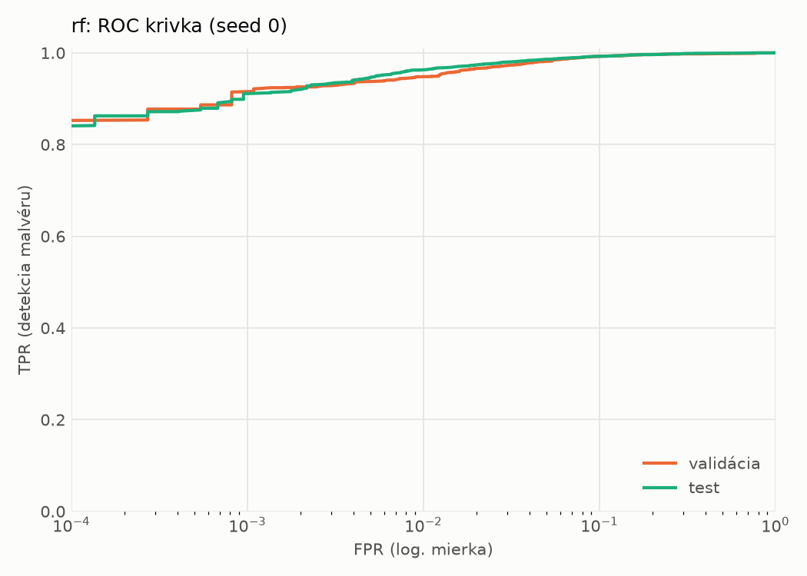
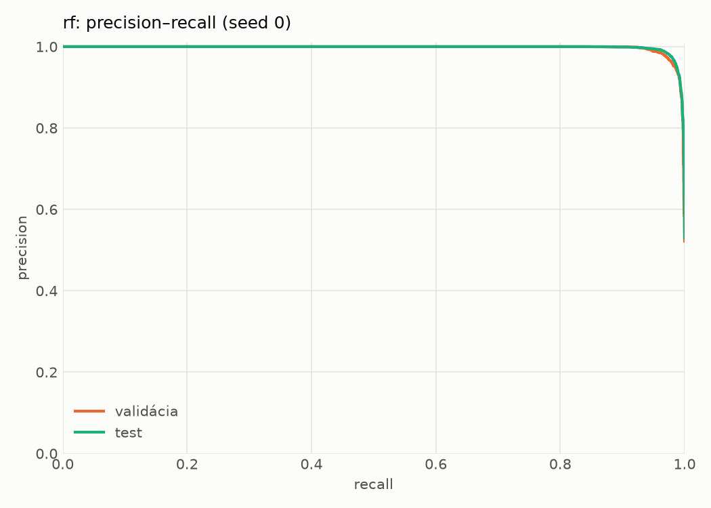
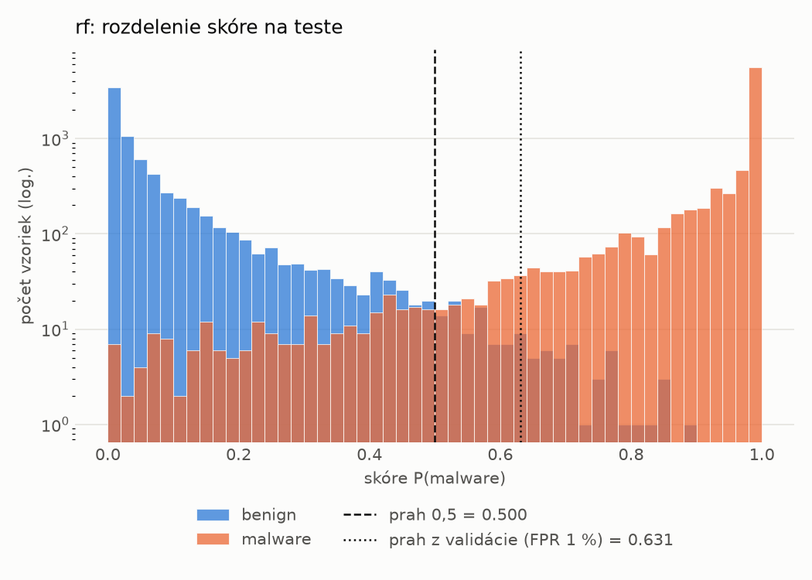
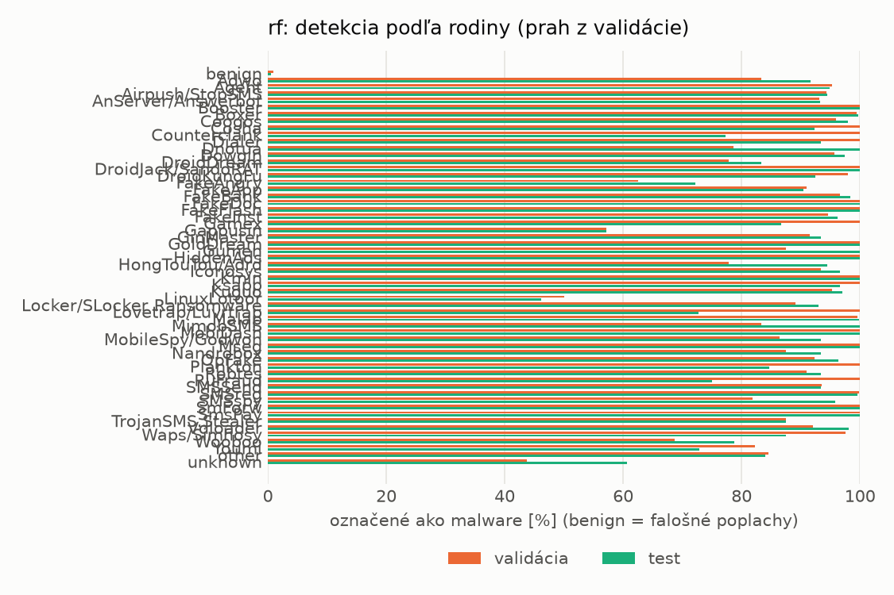
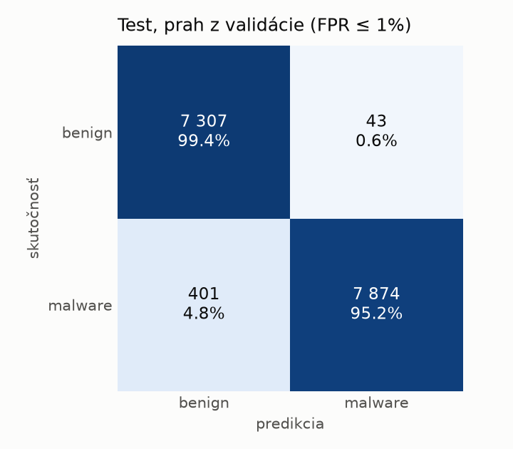
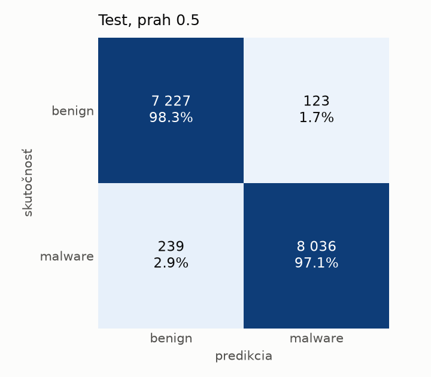

# hybrid/rf – beh `20261122-225447`

> Automaticky generované (`src/training/run_tabular.py`). Konfigurácia: `config.yaml`, protokol: `protocol.yaml`.

- **Model:** `random_forest` – Random Forest (pôvodné hodnoty príznakov)
- **Ladenie:** bez ladenia – hyperparametre prevzaté z `runs_v4/real_full/full/hybrid/rf/20261122-195013`
- **Finálne modely:** seedy [0, 1, 2]; hodnoty sú priemer ± smerodajná odchýlka cez seedy
- **Najlepšie hyperparametre:** `{"n_estimators": 150, "max_depth": 32, "min_samples_leaf": 1, "max_features": 0.05}`

## Detekčná kvalita (bez prahu)
| metrika | train (podvzorka) | validácia | test |
|---|---|---|---|
| ROC-AUC | 1.0000 ± 0.0000 | 0.9962 ± 0.0002 | 0.9968 ± 0.0000 |
| PR-AUC | 1.0000 ± 0.0000 | 0.9970 ± 0.0001 | 0.9976 ± 0.0000 |
| TPR pri FPR 1 % | 1.0000 ± 0.0000 | 0.9496 ± 0.0016 | 0.9623 ± 0.0014 |
| TPR pri FPR 0,1 % | 1.0000 ± 0.0000 | 0.9011 ± 0.0117 | 0.9131 ± 0.0020 |
| log loss | 0.0259 ± 0.0001 | 0.0912 ± 0.0017 | 0.0874 ± 0.0003 |
| Brier skóre | 0.0032 ± 0.0000 | 0.0231 ± 0.0002 | 0.0217 ± 0.0002 |

Rozdiel ROC-AUC train − validácia: **0.0038** (veľký rozdiel = preučenie).

## Pri prahu z validácie (FPR ≤ 1% na validácii)
| metrika | train (podvzorka) | validácia | test |
|---|---|---|---|
| accuracy | 0.9985 ± 0.0004 | 0.9692 ± 0.0008 | 0.9725 ± 0.0011 |
| balanced accuracy | 0.9985 ± 0.0004 | 0.9701 ± 0.0008 | 0.9736 ± 0.0011 |
| precision | 1.0000 ± 0.0000 | 0.9909 ± 0.0003 | 0.9941 ± 0.0008 |
| recall (TPR) | 0.9970 ± 0.0008 | 0.9496 ± 0.0016 | 0.9537 ± 0.0021 |
| FPR | 0.0000 ± 0.0000 | 0.0095 ± 0.0003 | 0.0064 ± 0.0008 |
| F1 | 0.9985 ± 0.0004 | 0.9698 ± 0.0008 | 0.9735 ± 0.0011 |
| MCC | 0.9969 ± 0.0008 | 0.9392 ± 0.0015 | 0.9457 ± 0.0022 |

## Pri pevnom prahu 0.5
| metrika | train (podvzorka) | validácia | test |
|---|---|---|---|
| accuracy | 1.0000 ± 0.0001 | 0.9721 ± 0.0002 | 0.9768 ± 0.0002 |
| balanced accuracy | 1.0000 ± 0.0001 | 0.9723 ± 0.0002 | 0.9772 ± 0.0002 |
| precision | 1.0000 ± 0.0000 | 0.9792 ± 0.0006 | 0.9848 ± 0.0001 |
| recall (TPR) | 0.9999 ± 0.0001 | 0.9670 ± 0.0010 | 0.9712 ± 0.0005 |
| FPR | 0.0000 ± 0.0000 | 0.0224 ± 0.0007 | 0.0168 ± 0.0002 |
| F1 | 1.0000 ± 0.0001 | 0.9731 ± 0.0002 | 0.9780 ± 0.0002 |
| MCC | 0.9999 ± 0.0001 | 0.9441 ± 0.0004 | 0.9536 ± 0.0004 |

## Výpočtové nároky (seed 0, testovacia množina)
| meranie | hodnota |
|---|---|
| tréning finálneho modelu | 1.4 s (priemer cez seedy) |
| ladenie spolu | 0 s |
| počet parametrov / uzlov | 788 390 |
| veľkosť modelu na disku | 63.35 MB |
| CPU latencia modelu (batch 1, 1 vlákno) | 4.672 ms (p95 4.953) |
| CPU priepustnosť (24 vlákien) | 194 818 vzoriek/s |

## Grafy
| | |
|---|---|
|  |  |
|  |  |
|  |  |
|  |  |

## Súbory
`metrics.json` (všetky metriky po seedoch vrátane rodín), `timing.json`, `hpo_trials.csv`,
`predictions/<časť>_seed<N>.parquet` (sha256, family, label, score), `model/seed_<N>/`, `log.txt`.
