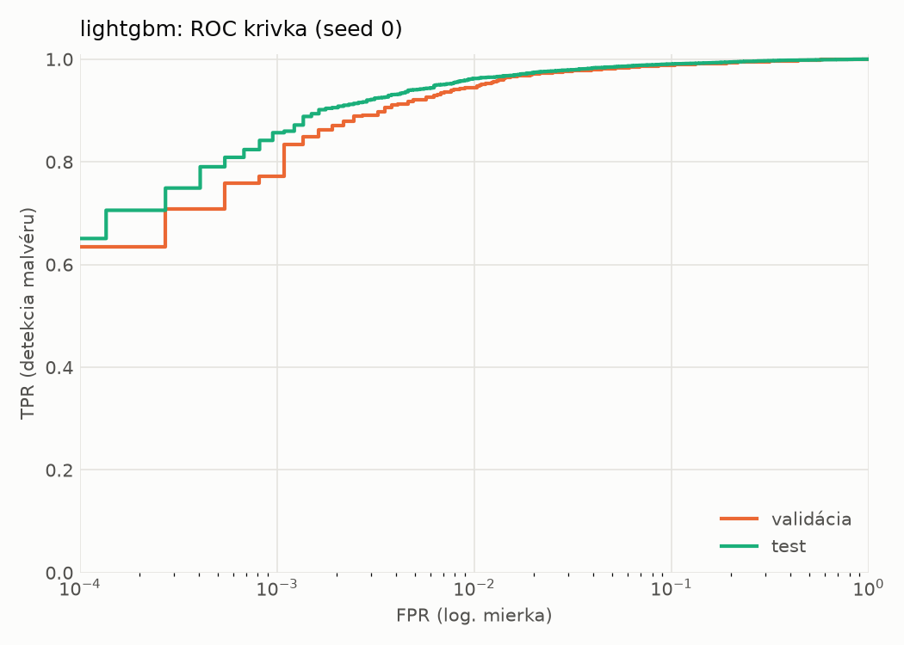
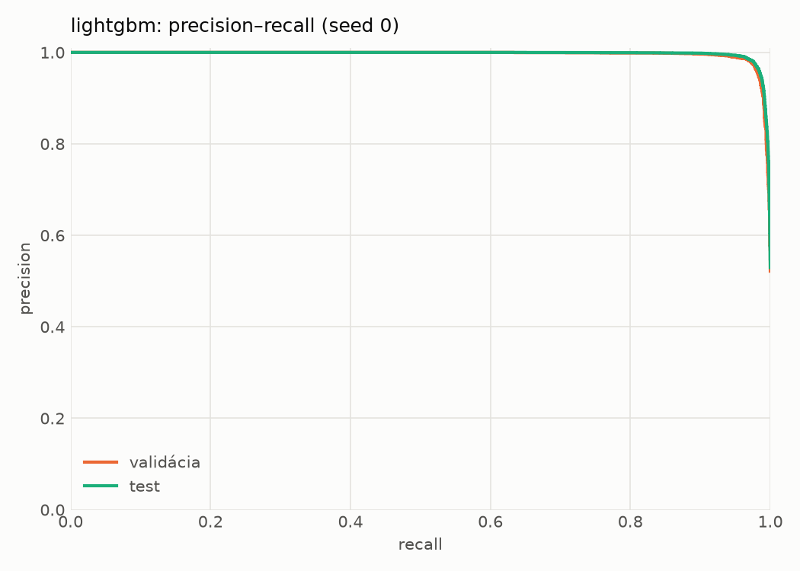
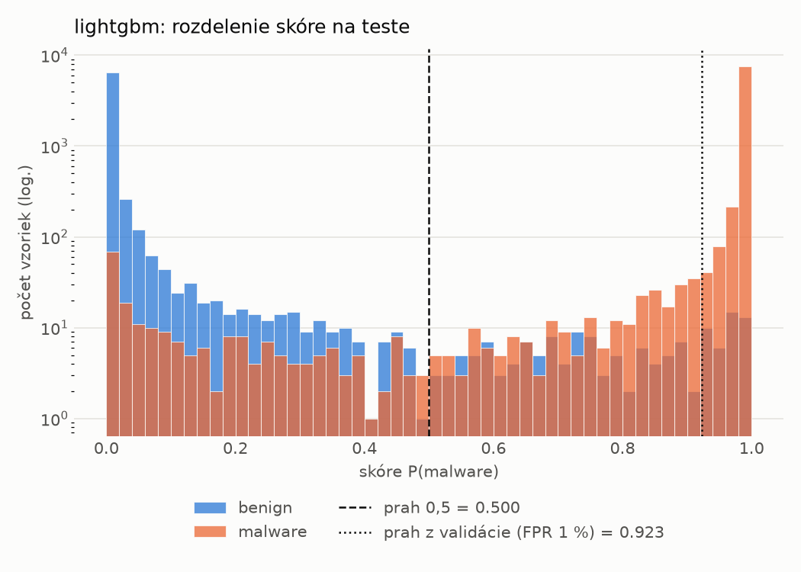
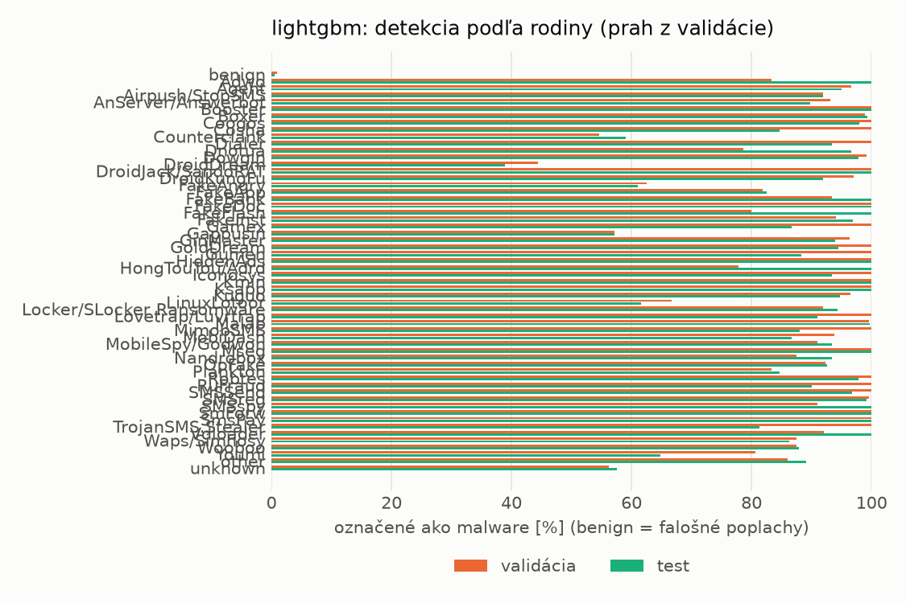
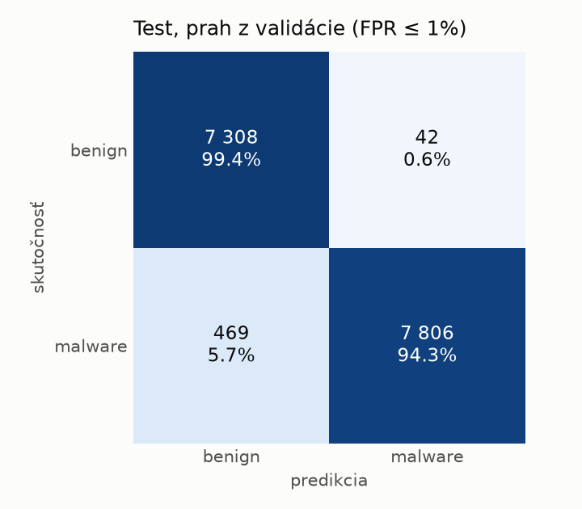
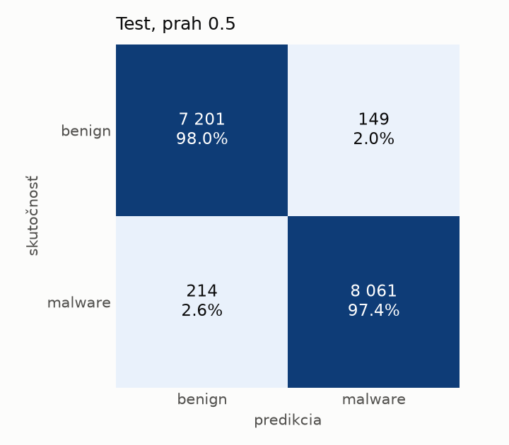
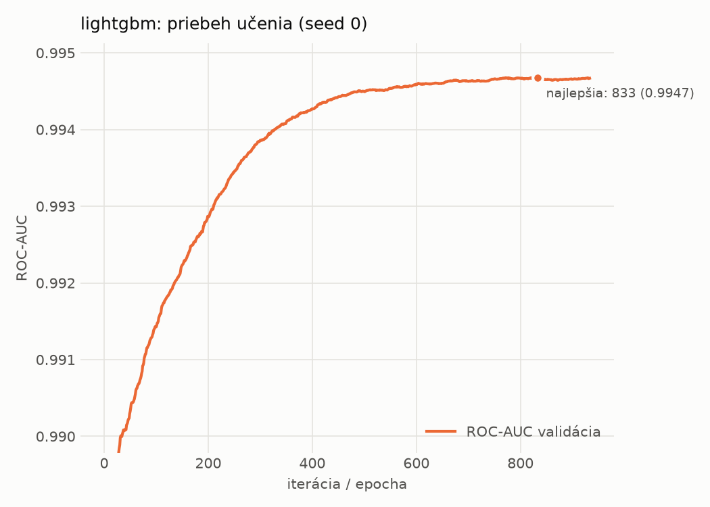

# static/lightgbm – beh `20261122-224851`

> Automaticky generované (`src/training/run_tabular.py`). Konfigurácia: `config.yaml`, protokol: `protocol.yaml`.

- **Model:** `lightgbm` – LightGBM, gradient boosting stromov s early stopping na validácii (pôvodné hodnoty príznakov)
- **Ladenie:** bez ladenia – hyperparametre prevzaté z `runs_v4/real_full/full/static/lightgbm/20261122-184829`
- **Finálne modely:** seedy [0, 1, 2]; hodnoty sú priemer ± smerodajná odchýlka cez seedy
- **Najlepšie hyperparametre:** `{"num_boost_round": 5000, "early_stopping_rounds": 100, "learning_rate": 0.015567978603457627, "num_leaves": 372, "min_child_samples": 12, "feature_fraction": 0.7551391358223217, "bagging_fraction": 0.6871892431836363, "lambda_l1": 1.3651906778474808e-06, "lambda_l2": 0.003382199534052785}`

## Detekčná kvalita (bez prahu)
| metrika | train (podvzorka) | validácia | test |
|---|---|---|---|
| ROC-AUC | 1.0000 ± 0.0000 | 0.9947 ± 0.0001 | 0.9957 ± 0.0000 |
| PR-AUC | 1.0000 ± 0.0000 | 0.9960 ± 0.0000 | 0.9969 ± 0.0000 |
| TPR pri FPR 1 % | 1.0000 ± 0.0000 | 0.9457 ± 0.0007 | 0.9606 ± 0.0018 |
| TPR pri FPR 0,1 % | 0.9999 ± 0.0001 | 0.7859 ± 0.0226 | 0.8428 ± 0.0126 |
| log loss | 0.0066 ± 0.0023 | 0.0872 ± 0.0027 | 0.0752 ± 0.0015 |
| Brier skóre | 0.0006 ± 0.0003 | 0.0210 ± 0.0001 | 0.0188 ± 0.0000 |

Rozdiel ROC-AUC train − validácia: **0.0053** (veľký rozdiel = preučenie).

## Pri prahu z validácie (FPR ≤ 1% na validácii)
| metrika | train (podvzorka) | validácia | test |
|---|---|---|---|
| accuracy | 0.9907 ± 0.0018 | 0.9671 ± 0.0005 | 0.9673 ± 0.0006 |
| balanced accuracy | 0.9910 ± 0.0018 | 0.9681 ± 0.0004 | 0.9688 ± 0.0005 |
| precision | 1.0000 ± 0.0000 | 0.9908 ± 0.0002 | 0.9945 ± 0.0002 |
| recall (TPR) | 0.9820 ± 0.0035 | 0.9457 ± 0.0007 | 0.9436 ± 0.0012 |
| FPR | 0.0000 ± 0.0000 | 0.0096 ± 0.0002 | 0.0059 ± 0.0002 |
| F1 | 0.9909 ± 0.0018 | 0.9677 ± 0.0005 | 0.9684 ± 0.0006 |
| MCC | 0.9815 ± 0.0036 | 0.9352 ± 0.0009 | 0.9360 ± 0.0011 |

## Pri pevnom prahu 0.5
| metrika | train (podvzorka) | validácia | test |
|---|---|---|---|
| accuracy | 0.9998 ± 0.0002 | 0.9746 ± 0.0001 | 0.9768 ± 0.0002 |
| balanced accuracy | 0.9998 ± 0.0001 | 0.9746 ± 0.0001 | 0.9770 ± 0.0002 |
| precision | 0.9998 ± 0.0000 | 0.9775 ± 0.0004 | 0.9817 ± 0.0003 |
| recall (TPR) | 0.9997 ± 0.0003 | 0.9737 ± 0.0005 | 0.9744 ± 0.0002 |
| FPR | 0.0002 ± 0.0000 | 0.0245 ± 0.0005 | 0.0205 ± 0.0003 |
| F1 | 0.9998 ± 0.0001 | 0.9756 ± 0.0001 | 0.9780 ± 0.0002 |
| MCC | 0.9995 ± 0.0003 | 0.9491 ± 0.0001 | 0.9535 ± 0.0004 |

## Výpočtové nároky (seed 0, testovacia množina)
| meranie | hodnota |
|---|---|
| tréning finálneho modelu | 12.6 s (priemer cez seedy) |
| ladenie spolu | 0 s |
| počet parametrov / uzlov | 618 919 |
| veľkosť modelu na disku | 34.38 MB |
| CPU latencia modelu (batch 1, 1 vlákno) | 0.176 ms (p95 0.216) |
| CPU priepustnosť (24 vlákien) | 82 304 vzoriek/s |

## Grafy
| | |
|---|---|
|  |  |
|  |  |
|  |  |
|  |  |

## Súbory
`metrics.json` (všetky metriky po seedoch vrátane rodín), `timing.json`, `hpo_trials.csv`,
`predictions/<časť>_seed<N>.parquet` (sha256, family, label, score), `model/seed_<N>/`, `log.txt`.
