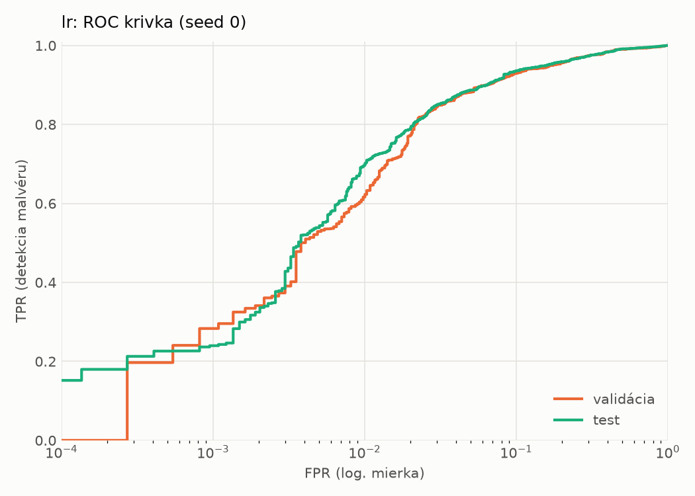
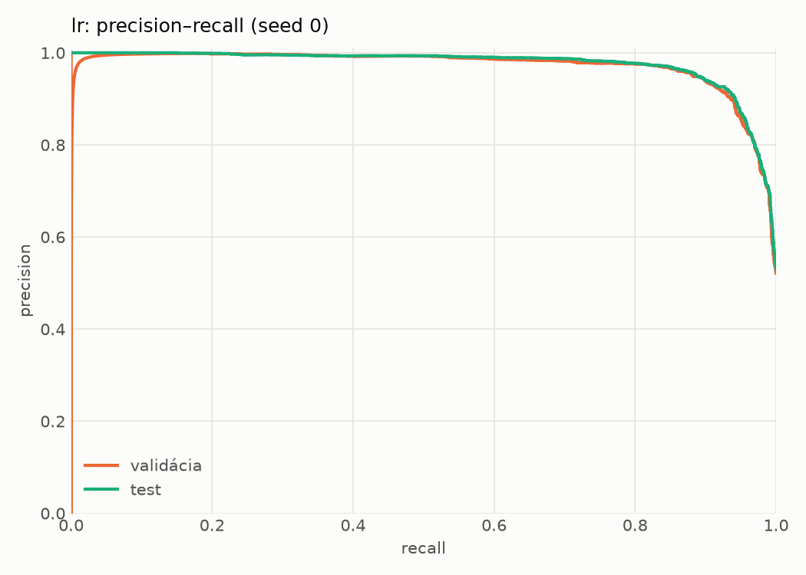
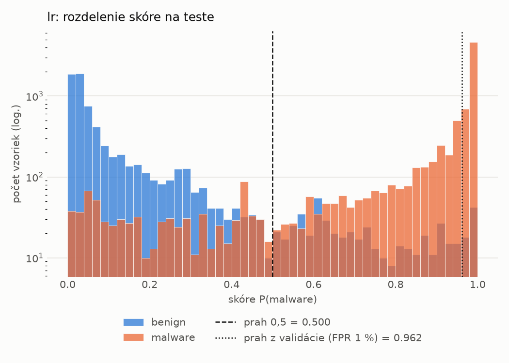
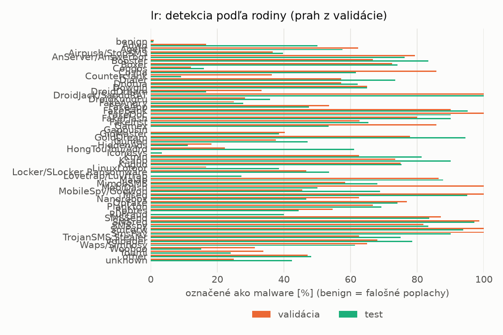
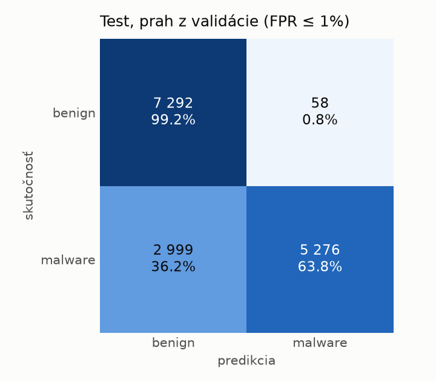
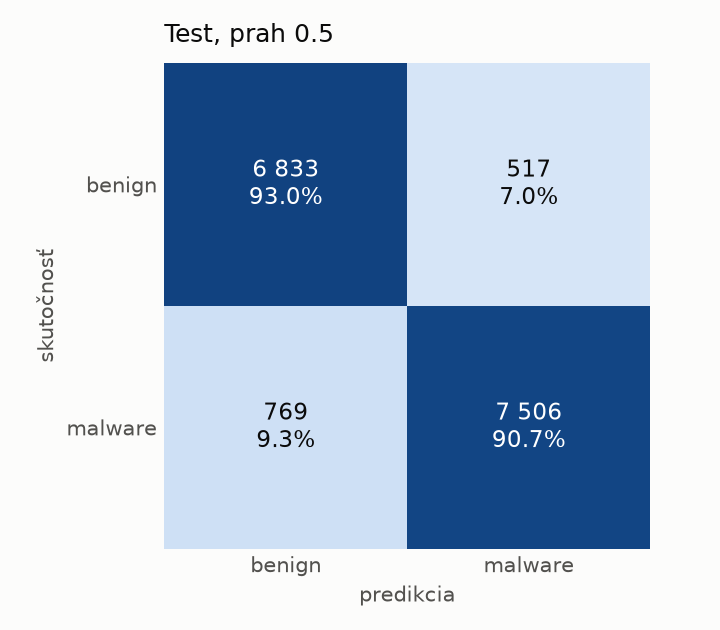

# static/lr – beh `20261122-224833`

> Automaticky generované (`src/training/run_tabular.py`). Konfigurácia: `config.yaml`, protokol: `protocol.yaml`.

- **Model:** `logreg` – logistická regresia s L2 regularizáciou (vstup signed log1p + štandardizácia)
- **Ladenie:** bez ladenia – hyperparametre prevzaté z `runs_v4/real_full/full/static/lr/20261122-184714`
- **Finálne modely:** seedy [0, 1, 2]; hodnoty sú priemer ± smerodajná odchýlka cez seedy
- **Najlepšie hyperparametre:** `{"max_iter": 2000, "C": 2.1423021757741068}`

## Detekčná kvalita (bez prahu)
| metrika | train (podvzorka) | validácia | test |
|---|---|---|---|
| ROC-AUC | 0.9714 ± 0.0000 | 0.9678 ± 0.0000 | 0.9696 ± 0.0000 |
| PR-AUC | 0.9753 ± 0.0000 | 0.9719 ± 0.0000 | 0.9751 ± 0.0000 |
| TPR pri FPR 1 % | 0.6832 ± 0.0000 | 0.6162 ± 0.0000 | 0.6964 ± 0.0000 |
| TPR pri FPR 0,1 % | 0.3377 ± 0.0000 | 0.2833 ± 0.0000 | 0.2398 ± 0.0000 |
| log loss | 0.2138 ± 0.0000 | 0.2280 ± 0.0000 | 0.2202 ± 0.0000 |
| Brier skóre | 0.0605 ± 0.0000 | 0.0634 ± 0.0000 | 0.0619 ± 0.0000 |

Rozdiel ROC-AUC train − validácia: **0.0036** (veľký rozdiel = preučenie).

## Pri prahu z validácie (FPR ≤ 1% na validácii)
| metrika | train (podvzorka) | validácia | test |
|---|---|---|---|
| accuracy | 0.7977 ± 0.0000 | 0.7951 ± 0.0000 | 0.8044 ± 0.0000 |
| balanced accuracy | 0.8042 ± 0.0000 | 0.8032 ± 0.0000 | 0.8148 ± 0.0000 |
| precision | 0.9900 ± 0.0000 | 0.9856 ± 0.0000 | 0.9891 ± 0.0000 |
| recall (TPR) | 0.6151 ± 0.0000 | 0.6162 ± 0.0000 | 0.6376 ± 0.0000 |
| FPR | 0.0066 ± 0.0000 | 0.0098 ± 0.0000 | 0.0079 ± 0.0000 |
| F1 | 0.7588 ± 0.0000 | 0.7583 ± 0.0000 | 0.7754 ± 0.0000 |
| MCC | 0.6511 ± 0.0000 | 0.6461 ± 0.0000 | 0.6628 ± 0.0000 |

## Pri pevnom prahu 0.5
| metrika | train (podvzorka) | validácia | test |
|---|---|---|---|
| accuracy | 0.9230 ± 0.0000 | 0.9169 ± 0.0000 | 0.9177 ± 0.0000 |
| balanced accuracy | 0.9235 ± 0.0000 | 0.9173 ± 0.0000 | 0.9184 ± 0.0000 |
| precision | 0.9399 ± 0.0000 | 0.9327 ± 0.0000 | 0.9356 ± 0.0000 |
| recall (TPR) | 0.9093 ± 0.0000 | 0.9060 ± 0.0000 | 0.9071 ± 0.0000 |
| FPR | 0.0624 ± 0.0000 | 0.0713 ± 0.0000 | 0.0703 ± 0.0000 |
| F1 | 0.9243 ± 0.0000 | 0.9192 ± 0.0000 | 0.9211 ± 0.0000 |
| MCC | 0.8465 ± 0.0000 | 0.8340 ± 0.0000 | 0.8356 ± 0.0000 |

## Výpočtové nároky (seed 0, testovacia množina)
| meranie | hodnota |
|---|---|
| tréning finálneho modelu | 0.2 s (priemer cez seedy) |
| ladenie spolu | 0 s |
| počet parametrov / uzlov | 164 |
| veľkosť modelu na disku | 0.01 MB |
| transformácia vstupu – latencia (1 vlákno) | 0.005 ms |
| transformácia vstupu – priepustnosť | 1 095 300 vzoriek/s |
| CPU latencia modelu (batch 1, 1 vlákno) | 0.004 ms (p95 0.004) |
| CPU priepustnosť (24 vlákien) | 3 822 256 vzoriek/s |

## Grafy
| | |
|---|---|
|  |  |
|  |  |
|  |  |
|  |  |

## Súbory
`metrics.json` (všetky metriky po seedoch vrátane rodín), `timing.json`, `hpo_trials.csv`,
`predictions/<časť>_seed<N>.parquet` (sha256, family, label, score), `model/seed_<N>/`, `log.txt`.
