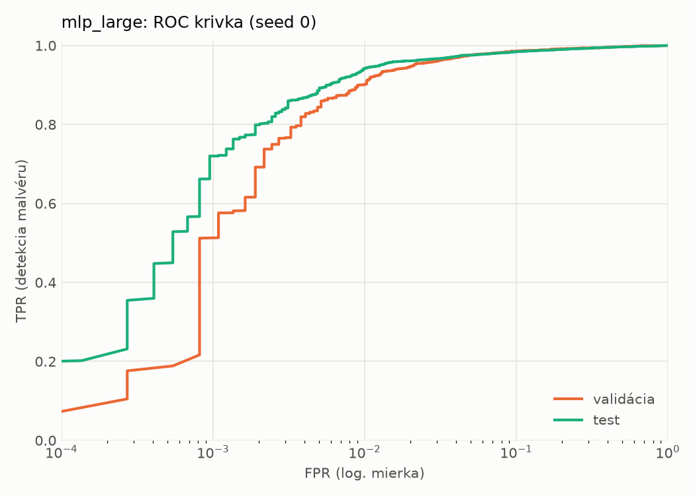
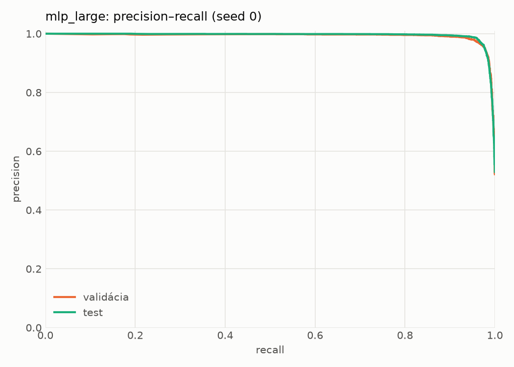
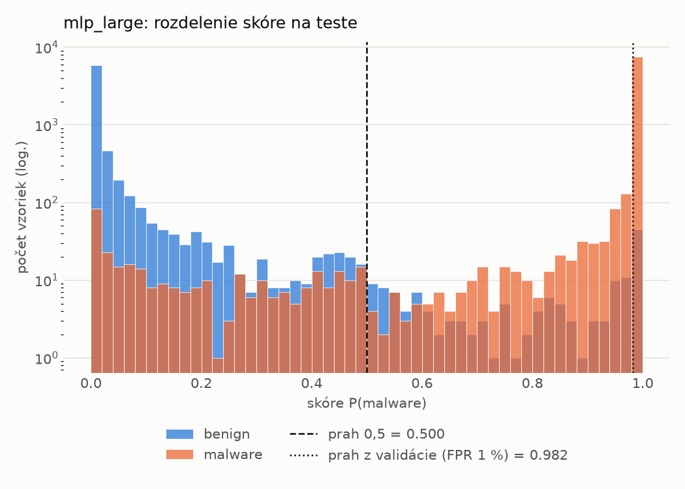
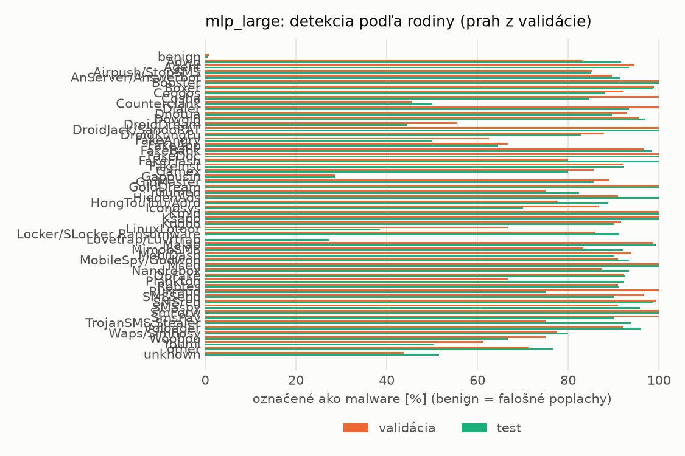
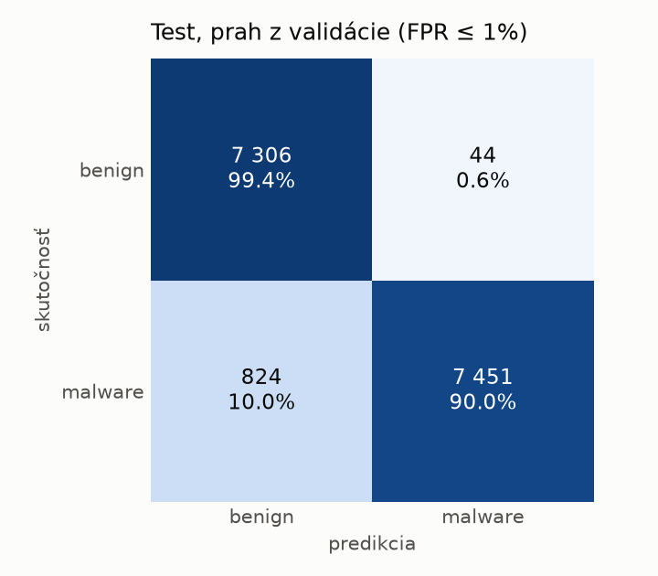
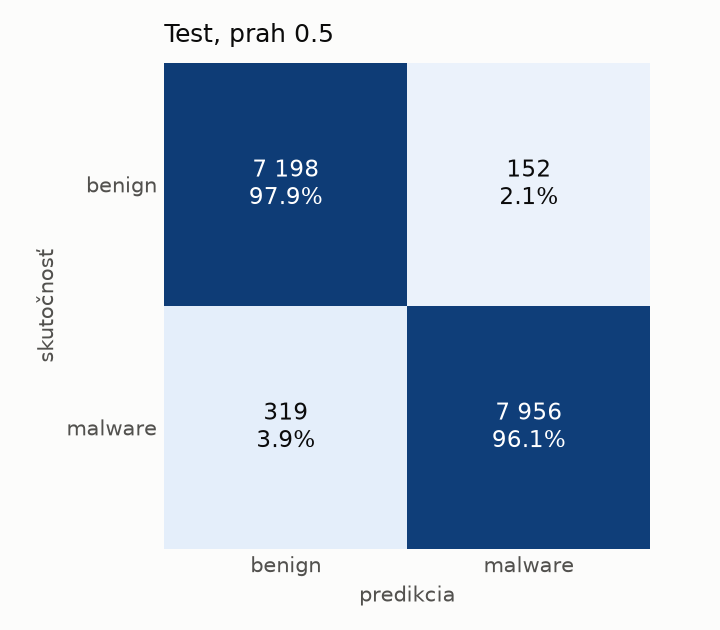
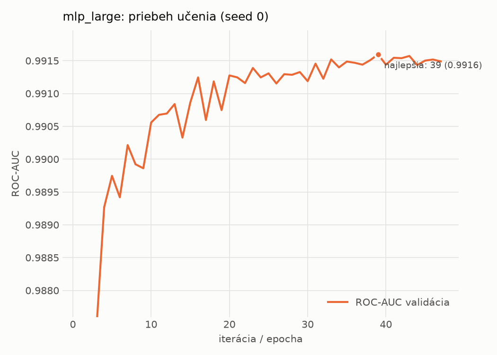

# static/mlp_large – beh `20261122-225035`

> Automaticky generované (`src/training/run_tabular.py`). Konfigurácia: `config.yaml`, protokol: `protocol.yaml`.

- **Model:** `mlp` – veľká neurónová sieť (3–5 skrytých vrstiev, 512–2048 neurónov), kandidát na učiteľa
- **Ladenie:** bez ladenia – hyperparametre prevzaté z `runs_v4/real_full/full/static/mlp_large/20261122-190815`
- **Finálne modely:** seedy [0, 1, 2]; hodnoty sú priemer ± smerodajná odchýlka cez seedy
- **Najlepšie hyperparametre:** `{"max_epochs": 100, "patience": 8, "hidden_layers": 3, "hidden_width": 512, "width_decay": 0.5, "dropout": 0.18301180344828658, "lr": 0.000378062291460712, "weight_decay": 1.421525321060219e-06, "batch_size": 256}`

## Detekčná kvalita (bez prahu)
| metrika | train (podvzorka) | validácia | test |
|---|---|---|---|
| ROC-AUC | 0.9980 ± 0.0013 | 0.9917 ± 0.0002 | 0.9917 ± 0.0010 |
| PR-AUC | 0.9983 ± 0.0010 | 0.9929 ± 0.0004 | 0.9937 ± 0.0005 |
| TPR pri FPR 1 % | 0.9731 ± 0.0102 | 0.9121 ± 0.0100 | 0.9390 ± 0.0041 |
| TPR pri FPR 0,1 % | 0.9427 ± 0.0233 | 0.5678 ± 0.0535 | 0.7056 ± 0.0289 |
| log loss | 0.0516 ± 0.0163 | 0.1190 ± 0.0028 | 0.1115 ± 0.0074 |
| Brier skóre | 0.0142 ± 0.0043 | 0.0282 ± 0.0013 | 0.0258 ± 0.0024 |

Rozdiel ROC-AUC train − validácia: **0.0063** (veľký rozdiel = preučenie).

## Pri prahu z validácie (FPR ≤ 1% na validácii)
| metrika | train (podvzorka) | validácia | test |
|---|---|---|---|
| accuracy | 0.9581 ± 0.0042 | 0.9495 ± 0.0053 | 0.9491 ± 0.0043 |
| balanced accuracy | 0.9595 ± 0.0040 | 0.9512 ± 0.0050 | 0.9516 ± 0.0041 |
| precision | 0.9994 ± 0.0004 | 0.9903 ± 0.0002 | 0.9939 ± 0.0005 |
| recall (TPR) | 0.9195 ± 0.0081 | 0.9121 ± 0.0100 | 0.9094 ± 0.0083 |
| FPR | 0.0006 ± 0.0004 | 0.0097 ± 0.0002 | 0.0063 ± 0.0005 |
| F1 | 0.9578 ± 0.0044 | 0.9496 ± 0.0055 | 0.9498 ± 0.0045 |
| MCC | 0.9195 ± 0.0077 | 0.9023 ± 0.0097 | 0.9020 ± 0.0079 |

## Pri pevnom prahu 0.5
| metrika | train (podvzorka) | validácia | test |
|---|---|---|---|
| accuracy | 0.9810 ± 0.0050 | 0.9640 ± 0.0013 | 0.9678 ± 0.0030 |
| balanced accuracy | 0.9814 ± 0.0049 | 0.9643 ± 0.0013 | 0.9684 ± 0.0028 |
| precision | 0.9941 ± 0.0029 | 0.9731 ± 0.0010 | 0.9803 ± 0.0008 |
| recall (TPR) | 0.9690 ± 0.0068 | 0.9575 ± 0.0030 | 0.9584 ± 0.0055 |
| FPR | 0.0061 ± 0.0030 | 0.0289 ± 0.0011 | 0.0216 ± 0.0010 |
| F1 | 0.9814 ± 0.0049 | 0.9652 ± 0.0013 | 0.9693 ± 0.0029 |
| MCC | 0.9623 ± 0.0098 | 0.9280 ± 0.0026 | 0.9358 ± 0.0058 |

## Výpočtové nároky (seed 0, testovacia množina)
| meranie | hodnota |
|---|---|
| tréning finálneho modelu | 19.8 s (priemer cez seedy) |
| ladenie spolu | 0 s |
| počet parametrov / uzlov | 250 113 |
| veľkosť modelu na disku | 1.02 MB |
| transformácia vstupu – latencia (1 vlákno) | 0.015 ms |
| transformácia vstupu – priepustnosť | 617 816 vzoriek/s |
| CPU latencia modelu (batch 1, 1 vlákno) | 0.153 ms (p95 0.325) |
| CPU priepustnosť (24 vlákien) | 895 872 vzoriek/s |
| GPU latencia (batch 1) | 0.439 ms (p95 0.895) |
| GPU priepustnosť | 833 903 vzoriek/s |
| GPU špičková pamäť | 144 MB |

## Grafy
| | |
|---|---|
|  |  |
|  |  |
|  |  |
|  |  |

## Súbory
`metrics.json` (všetky metriky po seedoch vrátane rodín), `timing.json`, `hpo_trials.csv`,
`predictions/<časť>_seed<N>.parquet` (sha256, family, label, score), `model/seed_<N>/`, `log.txt`.
