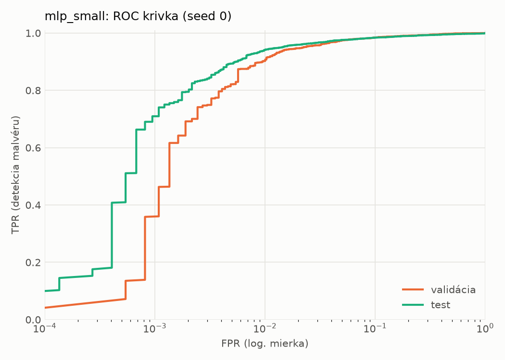
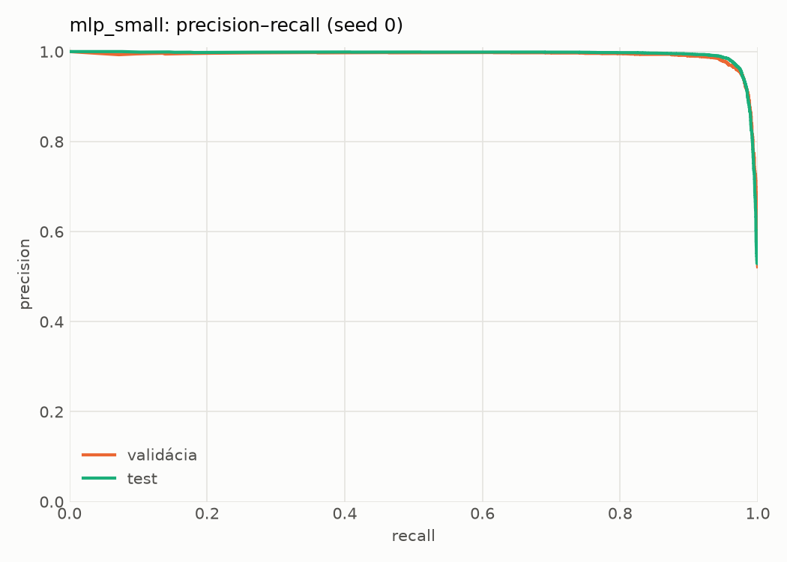
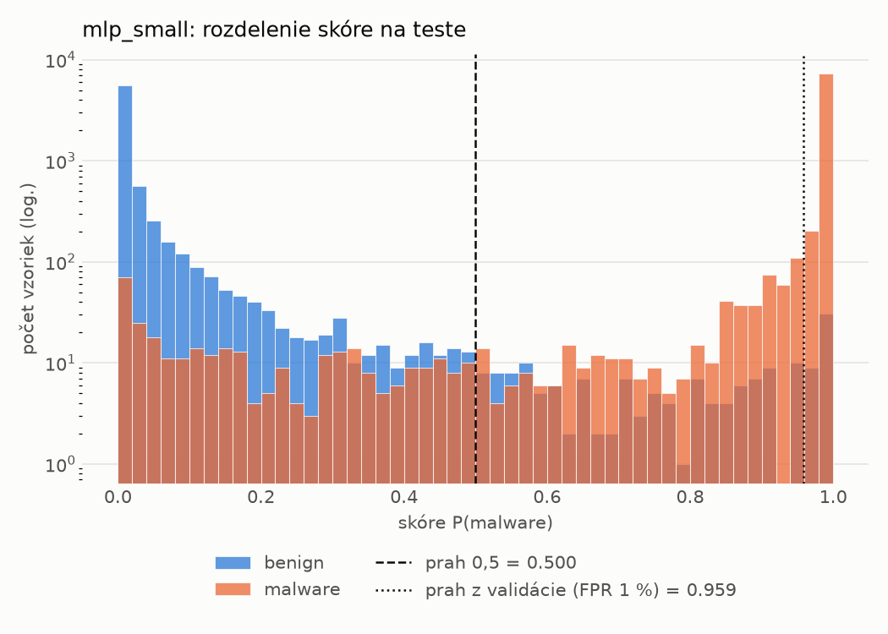
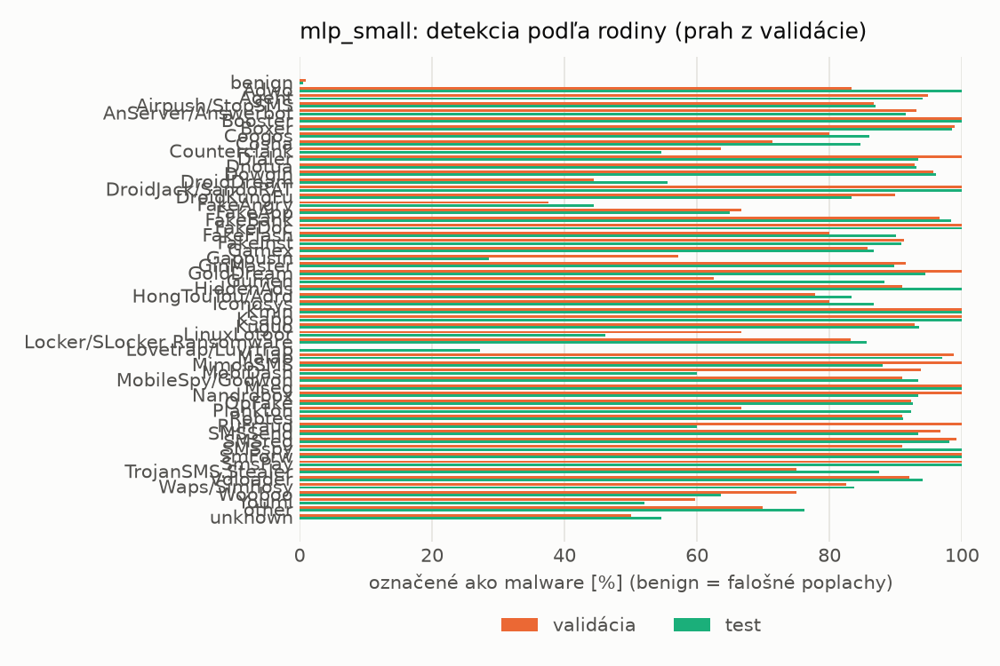
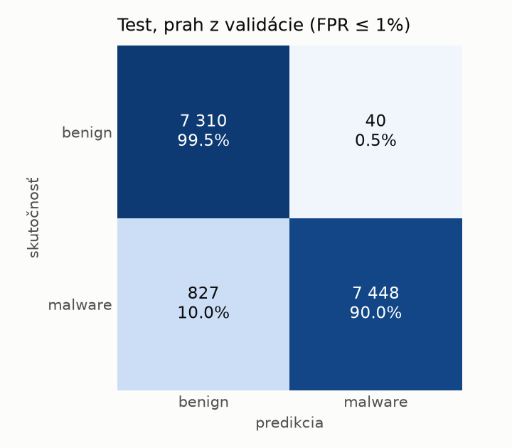
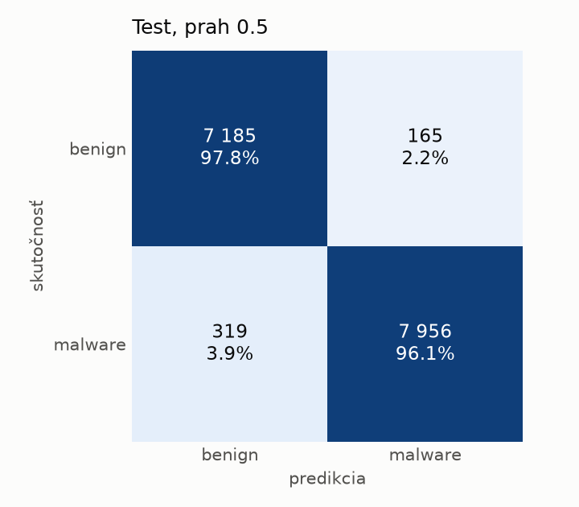
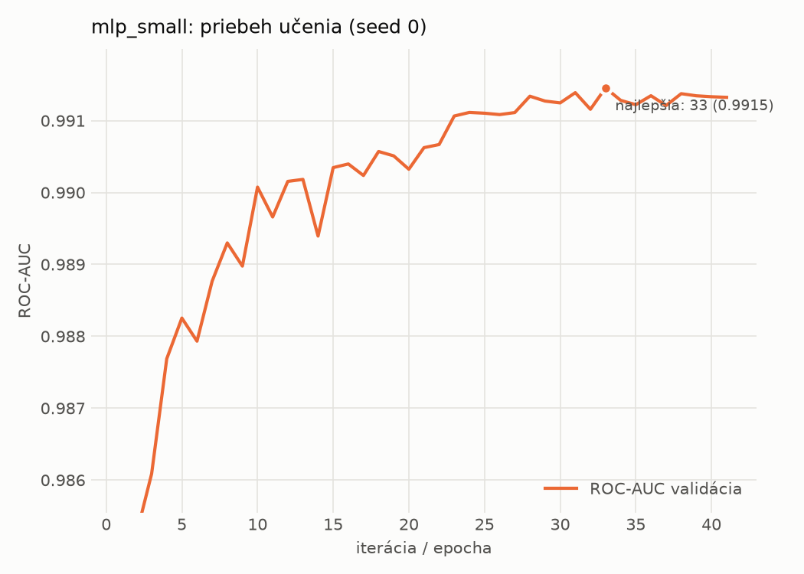

# static/mlp_small – beh `20261122-224947`

> Automaticky generované (`src/training/run_tabular.py`). Konfigurácia: `config.yaml`, protokol: `protocol.yaml`.

- **Model:** `mlp` – malá neurónová sieť (1–2 skryté vrstvy), kandidát na ľahkého študenta
- **Ladenie:** bez ladenia – hyperparametre prevzaté z `runs_v4/real_full/full/static/mlp_small/20261122-190134`
- **Finálne modely:** seedy [0, 1, 2]; hodnoty sú priemer ± smerodajná odchýlka cez seedy
- **Najlepšie hyperparametre:** `{"width_decay": 0.5, "max_epochs": 100, "patience": 8, "hidden_layers": 2, "hidden_width": 256, "dropout": 0.05428236214064427, "lr": 0.00041374253133077954, "weight_decay": 5.569517746104647e-06, "batch_size": 256}`

## Detekčná kvalita (bez prahu)
| metrika | train (podvzorka) | validácia | test |
|---|---|---|---|
| ROC-AUC | 0.9980 ± 0.0003 | 0.9914 ± 0.0004 | 0.9913 ± 0.0007 |
| PR-AUC | 0.9984 ± 0.0002 | 0.9923 ± 0.0008 | 0.9932 ± 0.0004 |
| TPR pri FPR 1 % | 0.9754 ± 0.0041 | 0.9032 ± 0.0029 | 0.9349 ± 0.0072 |
| TPR pri FPR 0,1 % | 0.9445 ± 0.0109 | 0.5130 ± 0.1350 | 0.7028 ± 0.0230 |
| log loss | 0.0507 ± 0.0037 | 0.1159 ± 0.0020 | 0.1104 ± 0.0051 |
| Brier skóre | 0.0136 ± 0.0011 | 0.0282 ± 0.0007 | 0.0256 ± 0.0010 |

Rozdiel ROC-AUC train − validácia: **0.0067** (veľký rozdiel = preučenie).

## Pri prahu z validácie (FPR ≤ 1% na validácii)
| metrika | train (podvzorka) | validácia | test |
|---|---|---|---|
| accuracy | 0.9541 ± 0.0027 | 0.9448 ± 0.0015 | 0.9457 ± 0.0024 |
| balanced accuracy | 0.9556 ± 0.0026 | 0.9467 ± 0.0015 | 0.9484 ± 0.0023 |
| precision | 0.9996 ± 0.0000 | 0.9902 ± 0.0000 | 0.9941 ± 0.0005 |
| recall (TPR) | 0.9117 ± 0.0052 | 0.9032 ± 0.0029 | 0.9028 ± 0.0046 |
| FPR | 0.0004 ± 0.0000 | 0.0098 ± 0.0000 | 0.0060 ± 0.0005 |
| F1 | 0.9536 ± 0.0028 | 0.9447 ± 0.0016 | 0.9462 ± 0.0025 |
| MCC | 0.9122 ± 0.0049 | 0.8936 ± 0.0028 | 0.8959 ± 0.0044 |

## Pri pevnom prahu 0.5
| metrika | train (podvzorka) | validácia | test |
|---|---|---|---|
| accuracy | 0.9818 ± 0.0016 | 0.9635 ± 0.0011 | 0.9678 ± 0.0015 |
| balanced accuracy | 0.9822 ± 0.0016 | 0.9636 ± 0.0011 | 0.9682 ± 0.0016 |
| precision | 0.9928 ± 0.0019 | 0.9689 ± 0.0016 | 0.9769 ± 0.0026 |
| recall (TPR) | 0.9719 ± 0.0013 | 0.9609 ± 0.0016 | 0.9620 ± 0.0012 |
| FPR | 0.0076 ± 0.0020 | 0.0337 ± 0.0017 | 0.0257 ± 0.0030 |
| F1 | 0.9822 ± 0.0016 | 0.9649 ± 0.0011 | 0.9694 ± 0.0014 |
| MCC | 0.9638 ± 0.0032 | 0.9270 ± 0.0022 | 0.9356 ± 0.0030 |

## Výpočtové nároky (seed 0, testovacia množina)
| meranie | hodnota |
|---|---|
| tréning finálneho modelu | 15.1 s (priemer cez seedy) |
| ladenie spolu | 0 s |
| počet parametrov / uzlov | 75 777 |
| veľkosť modelu na disku | 0.32 MB |
| transformácia vstupu – latencia (1 vlákno) | 0.014 ms |
| transformácia vstupu – priepustnosť | 568 010 vzoriek/s |
| CPU latencia modelu (batch 1, 1 vlákno) | 0.232 ms (p95 0.243) |
| CPU priepustnosť (24 vlákien) | 1 538 393 vzoriek/s |
| GPU latencia (batch 1) | 0.647 ms (p95 0.676) |
| GPU priepustnosť | 1 346 217 vzoriek/s |
| GPU špičková pamäť | 85 MB |

## Grafy
| | |
|---|---|
|  |  |
|  |  |
|  |  |
|  |  |

## Súbory
`metrics.json` (všetky metriky po seedoch vrátane rodín), `timing.json`, `hpo_trials.csv`,
`predictions/<časť>_seed<N>.parquet` (sha256, family, label, score), `model/seed_<N>/`, `log.txt`.
