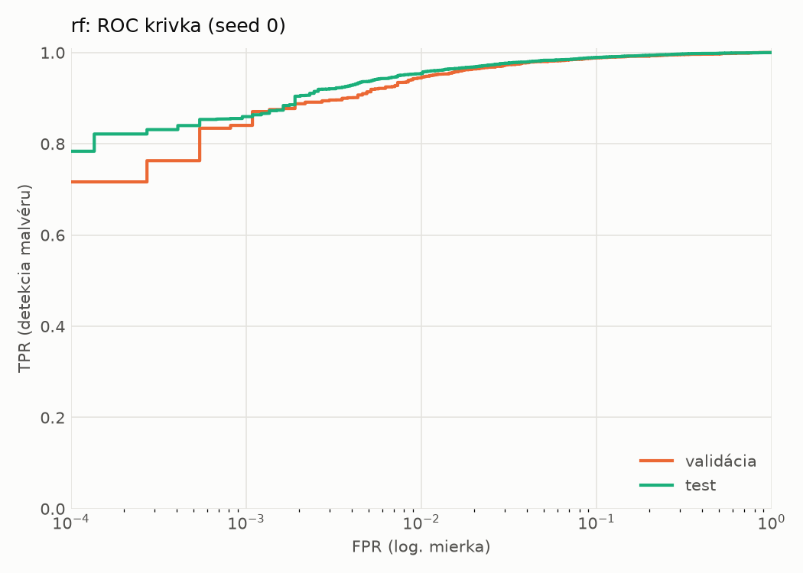
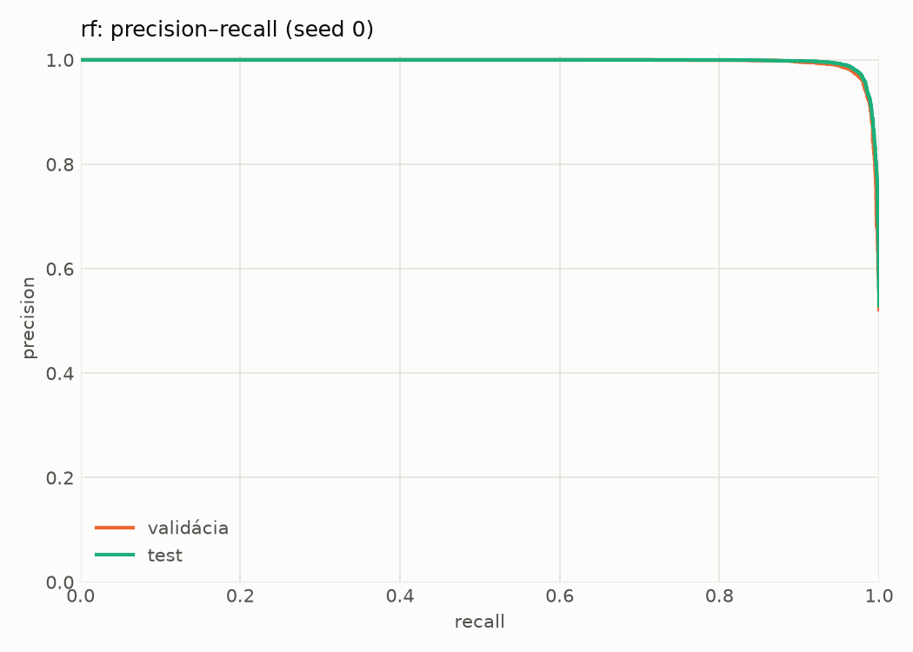
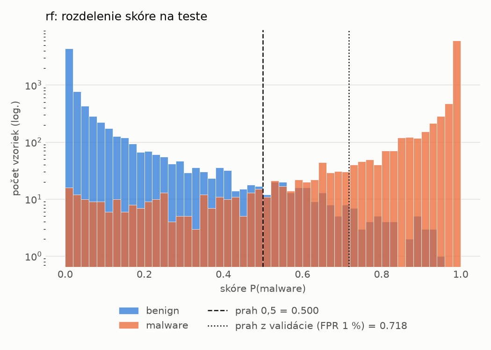
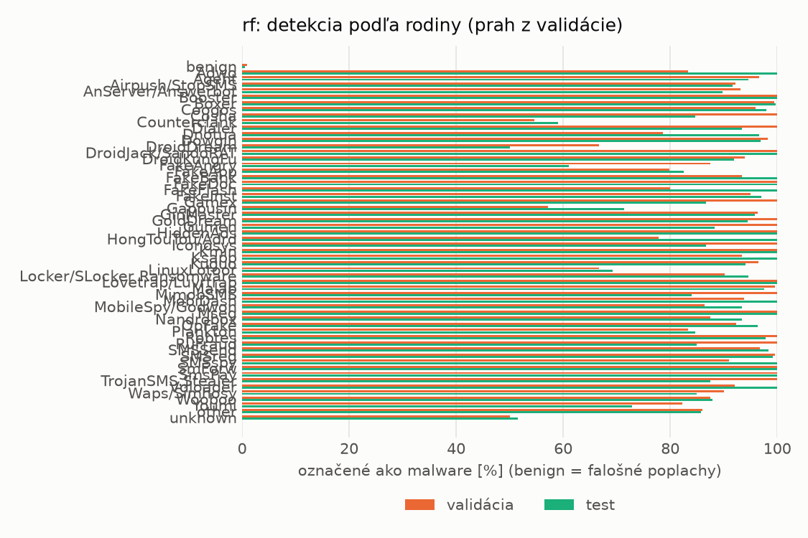
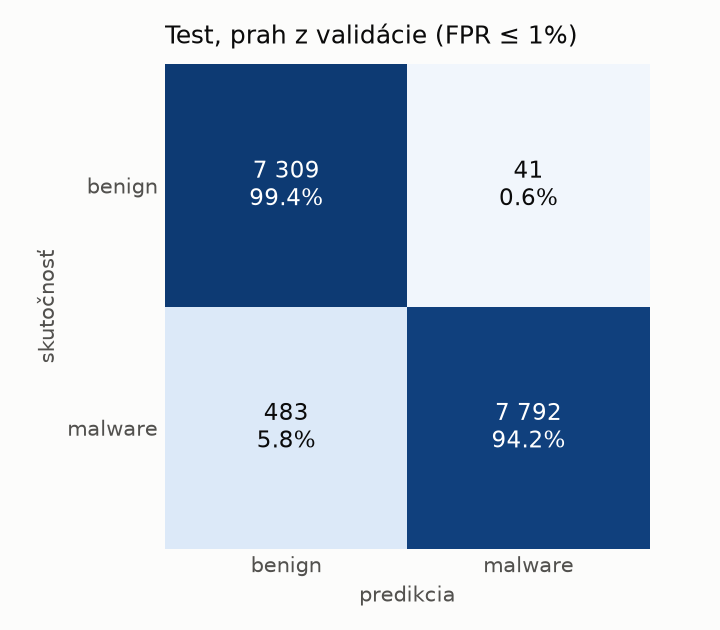
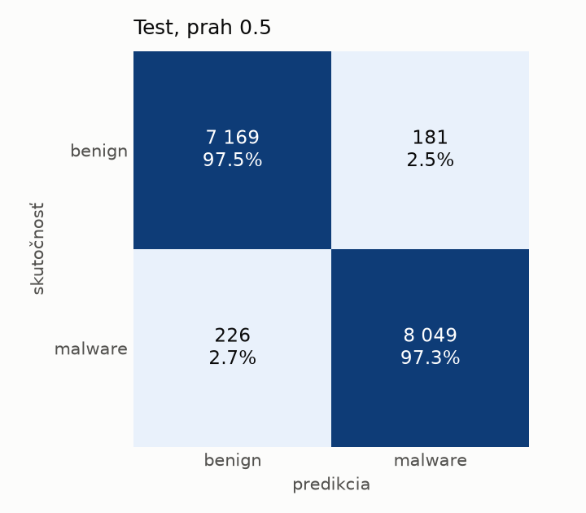

# static/rf – beh `20261122-224837`

> Automaticky generované (`src/training/run_tabular.py`). Konfigurácia: `config.yaml`, protokol: `protocol.yaml`.

- **Model:** `random_forest` – Random Forest (pôvodné hodnoty príznakov)
- **Ladenie:** bez ladenia – hyperparametre prevzaté z `runs_v4/real_full/full/static/rf/20261122-184723`
- **Finálne modely:** seedy [0, 1, 2]; hodnoty sú priemer ± smerodajná odchýlka cez seedy
- **Najlepšie hyperparametre:** `{"n_estimators": 400, "max_depth": 32, "min_samples_leaf": 1, "max_features": "sqrt"}`

## Detekčná kvalita (bez prahu)
| metrika | train (podvzorka) | validácia | test |
|---|---|---|---|
| ROC-AUC | 1.0000 ± 0.0000 | 0.9943 ± 0.0001 | 0.9955 ± 0.0001 |
| PR-AUC | 1.0000 ± 0.0000 | 0.9957 ± 0.0001 | 0.9967 ± 0.0000 |
| TPR pri FPR 1 % | 1.0000 ± 0.0000 | 0.9448 ± 0.0014 | 0.9550 ± 0.0011 |
| TPR pri FPR 0,1 % | 0.9997 ± 0.0001 | 0.8202 ± 0.0182 | 0.8697 ± 0.0088 |
| log loss | 0.0260 ± 0.0001 | 0.0912 ± 0.0008 | 0.0859 ± 0.0003 |
| Brier skóre | 0.0038 ± 0.0000 | 0.0238 ± 0.0001 | 0.0220 ± 0.0000 |

Rozdiel ROC-AUC train − validácia: **0.0057** (veľký rozdiel = preučenie).

## Pri prahu z validácie (FPR ≤ 1% na validácii)
| metrika | train (podvzorka) | validácia | test |
|---|---|---|---|
| accuracy | 0.9905 ± 0.0004 | 0.9665 ± 0.0007 | 0.9660 ± 0.0004 |
| balanced accuracy | 0.9908 ± 0.0004 | 0.9675 ± 0.0007 | 0.9676 ± 0.0004 |
| precision | 1.0000 ± 0.0000 | 0.9906 ± 0.0000 | 0.9944 ± 0.0003 |
| recall (TPR) | 0.9817 ± 0.0007 | 0.9448 ± 0.0014 | 0.9411 ± 0.0005 |
| FPR | 0.0000 ± 0.0000 | 0.0098 ± 0.0000 | 0.0060 ± 0.0004 |
| F1 | 0.9908 ± 0.0004 | 0.9672 ± 0.0007 | 0.9670 ± 0.0004 |
| MCC | 0.9812 ± 0.0007 | 0.9341 ± 0.0014 | 0.9335 ± 0.0008 |

## Pri pevnom prahu 0.5
| metrika | train (podvzorka) | validácia | test |
|---|---|---|---|
| accuracy | 0.9992 ± 0.0002 | 0.9706 ± 0.0008 | 0.9741 ± 0.0002 |
| balanced accuracy | 0.9992 ± 0.0001 | 0.9705 ± 0.0008 | 0.9743 ± 0.0002 |
| precision | 0.9998 ± 0.0000 | 0.9717 ± 0.0005 | 0.9786 ± 0.0006 |
| recall (TPR) | 0.9986 ± 0.0003 | 0.9719 ± 0.0012 | 0.9724 ± 0.0004 |
| FPR | 0.0002 ± 0.0000 | 0.0308 ± 0.0006 | 0.0239 ± 0.0007 |
| F1 | 0.9992 ± 0.0001 | 0.9718 ± 0.0008 | 0.9755 ± 0.0002 |
| MCC | 0.9983 ± 0.0003 | 0.9411 ± 0.0016 | 0.9481 ± 0.0003 |

## Výpočtové nároky (seed 0, testovacia množina)
| meranie | hodnota |
|---|---|
| tréning finálneho modelu | 1.9 s (priemer cez seedy) |
| ladenie spolu | 0 s |
| počet parametrov / uzlov | 2 635 900 |
| veľkosť modelu na disku | 211.25 MB |
| CPU latencia modelu (batch 1, 1 vlákno) | 12.050 ms (p95 12.401) |
| CPU priepustnosť (24 vlákien) | 150 733 vzoriek/s |

## Grafy
| | |
|---|---|
|  |  |
|  |  |
|  |  |
|  |  |

## Súbory
`metrics.json` (všetky metriky po seedoch vrátane rodín), `timing.json`, `hpo_trials.csv`,
`predictions/<časť>_seed<N>.parquet` (sha256, family, label, score), `model/seed_<N>/`, `log.txt`.
