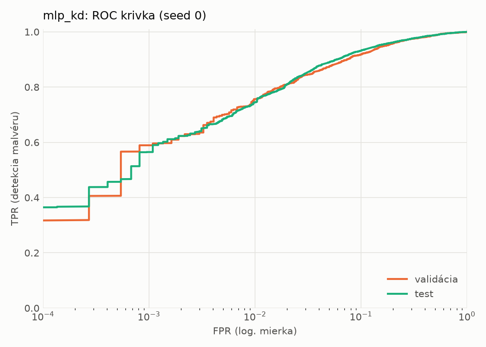
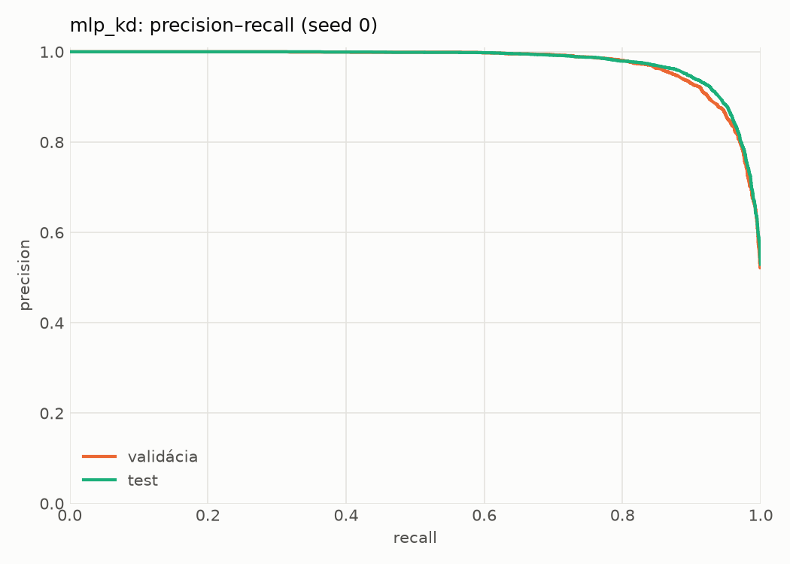
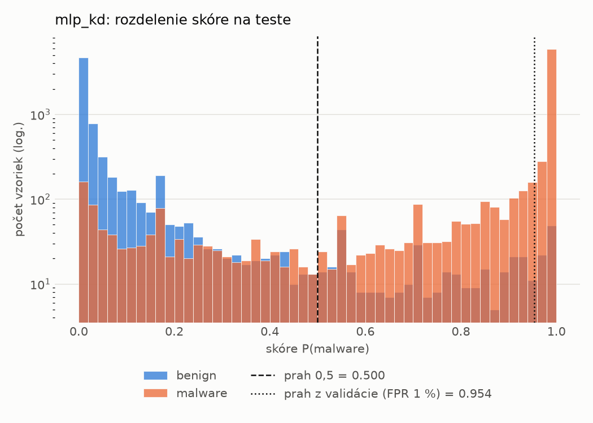
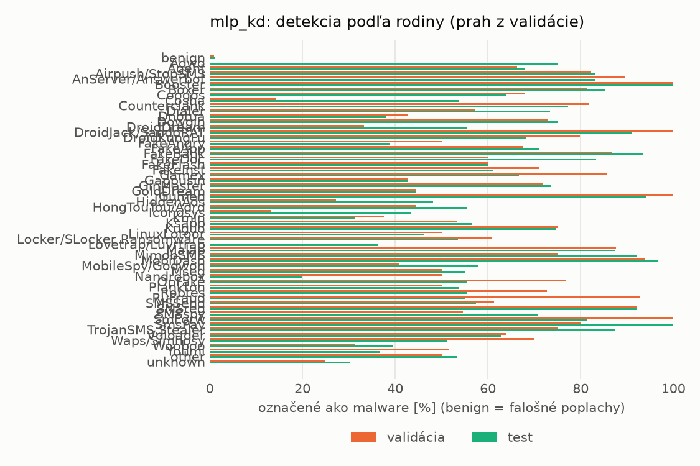
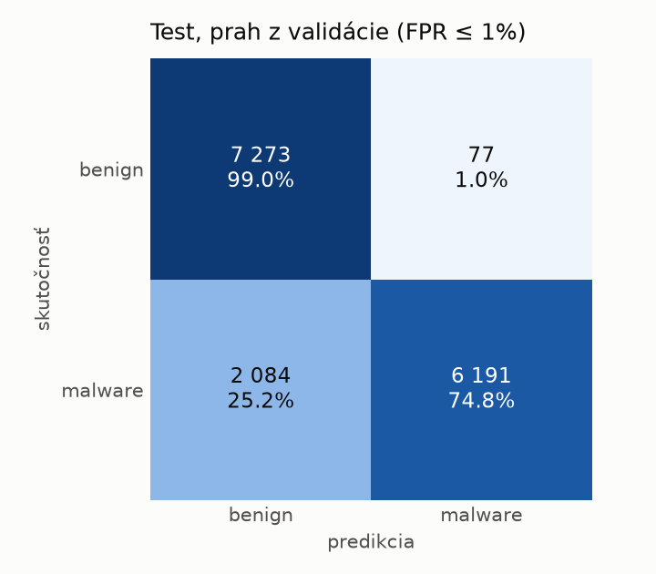
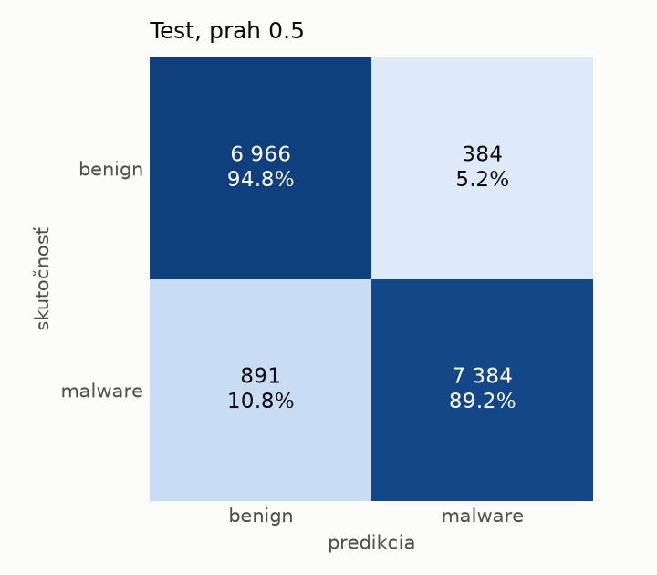
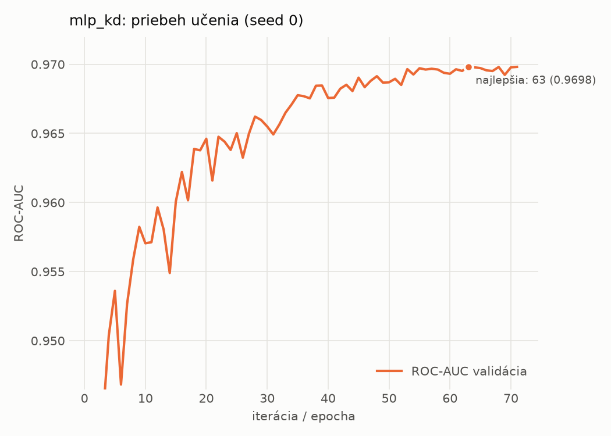

# dynamic/mlp_kd – beh `20261122-230432`

> Automaticky generované (`src/training/run_tabular.py`). Konfigurácia: `config.yaml`, protokol: `protocol.yaml`.

- **Model:** `mlp` – študent – malé MLP učené destiláciou z hybridného učiteľa
- **Ladenie:** bez ladenia – hyperparametre prevzaté z `runs_v4/real_full/full/students_dynamic/mlp_kd/20261122-205301`
- **Finálne modely:** seedy [0, 1, 2]; hodnoty sú priemer ± smerodajná odchýlka cez seedy
- **Najlepšie hyperparametre:** `{"hidden_layers": 1, "max_epochs": 100, "patience": 8, "hidden_width": 64, "dropout": 0.03643763137351852, "lr": 0.0028753520300020953, "weight_decay": 0.00022273244560059002, "batch_size": 512, "kd_alpha": 0.33129867518829337, "kd_temperature": 1.9602594769462303}`

## Detekčná kvalita (bez prahu)
| metrika | train (podvzorka) | validácia | test |
|---|---|---|---|
| ROC-AUC | 0.9752 ± 0.0010 | 0.9692 ± 0.0008 | 0.9718 ± 0.0008 |
| PR-AUC | 0.9810 ± 0.0008 | 0.9760 ± 0.0006 | 0.9783 ± 0.0008 |
| TPR pri FPR 1 % | 0.8164 ± 0.0109 | 0.7489 ± 0.0066 | 0.7505 ± 0.0068 |
| TPR pri FPR 0,1 % | 0.6159 ± 0.0229 | 0.5663 ± 0.0216 | 0.5608 ± 0.0071 |
| log loss | 0.2092 ± 0.0054 | 0.2548 ± 0.0033 | 0.2372 ± 0.0038 |
| Brier skóre | 0.0560 ± 0.0017 | 0.0682 ± 0.0011 | 0.0638 ± 0.0015 |

Rozdiel ROC-AUC train − validácia: **0.0060** (veľký rozdiel = preučenie).

## Pri prahu z validácie (FPR ≤ 1% na validácii)
| metrika | train (podvzorka) | validácia | test |
|---|---|---|---|
| accuracy | 0.8727 ± 0.0037 | 0.8643 ± 0.0034 | 0.8602 ± 0.0013 |
| balanced accuracy | 0.8768 ± 0.0035 | 0.8695 ± 0.0033 | 0.8675 ± 0.0012 |
| precision | 0.9938 ± 0.0004 | 0.9882 ± 0.0001 | 0.9889 ± 0.0011 |
| recall (TPR) | 0.7586 ± 0.0071 | 0.7489 ± 0.0066 | 0.7444 ± 0.0033 |
| FPR | 0.0050 ± 0.0003 | 0.0098 ± 0.0000 | 0.0094 ± 0.0010 |
| F1 | 0.8604 ± 0.0046 | 0.8520 ± 0.0043 | 0.8494 ± 0.0018 |
| MCC | 0.7704 ± 0.0060 | 0.7551 ± 0.0056 | 0.7493 ± 0.0017 |

## Pri pevnom prahu 0.5
| metrika | train (podvzorka) | validácia | test |
|---|---|---|---|
| accuracy | 0.9285 ± 0.0027 | 0.9109 ± 0.0013 | 0.9171 ± 0.0021 |
| balanced accuracy | 0.9294 ± 0.0027 | 0.9119 ± 0.0012 | 0.9188 ± 0.0020 |
| precision | 0.9554 ± 0.0019 | 0.9382 ± 0.0016 | 0.9510 ± 0.0005 |
| recall (TPR) | 0.9041 ± 0.0042 | 0.8877 ± 0.0041 | 0.8892 ± 0.0043 |
| FPR | 0.0452 ± 0.0019 | 0.0639 ± 0.0021 | 0.0516 ± 0.0006 |
| F1 | 0.9290 ± 0.0028 | 0.9122 ± 0.0015 | 0.9191 ± 0.0023 |
| MCC | 0.8585 ± 0.0053 | 0.8231 ± 0.0023 | 0.8362 ± 0.0039 |

## Výpočtové nároky (seed 0, testovacia množina)
| meranie | hodnota |
|---|---|
| tréning finálneho modelu | 14.4 s (priemer cez seedy) |
| ladenie spolu | 0 s |
| počet parametrov / uzlov | 8 641 |
| veľkosť modelu na disku | 0.04 MB |
| transformácia vstupu – latencia (1 vlákno) | 0.006 ms |
| transformácia vstupu – priepustnosť | 1 199 285 vzoriek/s |
| CPU latencia modelu (batch 1, 1 vlákno) | 0.155 ms (p95 0.165) |
| CPU priepustnosť (24 vlákien) | 7 309 258 vzoriek/s |
| GPU latencia (batch 1) | 0.275 ms (p95 0.299) |
| GPU priepustnosť | 2 887 743 vzoriek/s |
| GPU špičková pamäť | 62 MB |

## Grafy
| | |
|---|---|
|  |  |
|  |  |
|  |  |
|  |  |

## Súbory
`metrics.json` (všetky metriky po seedoch vrátane rodín), `timing.json`, `hpo_trials.csv`,
`predictions/<časť>_seed<N>.parquet` (sha256, family, label, score), `model/seed_<N>/`, `log.txt`.
