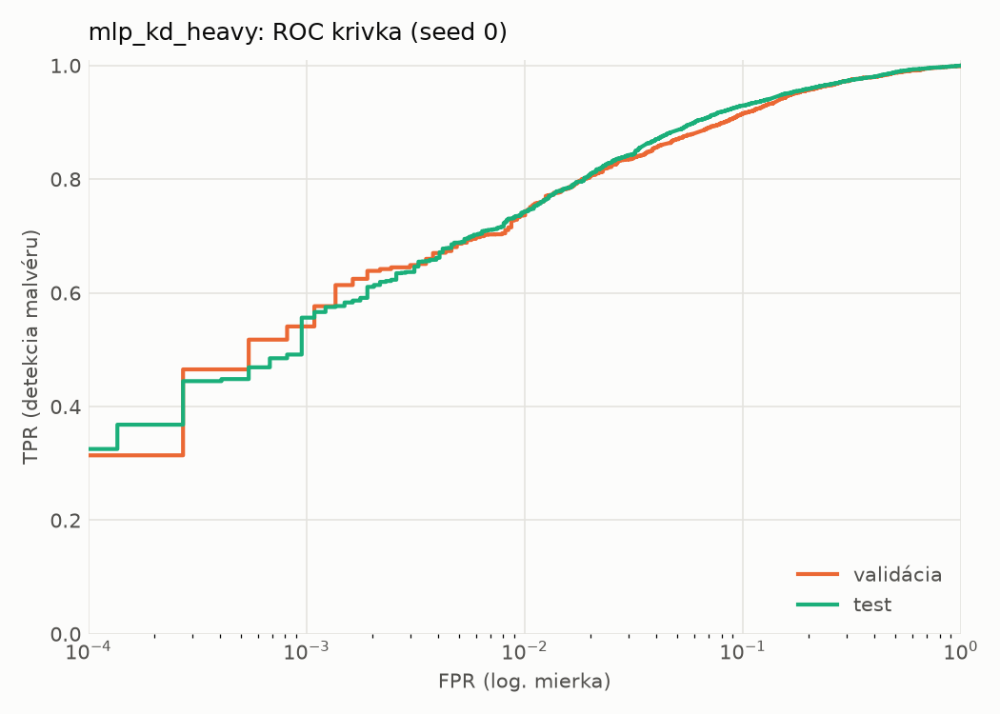
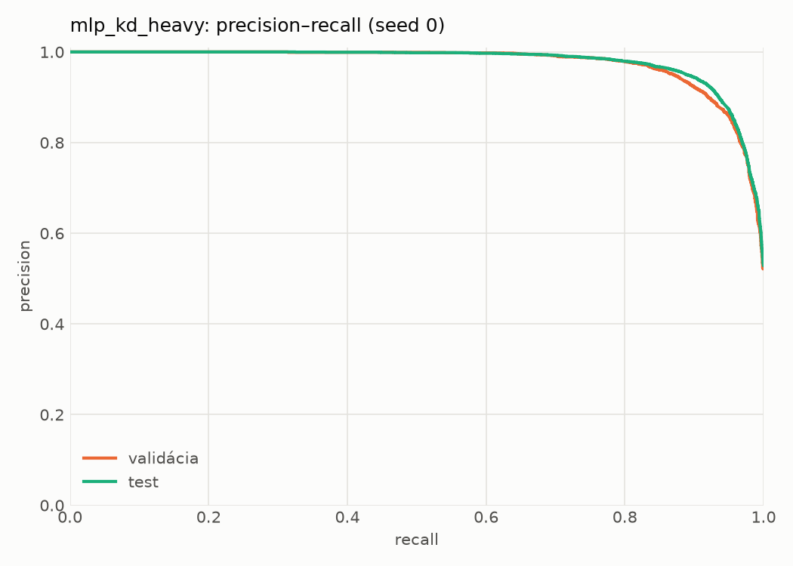
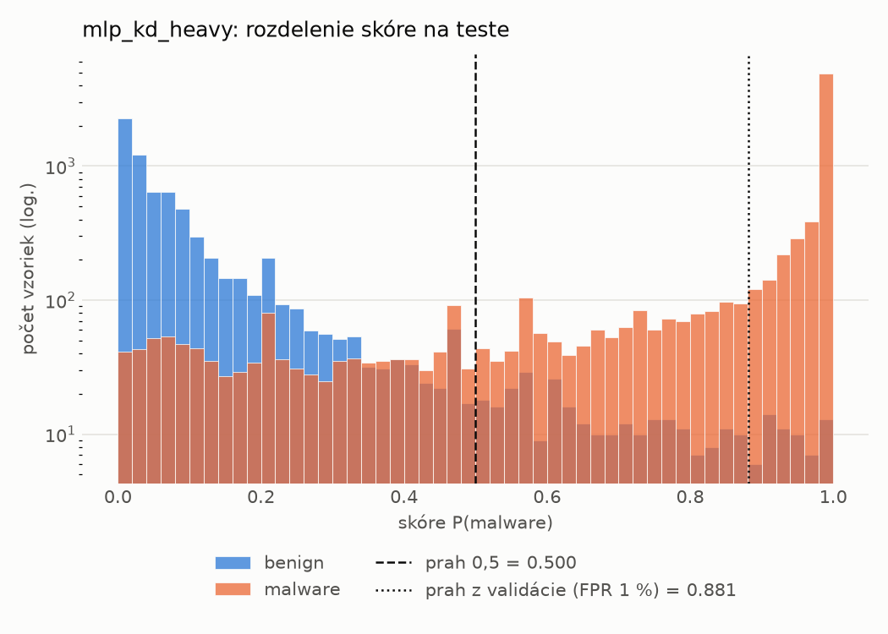
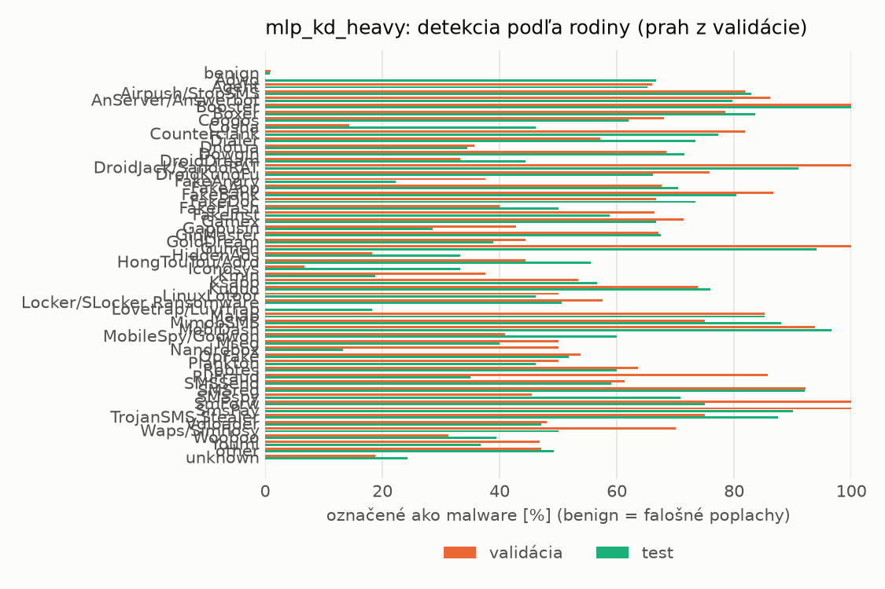
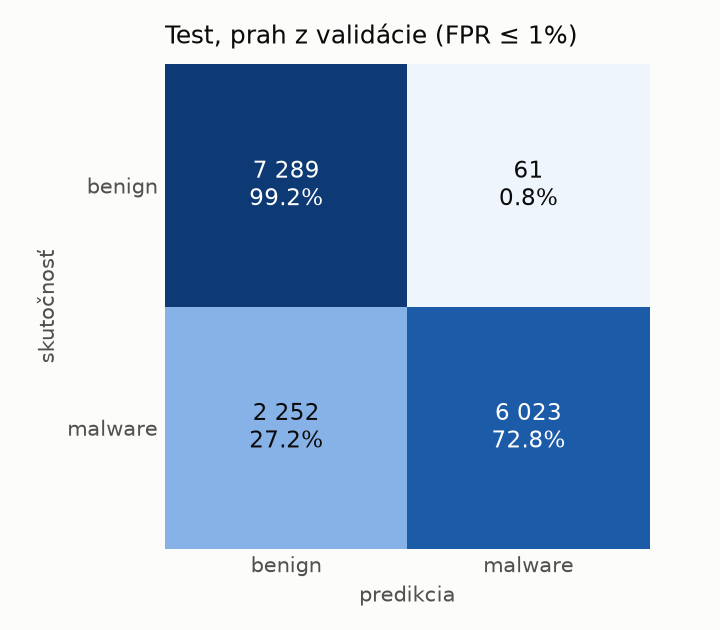
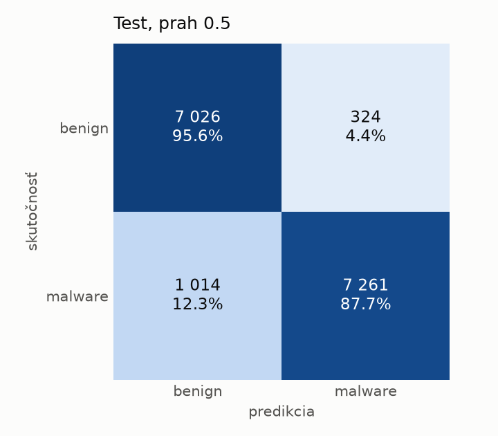
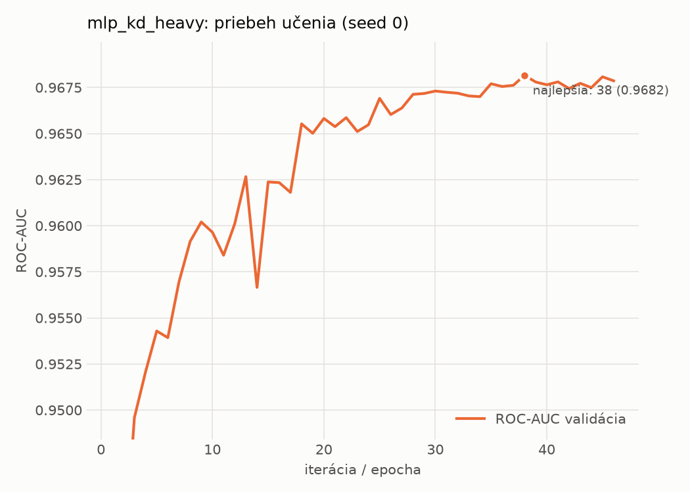

# dynamic/mlp_kd_heavy – beh `20261122-230654`

> Automaticky generované (`src/training/run_tabular.py`). Konfigurácia: `config.yaml`, protokol: `protocol.yaml`.

- **Model:** `mlp` – študent – malé MLP učené destiláciou z mlp_large hybridu (V4)
- **Ladenie:** bez ladenia – hyperparametre prevzaté z `runs_v4/real_full/full/students_dynamic/mlp_kd_heavy/20261122-211545`
- **Finálne modely:** seedy [0, 1, 2]; hodnoty sú priemer ± smerodajná odchýlka cez seedy
- **Najlepšie hyperparametre:** `{"hidden_layers": 1, "max_epochs": 100, "patience": 8, "hidden_width": 64, "dropout": 0.029123066185724737, "lr": 0.0017081972585601675, "weight_decay": 1.0334419171964511e-06, "batch_size": 256, "kd_alpha": 0.8514630095462001, "kd_temperature": 1.2684929468645387}`

## Detekčná kvalita (bez prahu)
| metrika | train (podvzorka) | validácia | test |
|---|---|---|---|
| ROC-AUC | 0.9771 ± 0.0013 | 0.9694 ± 0.0011 | 0.9720 ± 0.0011 |
| PR-AUC | 0.9823 ± 0.0010 | 0.9762 ± 0.0007 | 0.9785 ± 0.0006 |
| TPR pri FPR 1 % | 0.8165 ± 0.0067 | 0.7510 ± 0.0131 | 0.7469 ± 0.0046 |
| TPR pri FPR 0,1 % | 0.6328 ± 0.0118 | 0.5316 ± 0.0238 | 0.5376 ± 0.0182 |
| log loss | 0.1870 ± 0.0060 | 0.2229 ± 0.0050 | 0.2138 ± 0.0051 |
| Brier skóre | 0.0542 ± 0.0021 | 0.0653 ± 0.0017 | 0.0621 ± 0.0018 |

Rozdiel ROC-AUC train − validácia: **0.0077** (veľký rozdiel = preučenie).

## Pri prahu z validácie (FPR ≤ 1% na validácii)
| metrika | train (podvzorka) | validácia | test |
|---|---|---|---|
| accuracy | 0.8751 ± 0.0075 | 0.8654 ± 0.0069 | 0.8593 ± 0.0064 |
| balanced accuracy | 0.8791 ± 0.0073 | 0.8706 ± 0.0066 | 0.8667 ± 0.0060 |
| precision | 0.9946 ± 0.0007 | 0.9882 ± 0.0002 | 0.9887 ± 0.0013 |
| recall (TPR) | 0.7627 ± 0.0152 | 0.7510 ± 0.0131 | 0.7429 ± 0.0132 |
| FPR | 0.0044 ± 0.0006 | 0.0098 ± 0.0000 | 0.0096 ± 0.0012 |
| F1 | 0.8633 ± 0.0095 | 0.8534 ± 0.0086 | 0.8483 ± 0.0082 |
| MCC | 0.7746 ± 0.0121 | 0.7569 ± 0.0112 | 0.7478 ± 0.0098 |

## Pri pevnom prahu 0.5
| metrika | train (podvzorka) | validácia | test |
|---|---|---|---|
| accuracy | 0.9281 ± 0.0038 | 0.9115 ± 0.0019 | 0.9178 ± 0.0030 |
| balanced accuracy | 0.9292 ± 0.0036 | 0.9127 ± 0.0017 | 0.9198 ± 0.0027 |
| precision | 0.9598 ± 0.0024 | 0.9428 ± 0.0042 | 0.9552 ± 0.0030 |
| recall (TPR) | 0.8988 ± 0.0100 | 0.8840 ± 0.0077 | 0.8864 ± 0.0081 |
| FPR | 0.0404 ± 0.0030 | 0.0586 ± 0.0050 | 0.0468 ± 0.0037 |
| F1 | 0.9282 ± 0.0043 | 0.9124 ± 0.0024 | 0.9195 ± 0.0033 |
| MCC | 0.8583 ± 0.0068 | 0.8249 ± 0.0032 | 0.8382 ± 0.0051 |

## Výpočtové nároky (seed 0, testovacia množina)
| meranie | hodnota |
|---|---|
| tréning finálneho modelu | 20.5 s (priemer cez seedy) |
| ladenie spolu | 0 s |
| počet parametrov / uzlov | 8 641 |
| veľkosť modelu na disku | 0.04 MB |
| transformácia vstupu – latencia (1 vlákno) | 0.015 ms |
| transformácia vstupu – priepustnosť | 730 212 vzoriek/s |
| CPU latencia modelu (batch 1, 1 vlákno) | 0.156 ms (p95 0.167) |
| CPU priepustnosť (24 vlákien) | 4 339 313 vzoriek/s |
| GPU latencia (batch 1) | 0.456 ms (p95 0.488) |
| GPU priepustnosť | 3 209 144 vzoriek/s |
| GPU špičková pamäť | 94 MB |

## Grafy
| | |
|---|---|
|  |  |
|  |  |
|  |  |
|  |  |

## Súbory
`metrics.json` (všetky metriky po seedoch vrátane rodín), `timing.json`, `hpo_trials.csv`,
`predictions/<časť>_seed<N>.parquet` (sha256, family, label, score), `model/seed_<N>/`, `log.txt`.
