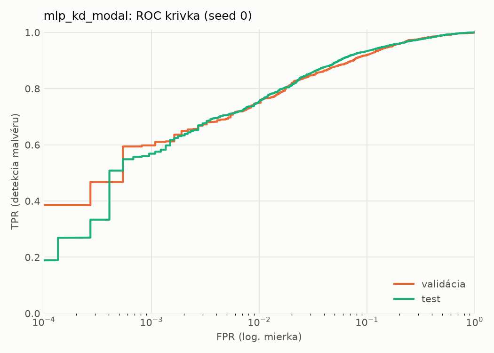
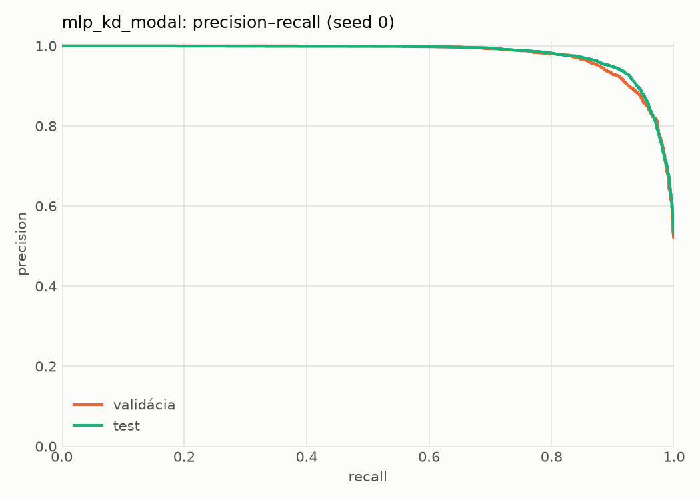
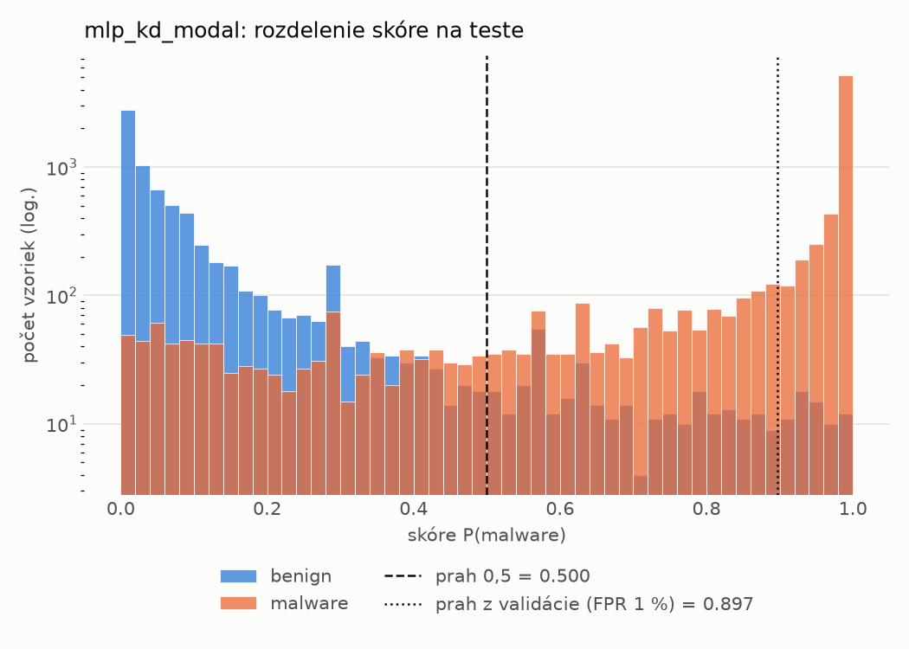
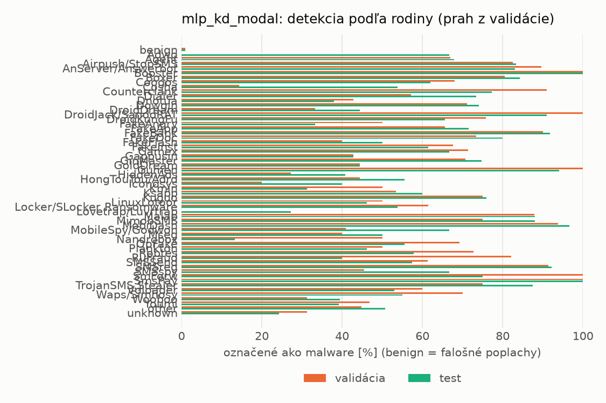
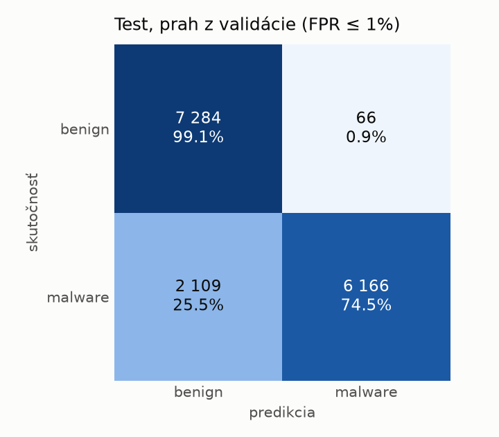
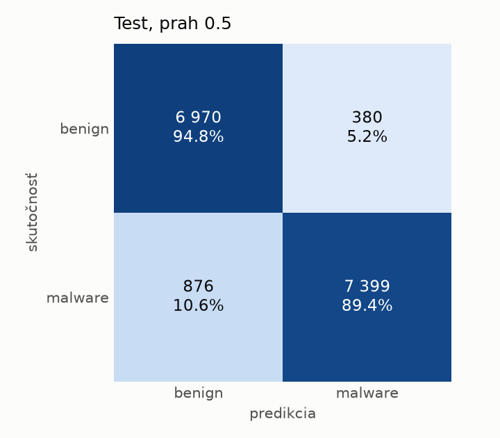
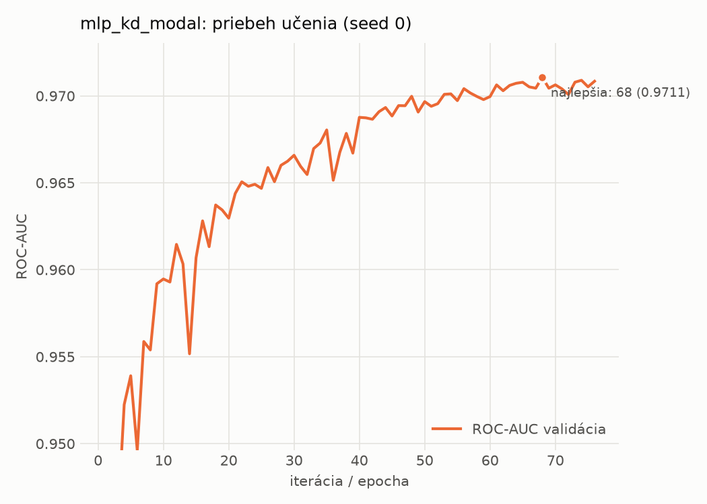

# dynamic/mlp_kd_modal – beh `20261122-230614`

> Automaticky generované (`src/training/run_tabular.py`). Konfigurácia: `config.yaml`, protokol: `protocol.yaml`.

- **Model:** `mlp` – študent – malé MLP učené destiláciou z učiteľa rovnakej modality (variant A)
- **Ladenie:** bez ladenia – hyperparametre prevzaté z `runs_v4/real_full/full/students_dynamic/mlp_kd_modal/20261122-210858`
- **Finálne modely:** seedy [0, 1, 2]; hodnoty sú priemer ± smerodajná odchýlka cez seedy
- **Najlepšie hyperparametre:** `{"hidden_layers": 1, "max_epochs": 100, "patience": 8, "hidden_width": 64, "dropout": 0.014842517384265013, "lr": 0.0018389280483922955, "weight_decay": 7.464279126466132e-05, "batch_size": 512, "kd_alpha": 0.45301900884301544, "kd_temperature": 1.2914074151312493}`

## Detekčná kvalita (bez prahu)
| metrika | train (podvzorka) | validácia | test |
|---|---|---|---|
| ROC-AUC | 0.9755 ± 0.0011 | 0.9703 ± 0.0009 | 0.9721 ± 0.0008 |
| PR-AUC | 0.9812 ± 0.0009 | 0.9769 ± 0.0005 | 0.9786 ± 0.0006 |
| TPR pri FPR 1 % | 0.8121 ± 0.0098 | 0.7515 ± 0.0028 | 0.7575 ± 0.0055 |
| TPR pri FPR 0,1 % | 0.6154 ± 0.0254 | 0.5811 ± 0.0219 | 0.5607 ± 0.0153 |
| log loss | 0.1910 ± 0.0044 | 0.2181 ± 0.0017 | 0.2100 ± 0.0025 |
| Brier skóre | 0.0552 ± 0.0013 | 0.0644 ± 0.0005 | 0.0615 ± 0.0009 |

Rozdiel ROC-AUC train − validácia: **0.0052** (veľký rozdiel = preučenie).

## Pri prahu z validácie (FPR ≤ 1% na validácii)
| metrika | train (podvzorka) | validácia | test |
|---|---|---|---|
| accuracy | 0.8758 ± 0.0005 | 0.8657 ± 0.0015 | 0.8620 ± 0.0011 |
| balanced accuracy | 0.8798 ± 0.0005 | 0.8709 ± 0.0014 | 0.8692 ± 0.0011 |
| precision | 0.9934 ± 0.0015 | 0.9882 ± 0.0000 | 0.9894 ± 0.0004 |
| recall (TPR) | 0.7650 ± 0.0004 | 0.7515 ± 0.0028 | 0.7474 ± 0.0023 |
| FPR | 0.0055 ± 0.0012 | 0.0098 ± 0.0000 | 0.0090 ± 0.0003 |
| F1 | 0.8644 ± 0.0005 | 0.8538 ± 0.0018 | 0.8515 ± 0.0014 |
| MCC | 0.7753 ± 0.0013 | 0.7573 ± 0.0024 | 0.7523 ± 0.0017 |

## Pri pevnom prahu 0.5
| metrika | train (podvzorka) | validácia | test |
|---|---|---|---|
| accuracy | 0.9280 ± 0.0013 | 0.9117 ± 0.0003 | 0.9178 ± 0.0021 |
| balanced accuracy | 0.9288 ± 0.0013 | 0.9126 ± 0.0002 | 0.9194 ± 0.0021 |
| precision | 0.9535 ± 0.0026 | 0.9367 ± 0.0013 | 0.9488 ± 0.0021 |
| recall (TPR) | 0.9050 ± 0.0015 | 0.8909 ± 0.0018 | 0.8931 ± 0.0024 |
| FPR | 0.0473 ± 0.0028 | 0.0657 ± 0.0016 | 0.0543 ± 0.0023 |
| F1 | 0.9286 ± 0.0012 | 0.9133 ± 0.0004 | 0.9201 ± 0.0021 |
| MCC | 0.8573 ± 0.0027 | 0.8245 ± 0.0005 | 0.8373 ± 0.0042 |

## Výpočtové nároky (seed 0, testovacia množina)
| meranie | hodnota |
|---|---|
| tréning finálneho modelu | 12.7 s (priemer cez seedy) |
| ladenie spolu | 0 s |
| počet parametrov / uzlov | 8 641 |
| veľkosť modelu na disku | 0.04 MB |
| transformácia vstupu – latencia (1 vlákno) | 0.015 ms |
| transformácia vstupu – priepustnosť | 708 081 vzoriek/s |
| CPU latencia modelu (batch 1, 1 vlákno) | 0.157 ms (p95 0.167) |
| CPU priepustnosť (24 vlákien) | 8 102 152 vzoriek/s |
| GPU latencia (batch 1) | 0.451 ms (p95 0.471) |
| GPU priepustnosť | 3 083 192 vzoriek/s |
| GPU špičková pamäť | 62 MB |

## Grafy
| | |
|---|---|
|  |  |
|  |  |
|  |  |
|  |  |

## Súbory
`metrics.json` (všetky metriky po seedoch vrátane rodín), `timing.json`, `hpo_trials.csv`,
`predictions/<časť>_seed<N>.parquet` (sha256, family, label, score), `model/seed_<N>/`, `log.txt`.
