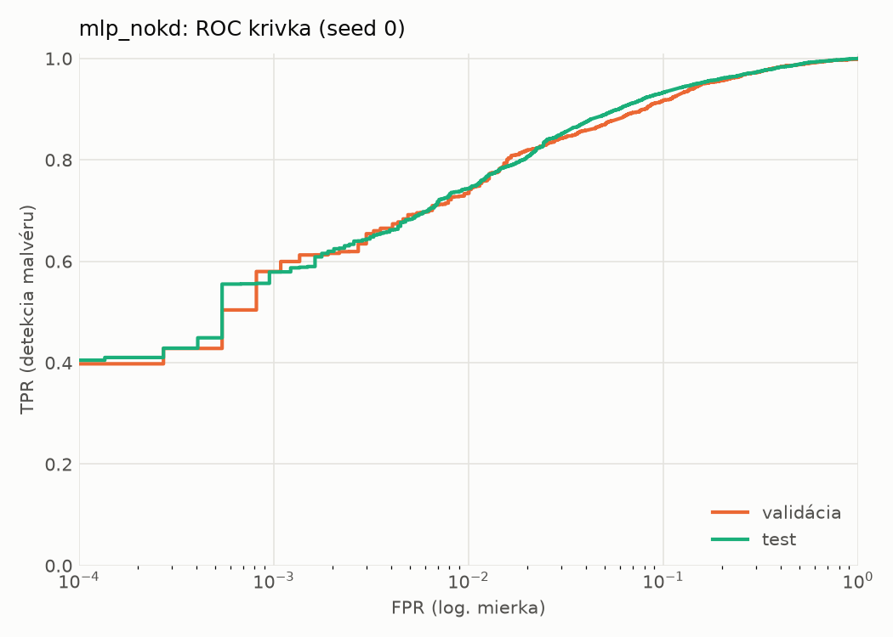
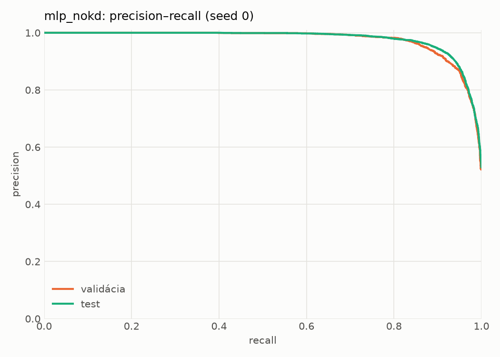
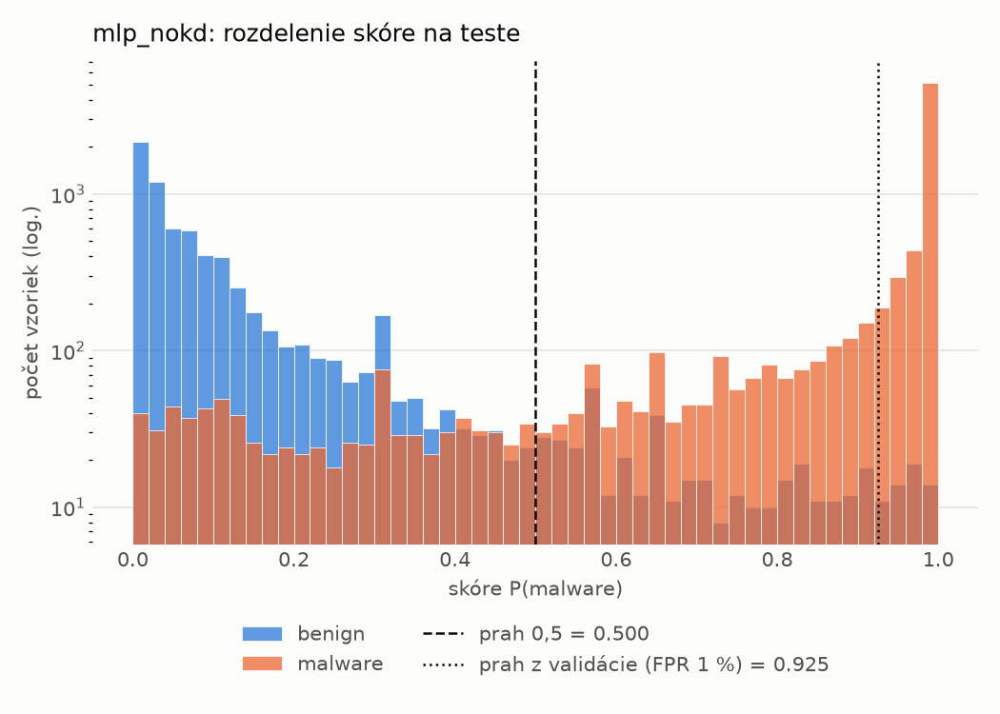
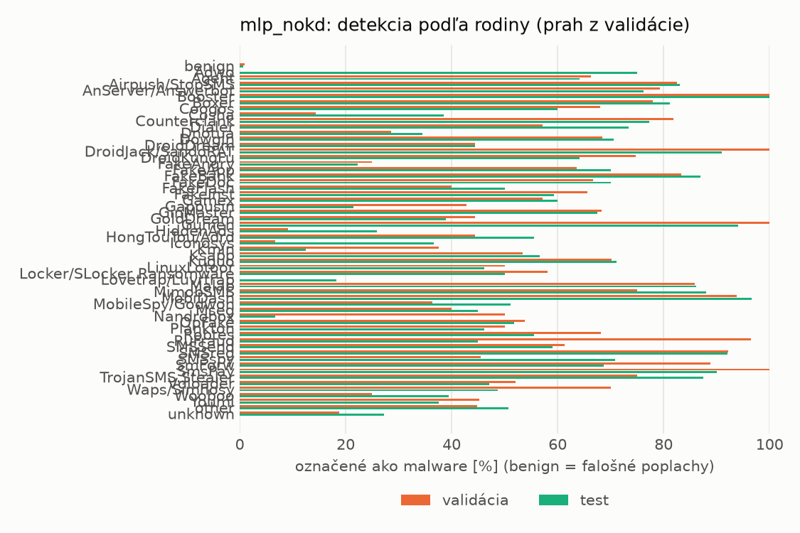
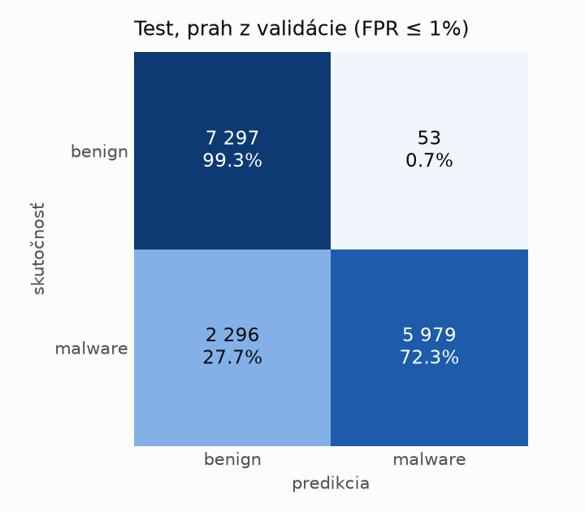
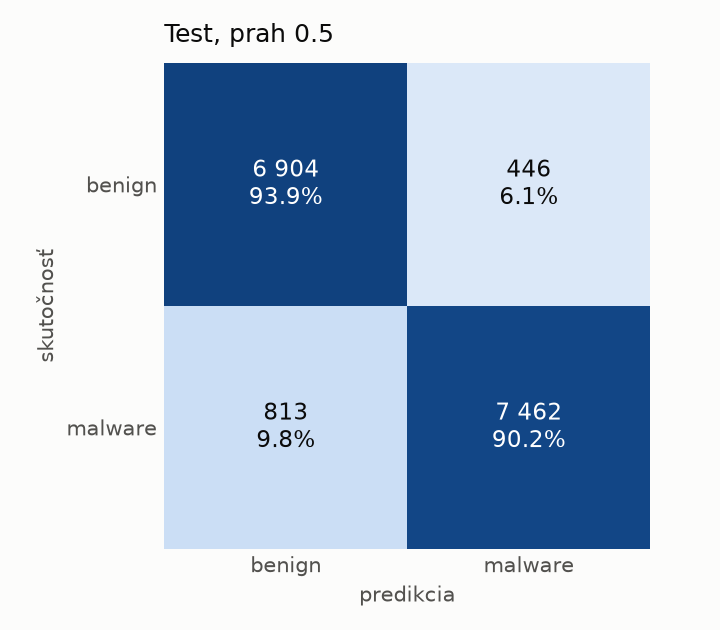
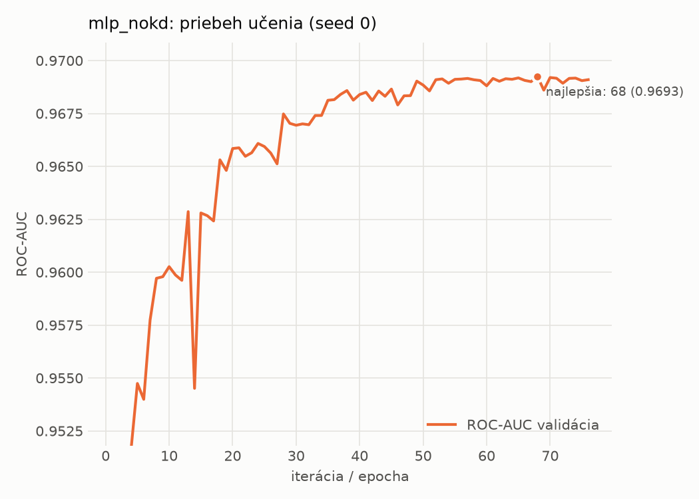

# dynamic/mlp_nokd – beh `20261122-230517`

> Automaticky generované (`src/training/run_tabular.py`). Konfigurácia: `config.yaml`, protokol: `protocol.yaml`.

- **Model:** `mlp` – kontrola – rovnaké malé MLP bez destilácie (iba skutočné označenia)
- **Ladenie:** bez ladenia – hyperparametre prevzaté z `runs_v4/real_full/full/students_dynamic/mlp_nokd/20261122-205917`
- **Finálne modely:** seedy [0, 1, 2]; hodnoty sú priemer ± smerodajná odchýlka cez seedy
- **Najlepšie hyperparametre:** `{"hidden_layers": 1, "max_epochs": 100, "patience": 8, "hidden_width": 64, "dropout": 0.014622282919838341, "lr": 0.0013105433289036465, "weight_decay": 1.7870054646247664e-05, "batch_size": 256}`

## Detekčná kvalita (bez prahu)
| metrika | train (podvzorka) | validácia | test |
|---|---|---|---|
| ROC-AUC | 0.9786 ± 0.0010 | 0.9696 ± 0.0008 | 0.9722 ± 0.0007 |
| PR-AUC | 0.9835 ± 0.0008 | 0.9764 ± 0.0004 | 0.9789 ± 0.0004 |
| TPR pri FPR 1 % | 0.8309 ± 0.0073 | 0.7394 ± 0.0124 | 0.7498 ± 0.0084 |
| TPR pri FPR 0,1 % | 0.6293 ± 0.0083 | 0.5321 ± 0.0414 | 0.5628 ± 0.0150 |
| log loss | 0.1800 ± 0.0037 | 0.2220 ± 0.0006 | 0.2113 ± 0.0009 |
| Brier skóre | 0.0520 ± 0.0011 | 0.0644 ± 0.0004 | 0.0610 ± 0.0001 |

Rozdiel ROC-AUC train − validácia: **0.0090** (veľký rozdiel = preučenie).

## Pri prahu z validácie (FPR ≤ 1% na validácii)
| metrika | train (podvzorka) | validácia | test |
|---|---|---|---|
| accuracy | 0.8682 ± 0.0060 | 0.8593 ± 0.0065 | 0.8531 ± 0.0064 |
| balanced accuracy | 0.8725 ± 0.0058 | 0.8648 ± 0.0062 | 0.8609 ± 0.0060 |
| precision | 0.9957 ± 0.0013 | 0.9880 ± 0.0002 | 0.9909 ± 0.0003 |
| recall (TPR) | 0.7485 ± 0.0127 | 0.7394 ± 0.0124 | 0.7294 ± 0.0124 |
| FPR | 0.0035 ± 0.0011 | 0.0098 ± 0.0000 | 0.0075 ± 0.0003 |
| F1 | 0.8545 ± 0.0078 | 0.8458 ± 0.0082 | 0.8402 ± 0.0081 |
| MCC | 0.7637 ± 0.0094 | 0.7471 ± 0.0105 | 0.7388 ± 0.0101 |

## Pri pevnom prahu 0.5
| metrika | train (podvzorka) | validácia | test |
|---|---|---|---|
| accuracy | 0.9315 ± 0.0014 | 0.9118 ± 0.0016 | 0.9192 ± 0.0003 |
| balanced accuracy | 0.9323 ± 0.0015 | 0.9127 ± 0.0020 | 0.9208 ± 0.0005 |
| precision | 0.9581 ± 0.0087 | 0.9375 ± 0.0093 | 0.9513 ± 0.0072 |
| recall (TPR) | 0.9073 ± 0.0082 | 0.8904 ± 0.0070 | 0.8933 ± 0.0077 |
| FPR | 0.0427 ± 0.0096 | 0.0649 ± 0.0108 | 0.0516 ± 0.0085 |
| F1 | 0.9320 ± 0.0014 | 0.9133 ± 0.0009 | 0.9213 ± 0.0008 |
| MCC | 0.8644 ± 0.0032 | 0.8248 ± 0.0040 | 0.8403 ± 0.0010 |

## Výpočtové nároky (seed 0, testovacia množina)
| meranie | hodnota |
|---|---|
| tréning finálneho modelu | 18.3 s (priemer cez seedy) |
| ladenie spolu | 0 s |
| počet parametrov / uzlov | 8 641 |
| veľkosť modelu na disku | 0.04 MB |
| transformácia vstupu – latencia (1 vlákno) | 0.015 ms |
| transformácia vstupu – priepustnosť | 743 234 vzoriek/s |
| CPU latencia modelu (batch 1, 1 vlákno) | 0.159 ms (p95 0.169) |
| CPU priepustnosť (24 vlákien) | 9 393 411 vzoriek/s |
| GPU latencia (batch 1) | 0.452 ms (p95 0.484) |
| GPU priepustnosť | 2 606 208 vzoriek/s |
| GPU špičková pamäť | 94 MB |

## Grafy
| | |
|---|---|
|  |  |
|  |  |
|  |  |
|  |  |

## Súbory
`metrics.json` (všetky metriky po seedoch vrátane rodín), `timing.json`, `hpo_trials.csv`,
`predictions/<časť>_seed<N>.parquet` (sha256, family, label, score), `model/seed_<N>/`, `log.txt`.
