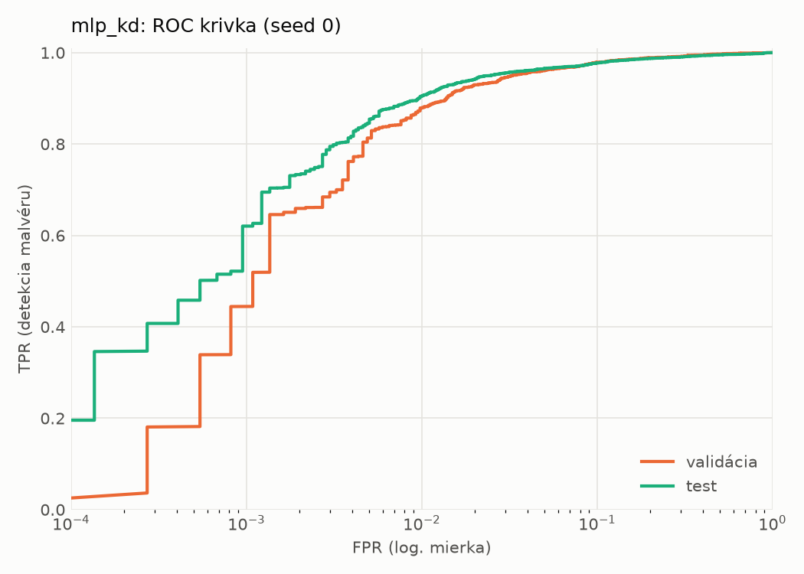
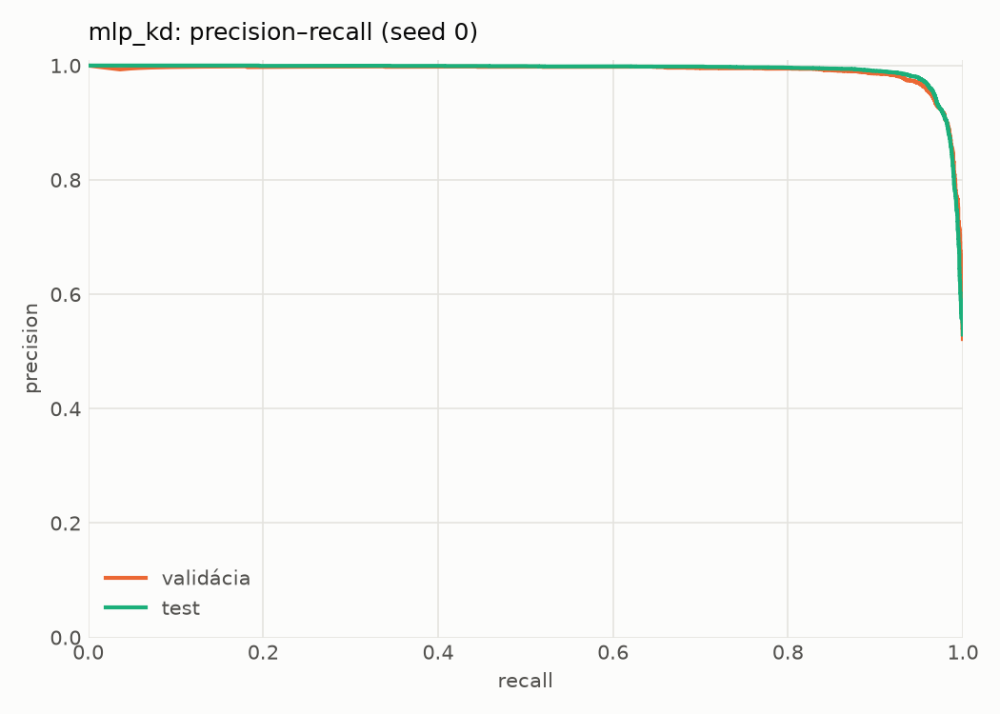
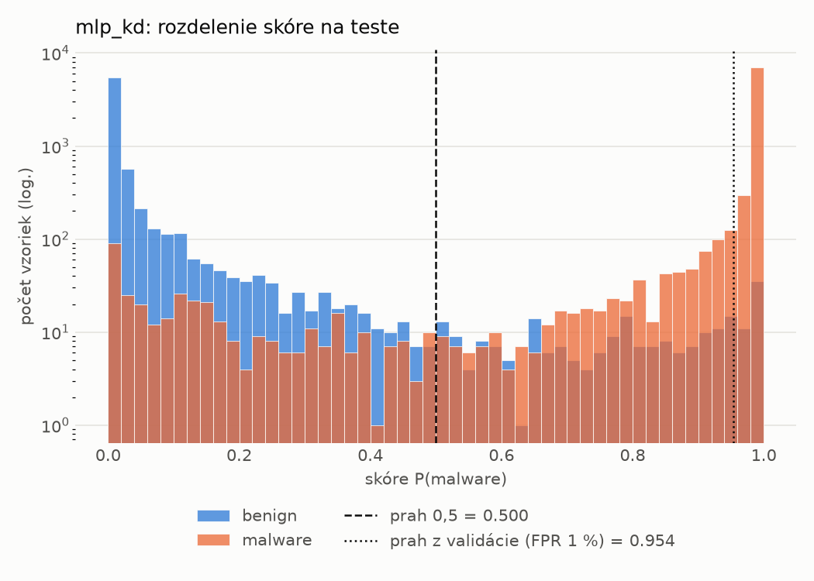
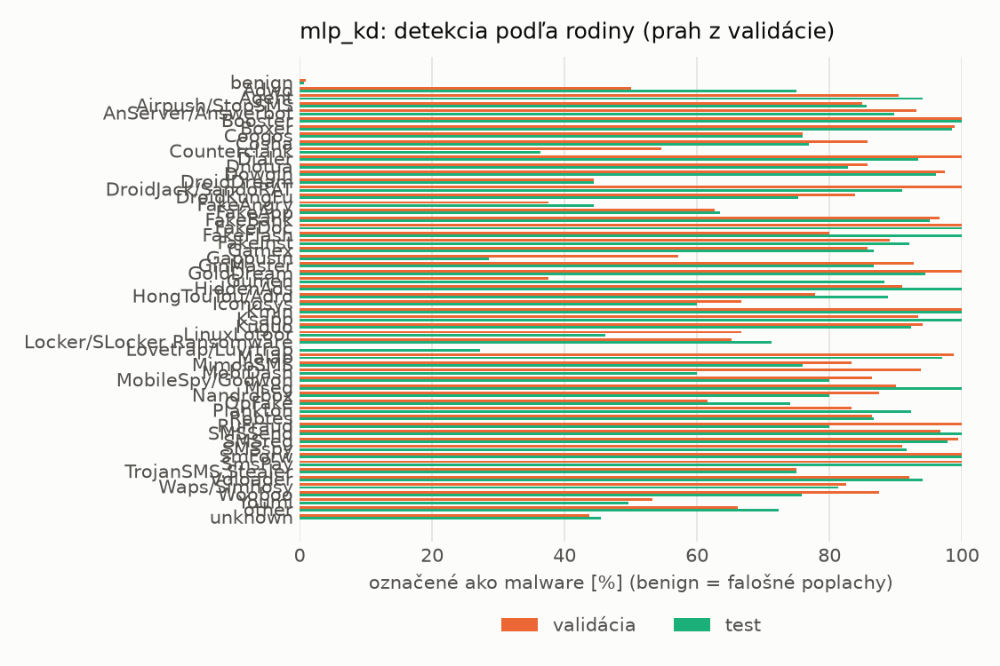
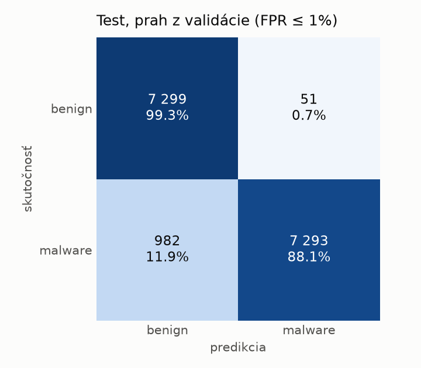
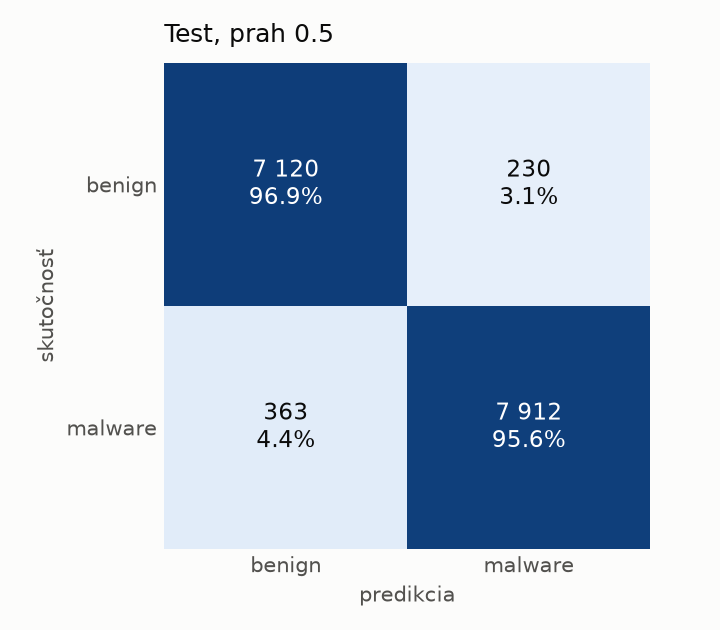
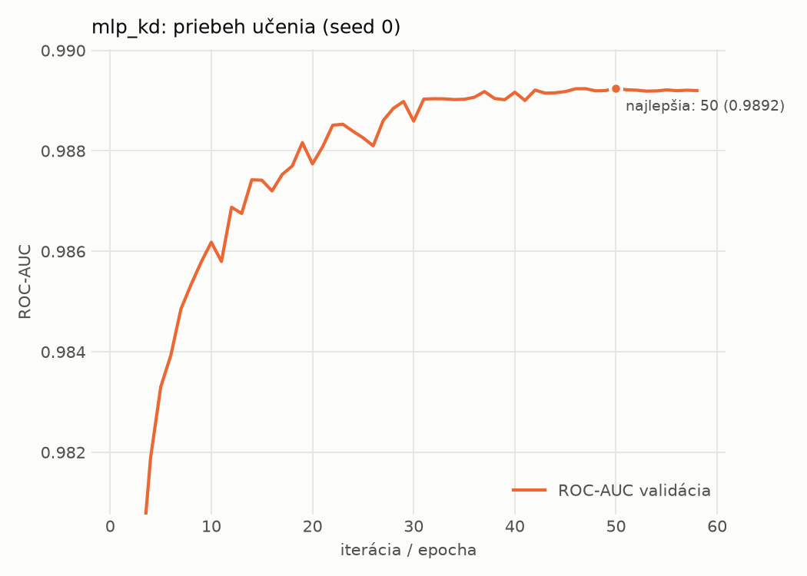

# static/mlp_kd – beh `20261122-230257`

> Automaticky generované (`src/training/run_tabular.py`). Konfigurácia: `config.yaml`, protokol: `protocol.yaml`.

- **Model:** `mlp` – študent – malé MLP učené destiláciou z hybridného učiteľa
- **Ladenie:** bez ladenia – hyperparametre prevzaté z `runs_v4/real_full/full/students_static/mlp_kd/20261122-203423`
- **Finálne modely:** seedy [0, 1, 2]; hodnoty sú priemer ± smerodajná odchýlka cez seedy
- **Najlepšie hyperparametre:** `{"hidden_layers": 1, "max_epochs": 100, "patience": 8, "hidden_width": 64, "dropout": 0.018096880153353218, "lr": 0.002445898909575082, "weight_decay": 6.315937377471515e-05, "batch_size": 1024, "kd_alpha": 0.6461462865023861, "kd_temperature": 1.5048732616232385}`

## Detekčná kvalita (bez prahu)
| metrika | train (podvzorka) | validácia | test |
|---|---|---|---|
| ROC-AUC | 0.9941 ± 0.0004 | 0.9896 ± 0.0003 | 0.9902 ± 0.0009 |
| PR-AUC | 0.9954 ± 0.0003 | 0.9906 ± 0.0003 | 0.9925 ± 0.0005 |
| TPR pri FPR 1 % | 0.9460 ± 0.0025 | 0.8846 ± 0.0054 | 0.9078 ± 0.0027 |
| TPR pri FPR 0,1 % | 0.8639 ± 0.0310 | 0.4983 ± 0.0786 | 0.6774 ± 0.0513 |
| log loss | 0.0878 ± 0.0031 | 0.1321 ± 0.0017 | 0.1204 ± 0.0054 |
| Brier skóre | 0.0232 ± 0.0007 | 0.0335 ± 0.0005 | 0.0301 ± 0.0007 |

Rozdiel ROC-AUC train − validácia: **0.0045** (veľký rozdiel = preučenie).

## Pri prahu z validácie (FPR ≤ 1% na validácii)
| metrika | train (podvzorka) | validácia | test |
|---|---|---|---|
| accuracy | 0.9417 ± 0.0037 | 0.9351 ± 0.0028 | 0.9372 ± 0.0030 |
| balanced accuracy | 0.9436 ± 0.0036 | 0.9374 ± 0.0027 | 0.9403 ± 0.0029 |
| precision | 0.9986 ± 0.0005 | 0.9900 ± 0.0001 | 0.9927 ± 0.0006 |
| recall (TPR) | 0.8885 ± 0.0070 | 0.8846 ± 0.0054 | 0.8880 ± 0.0059 |
| FPR | 0.0013 ± 0.0004 | 0.0098 ± 0.0000 | 0.0073 ± 0.0006 |
| F1 | 0.9404 ± 0.0040 | 0.9343 ± 0.0031 | 0.9374 ± 0.0032 |
| MCC | 0.8895 ± 0.0067 | 0.8760 ± 0.0051 | 0.8803 ± 0.0054 |

## Pri pevnom prahu 0.5
| metrika | train (podvzorka) | validácia | test |
|---|---|---|---|
| accuracy | 0.9705 ± 0.0003 | 0.9569 ± 0.0007 | 0.9629 ± 0.0008 |
| balanced accuracy | 0.9709 ± 0.0003 | 0.9571 ± 0.0007 | 0.9633 ± 0.0008 |
| precision | 0.9832 ± 0.0007 | 0.9636 ± 0.0017 | 0.9728 ± 0.0010 |
| recall (TPR) | 0.9595 ± 0.0004 | 0.9534 ± 0.0010 | 0.9568 ± 0.0009 |
| FPR | 0.0176 ± 0.0007 | 0.0393 ± 0.0019 | 0.0301 ± 0.0011 |
| F1 | 0.9712 ± 0.0003 | 0.9585 ± 0.0006 | 0.9647 ± 0.0008 |
| MCC | 0.9413 ± 0.0006 | 0.9138 ± 0.0014 | 0.9258 ± 0.0016 |

## Výpočtové nároky (seed 0, testovacia množina)
| meranie | hodnota |
|---|---|
| tréning finálneho modelu | 5.8 s (priemer cez seedy) |
| ladenie spolu | 0 s |
| počet parametrov / uzlov | 10 689 |
| veľkosť modelu na disku | 0.05 MB |
| transformácia vstupu – latencia (1 vlákno) | 0.006 ms |
| transformácia vstupu – priepustnosť | 946 987 vzoriek/s |
| CPU latencia modelu (batch 1, 1 vlákno) | 0.070 ms (p95 0.076) |
| CPU priepustnosť (24 vlákien) | 2 695 964 vzoriek/s |
| GPU latencia (batch 1) | 0.452 ms (p95 0.473) |
| GPU priepustnosť | 1 667 005 vzoriek/s |
| GPU špičková pamäť | 72 MB |

## Grafy
| | |
|---|---|
|  |  |
|  |  |
|  |  |
|  |  |

## Súbory
`metrics.json` (všetky metriky po seedoch vrátane rodín), `timing.json`, `hpo_trials.csv`,
`predictions/<časť>_seed<N>.parquet` (sha256, family, label, score), `model/seed_<N>/`, `log.txt`.
