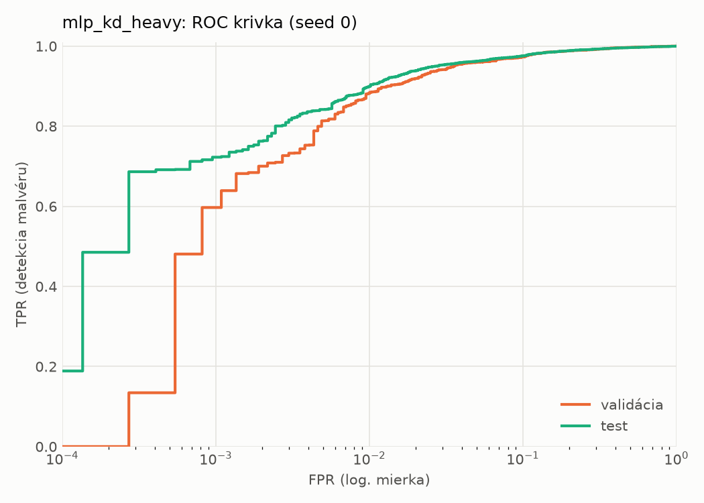
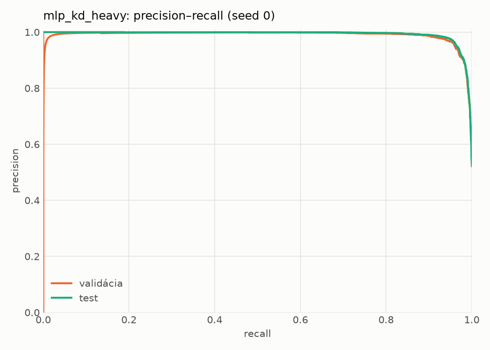
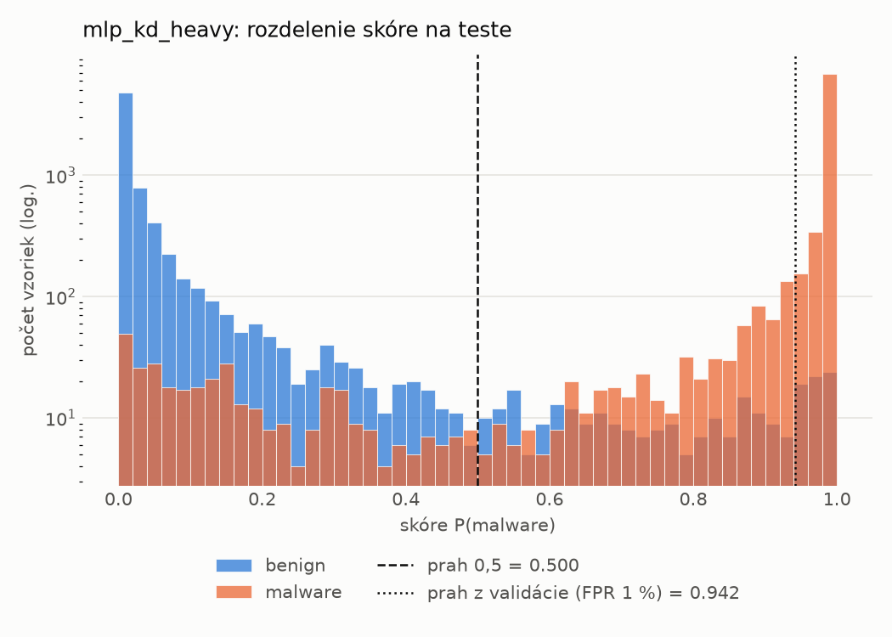
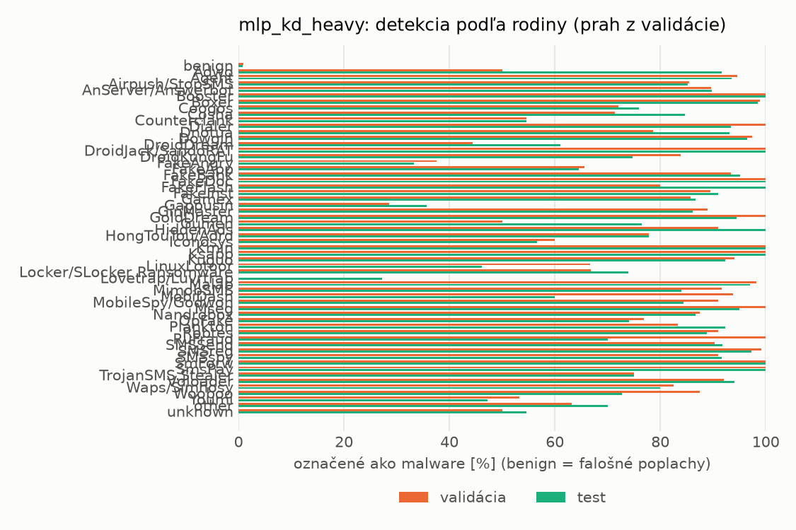
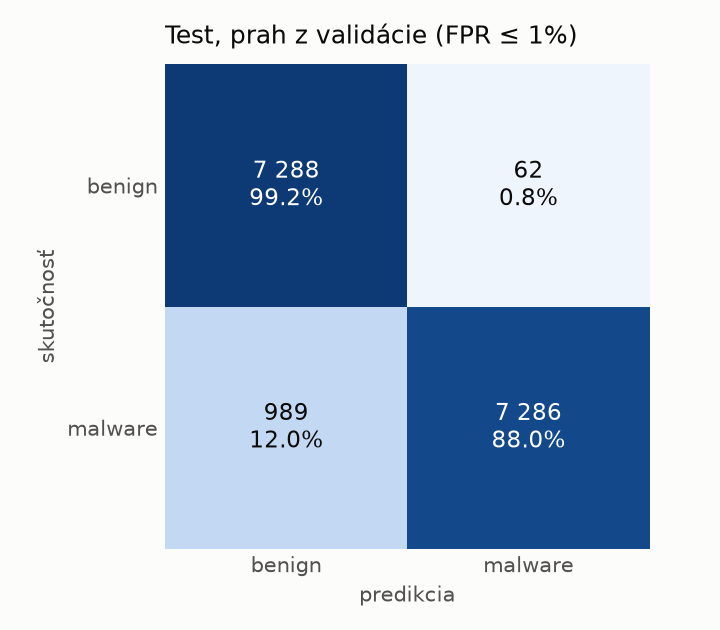
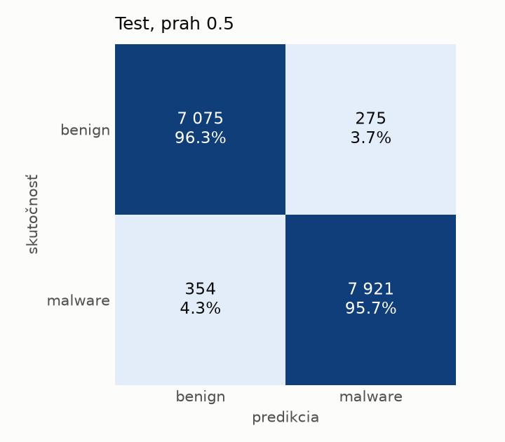
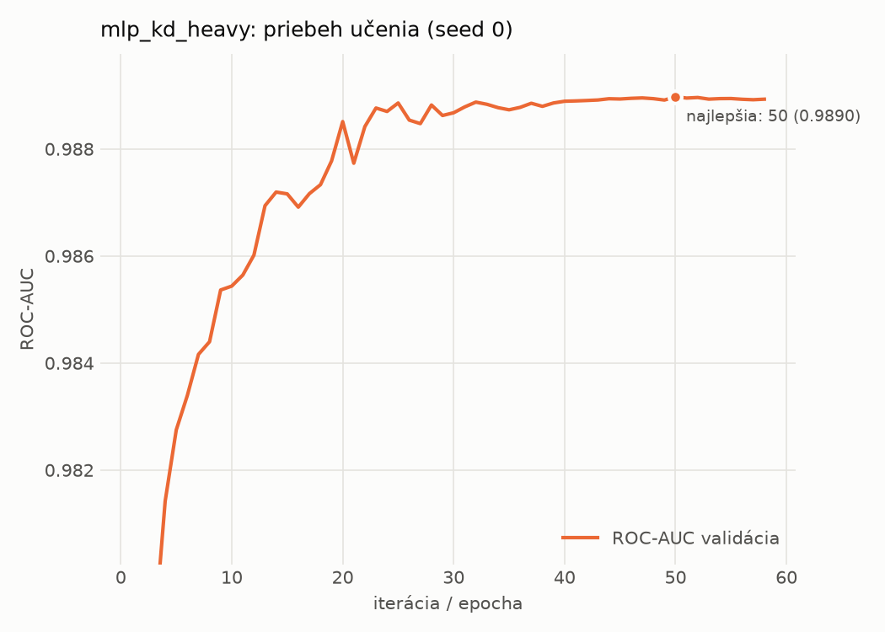

# static/mlp_kd_heavy – beh `20261122-230409`

> Automaticky generované (`src/training/run_tabular.py`). Konfigurácia: `config.yaml`, protokol: `protocol.yaml`.

- **Model:** `mlp` – študent – malé MLP učené destiláciou z mlp_large hybridu (V4)
- **Ladenie:** bez ladenia – hyperparametre prevzaté z `runs_v4/real_full/full/students_static/mlp_kd_heavy/20261122-204855`
- **Finálne modely:** seedy [0, 1, 2]; hodnoty sú priemer ± smerodajná odchýlka cez seedy
- **Najlepšie hyperparametre:** `{"hidden_layers": 1, "max_epochs": 100, "patience": 8, "hidden_width": 64, "dropout": 0.04239795529418809, "lr": 0.0021920597062990285, "weight_decay": 0.0001469802566586536, "batch_size": 1024, "kd_alpha": 0.8931311185241001, "kd_temperature": 5.447798930063548}`

## Detekčná kvalita (bez prahu)
| metrika | train (podvzorka) | validácia | test |
|---|---|---|---|
| ROC-AUC | 0.9936 ± 0.0003 | 0.9888 ± 0.0002 | 0.9904 ± 0.0002 |
| PR-AUC | 0.9950 ± 0.0002 | 0.9892 ± 0.0003 | 0.9926 ± 0.0004 |
| TPR pri FPR 1 % | 0.9365 ± 0.0013 | 0.8771 ± 0.0043 | 0.9018 ± 0.0023 |
| TPR pri FPR 0,1 % | 0.8487 ± 0.0182 | 0.5638 ± 0.0316 | 0.7368 ± 0.0245 |
| log loss | 0.0921 ± 0.0015 | 0.1305 ± 0.0014 | 0.1161 ± 0.0018 |
| Brier skóre | 0.0253 ± 0.0002 | 0.0350 ± 0.0002 | 0.0314 ± 0.0004 |

Rozdiel ROC-AUC train − validácia: **0.0048** (veľký rozdiel = preučenie).

## Pri prahu z validácie (FPR ≤ 1% na validácii)
| metrika | train (podvzorka) | validácia | test |
|---|---|---|---|
| accuracy | 0.9356 ± 0.0011 | 0.9312 ± 0.0022 | 0.9324 ± 0.0009 |
| balanced accuracy | 0.9377 ± 0.0011 | 0.9336 ± 0.0021 | 0.9358 ± 0.0008 |
| precision | 0.9977 ± 0.0009 | 0.9899 ± 0.0000 | 0.9931 ± 0.0014 |
| recall (TPR) | 0.8776 ± 0.0025 | 0.8771 ± 0.0043 | 0.8784 ± 0.0027 |
| FPR | 0.0022 ± 0.0008 | 0.0098 ± 0.0000 | 0.0069 ± 0.0014 |
| F1 | 0.9338 ± 0.0013 | 0.9301 ± 0.0024 | 0.9322 ± 0.0010 |
| MCC | 0.8784 ± 0.0020 | 0.8689 ± 0.0040 | 0.8717 ± 0.0015 |

## Pri pevnom prahu 0.5
| metrika | train (podvzorka) | validácia | test |
|---|---|---|---|
| accuracy | 0.9684 ± 0.0004 | 0.9563 ± 0.0007 | 0.9610 ± 0.0011 |
| balanced accuracy | 0.9688 ± 0.0004 | 0.9563 ± 0.0007 | 0.9613 ± 0.0012 |
| precision | 0.9801 ± 0.0012 | 0.9606 ± 0.0006 | 0.9693 ± 0.0025 |
| recall (TPR) | 0.9584 ± 0.0011 | 0.9554 ± 0.0021 | 0.9567 ± 0.0005 |
| FPR | 0.0209 ± 0.0013 | 0.0427 ± 0.0008 | 0.0341 ± 0.0029 |
| F1 | 0.9691 ± 0.0004 | 0.9580 ± 0.0008 | 0.9630 ± 0.0010 |
| MCC | 0.9370 ± 0.0008 | 0.9124 ± 0.0014 | 0.9219 ± 0.0023 |

## Výpočtové nároky (seed 0, testovacia množina)
| meranie | hodnota |
|---|---|
| tréning finálneho modelu | 5.9 s (priemer cez seedy) |
| ladenie spolu | 0 s |
| počet parametrov / uzlov | 10 689 |
| veľkosť modelu na disku | 0.05 MB |
| transformácia vstupu – latencia (1 vlákno) | 0.014 ms |
| transformácia vstupu – priepustnosť | 628 494 vzoriek/s |
| CPU latencia modelu (batch 1, 1 vlákno) | 0.158 ms (p95 0.168) |
| CPU priepustnosť (24 vlákien) | 2 705 440 vzoriek/s |
| GPU latencia (batch 1) | 0.452 ms (p95 0.483) |
| GPU priepustnosť | 1 769 295 vzoriek/s |
| GPU špičková pamäť | 113 MB |

## Grafy
| | |
|---|---|
|  |  |
|  |  |
|  |  |
|  |  |

## Súbory
`metrics.json` (všetky metriky po seedoch vrátane rodín), `timing.json`, `hpo_trials.csv`,
`predictions/<časť>_seed<N>.parquet` (sha256, family, label, score), `model/seed_<N>/`, `log.txt`.
