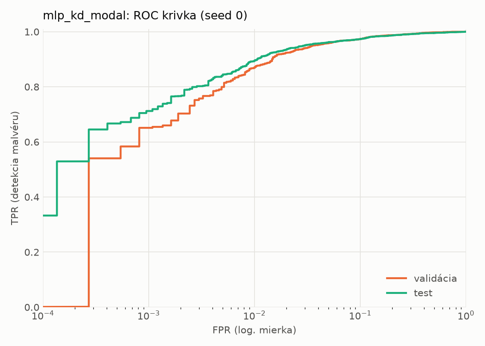
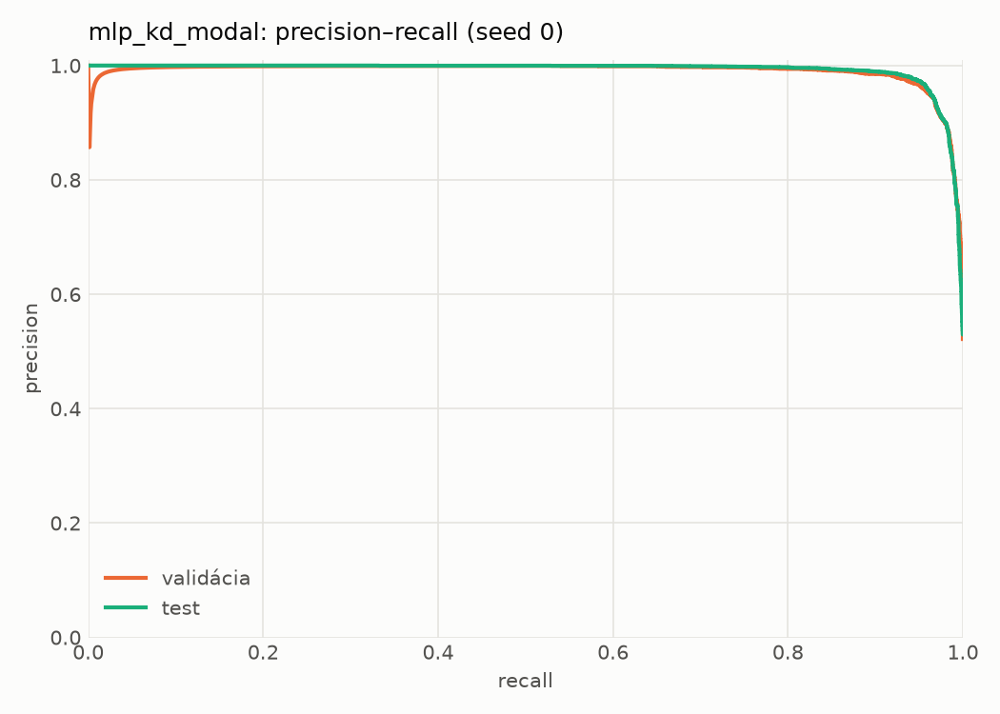
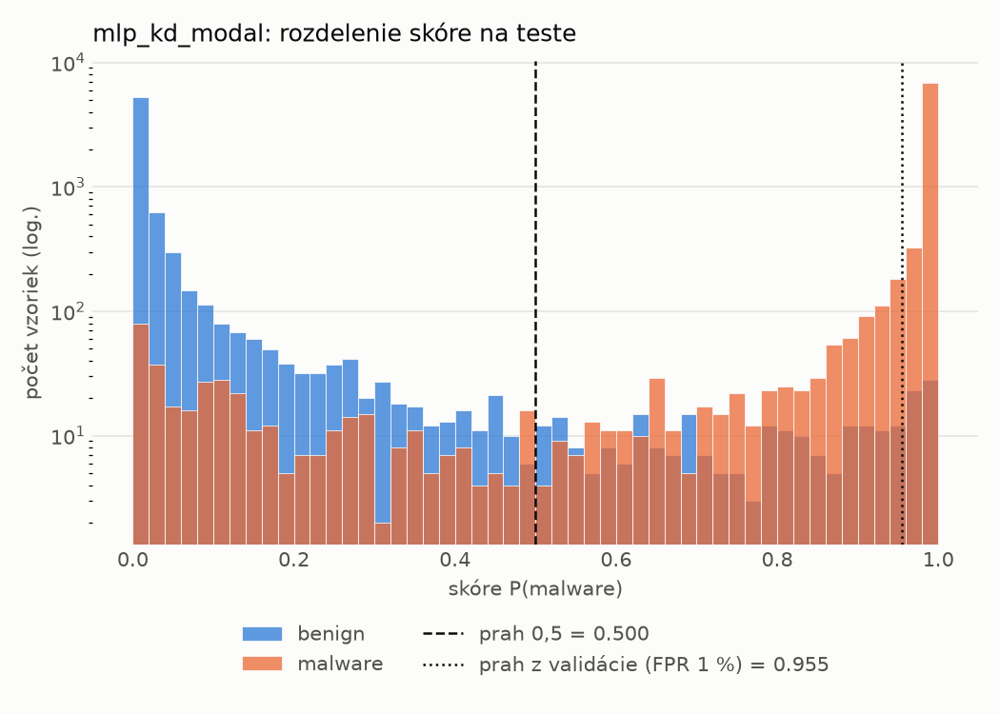
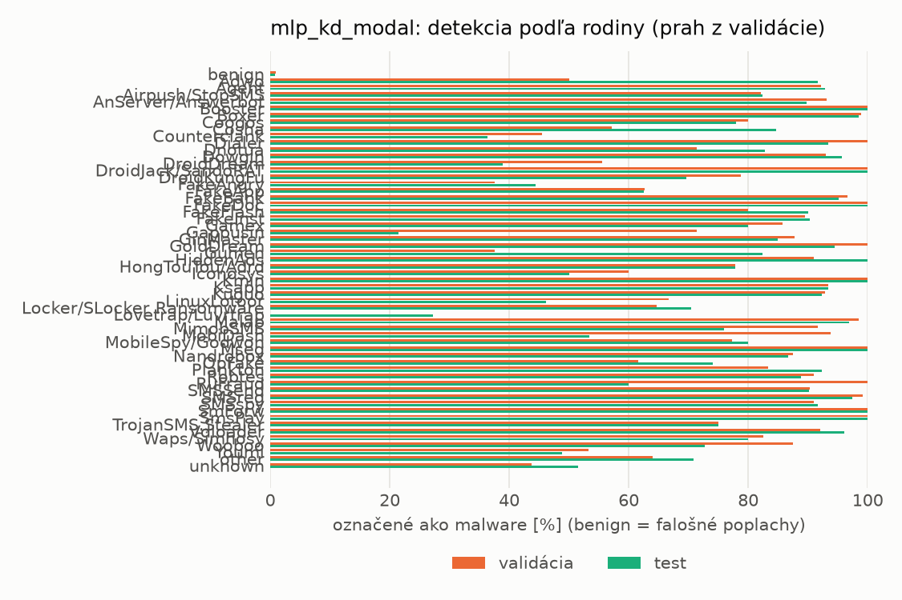
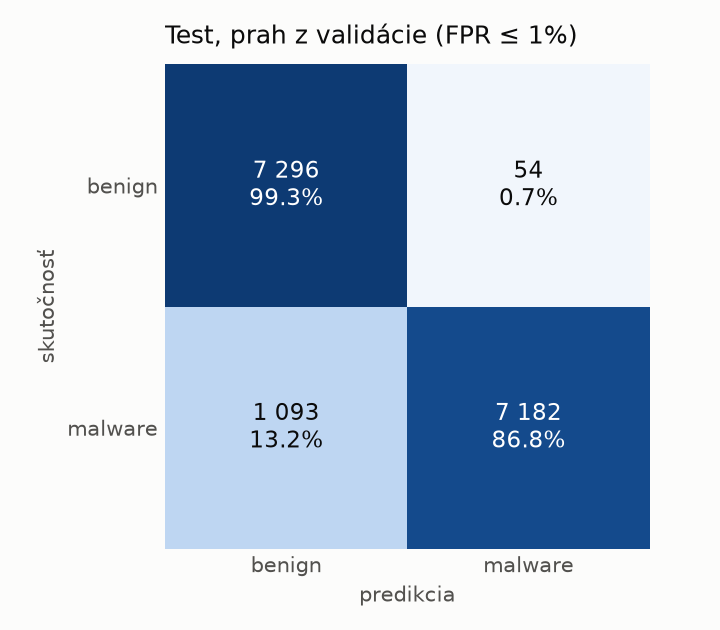
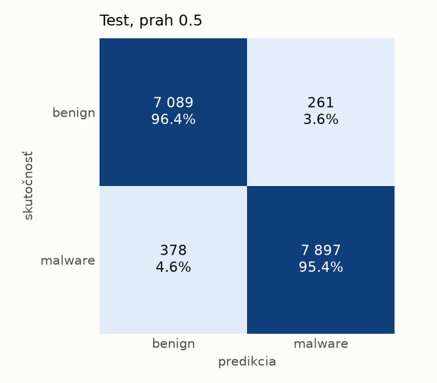
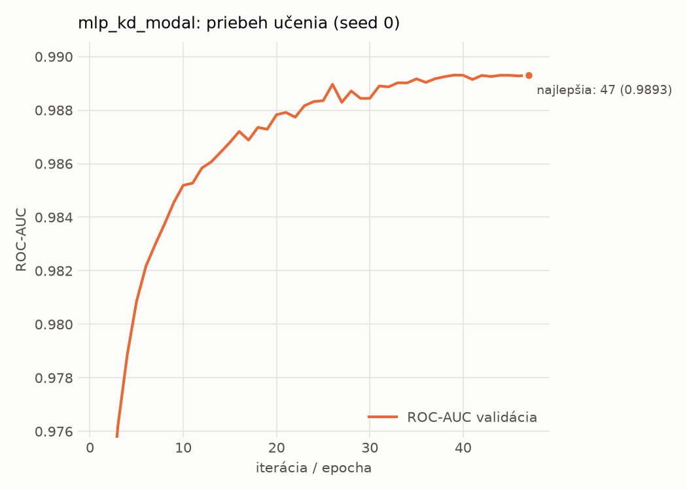

# static/mlp_kd_modal – beh `20261122-230351`

> Automaticky generované (`src/training/run_tabular.py`). Konfigurácia: `config.yaml`, protokol: `protocol.yaml`.

- **Model:** `mlp` – študent – malé MLP učené destiláciou z učiteľa rovnakej modality (variant A)
- **Ladenie:** bez ladenia – hyperparametre prevzaté z `runs_v4/real_full/full/students_static/mlp_kd_modal/20261122-204432`
- **Finálne modely:** seedy [0, 1, 2]; hodnoty sú priemer ± smerodajná odchýlka cez seedy
- **Najlepšie hyperparametre:** `{"hidden_layers": 1, "max_epochs": 100, "patience": 8, "hidden_width": 64, "dropout": 0.005196375734621726, "lr": 0.0014172842807441423, "weight_decay": 1.1835949733056038e-05, "batch_size": 1024, "kd_alpha": 0.5211229932470658, "kd_temperature": 1.6263320735090332}`

## Detekčná kvalita (bez prahu)
| metrika | train (podvzorka) | validácia | test |
|---|---|---|---|
| ROC-AUC | 0.9934 ± 0.0007 | 0.9896 ± 0.0004 | 0.9906 ± 0.0011 |
| PR-AUC | 0.9948 ± 0.0005 | 0.9905 ± 0.0008 | 0.9929 ± 0.0007 |
| TPR pri FPR 1 % | 0.9368 ± 0.0061 | 0.8735 ± 0.0061 | 0.9063 ± 0.0107 |
| TPR pri FPR 0,1 % | 0.8301 ± 0.0247 | 0.6438 ± 0.0446 | 0.7160 ± 0.0160 |
| log loss | 0.0945 ± 0.0051 | 0.1293 ± 0.0030 | 0.1180 ± 0.0072 |
| Brier skóre | 0.0255 ± 0.0013 | 0.0343 ± 0.0008 | 0.0314 ± 0.0013 |

Rozdiel ROC-AUC train − validácia: **0.0037** (veľký rozdiel = preučenie).

## Pri prahu z validácie (FPR ≤ 1% na validácii)
| metrika | train (podvzorka) | validácia | test |
|---|---|---|---|
| accuracy | 0.9345 ± 0.0036 | 0.9293 ± 0.0032 | 0.9306 ± 0.0038 |
| balanced accuracy | 0.9366 ± 0.0034 | 0.9318 ± 0.0030 | 0.9341 ± 0.0036 |
| precision | 0.9982 ± 0.0000 | 0.9898 ± 0.0001 | 0.9935 ± 0.0009 |
| recall (TPR) | 0.8749 ± 0.0069 | 0.8735 ± 0.0061 | 0.8747 ± 0.0068 |
| FPR | 0.0017 ± 0.0000 | 0.0098 ± 0.0000 | 0.0065 ± 0.0009 |
| F1 | 0.9325 ± 0.0039 | 0.9280 ± 0.0035 | 0.9303 ± 0.0041 |
| MCC | 0.8766 ± 0.0063 | 0.8656 ± 0.0057 | 0.8687 ± 0.0069 |

## Pri pevnom prahu 0.5
| metrika | train (podvzorka) | validácia | test |
|---|---|---|---|
| accuracy | 0.9676 ± 0.0019 | 0.9568 ± 0.0012 | 0.9606 ± 0.0013 |
| balanced accuracy | 0.9680 ± 0.0019 | 0.9569 ± 0.0012 | 0.9608 ± 0.0012 |
| precision | 0.9796 ± 0.0033 | 0.9630 ± 0.0017 | 0.9690 ± 0.0011 |
| recall (TPR) | 0.9573 ± 0.0016 | 0.9538 ± 0.0018 | 0.9561 ± 0.0016 |
| FPR | 0.0213 ± 0.0035 | 0.0400 ± 0.0019 | 0.0345 ± 0.0012 |
| F1 | 0.9684 ± 0.0018 | 0.9584 ± 0.0011 | 0.9625 ± 0.0012 |
| MCC | 0.9355 ± 0.0038 | 0.9134 ± 0.0024 | 0.9210 ± 0.0025 |

## Výpočtové nároky (seed 0, testovacia množina)
| meranie | hodnota |
|---|---|
| tréning finálneho modelu | 5.4 s (priemer cez seedy) |
| ladenie spolu | 0 s |
| počet parametrov / uzlov | 10 689 |
| veľkosť modelu na disku | 0.05 MB |
| transformácia vstupu – latencia (1 vlákno) | 0.016 ms |
| transformácia vstupu – priepustnosť | 570 839 vzoriek/s |
| CPU latencia modelu (batch 1, 1 vlákno) | 0.159 ms (p95 0.195) |
| CPU priepustnosť (24 vlákien) | 2 046 041 vzoriek/s |
| GPU latencia (batch 1) | 0.276 ms (p95 0.324) |
| GPU priepustnosť | 1 398 711 vzoriek/s |
| GPU špičková pamäť | 72 MB |

## Grafy
| | |
|---|---|
|  |  |
|  |  |
|  |  |
|  |  |

## Súbory
`metrics.json` (všetky metriky po seedoch vrátane rodín), `timing.json`, `hpo_trials.csv`,
`predictions/<časť>_seed<N>.parquet` (sha256, family, label, score), `model/seed_<N>/`, `log.txt`.
