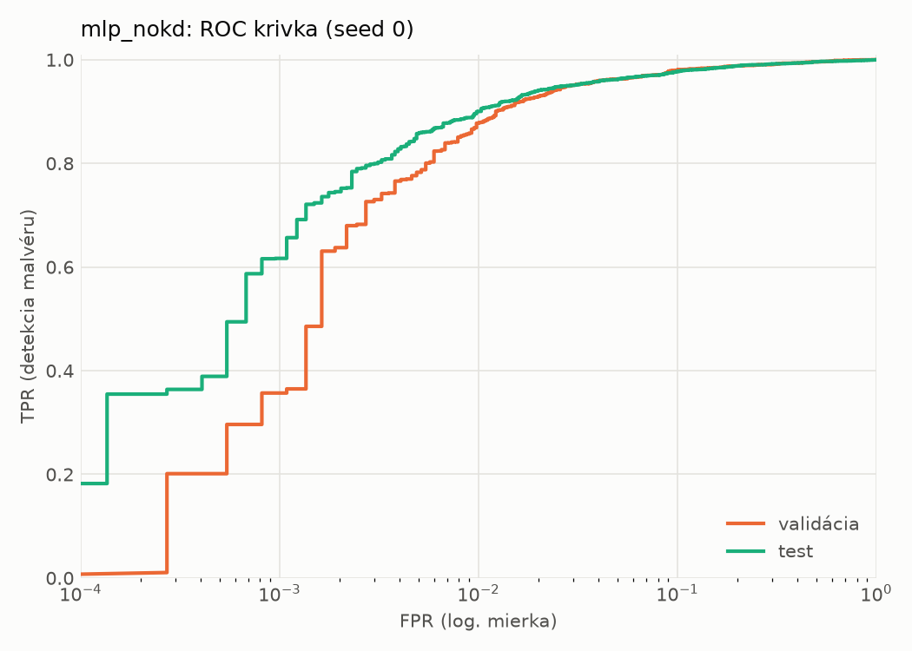
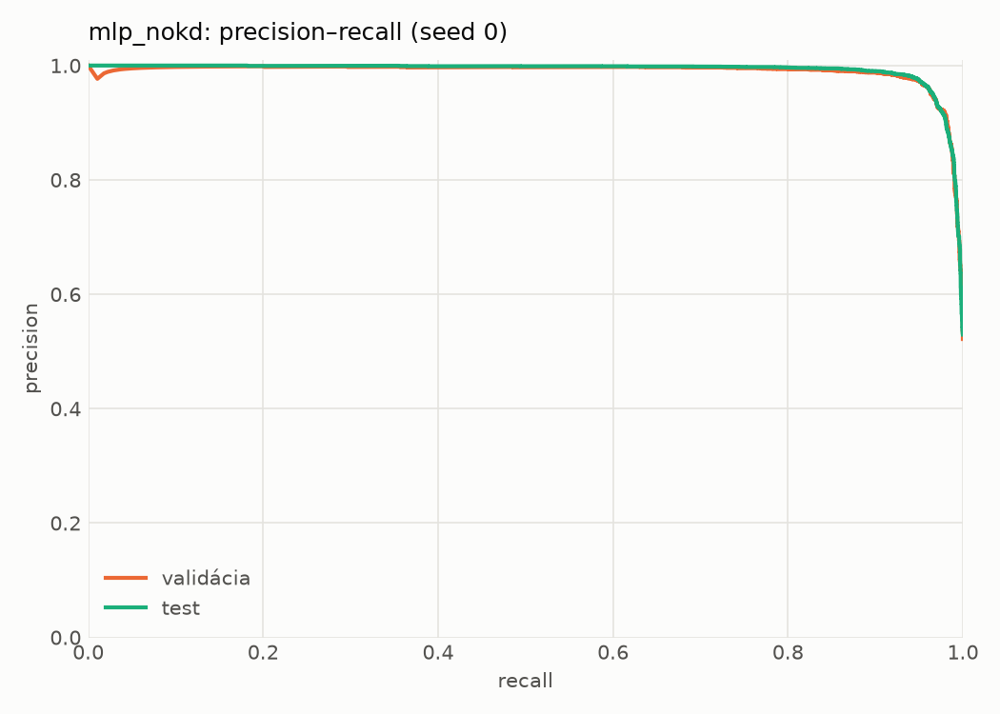
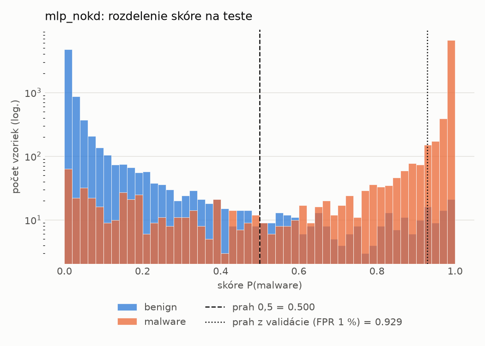
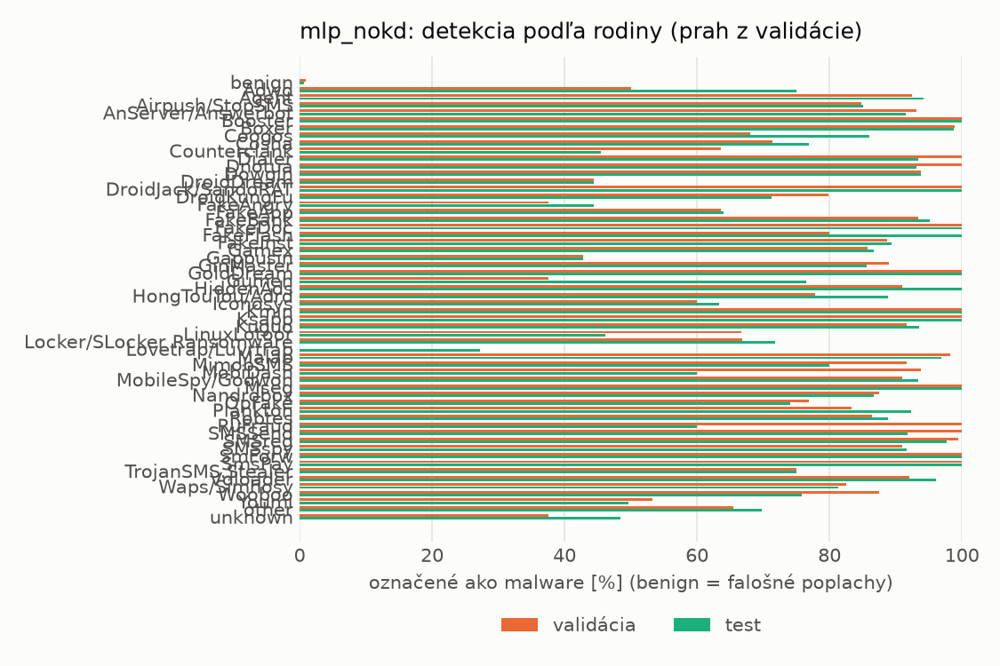
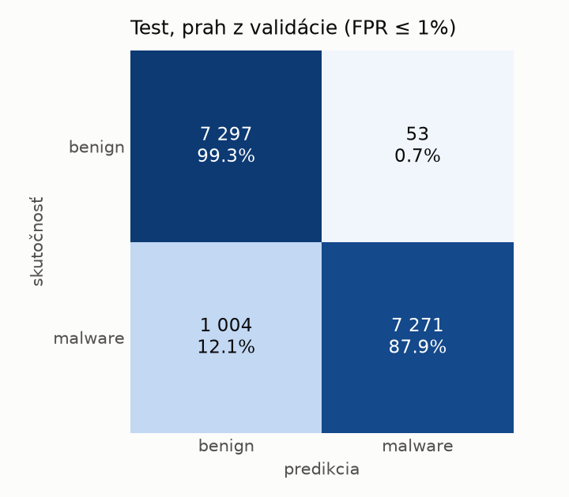
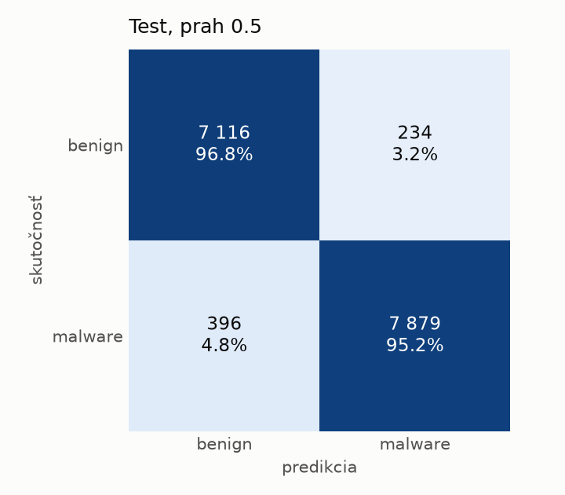
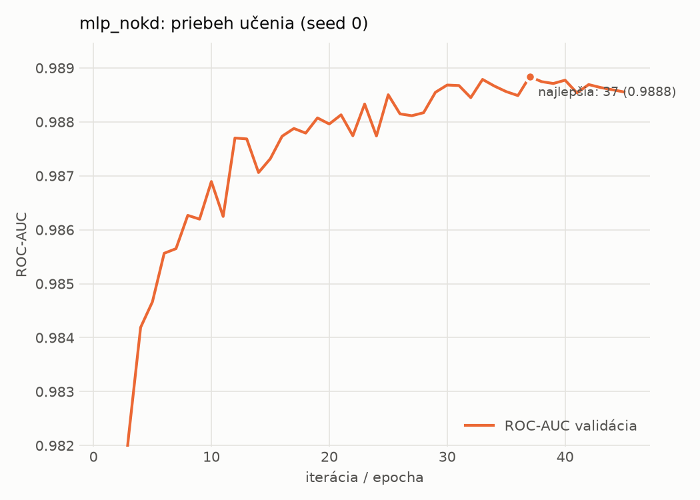

# static/mlp_nokd – beh `20261122-230316`

> Automaticky generované (`src/training/run_tabular.py`). Konfigurácia: `config.yaml`, protokol: `protocol.yaml`.

- **Model:** `mlp` – kontrola – rovnaké malé MLP bez destilácie (iba skutočné označenia)
- **Ladenie:** bez ladenia – hyperparametre prevzaté z `runs_v4/real_full/full/students_static/mlp_nokd/20261122-203844`
- **Finálne modely:** seedy [0, 1, 2]; hodnoty sú priemer ± smerodajná odchýlka cez seedy
- **Najlepšie hyperparametre:** `{"hidden_layers": 1, "max_epochs": 100, "patience": 8, "hidden_width": 64, "dropout": 0.011630579234704915, "lr": 0.0010706598847019353, "weight_decay": 3.845140400781195e-05, "batch_size": 256}`

## Detekčná kvalita (bez prahu)
| metrika | train (podvzorka) | validácia | test |
|---|---|---|---|
| ROC-AUC | 0.9947 ± 0.0003 | 0.9890 ± 0.0002 | 0.9900 ± 0.0006 |
| PR-AUC | 0.9958 ± 0.0001 | 0.9899 ± 0.0003 | 0.9922 ± 0.0005 |
| TPR pri FPR 1 % | 0.9474 ± 0.0018 | 0.8756 ± 0.0090 | 0.9037 ± 0.0057 |
| TPR pri FPR 0,1 % | 0.8680 ± 0.0083 | 0.4419 ± 0.0761 | 0.6257 ± 0.0877 |
| log loss | 0.0845 ± 0.0035 | 0.1275 ± 0.0013 | 0.1177 ± 0.0040 |
| Brier skóre | 0.0229 ± 0.0011 | 0.0331 ± 0.0005 | 0.0307 ± 0.0012 |

Rozdiel ROC-AUC train − validácia: **0.0057** (veľký rozdiel = preučenie).

## Pri prahu z validácie (FPR ≤ 1% na validácii)
| metrika | train (podvzorka) | validácia | test |
|---|---|---|---|
| accuracy | 0.9402 ± 0.0040 | 0.9304 ± 0.0047 | 0.9324 ± 0.0028 |
| balanced accuracy | 0.9422 ± 0.0038 | 0.9329 ± 0.0045 | 0.9358 ± 0.0025 |
| precision | 0.9987 ± 0.0002 | 0.9899 ± 0.0001 | 0.9929 ± 0.0012 |
| recall (TPR) | 0.8856 ± 0.0078 | 0.8756 ± 0.0090 | 0.8787 ± 0.0063 |
| FPR | 0.0012 ± 0.0002 | 0.0098 ± 0.0000 | 0.0071 ± 0.0013 |
| F1 | 0.9387 ± 0.0043 | 0.9292 ± 0.0051 | 0.9323 ± 0.0030 |
| MCC | 0.8868 ± 0.0070 | 0.8676 ± 0.0084 | 0.8718 ± 0.0046 |

## Pri pevnom prahu 0.5
| metrika | train (podvzorka) | validácia | test |
|---|---|---|---|
| accuracy | 0.9712 ± 0.0018 | 0.9579 ± 0.0009 | 0.9613 ± 0.0023 |
| balanced accuracy | 0.9717 ± 0.0017 | 0.9581 ± 0.0009 | 0.9618 ± 0.0021 |
| precision | 0.9847 ± 0.0010 | 0.9651 ± 0.0022 | 0.9722 ± 0.0010 |
| recall (TPR) | 0.9593 ± 0.0043 | 0.9539 ± 0.0028 | 0.9543 ± 0.0043 |
| FPR | 0.0160 ± 0.0011 | 0.0376 ± 0.0026 | 0.0307 ± 0.0012 |
| F1 | 0.9718 ± 0.0018 | 0.9594 ± 0.0009 | 0.9632 ± 0.0022 |
| MCC | 0.9428 ± 0.0034 | 0.9158 ± 0.0019 | 0.9227 ± 0.0044 |

## Výpočtové nároky (seed 0, testovacia množina)
| meranie | hodnota |
|---|---|
| tréning finálneho modelu | 10.9 s (priemer cez seedy) |
| ladenie spolu | 0 s |
| počet parametrov / uzlov | 10 689 |
| veľkosť modelu na disku | 0.05 MB |
| transformácia vstupu – latencia (1 vlákno) | 0.015 ms |
| transformácia vstupu – priepustnosť | 603 874 vzoriek/s |
| CPU latencia modelu (batch 1, 1 vlákno) | 0.161 ms (p95 0.176) |
| CPU priepustnosť (24 vlákien) | 1 939 307 vzoriek/s |
| GPU latencia (batch 1) | 0.292 ms (p95 0.335) |
| GPU priepustnosť | 1 283 072 vzoriek/s |
| GPU špičková pamäť | 113 MB |

## Grafy
| | |
|---|---|
|  |  |
|  |  |
|  |  |
|  |  |

## Súbory
`metrics.json` (všetky metriky po seedoch vrátane rodín), `timing.json`, `hpo_trials.csv`,
`predictions/<časť>_seed<N>.parquet` (sha256, family, label, score), `model/seed_<N>/`, `log.txt`.
