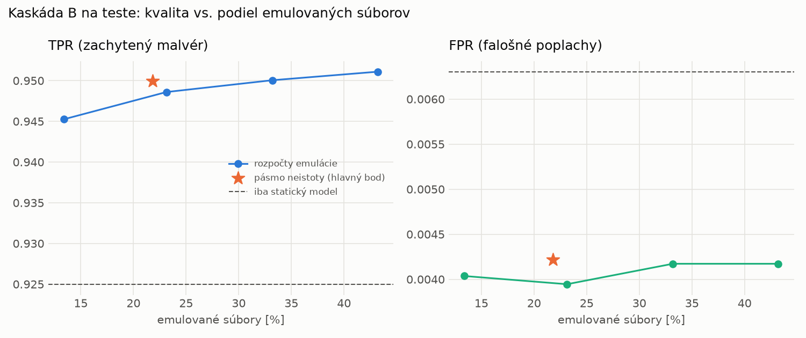

# Kaskáda B `b_baselines` – beh `20261122-220810`

> Generované `src/cascade/evaluate_b.py` (2026-11-22T22:08:11+01:00). Seedy: [0, 1, 2]; hodnoty = priemer ± sm. odchýlka.
> Všetky prahy a pásmo neistoty sú z validácie; test sa na nič nenastavuje. Postup: `docs/09_plan_v2.md`.

| rola | beh |
|---|---|
| static | `runs_v4/real_full/lofo/Boxer/static/lightgbm/20261122-214926` |
| dynamic | `runs_v4/real_full/lofo/Boxer/dynamic/lightgbm/20261122-215222` |
| hybrid | `runs_v4/real_full/lofo/Boxer/hybrid/lightgbm/20261122-215508` |

Druhý stupeň: **dynamic**. Pásmo neistoty statického modelu: FPR ≤ 0.1% nad `hi`,
najviac 1% malvéru validácie pod `lo` (seed 0: lo = 0.0312, hi = 0.9965, seed 1: lo = 0.0262, hi = 0.9987, seed 2: lo = 0.0228, hi = 0.9984).

## Test
| prístup | accuracy | balanced_accuracy | precision | recall_tpr | fpr | f1 | mcc |
|---|---|---|---|---|---|---|---|
| kaskáda B | 0.9715 ± 0.0048 | 0.9729 ± 0.0045 | 0.9961 ± 0.0002 | 0.9500 ± 0.0089 | 0.0042 ± 0.0001 | 0.9725 ± 0.0048 | 0.9442 ± 0.0091 |
| statický | 0.9573 ± 0.0052 | 0.9593 ± 0.0049 | 0.9940 ± 0.0002 | 0.9250 ± 0.0101 | 0.0063 ± 0.0003 | 0.9582 ± 0.0053 | 0.9172 ± 0.0096 |
| dynamický | 0.9038 ± 0.0028 | 0.9087 ± 0.0026 | 0.9903 ± 0.0013 | 0.8265 ± 0.0064 | 0.0091 ± 0.0013 | 0.9010 ± 0.0033 | 0.8215 ± 0.0044 |
| hybrid (každá vzorka) | 0.9795 ± 0.0001 | 0.9802 ± 0.0001 | 0.9923 ± 0.0003 | 0.9687 ± 0.0005 | 0.0084 ± 0.0004 | 0.9804 ± 0.0001 | 0.9592 ± 0.0003 |

- **emulované súbory: 21.82%** (ostatné rozhodne iba statický model); na hybrid ide 6.28% súborov
- chyby pri istom rozhodnutí statického modelu (seed 0): 91
- validácia: emulované 18.38%, na hybrid 4.48%

## Validácia
| prístup | accuracy | balanced_accuracy | precision | recall_tpr | fpr | f1 | mcc |
|---|---|---|---|---|---|---|---|
| kaskáda B | 0.9805 ± 0.0001 | 0.9807 ± 0.0001 | 0.9946 ± 0.0003 | 0.9669 ± 0.0005 | 0.0054 ± 0.0003 | 0.9805 ± 0.0001 | 0.9615 ± 0.0003 |
| statický | 0.9678 ± 0.0009 | 0.9681 ± 0.0009 | 0.9900 ± 0.0000 | 0.9460 ± 0.0019 | 0.0098 ± 0.0000 | 0.9675 ± 0.0010 | 0.9366 ± 0.0018 |
| dynamický | 0.9273 ± 0.0016 | 0.9281 ± 0.0016 | 0.9891 ± 0.0000 | 0.8660 ± 0.0032 | 0.0098 ± 0.0000 | 0.9235 ± 0.0018 | 0.8616 ± 0.0029 |
| hybrid (každá vzorka) | 0.9810 ± 0.0001 | 0.9812 ± 0.0001 | 0.9906 ± 0.0005 | 0.9719 ± 0.0004 | 0.0095 ± 0.0005 | 0.9811 ± 0.0001 | 0.9623 ± 0.0002 |

## Januárové vzorky vynechanej rodiny (iba malvér → TPR)
| prístup | TPR |
|---|---|
| kaskáda B | 0.7956 ± 0.0851 |
| statický | 0.7385 ± 0.0888 |
| dynamický | 0.4809 ± 0.0344 |
| hybrid (každá vzorka) | 0.9436 ± 0.0011 |

Podiel emulovaných: 85.37%

## Krivka rozpočtu emulácie (test, priemer cez seedy)
| budget_val | emulation_rate | hybrid_rate | recall_tpr | fpr | f1 |
|---|---|---|---|---|---|
| 0.1000 | 0.1340 | 0.0515 | 0.9453 | 0.0040 | 0.9701 |
| 0.2000 | 0.2313 | 0.0676 | 0.9486 | 0.0039 | 0.9719 |
| 0.3000 | 0.3318 | 0.0788 | 0.9501 | 0.0042 | 0.9725 |
| 0.4000 | 0.4319 | 0.0884 | 0.9511 | 0.0042 | 0.9731 |

## Výpočtové nároky
Čas dynamickej analýzy (beh v emulátore alebo na zariadení) dataset neuvádza, preto sa neodhaduje. Úspora kaskády B = podiel súborov s dynamickou analýzou: **21.82%** (ostatné prístupy 100 %).

_Chýba benchmark niektorého komponentu (v zero-day behoch sa nemeria)._

