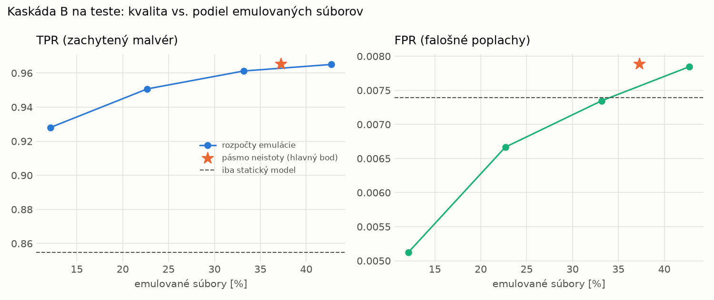

# Kaskáda B `b_direct` – beh `20261122-220807`

> Generované `src/cascade/evaluate_b.py` (2026-11-22T22:08:07+01:00). Seedy: [0, 1, 2]; hodnoty = priemer ± sm. odchýlka.
> Všetky prahy a pásmo neistoty sú z validácie; test sa na nič nenastavuje. Postup: `docs/09_plan_v2.md`.

| rola | beh |
|---|---|
| static | `runs_v4/real_full/lofo/Boxer/students_static/mlp_kd/20261122-220243` |
| hybrid | `runs_v4/real_full/lofo/Boxer/hybrid/lightgbm/20261122-215508` |

Druhý stupeň: **hybrid**. Pásmo neistoty statického modelu: FPR ≤ 0.1% nad `hi`,
najviac 1% malvéru validácie pod `lo` (seed 0: lo = 0.0202, hi = 0.9998, seed 1: lo = 0.0194, hi = 0.9996, seed 2: lo = 0.0202, hi = 0.9997).

## Test
| prístup | accuracy | balanced_accuracy | precision | recall_tpr | fpr | f1 | mcc |
|---|---|---|---|---|---|---|---|
| kaskáda B | 0.9780 ± 0.0004 | 0.9788 ± 0.0003 | 0.9928 ± 0.0004 | 0.9655 ± 0.0011 | 0.0079 ± 0.0004 | 0.9790 ± 0.0004 | 0.9564 ± 0.0007 |
| statický | 0.9197 ± 0.0100 | 0.9237 ± 0.0094 | 0.9924 ± 0.0005 | 0.8549 ± 0.0191 | 0.0074 ± 0.0006 | 0.9184 ± 0.0111 | 0.8493 ± 0.0173 |
| hybrid (každá vzorka) | 0.9795 ± 0.0001 | 0.9802 ± 0.0001 | 0.9923 ± 0.0003 | 0.9687 ± 0.0005 | 0.0084 ± 0.0004 | 0.9804 ± 0.0001 | 0.9592 ± 0.0003 |

- **emulované súbory: 37.25%** (ostatné rozhodne iba statický model); na hybrid ide 37.25% súborov
- chyby pri istom rozhodnutí statického modelu (seed 0): 80
- validácia: emulované 33.96%, na hybrid 33.96%

## Validácia
| prístup | accuracy | balanced_accuracy | precision | recall_tpr | fpr | f1 | mcc |
|---|---|---|---|---|---|---|---|
| kaskáda B | 0.9799 ± 0.0004 | 0.9800 ± 0.0004 | 0.9908 ± 0.0003 | 0.9693 ± 0.0011 | 0.0093 ± 0.0003 | 0.9799 ± 0.0004 | 0.9600 ± 0.0008 |
| statický | 0.9309 ± 0.0011 | 0.9317 ± 0.0011 | 0.9892 ± 0.0000 | 0.8733 ± 0.0022 | 0.0098 ± 0.0000 | 0.9276 ± 0.0012 | 0.8682 ± 0.0020 |
| hybrid (každá vzorka) | 0.9810 ± 0.0001 | 0.9812 ± 0.0001 | 0.9906 ± 0.0005 | 0.9719 ± 0.0004 | 0.0095 ± 0.0005 | 0.9811 ± 0.0001 | 0.9623 ± 0.0002 |

## Januárové vzorky vynechanej rodiny (iba malvér → TPR)
| prístup | TPR |
|---|---|
| kaskáda B | 0.9429 ± 0.0014 |
| statický | 0.6762 ± 0.2074 |
| hybrid (každá vzorka) | 0.9436 ± 0.0011 |

Podiel emulovaných: 95.03%

## Krivka rozpočtu emulácie (test, priemer cez seedy)
| budget_val | emulation_rate | hybrid_rate | recall_tpr | fpr | f1 |
|---|---|---|---|---|---|
| 0.1000 | 0.1212 | 0.1212 | 0.9281 | 0.0051 | 0.9604 |
| 0.2000 | 0.2268 | 0.2268 | 0.9507 | 0.0067 | 0.9718 |
| 0.3000 | 0.3318 | 0.3318 | 0.9612 | 0.0073 | 0.9770 |
| 0.4000 | 0.4272 | 0.4272 | 0.9650 | 0.0078 | 0.9787 |

## Výpočtové nároky
Čas dynamickej analýzy (beh v emulátore alebo na zariadení) dataset neuvádza, preto sa neodhaduje. Úspora kaskády B = podiel súborov s dynamickou analýzou: **37.25%** (ostatné prístupy 100 %).

_Chýba benchmark niektorého komponentu (v zero-day behoch sa nemeria)._

