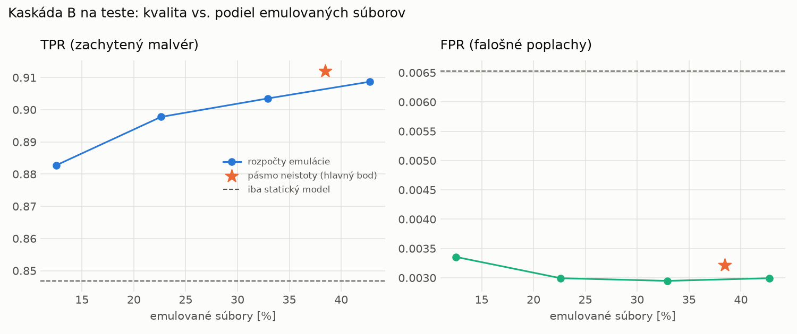

# Kaskáda B `b_heavyteacher` – beh `20261122-220814`

> Generované `src/cascade/evaluate_b.py` (2026-11-22T22:08:15+01:00). Seedy: [0, 1, 2]; hodnoty = priemer ± sm. odchýlka.
> Všetky prahy a pásmo neistoty sú z validácie; test sa na nič nenastavuje. Postup: `docs/09_plan_v2.md`.

| rola | beh |
|---|---|
| static | `runs_v4/real_full/lofo/Boxer/students_static/mlp_kd_heavy/20261122-220350` |
| dynamic | `runs_v4/real_full/lofo/Boxer/students_dynamic/mlp_kd_heavy/20261122-220636` |
| hybrid | `runs_v4/real_full/lofo/Boxer/hybrid/lightgbm/20261122-215508` |

Druhý stupeň: **dynamic**. Pásmo neistoty statického modelu: FPR ≤ 0.1% nad `hi`,
najviac 1% malvéru validácie pod `lo` (seed 0: lo = 0.0396, hi = 0.9992, seed 1: lo = 0.0295, hi = 0.9997, seed 2: lo = 0.0402, hi = 0.9983).

## Test
| prístup | accuracy | balanced_accuracy | precision | recall_tpr | fpr | f1 | mcc |
|---|---|---|---|---|---|---|---|
| kaskáda B | 0.9519 ± 0.0062 | 0.9544 ± 0.0059 | 0.9969 ± 0.0004 | 0.9121 ± 0.0114 | 0.0032 ± 0.0004 | 0.9526 ± 0.0064 | 0.9077 ± 0.0114 |
| statický | 0.9158 ± 0.0077 | 0.9202 ± 0.0073 | 0.9932 ± 0.0009 | 0.8468 ± 0.0143 | 0.0065 ± 0.0008 | 0.9142 ± 0.0085 | 0.8429 ± 0.0134 |
| dynamický | 0.8356 ± 0.0018 | 0.8444 ± 0.0016 | 0.9906 ± 0.0017 | 0.6962 ± 0.0042 | 0.0074 ± 0.0014 | 0.8177 ± 0.0025 | 0.7111 ± 0.0024 |
| hybrid (každá vzorka) | 0.9795 ± 0.0001 | 0.9802 ± 0.0001 | 0.9923 ± 0.0003 | 0.9687 ± 0.0005 | 0.0084 ± 0.0004 | 0.9804 ± 0.0001 | 0.9592 ± 0.0003 |

- **emulované súbory: 38.45%** (ostatné rozhodne iba statický model); na hybrid ide 11.25% súborov
- chyby pri istom rozhodnutí statického modelu (seed 0): 77
- validácia: emulované 35.49%, na hybrid 9.23%

## Validácia
| prístup | accuracy | balanced_accuracy | precision | recall_tpr | fpr | f1 | mcc |
|---|---|---|---|---|---|---|---|
| kaskáda B | 0.9604 ± 0.0010 | 0.9609 ± 0.0010 | 0.9948 ± 0.0006 | 0.9267 ± 0.0026 | 0.0050 ± 0.0006 | 0.9595 ± 0.0011 | 0.9231 ± 0.0019 |
| statický | 0.9227 ± 0.0033 | 0.9237 ± 0.0032 | 0.9890 ± 0.0001 | 0.8571 ± 0.0064 | 0.0098 ± 0.0000 | 0.9184 ± 0.0037 | 0.8536 ± 0.0058 |
| dynamický | 0.8681 ± 0.0007 | 0.8698 ± 0.0007 | 0.9876 ± 0.0002 | 0.7493 ± 0.0013 | 0.0097 ± 0.0002 | 0.8521 ± 0.0009 | 0.7600 ± 0.0012 |
| hybrid (každá vzorka) | 0.9810 ± 0.0001 | 0.9812 ± 0.0001 | 0.9906 ± 0.0005 | 0.9719 ± 0.0004 | 0.0095 ± 0.0005 | 0.9811 ± 0.0001 | 0.9623 ± 0.0002 |

## Januárové vzorky vynechanej rodiny (iba malvér → TPR)
| prístup | TPR |
|---|---|
| kaskáda B | 0.7693 ± 0.1337 |
| statický | 0.7057 ± 0.1707 |
| dynamický | 0.3265 ± 0.0569 |
| hybrid (každá vzorka) | 0.9436 ± 0.0011 |

Podiel emulovaných: 94.47%

## Krivka rozpočtu emulácie (test, priemer cez seedy)
| budget_val | emulation_rate | hybrid_rate | recall_tpr | fpr | f1 |
|---|---|---|---|---|---|
| 0.1000 | 0.1252 | 0.0618 | 0.8827 | 0.0034 | 0.9362 |
| 0.2000 | 0.2262 | 0.0930 | 0.8978 | 0.0030 | 0.9448 |
| 0.3000 | 0.3290 | 0.1141 | 0.9035 | 0.0029 | 0.9480 |
| 0.4000 | 0.4275 | 0.1262 | 0.9087 | 0.0030 | 0.9508 |

## Výpočtové nároky
Čas dynamickej analýzy (beh v emulátore alebo na zariadení) dataset neuvádza, preto sa neodhaduje. Úspora kaskády B = podiel súborov s dynamickou analýzou: **38.45%** (ostatné prístupy 100 %).

_Chýba benchmark niektorého komponentu (v zero-day behoch sa nemeria)._

