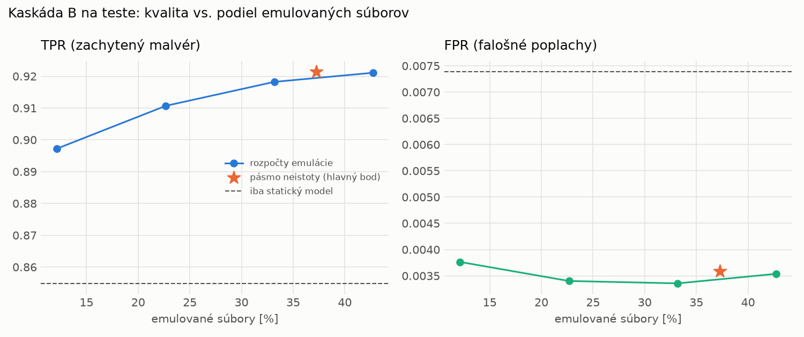

# Kaskáda B `b_main` – beh `20261122-220805`

> Generované `src/cascade/evaluate_b.py` (2026-11-22T22:08:05+01:00). Seedy: [0, 1, 2]; hodnoty = priemer ± sm. odchýlka.
> Všetky prahy a pásmo neistoty sú z validácie; test sa na nič nenastavuje. Postup: `docs/09_plan_v2.md`.

| rola | beh |
|---|---|
| static | `runs_v4/real_full/lofo/Boxer/students_static/mlp_kd/20261122-220243` |
| dynamic | `runs_v4/real_full/lofo/Boxer/students_dynamic/mlp_kd/20261122-220408` |
| hybrid | `runs_v4/real_full/lofo/Boxer/hybrid/lightgbm/20261122-215508` |

Druhý stupeň: **dynamic**. Pásmo neistoty statického modelu: FPR ≤ 0.1% nad `hi`,
najviac 1% malvéru validácie pod `lo` (seed 0: lo = 0.0202, hi = 0.9998, seed 1: lo = 0.0194, hi = 0.9996, seed 2: lo = 0.0202, hi = 0.9997).

## Test
| prístup | accuracy | balanced_accuracy | precision | recall_tpr | fpr | f1 | mcc |
|---|---|---|---|---|---|---|---|
| kaskáda B | 0.9567 ± 0.0054 | 0.9590 ± 0.0051 | 0.9966 ± 0.0000 | 0.9215 ± 0.0103 | 0.0036 ± 0.0001 | 0.9575 ± 0.0055 | 0.9165 ± 0.0100 |
| statický | 0.9197 ± 0.0100 | 0.9237 ± 0.0094 | 0.9924 ± 0.0005 | 0.8549 ± 0.0191 | 0.0074 ± 0.0006 | 0.9184 ± 0.0111 | 0.8493 ± 0.0173 |
| dynamický | 0.8510 ± 0.0013 | 0.8587 ± 0.0011 | 0.9870 ± 0.0016 | 0.7283 ± 0.0036 | 0.0108 ± 0.0014 | 0.8381 ± 0.0018 | 0.7340 ± 0.0014 |
| hybrid (každá vzorka) | 0.9795 ± 0.0001 | 0.9802 ± 0.0001 | 0.9923 ± 0.0003 | 0.9687 ± 0.0005 | 0.0084 ± 0.0004 | 0.9804 ± 0.0001 | 0.9592 ± 0.0003 |

- **emulované súbory: 37.25%** (ostatné rozhodne iba statický model); na hybrid ide 10.60% súborov
- chyby pri istom rozhodnutí statického modelu (seed 0): 80
- validácia: emulované 33.96%, na hybrid 8.76%

## Validácia
| prístup | accuracy | balanced_accuracy | precision | recall_tpr | fpr | f1 | mcc |
|---|---|---|---|---|---|---|---|
| kaskáda B | 0.9652 ± 0.0012 | 0.9656 ± 0.0012 | 0.9947 ± 0.0005 | 0.9364 ± 0.0028 | 0.0052 ± 0.0005 | 0.9647 ± 0.0013 | 0.9321 ± 0.0022 |
| statický | 0.9309 ± 0.0011 | 0.9317 ± 0.0011 | 0.9892 ± 0.0000 | 0.8733 ± 0.0022 | 0.0098 ± 0.0000 | 0.9276 ± 0.0012 | 0.8682 ± 0.0020 |
| dynamický | 0.8774 ± 0.0055 | 0.8790 ± 0.0054 | 0.9877 ± 0.0002 | 0.7678 ± 0.0109 | 0.0098 ± 0.0000 | 0.8640 ± 0.0069 | 0.7755 ± 0.0093 |
| hybrid (každá vzorka) | 0.9810 ± 0.0001 | 0.9812 ± 0.0001 | 0.9906 ± 0.0005 | 0.9719 ± 0.0004 | 0.0095 ± 0.0005 | 0.9811 ± 0.0001 | 0.9623 ± 0.0002 |

## Januárové vzorky vynechanej rodiny (iba malvér → TPR)
| prístup | TPR |
|---|---|
| kaskáda B | 0.8029 ± 0.0902 |
| statický | 0.6762 ± 0.2074 |
| dynamický | 0.4162 ± 0.0716 |
| hybrid (každá vzorka) | 0.9436 ± 0.0011 |

Podiel emulovaných: 95.03%

## Krivka rozpočtu emulácie (test, priemer cez seedy)
| budget_val | emulation_rate | hybrid_rate | recall_tpr | fpr | f1 |
|---|---|---|---|---|---|
| 0.1000 | 0.1212 | 0.0600 | 0.8972 | 0.0038 | 0.9441 |
| 0.2000 | 0.2268 | 0.0892 | 0.9107 | 0.0034 | 0.9517 |
| 0.3000 | 0.3318 | 0.1060 | 0.9182 | 0.0034 | 0.9559 |
| 0.4000 | 0.4272 | 0.1183 | 0.9211 | 0.0035 | 0.9573 |

## Výpočtové nároky
Čas dynamickej analýzy (beh v emulátore alebo na zariadení) dataset neuvádza, preto sa neodhaduje. Úspora kaskády B = podiel súborov s dynamickou analýzou: **37.25%** (ostatné prístupy 100 %).

_Chýba benchmark niektorého komponentu (v zero-day behoch sa nemeria)._

