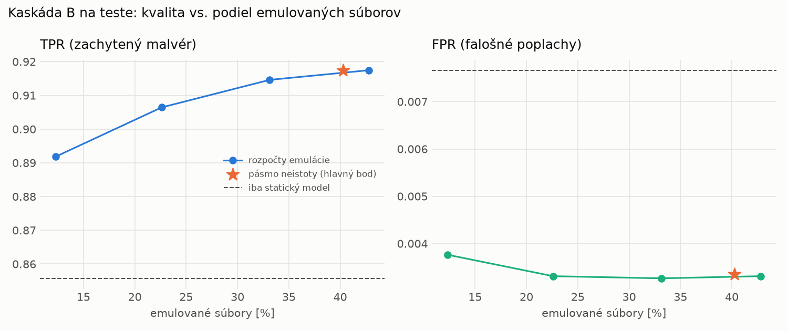

# Kaskáda B `b_nokd` – beh `20261122-220812`

> Generované `src/cascade/evaluate_b.py` (2026-11-22T22:08:13+01:00). Seedy: [0, 1, 2]; hodnoty = priemer ± sm. odchýlka.
> Všetky prahy a pásmo neistoty sú z validácie; test sa na nič nenastavuje. Postup: `docs/09_plan_v2.md`.

| rola | beh |
|---|---|
| static | `runs_v4/real_full/lofo/Boxer/students_static/mlp_nokd/20261122-220302` |
| dynamic | `runs_v4/real_full/lofo/Boxer/students_dynamic/mlp_nokd/20261122-220458` |
| hybrid | `runs_v4/real_full/lofo/Boxer/hybrid/lightgbm/20261122-215508` |

Druhý stupeň: **dynamic**. Pásmo neistoty statického modelu: FPR ≤ 0.1% nad `hi`,
najviac 1% malvéru validácie pod `lo` (seed 0: lo = 0.0337, hi = 0.9997, seed 1: lo = 0.0435, hi = 0.9992, seed 2: lo = 0.0397, hi = 0.9993).

## Test
| prístup | accuracy | balanced_accuracy | precision | recall_tpr | fpr | f1 | mcc |
|---|---|---|---|---|---|---|---|
| kaskáda B | 0.9547 ± 0.0041 | 0.9570 ± 0.0039 | 0.9968 ± 0.0003 | 0.9174 ± 0.0080 | 0.0034 ± 0.0003 | 0.9554 ± 0.0043 | 0.9127 ± 0.0075 |
| statický | 0.9200 ± 0.0044 | 0.9240 ± 0.0042 | 0.9921 ± 0.0013 | 0.8558 ± 0.0079 | 0.0077 ± 0.0012 | 0.9189 ± 0.0048 | 0.8498 ± 0.0078 |
| dynamický | 0.8404 ± 0.0028 | 0.8488 ± 0.0026 | 0.9897 ± 0.0007 | 0.7059 ± 0.0059 | 0.0083 ± 0.0007 | 0.8240 ± 0.0038 | 0.7182 ± 0.0041 |
| hybrid (každá vzorka) | 0.9795 ± 0.0001 | 0.9802 ± 0.0001 | 0.9923 ± 0.0003 | 0.9687 ± 0.0005 | 0.0084 ± 0.0004 | 0.9804 ± 0.0001 | 0.9592 ± 0.0003 |

- **emulované súbory: 40.27%** (ostatné rozhodne iba statický model); na hybrid ide 11.14% súborov
- chyby pri istom rozhodnutí statického modelu (seed 0): 68
- validácia: emulované 37.30%, na hybrid 9.35%

## Validácia
| prístup | accuracy | balanced_accuracy | precision | recall_tpr | fpr | f1 | mcc |
|---|---|---|---|---|---|---|---|
| kaskáda B | 0.9656 ± 0.0032 | 0.9660 ± 0.0032 | 0.9948 ± 0.0005 | 0.9369 ± 0.0060 | 0.0050 ± 0.0004 | 0.9650 ± 0.0034 | 0.9328 ± 0.0061 |
| statický | 0.9323 ± 0.0081 | 0.9332 ± 0.0080 | 0.9893 ± 0.0003 | 0.8760 ± 0.0159 | 0.0097 ± 0.0002 | 0.9292 ± 0.0091 | 0.8708 ± 0.0146 |
| dynamický | 0.8697 ± 0.0047 | 0.8713 ± 0.0047 | 0.9876 ± 0.0003 | 0.7524 ± 0.0092 | 0.0097 ± 0.0002 | 0.8541 ± 0.0060 | 0.7626 ± 0.0079 |
| hybrid (každá vzorka) | 0.9810 ± 0.0001 | 0.9812 ± 0.0001 | 0.9906 ± 0.0005 | 0.9719 ± 0.0004 | 0.0095 ± 0.0005 | 0.9811 ± 0.0001 | 0.9623 ± 0.0002 |

## Januárové vzorky vynechanej rodiny (iba malvér → TPR)
| prístup | TPR |
|---|---|
| kaskáda B | 0.7511 ± 0.1213 |
| statický | 0.6588 ± 0.1904 |
| dynamický | 0.3522 ± 0.0585 |
| hybrid (každá vzorka) | 0.9436 ± 0.0011 |

Podiel emulovaných: 96.34%

## Krivka rozpočtu emulácie (test, priemer cez seedy)
| budget_val | emulation_rate | hybrid_rate | recall_tpr | fpr | f1 |
|---|---|---|---|---|---|
| 0.1000 | 0.1230 | 0.0585 | 0.8918 | 0.0038 | 0.9412 |
| 0.2000 | 0.2261 | 0.0889 | 0.9064 | 0.0033 | 0.9494 |
| 0.3000 | 0.3314 | 0.1054 | 0.9146 | 0.0033 | 0.9539 |
| 0.4000 | 0.4279 | 0.1159 | 0.9175 | 0.0033 | 0.9555 |

## Výpočtové nároky
Čas dynamickej analýzy (beh v emulátore alebo na zariadení) dataset neuvádza, preto sa neodhaduje. Úspora kaskády B = podiel súborov s dynamickou analýzou: **40.27%** (ostatné prístupy 100 %).

_Chýba benchmark niektorého komponentu (v zero-day behoch sa nemeria)._

