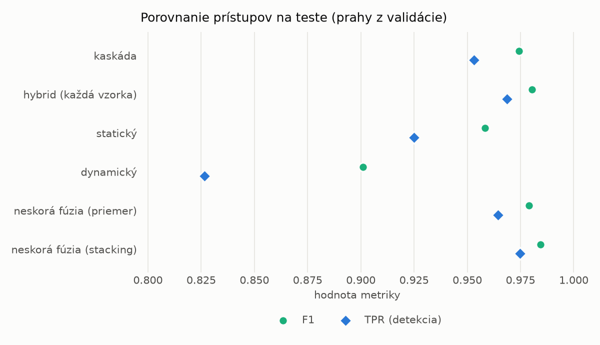
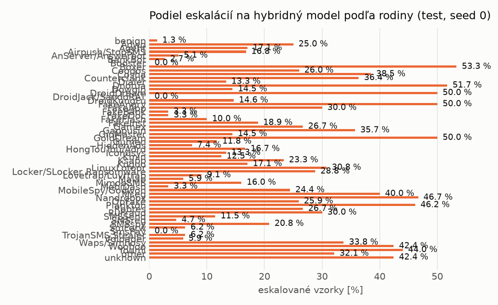

# Kaskáda `baselines` – beh `20261122-220800`

> Generované `src/cascade/evaluate.py` (2026-11-22T22:08:01+01:00). Seedy: [0, 1, 2]; hodnoty = priemer ± sm. odchýlka.
> Všetky prahy sú určené na validácii (FPR ≤ 1 %); test sa na nič nenastavuje.

| rola | beh |
|---|---|
| static | `runs_v4/real_full/lofo/Boxer/static/lightgbm/20261122-214926` |
| dynamic | `runs_v4/real_full/lofo/Boxer/dynamic/lightgbm/20261122-215222` |
| hybrid | `runs_v4/real_full/lofo/Boxer/hybrid/lightgbm/20261122-215508` |

## Test
| prístup | accuracy | balanced_accuracy | precision | recall_tpr | fpr | f1 | mcc |
|---|---|---|---|---|---|---|---|
| kaskáda | 0.9732 ± 0.0047 | 0.9745 ± 0.0045 | 0.9961 ± 0.0001 | 0.9532 ± 0.0089 | 0.0042 ± 0.0001 | 0.9742 ± 0.0047 | 0.9475 ± 0.0090 |
| hybrid (každá vzorka) | 0.9795 ± 0.0001 | 0.9802 ± 0.0001 | 0.9923 ± 0.0003 | 0.9687 ± 0.0005 | 0.0084 ± 0.0004 | 0.9804 ± 0.0001 | 0.9592 ± 0.0003 |
| statický | 0.9573 ± 0.0052 | 0.9593 ± 0.0049 | 0.9940 ± 0.0002 | 0.9250 ± 0.0101 | 0.0063 ± 0.0003 | 0.9582 ± 0.0053 | 0.9172 ± 0.0096 |
| dynamický | 0.9038 ± 0.0028 | 0.9087 ± 0.0026 | 0.9903 ± 0.0013 | 0.8265 ± 0.0064 | 0.0091 ± 0.0013 | 0.9010 ± 0.0033 | 0.8215 ± 0.0044 |
| neskorá fúzia (priemer) | 0.9782 ± 0.0004 | 0.9790 ± 0.0004 | 0.9943 ± 0.0003 | 0.9644 ± 0.0006 | 0.0063 ± 0.0003 | 0.9791 ± 0.0004 | 0.9568 ± 0.0009 |
| neskorá fúzia (stacking) | 0.9836 ± 0.0001 | 0.9842 ± 0.0001 | 0.9941 ± 0.0004 | 0.9749 ± 0.0006 | 0.0065 ± 0.0004 | 0.9844 ± 0.0001 | 0.9674 ± 0.0002 |

## Validácia
| prístup | accuracy | balanced_accuracy | precision | recall_tpr | fpr | f1 | mcc |
|---|---|---|---|---|---|---|---|
| kaskáda | 0.9818 ± 0.0002 | 0.9820 ± 0.0001 | 0.9946 ± 0.0003 | 0.9695 ± 0.0006 | 0.0054 ± 0.0003 | 0.9819 ± 0.0002 | 0.9640 ± 0.0003 |
| hybrid (každá vzorka) | 0.9810 ± 0.0001 | 0.9812 ± 0.0001 | 0.9906 ± 0.0005 | 0.9719 ± 0.0004 | 0.0095 ± 0.0005 | 0.9811 ± 0.0001 | 0.9623 ± 0.0002 |
| statický | 0.9678 ± 0.0009 | 0.9681 ± 0.0009 | 0.9900 ± 0.0000 | 0.9460 ± 0.0019 | 0.0098 ± 0.0000 | 0.9675 ± 0.0010 | 0.9366 ± 0.0018 |
| dynamický | 0.9273 ± 0.0016 | 0.9281 ± 0.0016 | 0.9891 ± 0.0000 | 0.8660 ± 0.0032 | 0.0098 ± 0.0000 | 0.9235 ± 0.0018 | 0.8616 ± 0.0029 |
| neskorá fúzia (priemer) | 0.9789 ± 0.0001 | 0.9791 ± 0.0001 | 0.9905 ± 0.0003 | 0.9677 ± 0.0005 | 0.0095 ± 0.0003 | 0.9790 ± 0.0001 | 0.9581 ± 0.0003 |
| neskorá fúzia (stacking) | 0.9842 ± 0.0006 | 0.9843 ± 0.0006 | 0.9906 ± 0.0003 | 0.9781 ± 0.0011 | 0.0095 ± 0.0003 | 0.9843 ± 0.0006 | 0.9685 ± 0.0012 |

## Správanie kaskády (test, seed 0)
- podiel eskalácií na hybrid: **10.93%** (1708 vzoriek)
- chyby pri zhode študentov (kaskáda ich nemôže opraviť): **228**
  (1.638% zo zhôd; FP 2, FN 226)
- úspešnosť na eskalovaných vzorkách: hybrid 0.9098360655737705, statický 0.7740046838407494,
  dynamický 0.2259953161592506  → prínos hybridu pri nezhode

## Výpočtové nároky (odhad z benchmarkov komponentov)
_Chýba benchmark niektorého komponentu (`python -m src.evaluation.benchmark`)._

