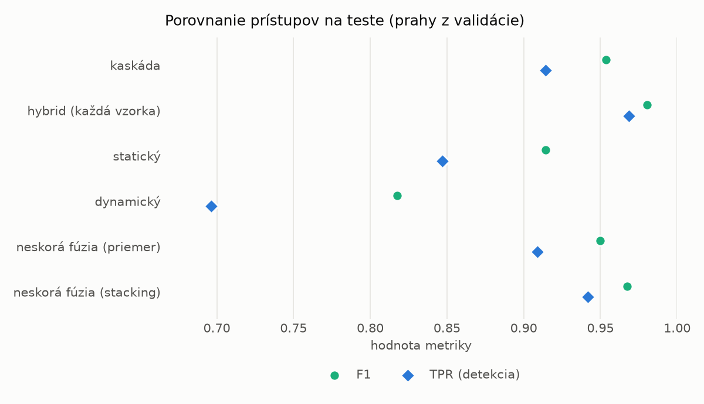
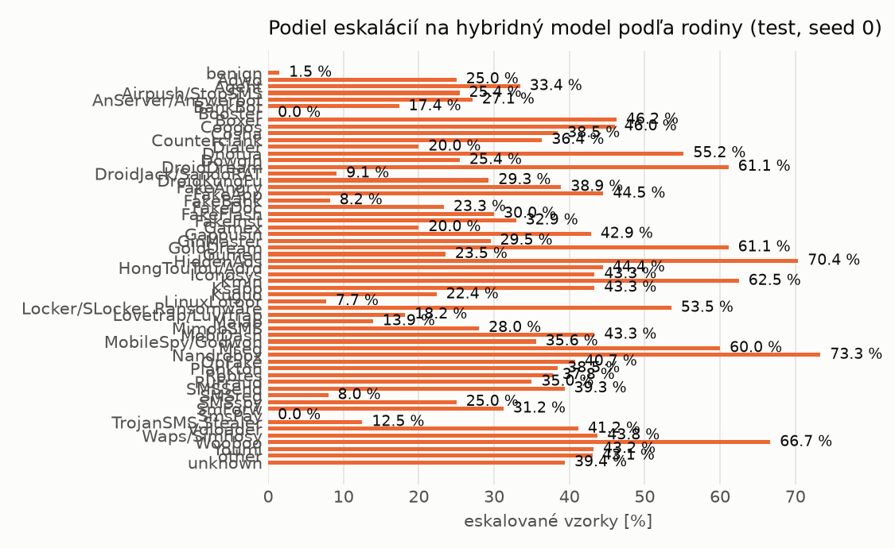

# Kaskáda `heavyteacher` – beh `20261122-220803`

> Generované `src/cascade/evaluate.py` (2026-11-22T22:08:03+01:00). Seedy: [0, 1, 2]; hodnoty = priemer ± sm. odchýlka.
> Všetky prahy sú určené na validácii (FPR ≤ 1 %); test sa na nič nenastavuje.

| rola | beh |
|---|---|
| static | `runs_v4/real_full/lofo/Boxer/students_static/mlp_kd_heavy/20261122-220350` |
| dynamic | `runs_v4/real_full/lofo/Boxer/students_dynamic/mlp_kd_heavy/20261122-220636` |
| hybrid | `runs_v4/real_full/lofo/Boxer/hybrid/lightgbm/20261122-215508` |

## Test
| prístup | accuracy | balanced_accuracy | precision | recall_tpr | fpr | f1 | mcc |
|---|---|---|---|---|---|---|---|
| kaskáda | 0.9530 ± 0.0060 | 0.9554 ± 0.0057 | 0.9968 ± 0.0004 | 0.9141 ± 0.0111 | 0.0033 ± 0.0004 | 0.9536 ± 0.0062 | 0.9096 ± 0.0111 |
| hybrid (každá vzorka) | 0.9795 ± 0.0001 | 0.9802 ± 0.0001 | 0.9923 ± 0.0003 | 0.9687 ± 0.0005 | 0.0084 ± 0.0004 | 0.9804 ± 0.0001 | 0.9592 ± 0.0003 |
| statický | 0.9158 ± 0.0077 | 0.9202 ± 0.0073 | 0.9932 ± 0.0009 | 0.8468 ± 0.0143 | 0.0065 ± 0.0008 | 0.9142 ± 0.0085 | 0.8429 ± 0.0134 |
| dynamický | 0.8356 ± 0.0018 | 0.8444 ± 0.0016 | 0.9906 ± 0.0017 | 0.6962 ± 0.0042 | 0.0074 ± 0.0014 | 0.8177 ± 0.0025 | 0.7111 ± 0.0024 |
| neskorá fúzia (priemer) | 0.9493 ± 0.0069 | 0.9518 ± 0.0064 | 0.9947 ± 0.0008 | 0.9091 ± 0.0137 | 0.0055 ± 0.0009 | 0.9499 ± 0.0072 | 0.9025 ± 0.0124 |
| neskorá fúzia (stacking) | 0.9663 ± 0.0023 | 0.9678 ± 0.0022 | 0.9943 ± 0.0009 | 0.9417 ± 0.0047 | 0.0061 ± 0.0010 | 0.9673 ± 0.0024 | 0.9340 ± 0.0044 |

## Validácia
| prístup | accuracy | balanced_accuracy | precision | recall_tpr | fpr | f1 | mcc |
|---|---|---|---|---|---|---|---|
| kaskáda | 0.9615 ± 0.0011 | 0.9620 ± 0.0011 | 0.9949 ± 0.0005 | 0.9289 ± 0.0026 | 0.0049 ± 0.0005 | 0.9608 ± 0.0012 | 0.9252 ± 0.0020 |
| hybrid (každá vzorka) | 0.9810 ± 0.0001 | 0.9812 ± 0.0001 | 0.9906 ± 0.0005 | 0.9719 ± 0.0004 | 0.0095 ± 0.0005 | 0.9811 ± 0.0001 | 0.9623 ± 0.0002 |
| statický | 0.9227 ± 0.0033 | 0.9237 ± 0.0032 | 0.9890 ± 0.0001 | 0.8571 ± 0.0064 | 0.0098 ± 0.0000 | 0.9184 ± 0.0037 | 0.8536 ± 0.0058 |
| dynamický | 0.8681 ± 0.0007 | 0.8698 ± 0.0007 | 0.9876 ± 0.0002 | 0.7493 ± 0.0013 | 0.0097 ± 0.0002 | 0.8521 ± 0.0009 | 0.7600 ± 0.0012 |
| neskorá fúzia (priemer) | 0.9476 ± 0.0078 | 0.9482 ± 0.0077 | 0.9896 ± 0.0002 | 0.9062 ± 0.0154 | 0.0098 ± 0.0000 | 0.9460 ± 0.0085 | 0.8986 ± 0.0143 |
| neskorá fúzia (stacking) | 0.9666 ± 0.0026 | 0.9669 ± 0.0026 | 0.9900 ± 0.0001 | 0.9437 ± 0.0052 | 0.0098 ± 0.0000 | 0.9663 ± 0.0028 | 0.9343 ± 0.0050 |

## Správanie kaskády (test, seed 0)
- podiel eskalácií na hybrid: **16.09%** (2514 vzoriek)
- chyby pri zhode študentov (kaskáda ich nemôže opraviť): **759**
  (5.789% zo zhôd; FP 2, FN 757)
- úspešnosť na eskalovaných vzorkách: hybrid 0.9677804295942721, statický 0.7239459029435164,
  dynamický 0.2760540970564837  → prínos hybridu pri nezhode

## Výpočtové nároky (odhad z benchmarkov komponentov)
_Chýba benchmark niektorého komponentu (`python -m src.evaluation.benchmark`)._

